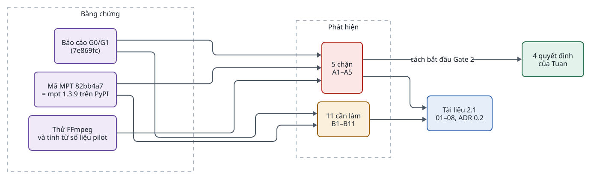
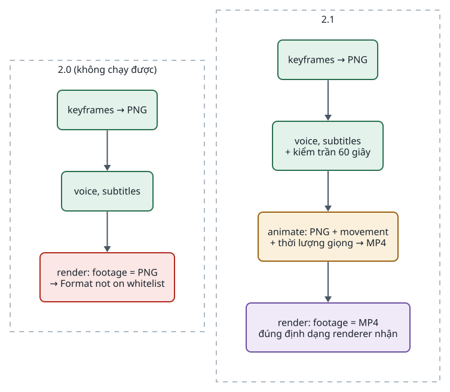
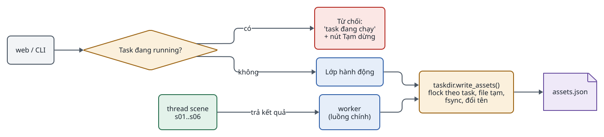
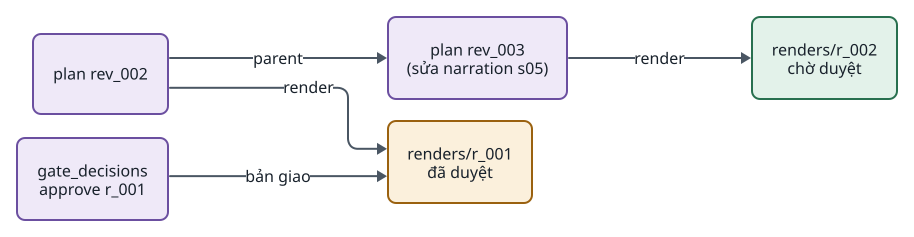
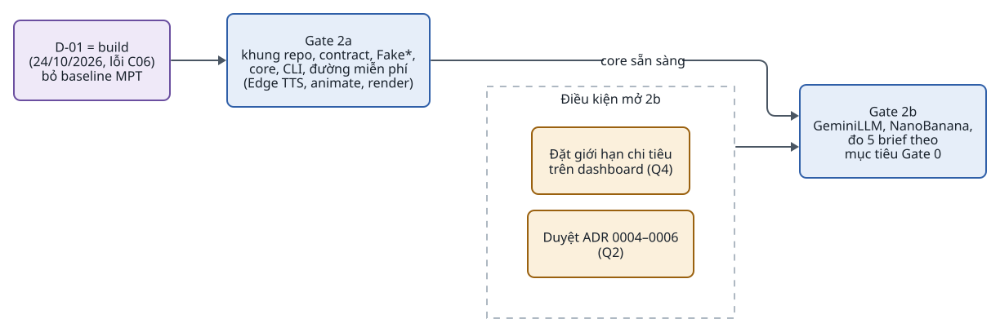

<!-- id:s1 -->
## Kết luận

<!-- id:s1.b1 -->
Hướng kiến trúc vẫn đúng. Core tối thiểu, MPT sau adapter, ScenePlan có revision và sổ chi phí ghi `pending` trước đều đứng vững khi đối chiếu với pilot và mã MPT. Trước khi viết code cần sửa 5 điểm chặn, quan trọng nhất là renderer đã chọn không nhận ảnh tĩnh làm footage. Mọi sửa đổi đã được đưa vào tài liệu thiết kế 2.1 và ADR 0004–0006 bản 0.2 trong cùng PR với báo cáo này.

<!-- id:s1.b2 -->
Table: Tóm tắt phát hiện
| Mức | Số phát hiện | Trạng thái |
| --- | --- | --- |
| Chặn: phải sửa trước khi code | 5 | Đã sửa trong tài liệu |
| Cần làm trong Gate 2 | 11 | Đã sửa trong tài liệu |
| Quyết định của Tuan | 4 | Q1–Q3 đã chốt, Q4 còn chờ, xem [mục cuối](#s6) |

<!-- id:s1.b3 -->
<!-- report-kit:d2
```d2
# cap: Ba nguồn bằng chứng dẫn tới các phát hiện; mọi phát hiện đều có nơi sửa trong tài liệu
direction: right
src: Bằng chứng {
  class: zone
  g1: "Báo cáo G0/G1\n(7e869fc)" {class: data}
  mpt: "Mã MPT 82bb4a7\n= mpt 1.3.9 trên PyPI" {class: data}
  exp: "Thử FFmpeg\nvà tính từ số liệu pilot" {class: data}
}
f: Phát hiện {
  class: zone
  a: "5 chặn\nA1–A5" {class: bad}
  b: "11 cần làm\nB1–B11" {class: gate}
}
doc: "Tài liệu 2.1\n01–08, ADR 0.2" {class: brain}
dec: "4 quyết định\ncủa Tuan" {class: hands}
src.g1 -> f.a
src.mpt -> f.a
src.exp -> f.a
src.g1 -> f.b
src.mpt -> f.b
f.a -> doc
f.b -> doc
f.a -> dec: "cách bắt đầu Gate 2"
```
-->
<picture>
<source media="(prefers-color-scheme: dark)" srcset="README.figs/s1.b3-dark.svg">

</picture>

<!-- id:s2 -->
## Bằng chứng đã dùng

<!-- id:s2.b1 -->
- Bộ thiết kế 2.0 (01–08) và ADR 0001–0006 tại `6d7e8a5`.
- [Báo cáo G0/G1](../g0-g1/README.md), [kế hoạch G0](../g0-g1/g0-plan.md), [bài học kiến trúc MPT](../g0-g1/mpt-architecture-review.md) và các file bằng chứng tại `7e869fc`.
- Mã MPT tại `82bb4a7`, đúng bản pilot đã chạy và trùng gói `mpt` 1.3.9 trên PyPI (bản mới nhất ngày 24/10/2026). Các file đã đọc: `app/services/video_project.py`, `voice.py`, `subtitle.py`, `app/config/config.py`, `app/paths.py`, `pyproject.toml`.
- Thử trực tiếp bộ lọc định dạng đầu vào của renderer với FFmpeg hệ thống:

<!-- id:s2.b2 -->
```text
$ ffmpeg -format_whitelist "mov,matroska,avi,mpegts,mpegvideo,ogg,flv,wav,mp3,flac,aac" -i t.png -t 1 o.mp4
[png_pipe] Format not on whitelist 'mov,matroska,avi,mpegts,mpegvideo,ogg,flv,wav,mp3,flac,aac'
Error opening input file t.png.
```

<!-- id:s2.b3 -->
Bản rà soát này đọc mã và chạy một phép thử FFmpeg nhỏ. Nó không chạy test suite của MPT và không render lại video pilot.

<!-- id:s3 -->
## Phát hiện chặn

<!-- id:s3.b1 -->
### A1 · Renderer không nhận ảnh tĩnh và không có chuyển động camera

<!-- id:s3.b2 -->
`video_project.py` đọc footage qua `-format_whitelist` gồm mov, matroska, avi, mpegts, mpegvideo, ogg, flv và các định dạng âm thanh. PNG và JPEG bị từ chối (phép thử ở trên). Stage scene chỉ có `scale`, `crop`, `fps` rồi lặp footage cho tới hết thời lượng giọng. Trong khi đó Gate 2 dựng hoàn toàn bằng ảnh keyframe, và FR-06 hứa chuyển động camera theo khóa `movement`. Ví dụ t_0042 ghi "video_project, zoom theo movement", điều mà renderer không làm được.

<!-- id:s3.b3 -->
Đề xuất đã áp dụng: thêm bước `animate`, chạy theo scene và không trả phí. Bước này dùng FFmpeg `zoompan` biến ảnh selected thành clip MP4 1080×1920, chuyển động theo khóa `movement`, dài đúng thời lượng giọng đã đo. Renderer giữ nguyên, không sửa bản copy, nên vẫn so được với upstream.

<!-- id:s3.b4 -->
<!-- report-kit:d2
```d2
# cap: Danh sách bước trước và sau khi soát; animate nằm giữa giọng đọc và render
direction: down
before: "2.0 (không chạy được)" {
  class: zone
  b1: "keyframes → PNG" {class: hands}
  b2: "voice, subtitles" {class: hands}
  b3: "render: footage = PNG\n→ Format not on whitelist" {class: bad}
  b1 -> b2 -> b3
}
after: "2.1" {
  class: zone
  a1: "keyframes → PNG" {class: hands}
  a2: "voice, subtitles\n+ kiểm trần 60 giây" {class: hands}
  a3: "animate: PNG + movement\n+ thời lượng giọng → MP4" {class: gate}
  a4: "render: footage = MP4\nđúng định dạng renderer nhận" {class: data}
  a1 -> a2 -> a3 -> a4
}
```
-->
<picture>
<source media="(prefers-color-scheme: dark)" srcset="README.figs/s3.b4-dark.svg">

</picture>

<!-- id:s3.b5 -->
Đã sửa ở: [03 · Danh sách bước](../../src/design/03-runner.md#s2), [04 · Khóa movement](../../src/design/04-data-contracts.md#s7), [05 · Ghi chú renderer](../../src/design/05-modules-providers.md#s7), FR-06 ở [01](../../src/design/01-system-design.md#s6), ví dụ ở [08](../../src/design/08-roadmap.md#s6), ADR-0004 R5.

<!-- id:s3.b6 -->
### A2 · Commit vendor lệch với bản MPT đã chạy

<!-- id:s3.b7 -->
Thiết kế ghi vendor `video_project.py` tại `9e7d8b7`, còn Gate 1 chạy `82bb4a7` (gói `mpt` 1.3.9). Giữa hai commit, `video_project.py` khác đúng một dòng: `fsync` mở file bằng `r+b` thay cho `rb`. Đề xuất đã áp dụng: P-01 chọn `mpt==1.3.9`, vendor cùng commit `82bb4a7`. Như vậy bản đã kiểm ở Gate 1, gói pip và bản copy là một.

<!-- id:s3.b8 -->
Đã sửa ở: 02, 05, 07, P-01 ở 08, ADR-0004.

<!-- id:s3.b9 -->
### A3 · Timeout sau khi gửi lượt gọi trả phí bị coi là lỗi tạm thời

<!-- id:s3.b10 -->
Bảng lỗi xếp "429, 5xx, timeout" vào `Retryable`, tức là thử lại tự động. Với lượt gọi trả phí, đọc timeout hay 5xx xảy ra sau khi request có thể đã tới provider, nên có thể đã bị tính phí. MPT xử lý MuAPI đúng theo hướng ngược lại: không retry POST mù. Đề xuất đã áp dụng: với lượt gọi trả phí, chỉ lỗi chắc chắn chưa gửi (không kết nối được, 429 bị từ chối trước khi xử lý) mới là `Retryable`; timeout, 5xx và response thiếu id là `Unconfirmed`. Dòng `pending` phải `fsync` trước khi gửi, nếu không thì mất điện ngay sau khi gửi sẽ xóa luôn dấu vết.

<!-- id:s3.b11 -->
Đã sửa ở: [03 · Lượt gọi trả phí](../../src/design/03-runner.md#s6), [03 · Retry](../../src/design/03-runner.md#s8), [05 · Lỗi chung](../../src/design/05-modules-providers.md#s1), ADR-0006, kịch bản chất lượng ở 01.

<!-- id:s3.b12 -->
### A4 · Hai process cùng ghi một task

<!-- id:s3.b13 -->
Thiết kế 2.0 cho web ghi revision ScenePlan, `selected` và upload bất cứ lúc nào, trong khi worker có thể đang chạy bước của revision trước. Bước theo scene chạy trong thread pool, nên nhiều thread cũng cùng ghi `assets.json`. "Khóa theo task" có được nêu nhưng không nói khóa gì, giữa ai.

<!-- id:s3.b14 -->
<!-- report-kit:d2
```d2
# cap: Quy tắc ghi sau khi soát: người chỉ sửa khi task không chạy; một hàm duy nhất ghi assets.json
direction: right
web: "web / CLI" {class: plain}
st: "Task đang running?" {shape: diamond; class: gate}
no: "Từ chối:\n'task đang chạy'\n+ nút Tạm dừng" {class: bad}
act: "Lớp hành động" {class: brain}
wk: "worker\n(luồng chính)" {class: brain}
th: "thread scene\ns01..s06" {class: hands}
fn: "taskdir.write_assets()\nflock theo task, file tạm,\nfsync, đổi tên" {class: gate}
fs: "assets.json" {shape: page; class: data}
web -> st
st -> no: có
st -> act: không
act -> fn
th -> wk: "trả kết quả"
wk -> fn
fn -> fs
```
-->
<picture>
<source media="(prefers-color-scheme: dark)" srcset="README.figs/s3.b14-dark.svg">

</picture>

<!-- id:s3.b15 -->
Đề xuất đã áp dụng: hành động của người bị từ chối khi task `running`, kèm lệnh `task pause` (worker dừng ở ranh giới mục kế tiếp, `wait_reason = paused`). Mọi lần ghi `assets.json` đi qua một hàm có `flock`, file tạm, `fsync` và đổi tên. Thread của scene trả kết quả về luồng chính, chỉ luồng chính ghi.

<!-- id:s3.b16 -->
Đã sửa ở: [03 · Trạng thái task](../../src/design/03-runner.md#s4), [04 · Ai ghi gì](../../src/design/04-data-contracts.md#s1), [06 · Can thiệp](../../src/design/06-web-ui.md#s5), 02, ADR-0005 R3–R4.

<!-- id:s3.b17 -->
### A5 · Brief và thời lượng chưa khớp sản phẩm đã chốt

<!-- id:s3.b18 -->
Gate 0 chốt D-02: Short sci-fi bí ẩn tiếng Việt, 45–58 giây, trần cứng 60 giây, 4–6 nhịp hình. Mỗi brief có hook, diễn biến, twist, hình bắt buộc và điều cấm. Thiết kế 2.0 chưa có contract Brief, ví dụ dùng 8 scene, và chỉ kiểm thời lượng ước tính ±10% trước khi có giọng. Số liệu pilot cho thấy ước tính theo số từ của G0 lệch:

<!-- id:s3.b19 -->
Table: Tốc độ đọc đo từ pilot (vi-VN-NamMinhNeural, tốc độ 1.0)
| Brief | Số từ | Thời lượng (giây) | Từ/giây |
| --- | --- | --- | --- |
| 01 | 97 | 34.51 | 2.81 |
| 02 | 96 | 33.67 | 2.85 |
| 03 | 101 | 35.59 | 2.84 |
| 04 | 101 | 34.80 | 2.90 |
| 05 | 107 | 35.33 | 3.03 |

<!-- id:s3.b20 -->
Giao thức G0 nhắm 100–130 từ, nhưng mức này chỉ cho khoảng 34–36 giây, ngắn hơn mục tiêu mềm 45 giây. Muốn đạt 45–58 giây cần khoảng 130–165 từ. Pilot cũng trượt C06 ở brief-02: mầm cây xuất hiện ngay từ đầu nên lộ twist.

<!-- id:s3.b21 -->
Đề xuất đã áp dụng:

<!-- id:s3.b22 -->
- Contract `Brief` theo đúng mẫu Gate 0. Mỗi mục `must_show` có thêm `not_before`, là nhịp sớm nhất được phép xuất hiện.
- Scene có trường `shows`.
- `plan` kiểm số scene, kiểm mọi hình bắt buộc đều có scene thể hiện và không xuất hiện sớm hơn cho phép.
- Tốc độ đọc là `wps` của giọng trong Series Bible, thay cho hằng số chung.
- Ngay sau `voice`, nếu tổng giọng vượt `max_s` thì task `waiting` với lý do `duration_exceeded` và không render.
- Thêm CON-08, cùng test T11 và T12.

<!-- id:s3.b23 -->
Đã sửa ở: FR-01, FR-02, FR-17, CON-08 ở [01](../../src/design/01-system-design.md#s6), [04 · Contract](../../src/design/04-data-contracts.md#s3), [03 · Đồng bộ thời lượng](../../src/design/03-runner.md#s9), [08 · Kiểm thử](../../src/design/08-roadmap.md#s4).

<!-- id:s4 -->
## Phát hiện cần làm trong Gate 2

<!-- id:s4.b1 -->
Table: Phát hiện cần làm trong Gate 2 và nơi đã sửa
| Mã | Phát hiện | Bằng chứng | Đề xuất đã áp dụng | Ở đâu |
| --- | --- | --- | --- | --- |
| B1 | `input_hash` chỉ gồm ScenePlan và id ứng viên: đổi giọng hay model sẽ bị bỏ qua | Bài học MPT số 1: fingerprint theo đúng dependency | Hash gồm adapter, model, tham số, phiên bản mẫu prompt, trường Series Bible được dùng | 03 s5 |
| B2 | File tồn tại được coi là xong | Bài học MPT số 4: artifact trước, record sau | Thứ tự commit: file tạm → hậu điều kiện → `fsync` + đổi tên → ứng viên → StepRun `done` | 03 s5 |
| B3 | Một file `final_9x16.mp4` bị ghi lại mỗi lần render, trái NFR-03 | Bài học MPT số 2: `current_revision` khác `last_successful_export` | `renders/r_NNN/`; bản đã duyệt là bản `gate_decisions` trỏ tới | 04, NFR-03, ADR-0005 |
| B4 | Không có kiểm tra đầu ra kỹ thuật | Pilot: một lượt ra 941×1672 mà không báo lỗi | Bảng hậu điều kiện theo bước; FR-17 | 03 s5 |
| B5 | Không có chỗ ghi checklist C01–C09 và phút công, nên không đo được G-02, D-01, D-07, T10 | Pilot giữ `accepted`, `human_minutes` là `null` | Bảng `reviews`, lệnh `studio review`, phiếu ở gate `final`; FR-18 | 04, 06, 01 |
| B6 | Ứng viên không mang nguồn và quyền, C09 không kiểm được | Pilot không xác định được nguồn của 5 ảnh local | Trường `ai_generated`, `source`, `rights`; khai báo khi upload | 04, 06, 07 |
| B7 | Gói `mpt` ghim cứng `fastapi==0.136.3`, `starlette==1.2.1`, `uvicorn==0.32.1`, `openai==2.24.0` và kéo theo Streamlit, Redis | `pyproject.toml` của MPT | Một `uv.lock` chung; web dùng đúng các bản đó; nâng MPT chạy cả test web | 01 CON-02, 02, 05, 07, ADR-0004 R4 |
| B8 | Ghi đè cấu hình theo task không chạm được provider trong MPT | `app/config/config.py` nạp `config.toml` một lần lúc import; MPT có thể tự ghi lại file | Ghi đè chỉ cho adapter trực tiếp và tham số lời gọi; `MPT_HOME` riêng ngoài `data/` | 04 s9, 07 s2 |
| B9 | Renderer cần `ffprobe`, mà `imageio-ffmpeg` đi kèm MPT không có | Pilot dùng FFmpeg từ `imageio-ffmpeg`; renderer gọi `ffprobe` ở stage timing | FFmpeg và ffprobe hệ thống; thêm vào preflight | 03 s12, 07 |
| B10 | `/files/*` chưa có quy tắc đường dẫn | Bài học MPT số 6: `realpath` + `commonpath` | Quy tắc trong 02 và 07 | 02 s5, 07 s6 |
| B11 | MPT không có một lớp lỗi unconfirmed chung, và có khác biệt khi ánh xạ tham số | 7 lớp `*Unconfirmed*` riêng; pilot gặp `bgm_type="none"` | `MptVideo` giữ danh sách lớp; test adapter kiểm cả ánh xạ tham số | 05 s3 |

<!-- id:s4.b2 -->
<!-- report-kit:d2
```d2
# cap: Hai loại revision tách nhau: ScenePlan cho nội dung, render cho thành phẩm; bản duyệt không bị bản sau ghi đè
direction: right
p2: "plan rev_002" {class: data}
p3: "plan rev_003\n(sửa narration s05)" {class: data}
r1: "renders/r_001\nđã duyệt" {class: gate}
r2: "renders/r_002\nchờ duyệt" {class: hands}
g: "gate_decisions\napprove r_001" {class: data}
p2 -> r1: render
p3 -> r2: render
g -> r1: "bản giao"
p2 -> p3: parent
```
-->
<picture>
<source media="(prefers-color-scheme: dark)" srcset="README.figs/s4.b2-dark.svg">

</picture>

<!-- id:s5 -->
## Lộ trình đề xuất

<!-- id:s5.b1 -->
Ngày 24/10/2026 Tuan chốt D-01 = build và bỏ baseline MPT (Q1, phương án 2), dựa trên lỗi C06 của pilot. Gate 1 đóng theo quyết định này. Gate 2 vẫn chia hai nửa, nhưng Gate 2b chỉ còn chờ giới hạn chi tiêu và ADR được duyệt:

<!-- id:s5.b2 -->
<!-- report-kit:d2
```d2
# cap: D-01 = build đã chốt; Gate 2a làm ngay với 0 USD, Gate 2b mở khi giới hạn chi tiêu và ADR đã có
direction: right
d01: "D-01 = build\n(24/10/2026, lỗi C06)\nbỏ baseline MPT" {class: data}
a: "Gate 2a\nkhung repo, contract, Fake*,\ncore, CLI, đường miễn phí\n(Edge TTS, animate, render)" {class: brain}
cond: "Điều kiện mở 2b" {
  class: zone
  lim: "Đặt giới hạn chi tiêu\nở tài khoản provider (Q4)" {class: gate}
  adr: "Kiểm OmniRoute\n(ảnh tham chiếu, fallback)" {class: gate}
}
b: "Gate 2b\nOmniRouteLLM, OmniRouteImage,\nđo 5 brief theo\nmục tiêu Gate 0" {class: brain}
d01 -> a
a -> b: "core sẵn sàng"
cond -> b
```
-->
<picture>
<source media="(prefers-color-scheme: dark)" srcset="README.figs/s5.b2-dark.svg">

</picture>

<!-- id:s5.b3 -->
Cái giá đã chấp nhận: không còn video MPT nguyên bản để so (T10 không áp dụng), và C06 mới cho thấy giới hạn của đầu vào một ảnh, chưa chứng minh MPT không dựng đúng được khi có đủ cảnh. Vì vậy Gate 2 đo studio theo mục tiêu tuyệt đối của Gate 0: video đạt C01–C09, tối đa 15 phút chủ động mỗi video được duyệt, tổng chi trong 5 USD. Pexels không còn cấp API key nên không có trong thiết kế.

<!-- id:s5.b4 -->
Chi tiết ở [08 · Gate 2](../../src/design/08-roadmap.md#s3).

<!-- id:s6 -->
## Quyết định cần Tuan

<!-- id:s6.b1 -->
> [!NOTE]
> Q1 · Bắt đầu Gate 2 thế nào khi Gate 1 chưa xong? Đã chốt ngày 24/10/2026: Tuan chọn phương án 2, bỏ baseline, ghi D-01 = build với lý do C06 của pilot, làm cả Gate 2. Đề xuất ban đầu là làm Gate 2a ngay và hoàn tất baseline trước Gate 2b.

<!-- id:s6.b2 -->
> [!NOTE]
> Q2: ADR-0004, ADR-0005 và ADR-0006 đã được Tuan duyệt ngày 24/10/2026.

<!-- id:s6.b3 -->
> [!NOTE]
> Q3 · P-01: đã chốt ngày 24/10/2026, ghim `mpt==1.3.9`, commit `82bb4a7`, vendor cùng commit.

<!-- id:s6.b4 -->
```q
Q4 · D-03: đặt giới hạn chi tiêu ở tài khoản upstream sau OmniRoute (cinf, codex), trước lượt gọi trả phí đầu tiên?
1. Đặt 5 USD như trần kế hoạch G0 (chặn cứng hoặc nạp trước)
2. Đặt mức khác (ghi chú)
rec: 1
```

<!-- id:s7 -->
## Những gì giữ nguyên

<!-- id:s7.b1 -->
- Core tối thiểu và MPT sau adapter. Bài học MPT số 5 (UI mỏng, một application service dùng chung) và số 6 (registry nhỏ, một worker) đã có sẵn trong thiết kế.
- ScenePlan có revision, render theo ứng viên selected. Vẫn giữ `assets.json`, chỉ siết cách ghi; chưa cần chuyển chỉ mục ứng viên vào SQLite.
- Sổ chi phí `costs.jsonl` với `pending` trước, không đặt ngân sách. Tách `submit` và `poll` khớp bài học MPT số 3.
- Không tự gửi lại, không agent mặc định, không workflow engine.

<!-- id:s8 -->
## Thay đổi trong tài liệu

<!-- id:s8.b1 -->
Table: Tài liệu đã sửa trong PR này
| Tài liệu | Bản | Thay đổi chính |
| --- | --- | --- |
| [01 · Thiết kế hệ thống](../../src/design/01-system-design.md) | 2.1 | FR-01, FR-02, FR-06, FR-12, FR-17, FR-18; NFR-03; CON-02, CON-08; `animate` trong luồng giá trị; kịch bản chất lượng |
| [02 · Kiến trúc](../../src/design/02-architecture.md) | 2.1 | `animate.py`, vendor `82bb4a7`, `uv.lock` chung, quy tắc web không ghi task đang chạy, đường dẫn `/files` |
| [03 · Worker](../../src/design/03-runner.md) | 2.1 | Bước `animate`, quy tắc sửa khi chạy, `input_hash`, commit artifact, hậu điều kiện, lỗi sau khi gửi, trần thời lượng, preflight |
| [04 · Dữ liệu](../../src/design/04-data-contracts.md) | 2.1 | Contract `Brief`, `shows`, `wps`, `reviews`, nguồn và quyền, `renders/r_NNN`, ghi `assets.json`, cấu hình MPT |
| [05 · Provider](../../src/design/05-modules-providers.md) | 2.1 | Giới hạn renderer, vendor `82bb4a7`, bảng lỗi, lớp unconfirmed theo provider, pin phụ thuộc |
| [06 · Giao diện](../../src/design/06-web-ui.md) | 2.1 | Phiếu duyệt, `review`, `task pause`, khai báo nguồn khi upload |
| [07 · Vận hành](../../src/design/07-operations.md) | 2.1 | FFmpeg và ffprobe hệ thống, `MPT_HOME` riêng, giới hạn chi tiêu, runbook mới |
| [08 · Lộ trình](../../src/design/08-roadmap.md) | 2.1 | Trạng thái Gate 0–1, Gate 2a/2b, T11–T12, ví dụ 6 scene, P-01 |
| [ADR-0004](../../src/adr/0004-minimal-core-mpt-adapters.md), [0005](../../src/adr/0005-sceneplan-revisions-selected.md), [0006](../../src/adr/0006-paid-call-ledger.md) | 0.2 | Bổ sung theo A1–A4, B3, B7; vẫn chờ duyệt |
