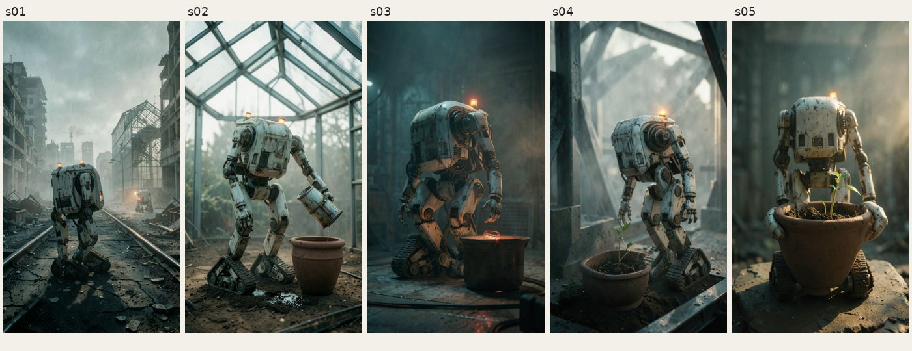

# Gate 4 · ComfyImage và FLUX.2 Klein 4B

Pilot ngày **27/10/2026 (Asia/Bangkok)**, tiếp nối [Slice E](../g4/README.md) trong **cùng trần chi phiên 2 USD**. Đã nối workflow đã duyệt vào pipeline, sinh 5 keyframe qua GPU thật, review ảnh rồi render MP4. Không gọi hay so sánh với OmniRoute. Kết quả kỹ thuật đạt; nội dung còn lỗi và **chờ Tuan duyệt cuối**.

[Bằng chứng JSON đã bỏ bí mật](evidence.json) · [Profile và cách vận hành](../../../workflows/flux2-klein-4b/README.md) · [Thiết kế GPU/ComfyUI](../../src/design/09-gpu-comfyui.md).

## Phạm vi kiểm chứng

| Mục | Kết quả |
| --- | --- |
| Brief | “Người làm vườn cuối cùng”, 5 scene, series `garden`; dùng lại plan đã review của `t_0009`, không sinh kịch bản mới |
| Task mới | `t_0011`, plan rev 1; image `comfyui`, TTS/subtitles `mpt`, renderer `video_project` |
| Model | FLUX.2 Klein 4B distilled FP8, Qwen3 4B, Klein VAE; 3 URL ghim commit, SHA-256 và Apache-2.0 trong [manifest](../../../workflows/flux2-klein-4b/manifest.json); không custom node |
| GPU | RTX 3090 24 GB, CUDA; rental `r_675867bb43e2`, instance `57849246`, disk 100 GB |
| Runtime | Image và commit ComfyUI giữ cùng bản đã kiểm ở Slice E; kết nối HTTPS + Bearer, kiểm CA Vast |
| Provisioning | 3 model tải và khớp SHA-256; rental ready sau khoảng 271 giây |
| Reference | Một sheet `robot_bao_tri_sheet_v2.png`, upload tên SHA-256; `ReferenceLatent` ở cả positive/negative conditioning |
| Keyframes | 5 run `succeeded`, 5 PNG 1088×1920 khớp hash; một attempt/scene, không regenerate |
| Thời gian ảnh | Khoảng 136 giây từ tạo task tới gate keyframes; mỗi run từ tạo đến output đã kiểm 22–25 giây, gồm HTTP/poll/download, không phải benchmark riêng inference |
| Sau review ảnh | TTS tiếng Việt, timing, phụ đề, animate và render trong 39,41 giây |
| MP4 | `r_001`, H.264 1080×1920, 30 fps, AAC stereo 48 kHz, **53,133 giây**, phụ đề burn-in |
| SHA-256 MP4 | `ede7b14f7be2ae2b537bb29fc43c78dde054d18c32e9648781d825cf322f6976` |
| Dọn máy | Rental `destroyed`; kiểm tài khoản lúc 18:00:43 UTC không còn instance có label `igniterra:` |

PNG/MP4 đầy đủ ở `data/tasks/t_0011/` trên máy chạy, không đưa binary lớn vào Git. Khi mở web bằng cùng `data_dir`, xem `/tasks/t_0011` hoặc `/files/tasks/t_0011/renders/r_001/final_9x16.mp4`. `/monitor?task=t_0011` nối mỗi scene tới run và rental; trang run preview output đã kiểm. Trang Monitor đọc SQLite mỗi 5 giây, cần worker cập nhật dữ liệu, chưa có phần trăm node hay heartbeat worker.

## Review nội dung tuyệt đối

Codex quan sát trực tiếp 5 ảnh và đối chiếu plan cùng sheet; đây **không phải phiếu duyệt của Tuan**. Tính là ảnh đạt sơ bộ khi giữ thiết kế nhân vật, thể hiện đúng hành động/vật thể chính và không có lỗi nội dung lớn. Cả 5 ảnh giữ các dấu hiệu cơ bản: vỏ trắng cũ, thân hộp không mặt, tay cơ khí và chân xích. Độ đồng nhất chi tiết chưa hoàn toàn: số đèn và chi tiết vỏ thay đổi; kích thước chậu thay đổi giữa cảnh.

| Scene | Nhận xét | Đạt nội dung sơ bộ |
| --- | --- | --- |
| s01 | Đúng đô thị bỏ hoang nhưng robot tiền cảnh quá lớn, có thêm robot ở xa; không đúng một nhân vật trong cảnh | Không |
| s02 | Robot tưới chậu đất trống, có dòng nước; chưa có mầm cây sớm | Có |
| s03 | Đúng không khí ban đêm, nhưng cuộn nhiệt nằm **trong** chậu thay vì bên dưới, đèn vẫn vàng thay vì đỏ | Không |
| s04 | Mầm xanh trong chậu, robot bên cạnh, ánh sáng bình minh; nội dung chính rõ | Có |
| s05 | Mầm và chậu rõ, nhưng còn cả thân robot thay vì chỉ mép tay; chưa đúng close-up. Plan cũ cũng mâu thuẫn giữa visual close-up và shot wide | Không |

**2/5 ảnh đạt sơ bộ**, 5/5 đạt media kỹ thuật và nhận diện nhân vật cơ bản; không diễn giải thành 5/5 đạt nội dung. Gate keyframes có note của Codex chỉ cho render bản pilot để kiểm kỹ thuật. Task dừng ở `waiting / gate:final`, chưa có phiếu C01–C09 và chưa duyệt phát hành. Chưa đo phút công của người hay chất lượng giọng nghe; thời gian chạy máy không thay số đo này. Bước sửa nội dung tiếp theo là làm rõ shot s05, giảm ảnh hưởng nhiều góc của sheet lên s01 và chỉ dẫn vị trí cuộn nhiệt/đèn ở s03; không thuê thêm GPU tự động.

## Chi phí và hai lượt thuê

| Lượt | Kết quả | Thời gian tới cleanup |
| --- | --- | --- |
| RTX A5000, instance `57848117` | Model SHA và runtime đạt; `LoadImage` không liệt kê ảnh upload trong thư mục con nên chặn trước inference. Đã sửa upload vào input root và thêm mô phỏng enum thật vào test | Khoảng 578 giây |
| RTX 3090, instance `57849246` | 5 ảnh đã kiểm, tới gate keyframes rồi destroy; render local sau khi hủy GPU | Khoảng 419 giây |

Giá offer lượt thành công là **0,2125925926 USD/giờ đã gồm disk**, bandwidth down/up lần lượt 0,0026041667 / 0,00390625 USD/GB. Không chia mức giá theo giờ thành giá inference giả.

Tại lúc kiểm cuối, mức giảm số dư cộng dồn của phiên là **0,1409463264 USD**, gồm **0,0164128571 USD** Slice E trước đó. Phần pilot ComfyImage là **0,1245334693 USD**, gồm cả lượt lỗi, khởi động/tải model và bandwidth. Với **2 ảnh Codex chấp nhận sơ bộ**, chi phí quan sát là **0,0622667346 USD/ảnh đạt sơ bộ**. Chưa có số ảnh người duyệt nên chưa tính chi phí/ảnh được người duyệt. API có thể hạch toán trễ; đây chưa phải hóa đơn cuối, cũng chưa phải số đo ổn định cho batch sản xuất.

Harness lượt hai gặp `TypeError` khi ghi event metadata ảnh sau khi pipeline đã tới gate; `finally` vẫn hủy máy. Báo cáo đối soát lại SQLite, 5 run `succeeded` và SHA của từng file trước khi render; giữ lỗi harness trong JSON thay vì coi nó là lỗi inference hoặc bỏ khỏi bằng chứng.

## Kiểm thử và giới hạn

`python -m pytest -q`: **286 passed**. Bộ test HTTP/SQLite mới kiểm template chưa duyệt, bind chỉ đổi literal, upload path giả mạo, enum `LoadImage`, provenance, cùng attempt không submit lại, timeout giữ run, tải lỗi giữ output G11, tải lại, commit keyframe vào pipeline và Monitor read-only. Có một cảnh báo deprecation Starlette/AnyIO, không làm hỏng test.

Pilot thật kiểm đường **reference**, chưa chạy inference text-to-image không refs trên GPU thật; đường đó được kiểm qua HTTP giả. Chưa kiểm custom node, video generation hoặc Wan. Chưa chứng minh chất lượng sản xuất hay thay thế hoàn toàn provider ảnh hiện có. Người vận hành phải chọn rental ready, duyệt manifest và giữ giới hạn; content adapter không tự thuê máy.
