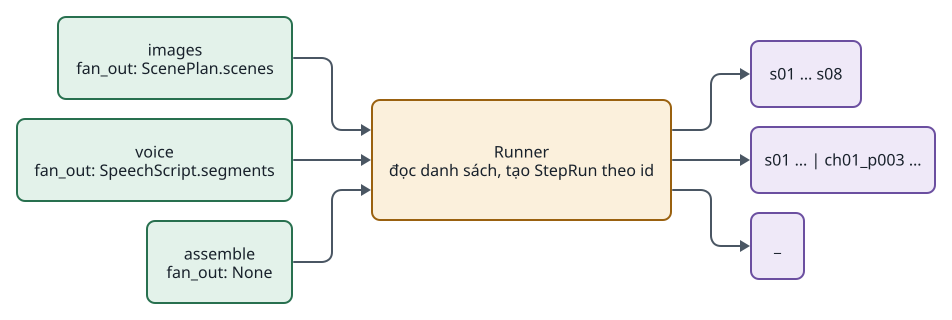

<!-- id:summary -->
## Tóm tắt

<!-- id:summary.b1-2 -->
> [!WARNING]
> Bị loại ngày 19/10/2026 theo ADD-AIVIDEO-003. AD-05: danh sách bước cố định bằng Python lặp theo scene; chưa cần runner tổng quát (bản rà soát F01). Thêm lại khi có từ 2 loại video với danh sách bước khác nhau. Giữ lại làm hồ sơ lịch sử.

<!-- id:summary.b1 -->
> [!IMPORTANT]
> Quyết định: module khai báo `fan_out: "Contract.field"` (ví dụ `"ScenePlan.scenes"`, `"SpeechScript.segments"`) hoặc `None`; runner lấy danh sách đó và tạo một StepRun cho mỗi phần tử theo `id`. Runner không có khái niệm "scene".

<!-- id:summary.b2 -->
Fan-out là việc runner tách một bước thành nhiều lần chạy nhỏ, ví dụ bước `images` với 8 scene thành 8 lần chạy riêng để chạy song song, retry riêng scene lỗi và resume đúng chỗ. Quyết định này nằm trong cách runner đọc module và cách StepRun lưu vào SQLite, nên phải chốt trước Phase 1 (nguồn: ADD-AIVIDEO-001 mục 12.4). Khuyến nghị: duyệt.

<!-- id:summary.b3 -->
<!-- report-kit:d2
```d2
# cap: Cùng một cơ chế cho video (theo scene) và audiobook (theo đoạn)
direction: right
m1: "images\nfan_out: ScenePlan.scenes" {class: hands}
m2: "voice\nfan_out: SpeechScript.segments" {class: hands}
m3: "assemble\nfan_out: None" {class: hands}
r: "Runner\nđọc danh sách, tạo StepRun theo id" {class: gate}
o1: "s01 … s08" {class: data}
o2: "s01 … | ch01_p003 …" {class: data}
o3: "_" {class: data}
m1 -> r
m2 -> r
m3 -> r
r -> o1
r -> o2
r -> o3
```
-->
<picture>
<source media="(prefers-color-scheme: dark)" srcset="0001-generic-fan-out.figs/summary.b3-dark.svg">

</picture>

<!-- id:impact -->
## Ảnh hưởng tới sử dụng và vận hành

<!-- id:impact.b1 -->
Người vận hành không thấy khác biệt ở video: vẫn thấy lưới scene và nút chạy lại scene. Khác biệt xuất hiện khi thêm audiobook hoặc podcast: không phải sửa runner, chỉ thêm module và profile. Retry, resume và chạy lại hoạt động theo đoạn với audiobook giống theo scene với video.

<!-- id:proscons -->
## Ưu và nhược điểm

<!-- id:proscons.b1 -->
```cards
- h: Ưu điểm
  chip: ok
  ul: [Một cơ chế cho mọi quy trình, Không sửa runner khi thêm audiobook hoặc podcast, Chi phí làm ngay chỉ là một trường chuỗi thay cho một biến đúng/sai, Profile ghi đè được fan_out của một bước]
- h: Nhược điểm
  chip: bad
  ul: [Runner phải kiểm đường dẫn Contract.field lúc tạo task, Mỗi phần tử danh sách bắt buộc có id duy nhất, "UI phải hiển thị mục chung chung thay vì chỉ \"scene\""]
```

<!-- id:blockers -->
## Điểm chặn

<!-- id:blockers.b1 -->
Table: Việc phải xong trước
| Việc | Người làm | Bị chặn |
| --- | --- | --- |
| Duyệt ADR này | Tuan | Runner Phase 1 (bước 4 trong lộ trình) |
| Chốt schema `id` cho phần tử của ScenePlan.scenes và SpeechScript.segments | Claude | Contracts Phase 1 |

<!-- id:risks -->
## Rủi ro

<!-- id:risk-table -->
Table: Rủi ro
| ID | Rủi ro | Khả năng | Ảnh hưởng | Giảm thiểu | Người theo dõi | Nguồn |
| --- | --- | --- | --- | --- | --- | --- |
| R1 | Viết cứng "theo scene" lọt vào runner qua đường tắt | Not rated | High | Test runner với một contract giả không có scene | Claude | ADD-AIVIDEO-001 12.4 |
| R2 | Một module cần fan-out lồng nhau (chương × đoạn) | Low | Medium | Làm phẳng danh sách trong contract, id ghép `ch01_p003` | Claude | Thiết kế này |
| R3 | Đổi id phần tử giữa các lượt làm mất liên kết lượt thử | Not rated | Medium | id ổn định do module sinh, không theo vị trí | Claude | Thiết kế này |

<!-- id:options -->
## Phương án đã xét

<!-- id:options.b1 -->
Table: Phương án
| Phương án | Ảnh hưởng | Vì sao không chọn |
| --- | --- | --- |
| Biến đúng/sai `per_scene` và runner lấy `ScenePlan.scenes` | Video chạy được | Audiobook không có scene; phải sửa runner và chuyển đổi dữ liệu task cũ |
| Module tự lặp bên trong `run` | Runner đơn giản nhất | Mất retry riêng, resume đúng chỗ và song song theo mục |
| Workflow engine có map/fan-out (LangGraph, Temporal) | Có sẵn cơ chế | Thêm framework cho việc một vòng lặp trên SQLite làm được |

<!-- id:founder-feedback -->
## Ý kiến người quyết định

<!-- id:founder-feedback.b1 -->
```q
Duyệt fan-out tổng quát theo danh sách khai báo trong contract?
1. Approve
2. Reject
3. Request changes (ghi chú bên dưới)
rec: 1
```

<!-- id:context -->
## Phụ lục kỹ thuật · Bối cảnh

<!-- id:context.b1 -->
Video tách theo scene; audiobook tách theo chương hoặc đoạn; podcast tách theo lượt thoại. Nếu runner chỉ biết scene, mỗi quy trình mới kéo theo sửa core, trái với mục tiêu G-02 ở [Thiết kế hệ thống](../design/01-system-design.md#s3).

<!-- id:decision -->
## Phụ lục kỹ thuật · Quyết định

<!-- id:decision.b1 -->
```python
class ImagesModule:   fan_out = "ScenePlan.scenes"        # mỗi scene một lần
class VoiceModule:    fan_out = "SpeechScript.segments"   # video lẫn audiobook: mỗi đoạn một lần
class AssembleModule: fan_out = None                      # chạy một lần
```

<!-- id:decision.b2 -->
- `fan_out` là `"<Contract>.<field>"`; field là danh sách phần tử có `id`.
- Profile ghi đè được: `voice: {fan_out: "SpeechScript.segments", concurrency: 4}`.
- `StepRun.item` = `id` của phần tử, hoặc `"_"`.
- Runner kiểm lúc tạo task rằng contract được một bước trước cung cấp và field là danh sách.

<!-- id:consequences -->
## Phụ lục kỹ thuật · Hệ quả

<!-- id:consequences.b1 -->
Chi tiết cơ chế ở [Pipeline Runner · Fan-out](../design/03-runner.md#s5). UI hiển thị "mục" theo tên field (scene, đoạn). Chạy lại một mục dùng `item` làm khóa cho các bước sau có cùng danh sách.

<!-- id:migration -->
## Phụ lục kỹ thuật · Chuyển đổi và quay lại

<!-- id:migration.b1 -->
Chưa có dữ liệu: không cần chuyển đổi. Nếu quay lại phương án `per_scene`, chỉ cần đổi `fan_out` của các module video thành `"ScenePlan.scenes"`, vốn đã là giá trị đang dùng.
