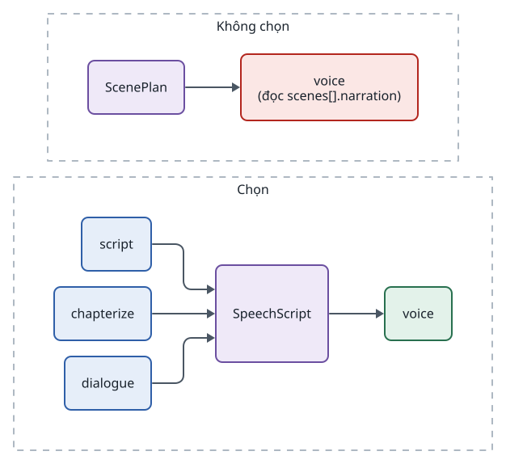

<!-- id:summary -->
## Tóm tắt

<!-- id:summary.b1-2 -->
> [!WARNING]
> Bị loại ngày 19/10/2026 theo ADD-AIVIDEO-003. AD-06: ScenePlan là contract kịch bản duy nhất; lời đọc lấy từ trường narration (bản rà soát F02). Audiobook trả về ScenePlan với mỗi scene là một đoạn. Giữ lại làm hồ sơ lịch sử.

<!-- id:summary.b1 -->
> [!IMPORTANT]
> Quyết định: `voice` nhận contract `SpeechScript` (danh sách đoạn, mỗi đoạn có `id`, `text`, `speaker`, tùy chọn `pause_after_ms`). Với video, `script` trả cả ScenePlan và SpeechScript; với audiobook, `chapterize` trả thẳng SpeechScript.

<!-- id:summary.b2 -->
Nếu `voice` đọc thẳng ScenePlan, nó dính chặt với video; audiobook hay podcast phải sửa `voice`, và dữ liệu task cũ có hình dạng khác bản mới. Hình dạng dữ liệu lưu trong SQLite nên phải chốt trước Phase 1 (nguồn: ADD-AIVIDEO-001 mục 12.4). Khuyến nghị: duyệt.

<!-- id:summary.b3 -->
<!-- report-kit:d2
```d2
# cap: Trước và sau: voice không còn biết dữ liệu đến từ quy trình nào
direction: right
before: "Không chọn" {
  class: zone
  sp: ScenePlan {class: data}
  v1: "voice\n(đọc scenes[].narration)" {class: bad}
  sp -> v1
}
after: "Chọn" {
  class: zone
  s: script {class: brain}
  c: chapterize {class: brain}
  d: dialogue {class: brain}
  ss: SpeechScript {class: data}
  v2: voice {class: hands}
  s -> ss
  c -> ss
  d -> ss
  ss -> v2
}
```
-->
<picture>
<source media="(prefers-color-scheme: dark)" srcset="0002-speechscript-contract.figs/summary.b3-dark.svg">

</picture>

<!-- id:impact -->
## Ảnh hưởng tới sử dụng và vận hành

<!-- id:impact.b1 -->
Màn hình Storyboard sửa lời đọc trên SpeechScript, nên sửa một đoạn chỉ đọc lại đoạn đó, ở cả video và audiobook. Giọng theo nhân vật (`voices`) và từ điển phát âm (`lexicon`) của Series Bible áp dụng thống nhất.

<!-- id:proscons -->
## Ưu và nhược điểm

<!-- id:proscons.b1 -->
```cards
- h: Ưu điểm
  chip: ok
  ul: [Một module voice cho video, audiobook, podcast, Đọc lại đúng một đoạn khi sửa, Hội thoại nhiều giọng có chỗ trong contract (speaker), Dữ liệu task cũ và mới cùng hình dạng]
- h: Nhược điểm
  chip: bad
  ul: [Thêm một contract phải giữ đồng bộ với narration trong ScenePlan, script phải sinh hai output thay vì một]
```

<!-- id:blockers -->
## Điểm chặn

<!-- id:blockers.b1 -->
Table: Việc phải xong trước
| Việc | Người làm | Bị chặn |
| --- | --- | --- |
| Duyệt ADR này | Tuan | Contracts Phase 1, module `voice` |
| Quy tắc đồng bộ: sửa narration của scene thì cập nhật đoạn cùng `id` | Claude | Storyboard Phase 2 |

<!-- id:risks -->
## Rủi ro

<!-- id:risk-table -->
Table: Rủi ro
| ID | Rủi ro | Khả năng | Ảnh hưởng | Giảm thiểu | Người theo dõi | Nguồn |
| --- | --- | --- | --- | --- | --- | --- |
| R1 | Narration trong ScenePlan và text trong SpeechScript lệch nhau sau khi sửa | Medium | Medium | Video: SpeechScript sinh lại từ ScenePlan khi sửa scene; đoạn dùng cùng `id` với scene | Claude | Thiết kế này |
| R2 | Phụ đề cần mốc theo scene, không theo đoạn | Low | Low | Với video, một đoạn ứng với một scene (`id` trùng) | Claude | ADD-AIVIDEO-001 4.6 |
| R3 | Audiobook cần thêm trường (chương, cảm xúc) | Not rated | Low | Thêm trường tùy chọn, tăng `schema_version` khi không tương thích | Claude | Thiết kế này |

<!-- id:options -->
## Phương án đã xét

<!-- id:options.b1 -->
Table: Phương án
| Phương án | Ảnh hưởng | Vì sao không chọn |
| --- | --- | --- |
| `voice` đọc ScenePlan | Ít contract nhất | Khóa `voice` vào video; audiobook phải sửa `voice` và chuyển đổi dữ liệu |
| Mỗi quy trình một module giọng riêng | Không dính nhau | Lặp code TTS, retry, mốc thời gian, lexicon |
| `voice` nhận chuỗi văn bản thô | Đơn giản | Mất fan-out theo đoạn, người nói, khoảng nghỉ |

<!-- id:founder-feedback -->
## Ý kiến người quyết định

<!-- id:founder-feedback.b1 -->
```q
Duyệt contract SpeechScript làm đầu vào duy nhất của voice?
1. Approve
2. Reject
3. Request changes (ghi chú bên dưới)
rec: 1
```

<!-- id:context -->
## Phụ lục kỹ thuật · Bối cảnh

<!-- id:context.b1 -->
Audiobook, podcast hai giọng và lồng tiếng đều cần đọc văn bản nhưng không có scene. Xem [Module và provider · Quy trình ngoài video](../design/05-modules-providers.md#s10).

<!-- id:decision -->
## Phụ lục kỹ thuật · Quyết định

<!-- id:decision.b1 -->
```json
// Video: module script rút từ narration của từng scene
{"schema_version": 1, "segments": [{"id": "s03", "text": "Rồi gương mặt ấy hiện lên...", "speaker": "narrator"}]}

// Audiobook: module chapterize tạo từ chương sách
{"schema_version": 1, "segments": [{"id": "ch01_p004", "text": "\"Ai đó?\" Kai hỏi.", "speaker": "kai"}]}
```

<!-- id:decision.b2 -->
`voice` khai báo `consumes: ["SpeechScript"]`, `fan_out: "SpeechScript.segments"`, `produces: "AudioTrack"`.

<!-- id:consequences -->
## Phụ lục kỹ thuật · Hệ quả

<!-- id:consequences.b1 -->
Contract chi tiết ở [Contract và dữ liệu · SpeechScript](../design/04-data-contracts.md#s6). `script` khai báo hai output; registry phải cho phép một module `produces` nhiều contract, hoặc `script` lưu SpeechScript qua một contract phụ. Chốt cách làm khi code registry.

<!-- id:migration -->
## Phụ lục kỹ thuật · Chuyển đổi và quay lại

<!-- id:migration.b1 -->
Chưa có dữ liệu: không cần chuyển đổi. Quay lại phương án đọc ScenePlan chỉ cần một adapter nhỏ ScenePlan → SpeechScript bên trong `voice`.
