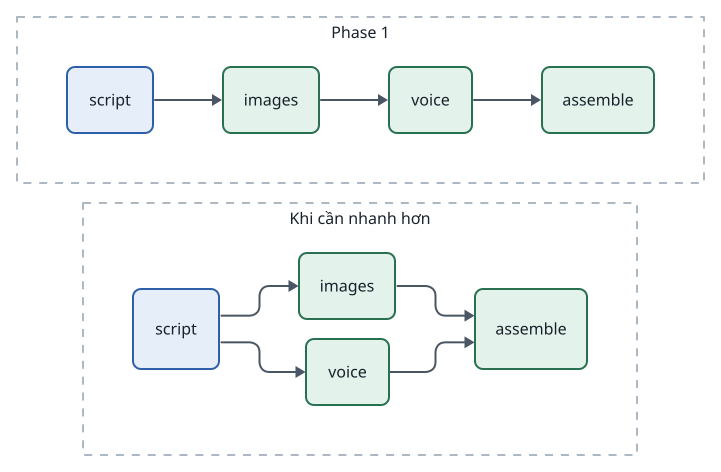

<!-- id:summary -->
## Tóm tắt

<!-- id:summary.b1-2 -->
> [!WARNING]
> Bị loại ngày 19/10/2026 theo ADD-AIVIDEO-003. AD-05: các bước chạy tuần tự, chỉ song song giữa các scene trong một bước; bỏ cú pháp parallel (bản rà soát F01, F06). Thêm lại khi đo được thời gian chờ là nút thắt. Giữ lại làm hồ sơ lịch sử.

<!-- id:summary.b1 -->
> [!IMPORTANT]
> Quyết định: định dạng profile chấp nhận phần tử `parallel:` chứa danh sách bước. Phase 1 runner chạy các bước trong nhóm lần lượt; khi cần nhanh hơn chỉ sửa bên trong runner, config và giao diện giữ nguyên.

<!-- id:summary.b2 -->
`images` và `voice` không phụ thuộc nhau (cả hai chỉ cần kịch bản), nên chạy cùng lúc sẽ nhanh hơn. Nếu profile chỉ là danh sách phẳng, sau này muốn chạy song song phải đổi định dạng config, kéo theo sửa mọi profile, trang Settings, phần kiểm tra hợp lệ và cách runner xác định "bước tiếp theo" (nguồn: ADD-AIVIDEO-001 mục 12.4). Khuyến nghị: duyệt.

<!-- id:summary.b3 -->
```d2
# cap: Cùng một profile; Phase 1 chạy nhóm lần lượt, sau này song song mà không đổi config
direction: right
p1: "Phase 1" {
  class: zone
  a1: script {class: brain}
  b1: images {class: hands}
  c1: voice {class: hands}
  d1: assemble {class: hands}
  a1 -> b1 -> c1 -> d1
}
later: "Khi cần nhanh hơn" {
  class: zone
  a2: script {class: brain}
  b2: images {class: hands}
  c2: voice {class: hands}
  d2: assemble {class: hands}
  a2 -> b2
  a2 -> c2
  b2 -> d2
  c2 -> d2
}
```
<picture>
<source media="(prefers-color-scheme: dark)" srcset="0003-parallel-step-groups.figs/summary.b3-dark.svg">

</picture>

<!-- id:impact -->
## Ảnh hưởng tới sử dụng và vận hành

<!-- id:impact.b1 -->
Không có thay đổi hành vi ở Phase 1. Trang Settings hiển thị nhóm như một khối có thể bật / tắt từng bước bên trong. Khi bật chạy song song thật, thời gian chờ một task giảm khoảng bằng thời gian của bước ngắn hơn trong nhóm (suy luận, chưa đo).

<!-- id:proscons -->
## Ưu và nhược điểm

<!-- id:proscons.b1 -->
```cards
- h: Ưu điểm
  chip: ok
  ul: [Định dạng profile không đổi khi bật song song, Settings và validation viết một lần, Gần như không tốn công ở Phase 1]
- h: Nhược điểm
  chip: bad
  ul: [Validation phải hiểu nhóm ngay từ Phase 1, Có cú pháp chưa có hiệu lực thật, dễ gây hiểu nhầm]
```

<!-- id:blockers -->
## Điểm chặn

<!-- id:blockers.b1 -->
Table: Việc phải xong trước
| Việc | Người làm | Bị chặn |
| --- | --- | --- |
| Duyệt ADR này | Tuan | Định dạng profile, validation Phase 1 |
| Quy tắc "bước tiếp theo" khi một bước trong nhóm đang `waiting` | Claude | Runner Phase 1 |

<!-- id:risks -->
## Rủi ro

<!-- id:risk-table -->
Table: Rủi ro
| ID | Rủi ro | Khả năng | Ảnh hưởng | Giảm thiểu | Người theo dõi | Nguồn |
| --- | --- | --- | --- | --- | --- | --- |
| R1 | Hai bước trong nhóm dùng chung rate limit một provider | Medium | Low | `concurrency` theo provider, không theo bước | Claude | ADD-AIVIDEO-001 mục 5 |
| R2 | Gate nằm trong nhóm làm trạng thái khó hiểu | Low | Medium | Validation cấm `gate` bên trong nhóm | Claude | Thiết kế này |
| R3 | SQLite bị ghi đồng thời nhiều hơn khi chạy song song thật | Not rated | Medium | WAL; ghi ngắn; đo trước khi bật | Claude | ADD-AIVIDEO-001 mục 10 |

<!-- id:options -->
## Phương án đã xét

<!-- id:options.b1 -->
Table: Phương án
| Phương án | Ảnh hưởng | Vì sao không chọn |
| --- | --- | --- |
| Danh sách phẳng, thêm song song sau | Đơn giản nhất bây giờ | Đổi định dạng sau chạm runner, Settings, validation và mọi profile |
| DAG đầy đủ (`needs:` cho từng bước) | Linh hoạt nhất | Phức tạp hơn nhu cầu; rẽ nhánh có điều kiện chưa được khuyến nghị |
| Song song thật ngay Phase 1 | Nhanh hơn ngay | Thêm công và rủi ro cho Phase 1 khi chưa cần |

<!-- id:founder-feedback -->
## Ý kiến người quyết định

<!-- id:founder-feedback.b1 -->
```q
Duyệt cú pháp nhóm parallel trong profile từ Phase 1?
1. Approve
2. Reject
3. Request changes (ghi chú bên dưới)
rec: 1
```

<!-- id:context -->
## Phụ lục kỹ thuật · Bối cảnh

<!-- id:context.b1 -->
Hạn chế "các bước chạy tuần tự" được ghi ở [Vận hành · Rủi ro và hạn chế](../design/07-operations.md#s7); đây là hạn chế duy nhất trong nhóm "sửa core" được khuyến nghị xử lý trước Phase 1.

<!-- id:decision -->
## Phụ lục kỹ thuật · Quyết định

<!-- id:decision.b1 -->
```yaml
steps:
  - script
  - parallel:
      - images
      - voice
  - gate: keyframes
  - assemble: {subtitles: true, aspect: "9:16"}
```

<!-- id:decision.b2 -->
- Một nhóm xong khi mọi bước trong nhóm xong; bước sau nhóm thấy output của mọi bước trong nhóm.
- Không cho `gate` hoặc nhóm lồng nhau bên trong nhóm.
- Một bước trong nhóm `waiting` hoặc `failed` thì task `waiting` hoặc `failed` như bước thường.

<!-- id:consequences -->
## Phụ lục kỹ thuật · Hệ quả

<!-- id:consequences.b1 -->
Mô tả runner ở [Pipeline Runner · Song song](../design/03-runner.md#s10). Settings Phase 2 hiển thị nhóm. Khi bật song song thật, chỉ đổi phần thực thi trong runner.

<!-- id:migration -->
## Phụ lục kỹ thuật · Chuyển đổi và quay lại

<!-- id:migration.b1 -->
Chưa có profile nào: không cần chuyển đổi. Quay lại danh sách phẳng: làm phẳng nhóm theo thứ tự khai báo, giữ nguyên hành vi Phase 1.
