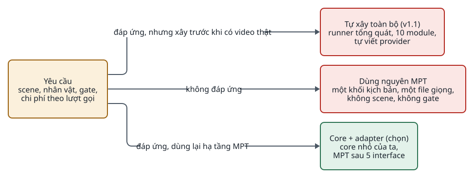

<!-- id:summary -->
## Tóm tắt

<!-- id:summary.b1 -->
> [!IMPORTANT]
> Quyết định: studio là một core Python nhỏ do ta viết, gọi các chức năng của MoneyPrinterTurbo (MPT) qua 5 provider interface. MPT là gói pip `mpt` ghim phiên bản; chỉ thư mục `studio/providers/mpt/` được import `app.*`. Renderer là bản copy `video_project.py` của MPT tại commit `82bb4a7`, trùng gói `mpt` 1.3.9. Renderer này chỉ nhận footage là video và không có chuyển động camera, nên ảnh tĩnh được bước `animate` của ta dựng thành clip trước khi render; bản copy giữ nguyên.

<!-- id:summary.b2 -->
Core lo phần MPT không có: kịch bản theo scene, mẫu nhân vật và từ vựng camera, chọn và duyệt từng scene, nhật ký chi phí. MPT lo phần ta không nên tự viết: 14 provider giọng đọc (có Edge TTS tiếng Việt miễn phí), căn phụ đề, provider video AI. Điều kiện build đã được chốt: ngày 24/10/2026 Tuan chọn D-01 = build dựa trên lỗi C06 của pilot và bỏ baseline MPT; rủi ro là chưa chứng minh MPT không dựng đúng được khi có đủ cảnh (nguồn: ADD-AIVIDEO-003 mục 1, 2, 10; [08 · Quyết định](../design/08-roadmap.md#s7)). Khuyến nghị: duyệt.

<!-- id:summary.b3 -->
<!-- report-kit:d2
```d2
# cap: Ba phương án: tự xây hết, dùng nguyên MPT, và core + adapter được chọn
direction: right
a: "Tự xây toàn bộ (v1.1)\nrunner tổng quát, 10 module,\ntự viết provider" {class: bad}
b: "Dùng nguyên MPT\nmột khối kịch bản, một file giọng,\nkhông scene, không gate" {class: bad}
c: "Core + adapter (chọn)\ncore nhỏ của ta,\nMPT sau 5 interface" {class: hands}
need: "Yêu cầu\nscene, nhân vật, gate,\nchi phí theo lượt gọi" {class: gate}
need -> a: "đáp ứng, nhưng xây trước khi có video thật"
need -> b: "không đáp ứng"
need -> c: "đáp ứng, dùng lại hạ tầng MPT"
```
-->
<picture>
<source media="(prefers-color-scheme: dark)" srcset="0004-minimal-core-mpt-adapters.figs/summary.b3-dark.svg">

</picture>

<!-- id:impact -->
## Ảnh hưởng tới sử dụng và vận hành

<!-- id:impact.b1 -->
Người vận hành dùng một hệ thống duy nhất (CLI rồi trang review); họ không mở WebUI của MPT. Người phát triển phải giữ ranh giới import và chạy test adapter trước mỗi lần nâng MPT. API key và cấu hình provider nằm trong `config.toml` của MPT (`MPT_HOME`), nên có một nơi cấu hình cho cả hai phía.

<!-- id:proscons -->
## Ưu và nhược điểm

<!-- id:proscons.b1 -->
```cards
- h: Ưu điểm
  chip: ok
  ul: [Không tự viết 14 provider TTS và căn phụ đề, Giữ quyền kiểm soát contract và trạng thái, "Bỏ MPT cho một năng lực = viết adapter khác", "Renderer đã kiểm thử: dựng lại theo scene, SHA-256, revision"]
- h: Nhược điểm
  chip: bad
  ul: [Phụ thuộc một dự án thay đổi gần như hằng ngày, "Cấu hình MPT là toàn cục, khó chạy hai cấu hình song song", "Gói mpt dùng tên package app", Phải bảo trì bản copy video_project.py]
```

<!-- id:blockers -->
## Điểm chặn

<!-- id:blockers.b1 -->
Table: Việc phải xong trước
| Việc | Người làm | Bị chặn |
| --- | --- | --- |
| ~~Chốt phiên bản MPT ghim (P-01)~~ Đã chốt `mpt==1.3.9` (24/10/2026) | Tuan | Adapter MPT, `vendor/video_project.py` |
| Duyệt ADR này | Tuan | Khởi tạo package `studio/` |

<!-- id:risks -->
## Rủi ro

<!-- id:risk-table -->
Table: Rủi ro
| ID | Rủi ro | Khả năng | Ảnh hưởng | Giảm thiểu | Người theo dõi | Nguồn |
| --- | --- | --- | --- | --- | --- | --- |
| R1 | MPT đổi chữ ký hàm khi nâng cấp | Medium | Medium | Ghim phiên bản; test riêng từng adapter trước khi nâng | Claude | ADD-AIVIDEO-003 13.3 |
| R2 | Code ngoài adapter import `app.*` qua đường tắt | Not rated | High | Test quét import chạy trong CI | Claude | ADD-AIVIDEO-003 5.4 |
| R3 | MPT ngừng bảo trì hoặc đổi giấy phép | Low | Medium | Bản copy renderer đã tự chứa; adapter khác cùng interface | Claude | Thiết kế này |
| R4 | Gói `mpt` ghim cứng FastAPI, Starlette, uvicorn, openai mà studio cũng dùng | High | Medium | Một `uv.lock` chung; studio dùng đúng các bản đó; nhánh nâng MPT chạy cả test web | Claude | `pyproject.toml` của MPT tại `82bb4a7` |
| R5 | Renderer từ chối footage dạng ảnh | High | High | Bước `animate` dựng clip MP4 từ ảnh; hậu điều kiện kiểm trước render | Claude | Kiểm thử ngày 24/10/2026 |

<!-- id:options -->
## Phương án đã xét

<!-- id:options.b1 -->
Table: Phương án
| Phương án | Ảnh hưởng | Vì sao không chọn |
| --- | --- | --- |
| Tự xây toàn bộ (ADD-001 v1.1) | Kiểm soát hết | Bản rà soát F01: xây runner tổng quát trước khi có video thật; MPT đã có phần lớn hạ tầng provider và render |
| Dùng nguyên MPT | Không viết code | Không có scene, nhân vật, cổng duyệt, chi phí theo lượt gọi |
| Fork MPT | Sửa trực tiếp | Phải tự merge thay đổi hằng ngày của upstream |
| Copy toàn bộ mã MPT | Không phụ thuộc pip | Mang theo 36.000 dòng không dùng |

<!-- id:founder-feedback -->
## Ý kiến người quyết định

<!-- id:founder-feedback.b1 -->
```q
Duyệt core tối thiểu + adapter, MPT là thư viện provider?
1. Approve
2. Reject
3. Request changes (ghi chú bên dưới)
rec: 1
```

<!-- id:context -->
## Phụ lục kỹ thuật · Bối cảnh

<!-- id:context.b1 -->
MPT (khoảng 36.000 dòng Python, MIT, 203 file test) mạnh ở hạ tầng provider và render, yếu đúng ở phần sản phẩm cần khác biệt: pipeline chính coi kịch bản là một khối văn bản, một file giọng cho cả video, hình tìm theo từ khóa, trạng thái trong bộ nhớ process hoặc Redis.

<!-- id:decision -->
## Phụ lục kỹ thuật · Quyết định

<!-- id:decision.b1 -->
- Core định nghĩa `LLMProvider`, `ImageProvider`, `TTSProvider`, `SubtitleAligner`, `VideoProvider` ([05 · Provider interface](../design/05-modules-providers.md#s1)).
- Adapter MPT: `MptTTS`, `MptSubtitleAligner`, `MptVideo` (Gate 4), stock footage (khi cần).
- Không dùng: `webui/Main.py`, `task.py`, `state.py`, `video.py`, `upload_post.py`.
- Package của ta tên `studio`, không bao giờ `app`.

<!-- id:consequences -->
## Phụ lục kỹ thuật · Hệ quả

<!-- id:consequences.b1 -->
Ranh giới và bảng adapter ở [05 · Adapter và MPT](../design/05-modules-providers.md#s3); quy trình nâng MPT ở [07 · Vận hành](../design/07-operations.md#s3).

<!-- id:migration -->
## Phụ lục kỹ thuật · Chuyển đổi và quay lại

<!-- id:migration.b1 -->
Chưa có dữ liệu. Bỏ MPT cho một năng lực: viết adapter gọi thẳng SDK cùng interface, đổi một dòng cấu hình. Quay lại "dùng nguyên MPT": dừng ở Gate 2 theo điều kiện dừng ở [08 · Lộ trình](../design/08-roadmap.md#s1).
