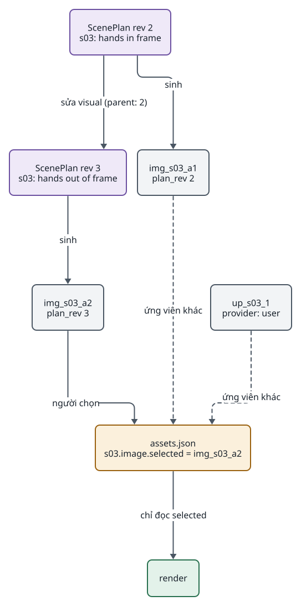

<!-- id:summary -->
## Tóm tắt

<!-- id:summary.b1 -->
> [!IMPORTANT]
> Quyết định: (1) ScenePlan là contract kịch bản duy nhất, có `revision` và `parent`; sửa scene luôn ghi `plan/rev_NNN.json` mới. (2) Mỗi lần sinh ảnh, audio, clip là một ứng viên ghi `plan_rev`; (3) render chỉ dùng ứng viên `selected` của từng scene trong `assets.json`; (4) mỗi lần render là một render revision `renders/r_NNN/`, bản đã duyệt không bị bản render sau ghi đè.

<!-- id:summary.b2 -->
Ba quyết định này định hình mọi file trong thư mục task và cách giao diện sửa, nên phải chốt trước khi viết contract ở Gate 2 (nguồn: ADD-AIVIDEO-003 AD-06, AD-07, AD-08; bản rà soát F02, F04, F05). Khuyến nghị: duyệt.

<!-- id:summary.b3 -->
<!-- report-kit:d2
```d2
# cap: Sửa s03 tạo revision mới và ứng viên mới; render đọc selected, không đọc bản mới nhất
direction: down
r2: "ScenePlan rev 2\ns03: hands in frame" {class: data}
r3: "ScenePlan rev 3\ns03: hands out of frame" {class: data}
a1: "img_s03_a1\nplan_rev 2" {class: plain}
a2: "img_s03_a2\nplan_rev 3" {class: plain}
u1: "up_s03_1\nprovider: user" {class: plain}
sel: "assets.json\ns03.image.selected = img_s03_a2" {class: gate}
render: render {class: hands}
r2 -> r3: "sửa visual (parent: 2)"
r2 -> a1: sinh
r3 -> a2: sinh
a2 -> sel: "người chọn"
a1 -> sel: "ứng viên khác" {style.stroke-dash: 3}
u1 -> sel: "ứng viên khác" {style.stroke-dash: 3}
sel -> render: "chỉ đọc selected"
```
-->
<picture>
<source media="(prefers-color-scheme: dark)" srcset="0005-sceneplan-revisions-selected.figs/summary.b3-dark.svg">

</picture>

<!-- id:impact -->
## Ảnh hưởng tới sử dụng và vận hành

<!-- id:impact.b1 -->
Người vận hành luôn quay lại được bản cũ: mọi ứng viên và revision còn trên Storyboard. Chọn ứng viên khác chỉ làm render chạy lại. Đổi lại, ổ đĩa tăng theo mọi ứng viên; cần dọn ứng viên không được chọn sau N ngày ([07 · Sao lưu](../design/07-operations.md#s5)).

<!-- id:proscons -->
## Ưu và nhược điểm

<!-- id:proscons.b1 -->
```cards
- h: Ưu điểm
  chip: ok
  ul: [Một nguồn sự thật cho lời đọc và hình, Không mất dữ liệu khi sửa, "Render xác định: cùng selected cho cùng video", "Upload của người dùng là một ứng viên như mọi ứng viên"]
- h: Nhược điểm
  chip: bad
  ul: [Dung lượng tăng theo ứng viên và revision, "Audiobook phải biểu diễn đoạn như một scene (chỉ narration và speaker)", Cần quy tắc chọn mặc định khi sinh lại]
```

<!-- id:blockers -->
## Điểm chặn

<!-- id:blockers.b1 -->
Table: Việc phải xong trước
| Việc | Người làm | Bị chặn |
| --- | --- | --- |
| Duyệt ADR này | Tuan | Contract Pydantic ở Gate 2 |
| Chốt `schema_version` 1 của ScenePlan và `assets.json` | Claude | Bước `plan`, renderer |

<!-- id:risks -->
## Rủi ro

<!-- id:risk-table -->
Table: Rủi ro
| ID | Rủi ro | Khả năng | Ảnh hưởng | Giảm thiểu | Người theo dõi | Nguồn |
| --- | --- | --- | --- | --- | --- | --- |
| R1 | Ứng viên được chọn thuộc revision cũ sau khi sửa scene | Medium | Medium | Sinh lại scene bị sửa đặt ứng viên mới làm selected; UI đánh dấu ứng viên lệch revision | Claude | Thiết kế này |
| R2 | Ổ đĩa đầy dần | Medium | Low | Dọn ứng viên không được chọn sau N ngày; sao lưu `data/` | Claude | ADD-AIVIDEO-003 13.1 |
| R3 | Ghi `assets.json` đồng thời từ worker và web | Medium | Medium | Một hàm ghi có `flock` theo task, file tạm, `fsync`, đổi tên; thread scene trả kết quả về luồng chính; web chỉ ghi khi task không `running` | Claude | Soát ngày 24/10/2026 |
| R4 | Worker đang chạy rev 2 trong khi người lưu rev 3 | Medium | Medium | Hành động của người bị từ chối khi task `running`; có lệnh `task pause` | Claude | Soát ngày 24/10/2026 |

<!-- id:options -->
## Phương án đã xét

<!-- id:options.b1 -->
Table: Phương án
| Phương án | Ảnh hưởng | Vì sao không chọn |
| --- | --- | --- |
| Hai contract ScenePlan + SpeechScript (ADR-0002) | Tách lời đọc khỏi hình | Bản rà soát F02: hai nguồn sự thật lệch nhau sau khi sửa |
| Render lấy bản mới nhất | Không cần trường selected | Bản rà soát F04: không chọn được ứng viên cũ hay upload |
| Ghi đè output khi sửa | Ít file | Bản rà soát F05: không khớp StepRun, mất bản cũ |

<!-- id:founder-feedback -->
## Ý kiến người quyết định

<!-- id:founder-feedback.b1 -->
```q
Duyệt ScenePlan có revision và render theo ứng viên selected?
1. Approve
2. Reject
3. Request changes (ghi chú bên dưới)
rec: 1
```

<!-- id:context -->
## Phụ lục kỹ thuật · Bối cảnh

<!-- id:context.b1 -->
Người dùng sửa từng scene trên Storyboard; worker resume theo StepRun. Nếu sửa ghi đè file, StepRun `done` trỏ tới file đã đổi và resume không biết phải chạy lại gì.

<!-- id:decision -->
## Phụ lục kỹ thuật · Quyết định

<!-- id:decision.b1 -->
Schema và ví dụ đầy đủ ở [04 · ScenePlan](../design/04-data-contracts.md#s4) và [04 · Ứng viên và selected](../design/04-data-contracts.md#s5).

<!-- id:consequences -->
## Phụ lục kỹ thuật · Hệ quả

<!-- id:consequences.b1 -->
Phạm vi chạy lại sau khi sửa ở [03 · Gate, sửa và chạy lại](../design/03-runner.md#s7).

<!-- id:migration -->
## Phụ lục kỹ thuật · Chuyển đổi và quay lại

<!-- id:migration.b1 -->
Chưa có dữ liệu. Mọi file mang `schema_version`; đổi schema không tương thích thì thêm hàm chuyển đổi đọc bản cũ.
