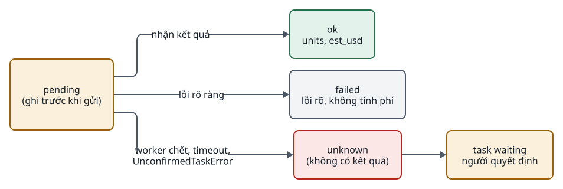

<!-- id:summary -->
## Tóm tắt

<!-- id:summary.b1 -->
> [!IMPORTANT]
> Quyết định: adapter ghi `{"status": "pending"}` vào `costs.jsonl` trước mỗi lượt gọi trả phí và một dòng kết quả `ok`, `failed` hoặc `unknown` sau. Khi chạy lại mà còn `pending` không có kết quả, hoặc MPT ném `UnconfirmedTaskError`, task chuyển `waiting` và người quyết định; hệ thống không tự gửi lại.

<!-- id:summary.b2 -->
Thiết kế không hứa "không bao giờ trả tiền hai lần" (bản rà soát F03); nó hứa không tự trả tiền lần hai mà người không biết. Ngân sách đặt trước và `pricing.yaml` bị bỏ vì giá đổi thường xuyên và ước tính lệch hóa đơn (F10). Khuyến nghị: duyệt.

<!-- id:summary.b3 -->
<!-- report-kit:d2
```d2
# cap: Vòng đời một dòng chi phí: pending luôn ghi trước, kết quả không rõ thì hỏi người
direction: right
p: "pending\n(ghi trước khi gửi)" {class: gate}
ok: "ok\nunits, est_usd" {class: hands}
failed: "failed\nlỗi rõ, không tính phí" {class: plain}
unk: "unknown\n(không có kết quả)" {class: bad}
w: "task waiting\nngười quyết định" {class: gate}
p -> ok: "nhận kết quả"
p -> failed: "lỗi rõ ràng"
p -> unk: "worker chết, timeout,\nUnconfirmedTaskError"
unk -> w
```
-->
<picture>
<source media="(prefers-color-scheme: dark)" srcset="0006-paid-call-ledger.figs/summary.b3-dark.svg">

</picture>

<!-- id:impact -->
## Ảnh hưởng tới sử dụng và vận hành

<!-- id:impact.b1 -->
Người vận hành đặt giới hạn chi tiêu ở tài khoản từng provider và đối chiếu ước tính với hóa đơn cuối tháng. Thỉnh thoảng phải trả lời "sinh lại s06?" trên Task detail sau sự cố. Chỉ số chính: chi phí và phút công trên mỗi video được duyệt.

<!-- id:proscons -->
## Ưu và nhược điểm

<!-- id:proscons.b1 -->
```cards
- h: Ưu điểm
  chip: ok
  ul: [Không tự gửi lại lượt gọi đã có thể bị tính phí, Không phải duy trì bảng giá, Một file JSONL đọc được bằng mắt và jq, Dùng lại UnconfirmedTaskError của MPT]
- h: Nhược điểm
  chip: bad
  ul: [Không chặn được task tiêu vượt trong lúc chạy, Người phải quyết định sau sự cố, "est_usd chỉ là ước tính"]
```

<!-- id:blockers -->
## Điểm chặn

<!-- id:blockers.b1 -->
Table: Việc phải xong trước
| Việc | Người làm | Bị chặn |
| --- | --- | --- |
| Duyệt ADR này | Tuan | Lớp ghi chi phí dùng chung cho adapter |
| Đặt giới hạn chi tiêu pilot ở tài khoản provider (D-03) | Tuan | Gate 1 |

<!-- id:risks -->
## Rủi ro

<!-- id:risk-table -->
Table: Rủi ro
| ID | Rủi ro | Khả năng | Ảnh hưởng | Giảm thiểu | Người theo dõi | Nguồn |
| --- | --- | --- | --- | --- | --- | --- |
| R1 | Adapter quên ghi pending trước lượt gọi | Not rated | High | Lớp ghi chi phí bọc mọi lượt gọi trả phí; test T05 | Claude | ADD-AIVIDEO-003 F03 |
| R2 | Task tiêu nhiều khi chạy song song nhiều scene với API đắt | Medium | Medium | Gate keyframe trước bước đắt; giới hạn ở tài khoản; test T08 | Claude | ADD-AIVIDEO-003 4 |
| R3 | Ước tính lệch hóa đơn | High | Low | Đối chiếu hằng tháng; chỉ dùng số đo được để ra quyết định | Tuan | ADD-AIVIDEO-003 F10 |

<!-- id:options -->
## Phương án đã xét

<!-- id:options.b1 -->
Table: Phương án
| Phương án | Ảnh hưởng | Vì sao không chọn |
| --- | --- | --- |
| `pricing.yaml` + reservation ngân sách theo task (v1.1) | Chặn trước khi vượt | Giá đổi, ước tính lệch hóa đơn; thêm cơ chế trước khi có số liệu |
| Tự động gửi lại khi không rõ kết quả | Không cần người | Có thể trả tiền hai lần |
| Không ghi gì trước lượt gọi | Đơn giản nhất | Không phân biệt được "chưa gửi" và "đã gửi, mất kết quả" |

<!-- id:founder-feedback -->
## Ý kiến người quyết định

<!-- id:founder-feedback.b1 -->
```q
Duyệt nhật ký chi phí với dòng pending trước lượt gọi trả phí?
1. Approve
2. Reject
3. Request changes (ghi chú bên dưới)
rec: 1
```

<!-- id:context -->
## Phụ lục kỹ thuật · Bối cảnh

<!-- id:context.b1 -->
Lượt gọi ảnh, video AI có thể bị tính phí dù client không nhận được kết quả (worker chết, timeout). Job video bất đồng bộ trả `job_id` trước khi có kết quả.

<!-- id:decision -->
## Phụ lục kỹ thuật · Quyết định

<!-- id:decision.b1 -->
Định dạng dòng ở [04 · Chi phí](../design/04-data-contracts.md#s6); trình tự lượt gọi ở [03 · Lượt gọi trả phí](../design/03-runner.md#s6).

<!-- id:consequences -->
## Phụ lục kỹ thuật · Hệ quả

<!-- id:consequences.b1 -->
Ngân sách theo task thêm lại khi chạy song song nhiều scene với API đắt cho thấy cần chặn trước (ADD-AIVIDEO-003 mục 4).

<!-- id:migration -->
## Phụ lục kỹ thuật · Chuyển đổi và quay lại

<!-- id:migration.b1 -->
Thêm ngân sách sau này chỉ đọc thêm `costs.jsonl`; không đổi định dạng dòng.
