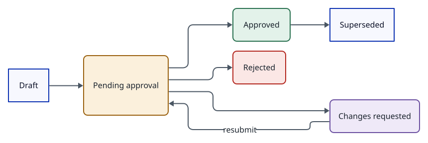
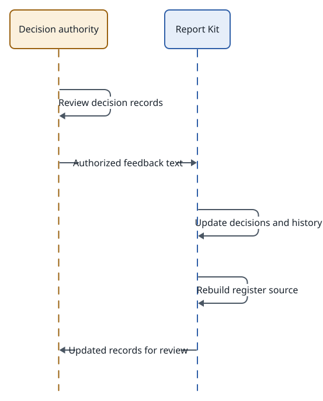

<!-- id:summary -->
## Overview

<!-- id:summary.b1 -->
```kpi
ADRs | 6
Pending | 0
Approved | 3
One-way | 5
Nearest due | –
```

<!-- id:list -->
## ADR list

<!-- id:list.b1 -->
Table: ADR list
| ADR | Decision | Impact | Door | Cost per month | Due | Status |
| --- | --- | --- | --- | --- | --- | --- |
| [ADR-0001](0001-generic-fan-out.md) | Module khai báo fan_out trỏ tới một danh sách trong contract; runner không viết cứng "theo scene". | High | One-way | 0 USD | W1 · 2026-10-26 | Rejected · 2026-10-19 |
| [ADR-0002](0002-speechscript-contract.md) | voice đọc SpeechScript (danh sách đoạn id, text, speaker) thay vì ScenePlan; mỗi quy trình tự sinh SpeechScript. | High | One-way | 0 USD | W1 · 2026-10-26 | Rejected · 2026-10-19 |
| [ADR-0003](0003-parallel-step-groups.md) | Profile chấp nhận nhóm parallel ngay từ Phase 1; runner được phép chạy các bước trong nhóm lần lượt cho tới khi cần nhanh hơn. | Medium | One-way | 0 USD | W1 · 2026-10-26 | Rejected · 2026-10-19 |
| [ADR-0004](0004-minimal-core-mpt-adapters.md) | Ta viết một core Python nhỏ (contract, danh sách bước, trạng thái, gate, nhật ký chi phí) và gọi MPT qua adapter; MPT ghim mpt 1.3.9, chỉ studio/providers/mpt/ được import app.*; copy duy nhất video_project.py tại 82bb4a7, không sửa; ảnh tĩnh thành clip qua bước animate của ta. | High | One-way | 0 USD | W2 · 2026-10-29 | Approved · 2026-10-24 |
| [ADR-0005](0005-sceneplan-revisions-selected.md) | ScenePlan là contract kịch bản duy nhất (lời đọc lấy từ narration); sửa tạo revision bất biến mới; mỗi lần sinh là một ứng viên và render chỉ đọc ứng viên selected trong assets.json. | High | One-way | 0 USD | W2 · 2026-10-29 | Approved · 2026-10-24 |
| [ADR-0006](0006-paid-call-ledger.md) | Mỗi lượt gọi trả phí ghi dòng pending vào costs.jsonl trước khi gửi và dòng ok/failed/unknown sau; kết quả không rõ thì task waiting, người quyết định; không đặt ngân sách hay pricing.yaml, giới hạn chi tiêu đặt ở tài khoản provider. | Medium | Two-way | 0 USD | W2 · 2026-10-29 | Approved · 2026-10-24 |

<!-- id:decide -->
## Recorded decisions

<!-- id:decide.b1 -->
No ADR is pending.

<!-- id:risk-matrix -->
## Risks

<!-- id:risk-matrix.b1 -->
Table: Risk matrix
| Likelihood \ Impact | Low | Medium | High |
| --- | --- | --- | --- |
| High | R3 | R4 | R5 |
| Medium | R1 · R2 | R1 · R1 · R1 · R3 · R4 · R2 | – |
| Low | R2 | R2 · R2 · R3 | – |
| Not rated | R3 | R3 · R3 | R1 · R2 · R1 |

<!-- id:risk-matrix.b2 -->
Table: Risk register
| ID | Risk | Likelihood | Impact | Mitigation | Owner | Source |
| --- | --- | --- | --- | --- | --- | --- |
| R1 | Viết cứng "theo scene" lọt vào runner qua đường tắt | Not rated | High | Test runner với một contract giả không có scene | Claude | ADD-AIVIDEO-001 12.4 |
| R2 | Một module cần fan-out lồng nhau (chương × đoạn) | Low | Medium | Làm phẳng danh sách trong contract, id ghép `ch01_p003` | Claude | Thiết kế này |
| R3 | Đổi id phần tử giữa các lượt làm mất liên kết lượt thử | Not rated | Medium | id ổn định do module sinh, không theo vị trí | Claude | Thiết kế này |
| R1 | Narration trong ScenePlan và text trong SpeechScript lệch nhau sau khi sửa | Medium | Medium | Video: SpeechScript sinh lại từ ScenePlan khi sửa scene; đoạn dùng cùng `id` với scene | Claude | Thiết kế này |
| R2 | Phụ đề cần mốc theo scene, không theo đoạn | Low | Low | Với video, một đoạn ứng với một scene (`id` trùng) | Claude | ADD-AIVIDEO-001 4.6 |
| R3 | Audiobook cần thêm trường (chương, cảm xúc) | Not rated | Low | Thêm trường tùy chọn, tăng `schema_version` khi không tương thích | Claude | Thiết kế này |
| R1 | Hai bước trong nhóm dùng chung rate limit một provider | Medium | Low | `concurrency` theo provider, không theo bước | Claude | ADD-AIVIDEO-001 mục 5 |
| R2 | Gate nằm trong nhóm làm trạng thái khó hiểu | Low | Medium | Validation cấm `gate` bên trong nhóm | Claude | Thiết kế này |
| R3 | SQLite bị ghi đồng thời nhiều hơn khi chạy song song thật | Not rated | Medium | WAL; ghi ngắn; đo trước khi bật | Claude | ADD-AIVIDEO-001 mục 10 |
| R1 | MPT đổi chữ ký hàm khi nâng cấp | Medium | Medium | Ghim phiên bản; test riêng từng adapter trước khi nâng | Claude | ADD-AIVIDEO-003 13.3 |
| R2 | Code ngoài adapter import `app.*` qua đường tắt | Not rated | High | Test quét import chạy trong CI | Claude | ADD-AIVIDEO-003 5.4 |
| R3 | MPT ngừng bảo trì hoặc đổi giấy phép | Low | Medium | Bản copy renderer đã tự chứa; adapter khác cùng interface | Claude | Thiết kế này |
| R4 | Gói `mpt` ghim cứng FastAPI, Starlette, uvicorn, openai mà studio cũng dùng | High | Medium | Một `uv.lock` chung; studio dùng đúng các bản đó; nhánh nâng MPT chạy cả test web | Claude | `pyproject.toml` của MPT tại `82bb4a7` |
| R5 | Renderer từ chối footage dạng ảnh | High | High | Bước `animate` dựng clip MP4 từ ảnh; hậu điều kiện kiểm trước render | Claude | Kiểm thử ngày 24/10/2026 |
| R1 | Ứng viên được chọn thuộc revision cũ sau khi sửa scene | Medium | Medium | Sinh lại scene bị sửa đặt ứng viên mới làm selected; UI đánh dấu ứng viên lệch revision | Claude | Thiết kế này |
| R2 | Ổ đĩa đầy dần | Medium | Low | Dọn ứng viên không được chọn sau N ngày; sao lưu `data/` | Claude | ADD-AIVIDEO-003 13.1 |
| R3 | Ghi `assets.json` đồng thời từ worker và web | Medium | Medium | Một hàm ghi có `flock` theo task, file tạm, `fsync`, đổi tên; thread scene trả kết quả về luồng chính; web chỉ ghi khi task không `running` | Claude | Soát ngày 24/10/2026 |
| R4 | Worker đang chạy rev 2 trong khi người lưu rev 3 | Medium | Medium | Hành động của người bị từ chối khi task `running`; có lệnh `task pause` | Claude | Soát ngày 24/10/2026 |
| R1 | Adapter quên ghi pending trước lượt gọi | Not rated | High | Lớp ghi chi phí bọc mọi lượt gọi trả phí; test T05 | Claude | ADD-AIVIDEO-003 F03 |
| R2 | Task tiêu nhiều khi chạy song song nhiều scene với API đắt | Medium | Medium | Gate keyframe trước bước đắt; giới hạn ở tài khoản; test T08 | Claude | ADD-AIVIDEO-003 4 |
| R3 | Ước tính lệch hóa đơn | High | Low | Đối chiếu hằng tháng; chỉ dùng số đo được để ra quyết định | Tuan | ADD-AIVIDEO-003 F10 |

<!-- id:lifecycle -->
## Status lifecycle

<!-- id:lifecycle.b1 -->
<!-- report-kit:d2
```d2
# cap: ADR status lifecycle
direction: right
draft: Draft
pending: Pending approval {class: gate}
approved: Approved {class: hands}
changes: Changes requested {class: data}
rejected: Rejected {class: bad}
superseded: Superseded
draft -> pending
pending -> approved
pending -> rejected
pending -> changes
changes -> pending: resubmit
approved -> superseded
```
-->
<picture>
<source media="(prefers-color-scheme: dark)" srcset="index.figs/lifecycle.b1-dark.svg">

</picture>

<!-- id:lifecycle.b2 -->
Table: ADR states
| State | Meaning | Next step |
| --- | --- | --- |
| Draft | Being written, not yet sent to the decision authority | Complete the manager part, move to Pending approval |
| Pending approval | Sent to the decision authority, with a due week | The decision authority responds before the due date |
| Approved | In force, being implemented | Review on the review date |
| Rejected | Not applied; the reason is recorded | Propose another option if needed |
| Changes requested | The decision authority requests changes | Revise per the note, resubmit as Pending approval |
| Superseded | A newer ADR replaces this decision | Link to the newer ADR |

<!-- id:process -->
## Feedback process

<!-- id:process.b1 -->
<!-- report-kit:d2
```d2
# cap: Decision feedback process
shape: sequence_diagram
authority: Decision authority {class: gate}
kit: Report Kit {class: brain}
authority -> authority: Review decision records
authority -> kit: Authorized feedback text
kit -> kit: Update decisions and history
kit -> kit: Rebuild register source
kit -> authority: Updated records for review
```
-->
<picture>
<source media="(prefers-color-scheme: dark)" srcset="index.figs/process.b1-dark.svg">

</picture>

<!-- id:process.b2 -->
`report adr-apply <adr-dir> <feedback file>` reads the feedback text copied from the register or an ADR page. Each line with an ADR ID and the choice Approve, Reject or Request changes updates that ADR's `adr` front matter: state, decision date, reason (the attached note, if any), and adds a version to the history; the register is then rebuilt.

<!-- id:scale -->
## Rating scales

<!-- id:scale.b1 -->
Table: Rating scales
| Attribute | Values | Rule |
| --- | --- | --- |
| Operational impact | High · Medium · Low | Record operational impact according to the host policy and supporting evidence. |
| Door type | One-way · Two-way | The rule is set by the host project policy. |
| Risk likelihood | Not rated · Low · Medium · High | Rated only from a measurement or a documented estimate; until then Not rated. Use the host project evidence and rating policy. |
| Risk impact | Low · Medium · High | The rule is set by the host project policy. |
| Decision due | Week W with a positive number | Use the host project schedule for dependent work. |
| Review date | Date | Set according to the host project review policy. |
