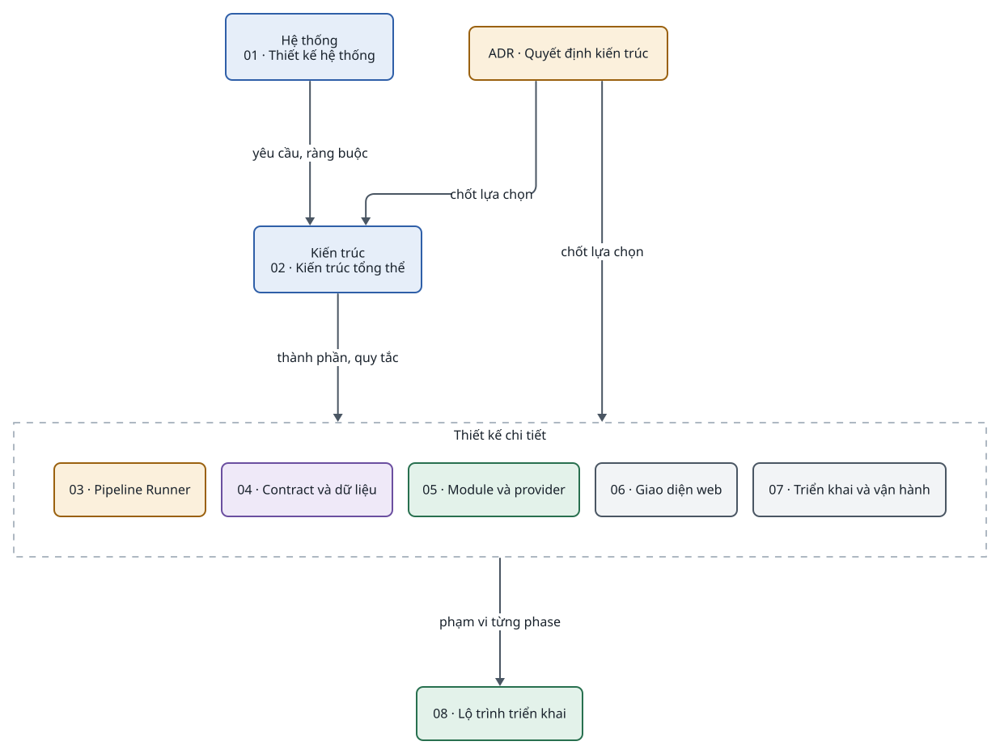
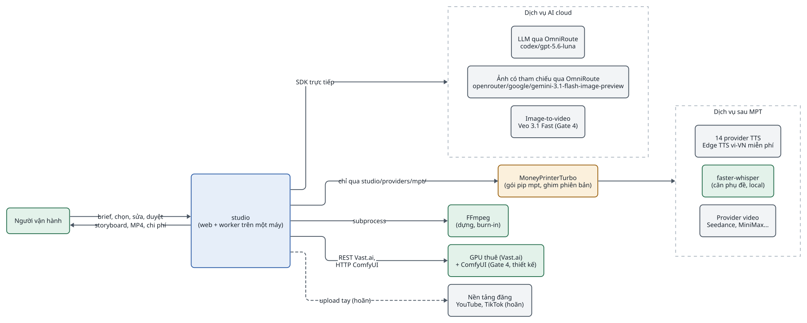
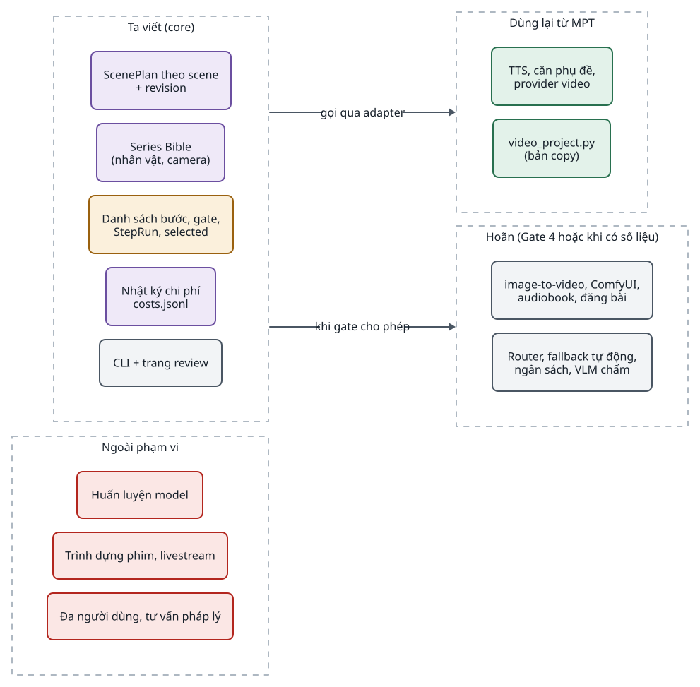
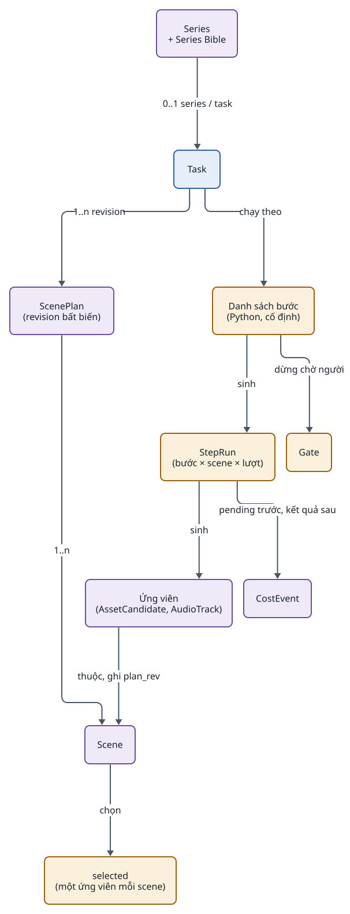
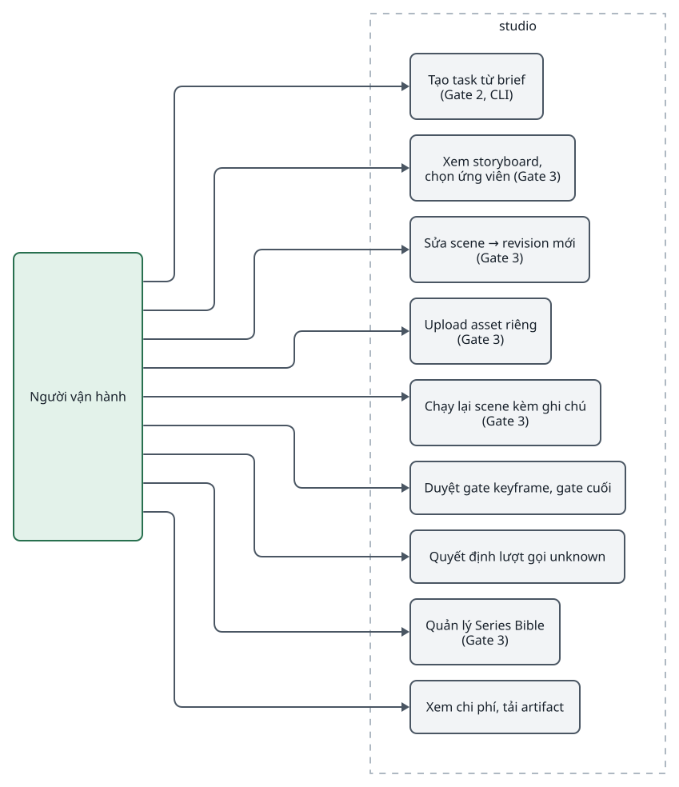
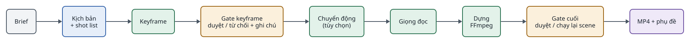
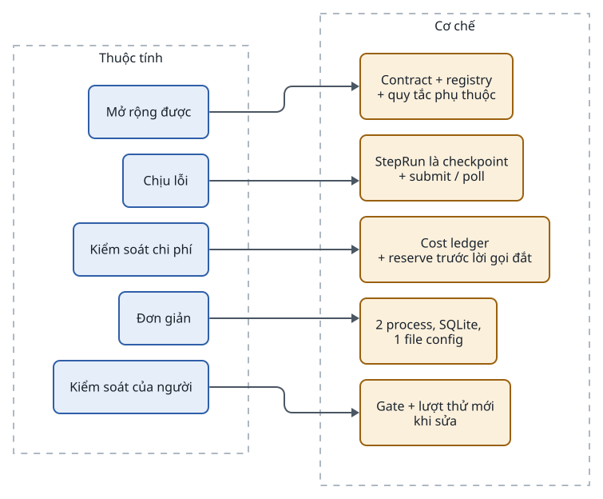

<!-- id:s1 -->
## Bộ tài liệu này

<!-- id:s1.b1 -->
Bộ tài liệu đi từ thiết kế hệ thống (hệ thống làm gì, cho ai, trong giới hạn nào) xuống thiết kế kiến trúc (hệ thống được dựng thế nào, code nằm ở đâu, chạy ra sao). Mỗi sự thật chỉ nằm ở một tài liệu sở hữu nó; tài liệu khác dẫn lại bằng liên kết hoặc khối `req`. Nguồn duy nhất là ADD-AIVIDEO-003 v3.0; ADD-001 v1.1 và ADD-002 v2.1 chỉ còn giá trị lịch sử.

<!-- id:s1.b2 -->
<!-- report-kit:d2
```d2
# cap: Bản đồ bộ tài liệu: hệ thống ở trên, kiến trúc ở giữa, chi tiết và kế hoạch ở dưới
direction: down
sys: "01 · Thiết kế hệ thống\nlàm gì, cho ai, đo bằng gì" {class: brain}
arch: "02 · Kiến trúc tổng thể\n4 tầng, 2 process, quy tắc phụ thuộc" {class: brain}
detail: Thiết kế chi tiết {
  class: zone
  run: "03 · Worker và luồng thực thi" {class: gate}
  dat: "04 · Contract và dữ liệu" {class: data}
  mod: "05 · Provider, adapter và MPT" {class: hands}
  ui: "06 · Giao diện review" {class: plain}
  ops: "07 · Triển khai và vận hành" {class: plain}
}
plan: "08 · Lộ trình theo decision gate" {class: hands}
adr: "ADR · Quyết định kiến trúc" {class: gate}
sys -> arch: "yêu cầu, ràng buộc"
arch -> detail: "thành phần, quy tắc"
detail -> plan: "gate nào xây phần nào"
adr -> arch: chốt lựa chọn
adr -> detail: chốt lựa chọn
```
-->
<picture>
<source media="(prefers-color-scheme: dark)" srcset="01-system-design.figs/s1.b2-dark.svg">

</picture>

<!-- id:s1.b3 -->
Table: Tài liệu trong bộ và câu hỏi mỗi tài liệu trả lời
| Tài liệu | Trả lời câu hỏi | Đọc khi |
| --- | --- | --- |
| [01 · Thiết kế hệ thống](01-system-design.md) | Hệ thống làm gì, cho ai, giới hạn nào | Bắt đầu; đánh giá một yêu cầu mới |
| [02 · Kiến trúc tổng thể](02-architecture.md) | Gồm những phần nào, ai được gọi ai, chạy ở đâu | Thêm thành phần; review thiết kế |
| [03 · Worker và luồng thực thi](03-runner.md) | Một task chạy, dừng ở gate, retry, resume thế nào | Viết core; debug task |
| [04 · Contract và dữ liệu](04-data-contracts.md) | Dữ liệu nào lưu ở đâu, schema ra sao, vì sao không ghi đè | Viết bước; đổi schema |
| [05 · Provider, adapter và MPT](05-modules-providers.md) | Interface năng lực, adapter nào gọi MPT, thêm provider thế nào | Thêm năng lực; đổi model; nâng MPT |
| [06 · Giao diện review](06-web-ui.md) | Người dùng xem, chọn, sửa, chạy lại gì | Làm CLI, trang review |
| [07 · Triển khai và vận hành](07-operations.md) | Chạy, sao lưu, bảo mật, xử lý sự cố thế nào | Cài đặt; sự cố |
| [08 · Lộ trình](08-roadmap.md) | Gate nào, kiểm chứng gì, khi nào dừng xây | Lập kế hoạch; trước mỗi gate |
| [ADR](../adr/index.md) | Quyết định nào đã chốt hay bị loại, vì sao | Trước khi đổi một quyết định |

<!-- id:s1.b4 -->
> [!IMPORTANT]
> Quy tắc bảo trì: khi code đi lệch tài liệu, sửa tài liệu sở hữu sự thật đó trong cùng PR và tăng `ver` kèm một dòng `rev`. Quyết định khó đảo ngược phải có ADR trước khi code. Chi tiết đánh dấu "đề xuất" (tên module, lược đồ SQLite, trạng thái chi tiết) được chốt hoặc sửa ở Gate 2.

<!-- id:s2 -->
## Bối cảnh hệ thống

<!-- id:s2.b1 -->
studio (tên package trong repo Igniterra) sản xuất video ngắn bằng AI theo scene, có người duyệt ở các điểm dừng, và mở rộng được sang audiobook và quy trình tương tự. Hệ thống điều phối các dịch vụ AI bên ngoài và MoneyPrinterTurbo (MPT) như một thư viện; nó không tự huấn luyện model.

<!-- id:s2.b2 -->
<!-- report-kit:d2
```d2
# cap: Ngữ cảnh: một người vận hành, studio trên một máy, MPT và các dịch vụ bên ngoài chỉ được gọi qua adapter
direction: right
op: Người vận hành {class: hands}
studio: "studio\n(web + worker trên một máy)" {class: brain}
mpt: "MoneyPrinterTurbo\n(gói pip mpt, ghim phiên bản)" {class: gate}
cloud: Dịch vụ AI cloud {
  class: zone
  llm: "LLM\nGemini 3.8 Flash, Claude" {class: plain}
  img: "Ảnh có tham chiếu\nNano Banana 2" {class: plain}
  vid: "Image-to-video\nVeo 3.1 Fast (Gate 4)" {class: plain}
}
mptsvc: Dịch vụ sau MPT {
  class: zone
  tts: "14 provider TTS\nEdge TTS vi-VN miễn phí" {class: plain}
  whisper: "faster-whisper\n(căn phụ đề, local)" {class: hands}
  vidp: "Provider video\nSeedance, MiniMax..." {class: plain}
}
local: "FFmpeg\n(dựng, burn-in)" {class: hands}
gpu: "GPU tự host\nComfyUI (Gate 4)" {class: hands}
pub: "Nền tảng đăng\nYouTube, TikTok (hoãn)" {class: plain}
op -> studio: "brief, chọn, sửa, duyệt"
studio -> op: "storyboard, MP4, chi phí"
studio -> cloud: "SDK trực tiếp"
studio -> mpt: "chỉ qua studio/providers/mpt/"
mpt -> mptsvc
studio -> local: subprocess
studio -> gpu: "HTTP API"
studio -> pub: "upload tay (hoãn)" {style.stroke-dash: 3}
```
-->
<picture>
<source media="(prefers-color-scheme: dark)" srcset="01-system-design.figs/s2.b2-dark.svg">

</picture>

<!-- id:s2.b3 -->
Table: Tác nhân và hệ thống ngoài
| Tác nhân | Vai trò | Giao tiếp |
| --- | --- | --- |
| Người vận hành | Tạo task, chọn ứng viên, sửa scene, duyệt gate, quyết định lượt gọi `unknown` | CLI (Gate 2), trang review trên `localhost` hoặc sau Tailscale (Gate 3) |
| MoneyPrinterTurbo | Thư viện provider: TTS, căn phụ đề, provider video, stock footage | Import `app.*` chỉ trong `studio/providers/mpt/`; cấu hình trong `config.toml` của MPT |
| Dịch vụ AI cloud | LLM viết ScenePlan, ảnh keyframe có nhân vật, image-to-video | SDK trực tiếp qua adapter của ta |
| FFmpeg | Dựng scene, ghép, burn-in phụ đề | subprocess từ renderer `video_project` |
| GPU tự host | Ảnh và video bằng model mở | HTTP endpoint ComfyUI, chỉ từ Gate 4 |
| Nền tảng đăng | Đăng video | Hoãn; upload tay cho tới Gate 4 |

<!-- id:s3 -->
## Mục tiêu và phạm vi

<!-- id:s3.b1 -->
Mục tiêu được đo trên video được duyệt, không trên số video sinh ra. Mọi con số chi phí và thời gian là ước tính cho tới khi đo ở Gate 1–2.

<!-- id:s3.b2 -->
Table: Mục tiêu hệ thống
| ID | Mục tiêu | Đo bằng |
| --- | --- | --- |
| G-01 | Từ một brief ra MP4 9:16 có hình theo scene, giọng tiếng Việt, phụ đề, không thao tác file thủ công | 5 brief của Gate 0 ra MP4 ở Gate 2 |
| G-02 | Hơn MPT nguyên bản trên cùng brief | Số video được duyệt hoặc phút công trên mỗi video được duyệt, so với baseline Gate 1 |
| G-03 | Người dùng kiểm soát từng scene | Chọn ứng viên, sửa scene, chạy lại riêng scene, duyệt gate |
| G-04 | Không phụ thuộc cứng vào MPT | Bỏ MPT cho một năng lực = viết adapter khác cùng interface, đổi một dòng cấu hình |
| G-05 | Chi phí minh bạch theo lượt gọi | `costs.jsonl` có từng lượt gọi trả phí; đối chiếu hóa đơn hằng tháng |
| G-06 | Một người phát triển và vận hành được | 2 process, SQLite, thư mục `data/`, FFmpeg, gói `mpt` |

<!-- id:s3.b3 -->
<!-- report-kit:d2
```d2
# cap: Phạm vi: phần ta viết, phần dùng lại từ MPT, phần hoãn có điều kiện và phần ngoài phạm vi
direction: right
in: Ta viết (core) {
  class: zone
  a: "ScenePlan theo scene\n+ revision" {class: data}
  b: "Series Bible\n(nhân vật, camera)" {class: data}
  c: "Danh sách bước, gate,\nStepRun, selected" {class: gate}
  d: "Nhật ký chi phí\ncosts.jsonl" {class: data}
  e: "CLI + trang review" {class: plain}
}
reuse: Dùng lại từ MPT {
  class: zone
  f: "TTS, căn phụ đề,\nprovider video" {class: hands}
  g: "video_project.py\n(bản copy)" {class: hands}
}
later: Hoãn (Gate 4 hoặc khi có số liệu) {
  class: zone
  h: "image-to-video, ComfyUI,\naudiobook, đăng bài" {class: plain}
  i: "Router, fallback tự động,\nngân sách, VLM chấm" {class: plain}
}
out: Ngoài phạm vi {
  class: zone
  j: "Huấn luyện model" {class: bad}
  k: "Trình dựng phim, livestream" {class: bad}
  l: "Đa người dùng, tư vấn pháp lý" {class: bad}
}
in -> reuse: "gọi qua adapter"
in -> later: "khi gate cho phép"
```
-->
<picture>
<source media="(prefers-color-scheme: dark)" srcset="01-system-design.figs/s3.b3-dark.svg">

</picture>

<!-- id:s4 -->
## Mô hình miền

<!-- id:s4.b1 -->
Core không biết "video" là gì: nó chạy một danh sách bước cố định qua các provider interface. Mọi lần sinh là một ứng viên, mọi lần sửa kịch bản là một revision; không có gì bị ghi đè.

<!-- id:s4.b2 -->
<!-- report-kit:d2
```d2
# cap: Mô hình miền: task có ScenePlan nhiều revision; mỗi bước sinh ứng viên theo scene; render chỉ dùng ứng viên selected
direction: down
series: "Series\n+ Series Bible" {class: data}
task: Task {class: brain}
plan: "ScenePlan\n(revision bất biến)" {class: data}
scene: Scene {class: data}
stl: "Danh sách bước\n(Python, cố định)" {class: gate}
run: "StepRun\n(bước × scene × lượt)" {class: gate}
cand: "Ứng viên\n(AssetCandidate, AudioTrack)" {class: data}
sel: "selected\n(một ứng viên mỗi scene)" {class: gate}
cost: CostEvent {class: data}
gate: Gate {class: gate}
series -> task: "0..1 series / task"
task -> plan: "1..n revision"
plan -> scene: "1..n"
task -> stl: "chạy theo"
stl -> run: "sinh"
stl -> gate: "dừng chờ người"
run -> cand: "sinh"
cand -> scene: "thuộc, ghi plan_rev"
scene -> sel: "chọn"
run -> cost: "pending trước, kết quả sau"
```
-->
<picture>
<source media="(prefers-color-scheme: dark)" srcset="01-system-design.figs/s4.b2-dark.svg">

</picture>

<!-- id:s4.b3 -->
Table: Thuật ngữ
| Thuật ngữ | Định nghĩa |
| --- | --- |
| Core | Phần code của ta: contract, danh sách bước, trạng thái, gate, nhật ký chi phí; không import MPT |
| Provider interface | Giao diện năng lực do core định nghĩa: `LLMProvider`, `ImageProvider`, `TTSProvider`, `SubtitleAligner`, `VideoProvider` |
| Adapter | Cài đặt một provider interface, gọi một dịch vụ cụ thể (API trực tiếp hoặc MPT) |
| MPT | MoneyPrinterTurbo, mã nguồn mở MIT, dùng như thư viện qua gói pip `mpt` (package tên `app`) |
| Task | Một lần sản xuất (một video) từ brief đến MP4 |
| StepRun | Một lần chạy một bước cho một scene và một lượt thử; bước đã `done` được bỏ qua khi chạy lại |
| ScenePlan | Kịch bản có cấu trúc theo scene, có revision; contract kịch bản duy nhất |
| Ứng viên / selected | Mỗi lần sinh ảnh, audio, clip là một ứng viên; render chỉ dùng ứng viên được chọn |
| Gate | Điểm dừng chờ người duyệt, từ chối hoặc sửa |
| Series Bible | Dữ liệu dùng chung cho một series: phong cách, mẫu nhân vật, giọng, từ vựng camera, từ điển phát âm |
| Revision | Bản bất biến của ScenePlan hoặc của dự án render; sửa luôn tạo revision mới |
| Decision gate | Mốc kiểm chứng trong lộ trình (Gate 0–4), có lối ra "dừng xây"; khác gate duyệt trong task |

<!-- id:s4.b4 -->
Trong bộ tài liệu, "phải" là yêu cầu bắt buộc, "nên" là khuyến nghị, "tùy chọn" là thành phần bật hoặc tắt được.

<!-- id:s5 -->
## Ca sử dụng chính

<!-- id:s5.b1 -->
<!-- report-kit:d2
```d2
# cap: Ca sử dụng của người vận hành, theo gate xuất hiện
direction: right
op: Người vận hành {class: hands}
uc: studio {
  class: zone
  u1: "Tạo task từ brief\n(Gate 2, CLI)" {class: plain}
  u2: "Xem storyboard,\nchọn ứng viên (Gate 3)" {class: plain}
  u3: "Sửa scene → revision mới\n(Gate 3)" {class: plain}
  u4: "Upload asset riêng\n(Gate 3)" {class: plain}
  u5: "Chạy lại scene kèm ghi chú\n(Gate 3)" {class: plain}
  u6: "Duyệt gate keyframe, gate cuối" {class: plain}
  u7: "Quyết định lượt gọi unknown" {class: plain}
  u8: "Quản lý Series Bible\n(Gate 3)" {class: plain}
  u9: "Xem chi phí, tải artifact" {class: plain}
}
op -> uc.u1
op -> uc.u2
op -> uc.u3
op -> uc.u4
op -> uc.u5
op -> uc.u6
op -> uc.u7
op -> uc.u8
op -> uc.u9
```
-->
<picture>
<source media="(prefers-color-scheme: dark)" srcset="01-system-design.figs/s5.b1-dark.svg">

</picture>

<!-- id:s5.b2 -->
Luồng giá trị chính, từ brief đến MP4, với hai điểm dừng cho người. Giọng đọc chạy trước bước motion để clip được yêu cầu theo độ dài thật của lời đọc.

<!-- id:s5.b3 -->
<!-- report-kit:d2
```d2
# cap: Luồng giá trị: gate keyframe đứng trước mọi bước đắt, gate cuối đứng trước khi giao
direction: down
brief: Brief {class: plain}
plan: "plan\nScenePlan rev 1" {class: brain}
kf: "keyframes\nứng viên ảnh / scene" {class: hands}
g1: "gate: keyframes\nchọn, sửa, chạy lại" {class: gate}
voice: "voice\nvo_sXX + mốc thời gian" {class: hands}
sub: "subtitles\nfull.ass" {class: hands}
mot: "motion (tùy chọn,\nGate 4)" {class: hands}
render: "render\nvideo_project + FFmpeg" {class: hands}
g2: "gate: final\nduyệt bản cuối" {class: gate}
out: "final_9x16.mp4" {class: data}
brief -> plan -> kf -> g1 -> voice -> sub -> mot -> render -> g2 -> out
```
-->
<picture>
<source media="(prefers-color-scheme: dark)" srcset="01-system-design.figs/s5.b3-dark.svg">

</picture>

<!-- id:s6 -->
## Yêu cầu chức năng

<!-- id:s6.b1 -->
Cột Gate là decision gate đầu tiên mà yêu cầu phải đạt (xem [08 · Lộ trình](08-roadmap.md)).

<!-- id:s6.b2 -->
Table: Yêu cầu chức năng
| ID | Yêu cầu | Gate | Thiết kế ở |
| --- | --- | --- | --- |
| FR-01 | Tạo task từ brief (thời lượng, ngôn ngữ, series, ghi đè adapter/model tùy chọn) | 2 | 06, 04 |
| FR-02 | Bước `plan` trả ScenePlan theo scene bằng structured output; `shot` là enum lấy từ Series Bible | 2 | 04, 05 |
| FR-03 | Chạy danh sách bước cố định, lặp theo scene; bỏ qua StepRun `done` có file hợp lệ | 2 | 03 |
| FR-04 | Mỗi lần sinh là một ứng viên; ứng viên đầu tiên mặc định là selected; render chỉ đọc selected | 2 | 04 |
| FR-05 | Giọng đọc qua `TTSProvider`; phụ đề từ mốc của TTS, hoặc căn bằng `SubtitleAligner` khi TTS không trả mốc | 2 | 05 |
| FR-06 | Render MP4 9:16 theo thời lượng giọng từng scene, chuyển động camera theo khóa `movement`, phụ đề burn-in; chỉ dựng lại scene đổi | 2 | 03, 05 |
| FR-07 | Ghi `pending` vào `costs.jsonl` trước mỗi lượt gọi trả phí, `ok`/`failed`/`unknown` sau | 2 | 03, 04 |
| FR-08 | Lượt gọi không rõ kết quả: task `waiting`, người quyết định; không tự gửi lại | 2 | 03, 06 |
| FR-09 | Retry lỗi tạm thời (tối đa 3 lần, backoff); retry vì chất lượng chỉ cho scene lỗi, lý do đưa vào prompt | 2 | 03 |
| FR-10 | Gate `keyframes` và `final`: dừng task, chờ duyệt, từ chối hoặc sửa | 2 (CLI), 3 (web) | 03, 06 |
| FR-11 | Sửa narration, visual, góc máy, mode của một scene tạo ScenePlan revision mới; chỉ phần phụ thuộc chạy lại | 3 | 03, 04, 06 |
| FR-12 | Upload ảnh, clip, nhạc riêng thành ứng viên `provider: user` và chọn được | 3 | 04, 06 |
| FR-13 | Series Bible: style, mẫu nhân vật 2–3 ảnh tham chiếu, giọng, từ vựng camera, lexicon; prompt keyframe ghép xác định | 3 | 04 |
| FR-14 | Trang review: Tasks, Storyboard, Task detail, Series; Settings đơn giản | 3 | 06 |
| FR-15 | Image-to-video theo scene `mode: motion`, job bất đồng bộ submit/poll, lỗi thì giữ ảnh tĩnh | 4 | 03, 05 |
| FR-16 | Quy trình khác (audiobook) bằng danh sách bước mới, dùng lại adapter | 4 | 05 |

<!-- id:s7 -->
## Yêu cầu phi chức năng

<!-- id:s7.b1 -->
Table: Yêu cầu phi chức năng
| ID | Yêu cầu | Đo bằng | Thiết kế ở |
| --- | --- | --- | --- |
| NFR-01 | Chỉ file trong `studio/providers/mpt/` được import `app.*`; core không import adapter cụ thể | Test quét import chạy trong CI | 02, 05 |
| NFR-02 | Không tự gửi lại lượt gọi trả phí khi kết quả không rõ | T05, T06: tắt worker giữa lượt gọi, chạy lại → `unknown`, không có lượt gọi mới | 03 |
| NFR-03 | Không ghi đè: sửa tạo revision mới, sinh lại tạo ứng viên mới | Mọi file trong thư mục task chỉ được thêm | 04 |
| NFR-04 | Mỗi provider interface có bản giả để test core không tốn tiền | `FakeTTS`, `FakeImage`... trong `tests/` | 05 |
| NFR-05 | Mọi ứng viên và dòng chi phí ghi provider và model thật | Trường `provider`, `model` luôn có | 04 |
| NFR-06 | Vận hành bởi một người trên một máy | 2 process, sao lưu bằng chép `data/` | 07 |
| NFR-07 | API key không xuất hiện trên UI, log hay artifact | Review, test log | 07 |
| NFR-08 | Đổi provider của một năng lực chỉ bằng cấu hình | T07: đổi adapter TTS chỉ bằng cấu hình | 05 |
| NFR-09 | Nâng phiên bản MPT không ảnh hưởng core | Test riêng từng adapter chạy trước khi nâng | 05, 07 |
| NFR-10 | Tôn trọng rate limit provider | Thread pool giới hạn theo adapter | 03 |

<!-- id:s8 -->
## Ràng buộc và giả định

<!-- id:s8.b1 -->
Table: Ràng buộc và giả định
| ID | Ràng buộc / giả định | Hệ quả thiết kế |
| --- | --- | --- |
| CON-01 | Một người vận hành, một máy | Modular monolith, không broker, không microservice (AD-01) |
| CON-02 | Python 3.11+, FFmpeg, gói `mpt`, API key là toàn bộ phụ thuộc nền | Stack ở [02 · Công nghệ](02-architecture.md#s8) |
| CON-03 | MPT cập nhật gần như hằng ngày; gói `mpt` dùng tên package `app` | Ghim phiên bản; package của ta tên `studio`; ranh giới adapter |
| CON-04 | Giá và sự tồn tại của provider thay đổi thường xuyên (OpenAI gỡ Sora 2 khỏi API ngày 24/09/2026) | Chỉ ghi nhật ký chi phí, giới hạn chi tiêu ở tài khoản provider (AD-10) |
| CON-05 | Chính sách nền tảng (YouTube, TikTok, ACX, EU AI Act Điều 50 từ 02/08/2026) | Gate cuối do người; không tự đăng trước Gate 4 |
| CON-06 | Model tự host có giấy phép khác nhau | Chỉ Wan 2.2, FLUX.2 klein 4B (Apache 2.0) cho thương mại |
| CON-07 | Chưa có baseline: chi phí và thời gian trong tài liệu lấy từ báo cáo nghiên cứu tháng 10/2026 | Gate 1 đo baseline; mọi con số là ước tính tới khi đo |

<!-- id:s9 -->
## Thuộc tính chất lượng

<!-- id:s9.b1 -->
Mỗi thuộc tính chất lượng được giữ bằng một cơ chế cụ thể, kiểm được bằng test; không thuộc tính nào dựa vào "cẩn thận khi code".

<!-- id:s9.b2 -->
<!-- report-kit:d2
```d2
# cap: Thuộc tính chất lượng và cơ chế giữ chúng
direction: right
q: Thuộc tính {
  class: zone
  ind: Độc lập với MPT {class: brain}
  rel: Chịu lỗi, không trả tiền hai lần {class: brain}
  ctl: Kiểm soát từng scene {class: brain}
  cost: Chi phí minh bạch {class: brain}
  simple: Đơn giản {class: brain}
}
m: Cơ chế {
  class: zone
  m1: "5 provider interface\n+ test quét import" {class: gate}
  m2: "StepRun là checkpoint\n+ pending trước lượt gọi\n+ submit / poll" {class: gate}
  m3: "ScenePlan revision\n+ selected + gate" {class: gate}
  m4: "costs.jsonl theo lượt gọi\n+ đối chiếu hóa đơn" {class: gate}
  m5: "Danh sách bước Python,\n2 process, SQLite" {class: gate}
}
q.ind -> m.m1
q.rel -> m.m2
q.ctl -> m.m3
q.cost -> m.m4
q.simple -> m.m5
```
-->
<picture>
<source media="(prefers-color-scheme: dark)" srcset="01-system-design.figs/s9.b2-dark.svg">

</picture>

<!-- id:s9.b3 -->
Table: Kịch bản chất lượng
| Kịch bản | Kích thích | Phản ứng mong đợi | Test |
| --- | --- | --- | --- |
| Đổi TTS | Đổi adapter TTS trong cấu hình | Task mới dùng provider mới; core và bước không đổi | T07 |
| Worker chết sau khi gửi lượt gọi trả phí | Tắt worker ngay sau `pending` | Chạy lại: dòng `unknown`, task `waiting`, không gửi lại | T05 |
| Worker chết khi đang poll job video | Tắt worker giữa poll | Chạy lại: poll `job_id` cũ, không submit mới | T06 |
| Sửa một scene | Đổi narration s05 | ScenePlan rev mới; chỉ voice s05, subtitles, render chạy lại; 7 scene khác dùng lại | T02 |
| Lỗi tạm thời | 429 / 5xx / timeout | Thử lại cùng đầu vào, backoff, tối đa 3 lần | T04 |
| MPT đổi chữ ký hàm | Nâng phiên bản `mpt` | Chỉ test adapter liên quan đỏ; core không ảnh hưởng | Test adapter |

<!-- id:s10 -->
## Hạn chế và quyết định mở

<!-- id:s10.b1 -->
Phần lớn hạn chế là đánh đổi có chủ đích để giữ hệ thống nhỏ; chi tiết ở [07 · Rủi ro](07-operations.md#s7). Ba quyết định kiến trúc khó đảo ngược đang chờ duyệt trước Gate 2; ba đề xuất của v1.1 đã bị loại.

<!-- id:s10.b2 -->
Table: Quyết định kiến trúc trong sổ ADR
| ADR | Quyết định | Trạng thái |
| --- | --- | --- |
| [ADR-0004](../adr/0004-minimal-core-mpt-adapters.md) | Core tối thiểu + adapter; MPT là thư viện provider ghim phiên bản; copy duy nhất `video_project.py` | {chip:wait} Chờ duyệt trước Gate 2 |
| [ADR-0005](../adr/0005-sceneplan-revisions-selected.md) | ScenePlan là contract kịch bản duy nhất, có revision; render dùng ứng viên selected | {chip:wait} Chờ duyệt trước Gate 2 |
| [ADR-0006](../adr/0006-paid-call-ledger.md) | Ghi `pending` trước lượt gọi trả phí; nhật ký chi phí thay cho ngân sách đặt trước | {chip:wait} Chờ duyệt trước Gate 2 |
| [ADR-0001](../adr/0001-generic-fan-out.md) | Fan-out tổng quát theo danh sách trong contract | {chip:bad} Bị loại (AD-05) |
| [ADR-0002](../adr/0002-speechscript-contract.md) | Contract `SpeechScript` riêng cho `voice` | {chip:bad} Bị loại (AD-06) |
| [ADR-0003](../adr/0003-parallel-step-groups.md) | Cú pháp nhóm `parallel:` trong profile | {chip:bad} Bị loại (AD-05) |
