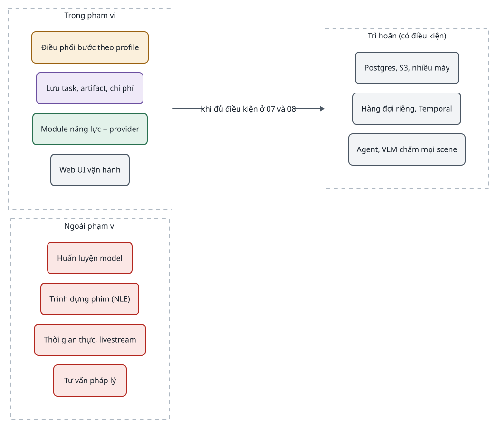

<!-- id:s1 -->
## Bộ tài liệu này

<!-- id:s1.b1 -->
Bộ tài liệu đi từ thiết kế hệ thống (hệ thống làm gì, cho ai, trong giới hạn nào) xuống thiết kế kiến trúc (hệ thống được dựng thế nào). Mỗi sự thật chỉ nằm ở một tài liệu sở hữu nó; tài liệu khác dẫn lại bằng liên kết hoặc khối `req`.

<!-- id:s1.b2 -->
```d2
# cap: Bản đồ bộ tài liệu thiết kế, từ hệ thống xuống kiến trúc và kế hoạch
direction: down
sys: "Hệ thống\n01 · Thiết kế hệ thống" {class: brain}
arch: "Kiến trúc\n02 · Kiến trúc tổng thể" {class: brain}
detail: Thiết kế chi tiết {
  class: zone
  run: "03 · Pipeline Runner" {class: gate}
  dat: "04 · Contract và dữ liệu" {class: data}
  mod: "05 · Module và provider" {class: hands}
  ui: "06 · Giao diện web" {class: plain}
  ops: "07 · Triển khai và vận hành" {class: plain}
}
plan: "08 · Lộ trình triển khai" {class: hands}
adr: "ADR · Quyết định kiến trúc" {class: gate}
sys -> arch: yêu cầu, ràng buộc
arch -> detail: thành phần, quy tắc
detail -> plan: phạm vi từng phase
adr -> arch: chốt lựa chọn
adr -> detail: chốt lựa chọn
```
<picture>
<source media="(prefers-color-scheme: dark)" srcset="01-system-design.figs/s1.b2-dark.svg">

</picture>

<!-- id:s1.b3 -->
Table: Tài liệu trong bộ và câu hỏi mỗi tài liệu trả lời
| Tài liệu | Trả lời câu hỏi | Đọc khi |
| --- | --- | --- |
| [01 · Thiết kế hệ thống](01-system-design.md) | Hệ thống làm gì, cho ai, giới hạn nào | Bắt đầu; đánh giá một yêu cầu mới |
| [02 · Kiến trúc tổng thể](02-architecture.md) | Gồm những phần nào, phụ thuộc ra sao | Thêm thành phần; review thiết kế |
| [03 · Pipeline Runner](03-runner.md) | Một task được chạy, retry, resume, dừng duyệt thế nào | Làm core; debug task |
| [04 · Contract và dữ liệu](04-data-contracts.md) | Dữ liệu nào lưu ở đâu, schema ra sao | Viết module; đổi schema |
| [05 · Module và provider](05-modules-providers.md) | Viết, cắm và kiểm thử module, provider thế nào | Thêm năng lực; đổi model |
| [06 · Giao diện web](06-web-ui.md) | Người vận hành xem và điều khiển gì | Làm UI và Task API |
| [07 · Triển khai và vận hành](07-operations.md) | Chạy, sao lưu, bảo mật, mở rộng thế nào | Cài đặt; sự cố |
| [08 · Lộ trình](08-roadmap.md) | Làm gì trước, khi nào xong một phase | Lập kế hoạch |
| [ADR](../adr/index.md) | Quyết định nào đã chốt, vì sao | Trước khi đổi một quyết định |

<!-- id:s1.b4 -->
> [!IMPORTANT]
> Quy tắc bảo trì: khi code đi lệch tài liệu, sửa tài liệu sở hữu sự thật đó trong cùng PR và tăng `ver` kèm một dòng `rev`. Quyết định khó đảo ngược phải có ADR trước khi code.

<!-- id:s2 -->
## Bối cảnh hệ thống

<!-- id:s2.b1 -->
Igniterra là hệ thống sản xuất nội dung tự động bằng AI (video ngắn, audiobook và quy trình tương tự) cho một người hoặc một nhóm nhỏ vận hành trên một máy. Hệ thống điều phối các dịch vụ AI bên ngoài; nó không tự huấn luyện model.

<!-- id:s2.b2 -->
```d2
# cap: Bối cảnh hệ thống: một người vận hành, một hệ thống, các dịch vụ bên ngoài qua adapter
direction: right
op: Người vận hành {class: hands}
cron: "cron\n(lịch sản xuất)" {class: gate}
ign: "Igniterra\n(web + worker trên một máy)" {class: brain}
cloud: Dịch vụ AI cloud {
  class: zone
  llm: "LLM\nGemini, Claude" {class: plain}
  img: "Tạo ảnh\nNano Banana" {class: plain}
  vid: "Image-to-video\nVeo, Kling" {class: plain}
  tts: "TTS\nElevenLabs, Gemini TTS" {class: plain}
}
gpu: "GPU tự host\nComfyUI (FLUX.2, Wan 2.2)" {class: hands}
pub: "Nền tảng xuất bản\nYouTube, TikTok" {class: plain}
local: "Công cụ local\nFFmpeg, faster-whisper" {class: hands}
op -> ign: brief, duyệt, sửa
cron -> ign: tạo task theo lịch
ign -> cloud: lời gọi API
ign -> gpu: HTTP API
ign -> local: subprocess
ign -> pub: upload (Phase 5)
ign -> op: video, audio, chi phí
```
<picture>
<source media="(prefers-color-scheme: dark)" srcset="01-system-design.figs/s2.b2-dark.svg">

</picture>

<!-- id:s2.b3 -->
Table: Tác nhân và hệ thống ngoài
| Tác nhân | Vai trò | Giao tiếp |
| --- | --- | --- |
| Người vận hành | Tạo task, duyệt gate, sửa output, chỉnh cấu hình | Web UI trên `localhost` hoặc sau Tailscale |
| cron | Tạo task theo lịch | Task API (cùng JSON với form) |
| Dịch vụ AI cloud | LLM, ảnh, video, TTS | Provider adapter, API key trong `.env` |
| GPU tự host | Ảnh và video bằng model mở | HTTP endpoint ComfyUI |
| Công cụ local | Dựng video, đo kỹ thuật, STT | subprocess qua command builder |
| Nền tảng xuất bản | Đăng video, hẹn giờ, gắn cờ nội dung AI | YouTube Data API, TikTok Content Posting API |

<!-- id:s3 -->
## Mục tiêu và phạm vi

<!-- id:s3.b1 -->
Table: Mục tiêu hệ thống
| ID | Mục tiêu | Đo bằng |
| --- | --- | --- |
| G-01 | Từ một brief ra sản phẩm hoàn chỉnh (MP4 9:16 có hình, giọng, phụ đề) không thao tác file thủ công | 5 video 60 giây từ 5 brief ở Phase 1 |
| G-02 | Core ổn định: thêm model, module, quy trình mà không sửa core | Các tình huống ở [Kiến trúc · Mở rộng](02-architecture.md#s7) không chạm core |
| G-03 | Chi phí minh bạch và có trần | Chi phí theo task, bước, scene, lượt thử; task dừng ở trần ngân sách |
| G-04 | Chịu lỗi rẻ: chạy lại đúng phần hỏng, không trả tiền hai lần | Resume sau khi tắt worker không có chi phí trùng |
| G-05 | Một người phát triển và vận hành được | 2 process, 1 SQLite, 1 thư mục `data/`, 1 file `config.yaml` |
| G-06 | Người dùng can thiệp được vào mọi bước | Duyệt, từ chối kèm ghi chú, sửa output, thay asset ở gate |

<!-- id:s3.b2 -->
```d2
# cap: Phạm vi: trong hệ thống, ngoài hệ thống và trì hoãn
direction: right
in: Trong phạm vi {
  class: zone
  a: "Điều phối bước theo profile" {class: gate}
  b: "Lưu task, artifact, chi phí" {class: data}
  c: "Module năng lực + provider" {class: hands}
  d: "Web UI vận hành" {class: plain}
}
later: Trì hoãn (có điều kiện) {
  class: zone
  e: "Postgres, S3, nhiều máy" {class: plain}
  f: "Hàng đợi riêng, Temporal" {class: plain}
  g: "Agent, VLM chấm mọi scene" {class: plain}
}
out: Ngoài phạm vi {
  class: zone
  h: "Huấn luyện model" {class: bad}
  i: "Trình dựng phim (NLE)" {class: bad}
  j: "Thời gian thực, livestream" {class: bad}
  k: "Tư vấn pháp lý" {class: bad}
}
in -> later: khi đủ điều kiện ở 07 và 08
```
<picture>
<source media="(prefers-color-scheme: dark)" srcset="01-system-design.figs/s3.b2-dark.svg">

</picture>

<!-- id:s4 -->
## Mô hình miền

<!-- id:s4.b1 -->
Core không biết "video" là gì: nó chỉ chạy các bước của một profile. Các khái niệm dưới đây là ngôn ngữ chung của mọi tài liệu và của code.

<!-- id:s4.b2 -->
```d2
# cap: Mô hình miền: task chạy một profile, mỗi bước sinh nhiều StepRun theo mục và lượt thử
direction: right
series: "Series\n+ Series Bible" {class: data}
task: Task {class: brain}
profile: "Profile\n(config.yaml)" {class: gate}
step: "Step\n(module hoặc gate)" {class: gate}
module: Module {class: hands}
provider: Provider {class: hands}
run: "StepRun\n(bước × mục × lượt)" {class: brain}
art: "Artifact\n(file trong data/)" {class: data}
cost: CostEvent {class: data}
contract: "Contract\n(schema có version)" {class: data}
series -> task: "0..1 series / task"
task -> profile: chạy theo
profile -> step: "danh sách có thứ tự"
step -> module: thực thi bằng
module -> provider: "gọi qua interface năng lực"
task -> run: "1..n"
run -> art: sinh ra
run -> cost: ghi
module -> contract: "nhận / trả"
```
<picture>
<source media="(prefers-color-scheme: dark)" srcset="01-system-design.figs/s4.b2-dark.svg">

</picture>

<!-- id:s4.b3 -->
Table: Thuật ngữ
| Thuật ngữ | Định nghĩa |
| --- | --- |
| Task | Một yêu cầu sản xuất (một video, một cuốn audiobook) đi qua hệ thống từ input đến output |
| Profile | Danh sách bước có thứ tự (có thể có nhóm `parallel:`), khai báo trong `config.yaml`, quyết định task chạy module nào |
| Step / StepRun | Một bước trong profile; StepRun là một lần chạy bước đó cho một mục (scene, đoạn) và một lượt thử |
| Module | Thành phần thực hiện một năng lực, giao tiếp chỉ qua contract |
| Provider | Adapter tới một dịch vụ hoặc công cụ cụ thể (Gemini, ElevenLabs, ComfyUI, FFmpeg) |
| Contract | Schema Pydantic có `schema_version` mà module nhận và trả (ScenePlan, SpeechScript, SceneVisual...) |
| Gate | Bước dừng chờ người: duyệt, từ chối kèm ghi chú, hoặc sửa output |
| Fan-out | Runner tách một bước thành một StepRun cho mỗi phần tử của một danh sách trong contract |
| Artifact | File do một StepRun sinh ra, lưu trong `data/` |
| Series Bible | Dữ liệu dùng chung cho một series: phong cách, nhân vật, giọng, từ vựng camera, từ điển phát âm |

<!-- id:s4.b4 -->
Trong bộ tài liệu, "phải" là yêu cầu bắt buộc, "nên" là khuyến nghị, "tùy chọn" là thành phần bật hoặc tắt được.

<!-- id:s5 -->
## Ca sử dụng chính

<!-- id:s5.b1 -->
```d2
# cap: Ca sử dụng của người vận hành và cron
direction: right
op: Người vận hành {class: hands}
cron: cron {class: gate}
uc: Igniterra {
  class: zone
  u1: "Tạo task từ brief" {class: plain}
  u2: "Theo dõi task và chi phí" {class: plain}
  u3: "Duyệt / từ chối gate" {class: plain}
  u4: "Sửa output, thay asset" {class: plain}
  u5: "Chạy lại bước hoặc scene" {class: plain}
  u6: "Quản lý Series Bible" {class: plain}
  u7: "Chỉnh profile và provider" {class: plain}
  u8: "Tải artifact, xuất bản" {class: plain}
}
op -> uc.u1
op -> uc.u2
op -> uc.u3
op -> uc.u4
op -> uc.u5
op -> uc.u6
op -> uc.u7
op -> uc.u8
cron -> uc.u1: Task API
```
<picture>
<source media="(prefers-color-scheme: dark)" srcset="01-system-design.figs/s5.b1-dark.svg">

</picture>

<!-- id:s5.b2 -->
Luồng giá trị chính, từ brief đến sản phẩm, với hai điểm dừng cho người:

<!-- id:s5.b3 -->
```d2
# cap: Luồng giá trị của profile video: hai gate giữ chất lượng trước bước đắt và trước khi giao
direction: right
brief: Brief {class: plain}
script: "Kịch bản\n+ shot list" {class: brain}
img: Keyframe {class: hands}
g1: "Gate keyframe\nduyệt / từ chối + ghi chú" {class: gate}
mot: "Chuyển động\n(tùy chọn)" {class: hands}
voice: Giọng đọc {class: hands}
asm: "Dựng\nFFmpeg" {class: hands}
g2: "Gate cuối\nduyệt / chạy lại scene" {class: gate}
out: "MP4 + phụ đề" {class: data}
brief -> script -> img -> g1 -> mot -> voice -> asm -> g2 -> out

```
<picture>
<source media="(prefers-color-scheme: dark)" srcset="01-system-design.figs/s5.b3-dark.svg">

</picture>

<!-- id:s6 -->
## Yêu cầu chức năng

<!-- id:s6.b1 -->
Table: Yêu cầu chức năng
| ID | Yêu cầu | Phase | Thiết kế ở |
| --- | --- | --- | --- |
| FR-01 | Tạo task từ form hoặc Task API với brief, profile, series, ngân sách và ghi đè tùy chọn | 1 | 06, 04 |
| FR-02 | Chạy các bước của profile theo thứ tự, kiểm tra hợp lệ trước khi chạy | 1 | 03 |
| FR-03 | Tách một bước theo danh sách khai báo trong contract (fan-out tổng quát) | 1 | 03, ADR-0001 |
| FR-04 | Lưu checkpoint mỗi StepRun và resume đúng chỗ sau sự cố | 1 | 03 |
| FR-05 | Retry lỗi tạm thời và retry vì chất lượng chỉ cho mục lỗi; xử lý hết lượt bằng `on_fail` | 1 | 03 |
| FR-06 | Gate dừng task chờ người; duyệt, từ chối kèm ghi chú thành feedback | 1 | 03, 06 |
| FR-07 | Ghi từng sự kiện chi phí và chặn lời gọi vượt ngân sách | 1 | 03, 04 |
| FR-08 | Xem input, output, artifact, log, lỗi của từng bước và từng lượt thử | 1 | 06 |
| FR-09 | Chạy lại một bước hoặc một scene; chỉ phần phụ thuộc chạy lại | 1 | 03, 06 |
| FR-10 | Đổi provider của một năng lực chỉ bằng config | 1 | 05 |
| FR-11 | Series Bible với mẫu nhân vật, từ vựng camera, giọng, lexicon; prompt ghép xác định | 2 | 04, 05 |
| FR-12 | Màn hình Storyboard: sửa scene, sửa lời đọc, thay asset, chạy lại có hướng dẫn | 2 | 06 |
| FR-13 | Bật / tắt bước, chọn provider trên trang Settings, kiểm tra trước khi lưu | 2 | 06 |
| FR-14 | Ghi đè provider, model, bước, ngân sách theo task | 2 | 04 |
| FR-15 | Image-to-video theo scene với job bất đồng bộ submit / poll và fallback ảnh tĩnh | 3 | 05, 03 |
| FR-16 | Định tuyến local / cloud theo `tier` của scene, có chuỗi dự phòng | 4 | 05 |
| FR-17 | Xuất bản lên YouTube, TikTok và nhập analytics | 5 | 05, 07 |
| FR-18 | Chạy quy trình khác (audiobook, podcast) bằng profile mới | 2+ | 05 |

<!-- id:s7 -->
## Yêu cầu phi chức năng

<!-- id:s7.b1 -->
Table: Yêu cầu phi chức năng
| ID | Yêu cầu | Đo bằng | Thiết kế ở |
| --- | --- | --- | --- |
| NFR-01 | Core không import module cụ thể; module không import module khác | Test kiểm tra import trong CI | 02 |
| NFR-02 | Resume không gửi lại job đã gửi, không ghi chi phí trùng | Tắt worker giữa job video rồi bật lại: ledger một dòng | 03 |
| NFR-03 | Chi phí ước tính lệch hóa đơn không quá mức chấp nhận | Đối chiếu hóa đơn hằng tháng với `cost_events` | 04, 07 |
| NFR-04 | Mọi module kiểm thử được độc lập, không tốn tiền | CLI `run-step` với provider giả | 05 |
| NFR-05 | Vận hành bởi một người trên một máy | Sao lưu bằng chép `data/`; 2 process | 07 |
| NFR-06 | Lỗi cấu hình và schema lộ ra trước khi tốn tiền | Kiểm tra lúc tạo task | 03, 04 |
| NFR-07 | API key không xuất hiện trên UI, log hay artifact | Review và test log | 07 |
| NFR-08 | Mọi lần chạy ghi lại provider và model thật | `StepRun.meta` luôn có `provider`, `model` | 04 |
| NFR-09 | Không ghi đè: mỗi lần sửa hoặc chạy lại là một lượt thử mới | Tên file `step/item_aN.ext` | 03, 04 |
| NFR-10 | Tôn trọng rate limit của provider | Giới hạn `concurrency` theo provider | 03, 05 |

<!-- id:s8 -->
## Ràng buộc và giả định

<!-- id:s8.b1 -->
Table: Ràng buộc và giả định
| ID | Ràng buộc / giả định | Hệ quả thiết kế |
| --- | --- | --- |
| CON-01 | Một người vận hành, một máy | Modular monolith, không broker, không microservice |
| CON-02 | Python 3.12, FFmpeg và API key là toàn bộ phụ thuộc nền | Stack ở [Kiến trúc · Công nghệ](02-architecture.md#s8) |
| CON-03 | Giá và sự tồn tại của provider thay đổi thường xuyên | Giá trong `pricing.yaml`; adapter theo năng lực |
| CON-04 | Chính sách nền tảng (YouTube, TikTok, ACX, EU AI Act Điều 50) | Gate cuối do người; cờ nội dung AI; hồ sơ quyền |
| CON-05 | Model tự host có giấy phép khác nhau | Chỉ dùng Wan 2.2, FLUX.2 klein 4B (Apache 2.0) cho thương mại |
| CON-06 | Giá trong tài liệu lấy từ báo cáo nghiên cứu tháng 10/2026 | Kiểm tra lại khi lập ngân sách |

<!-- id:s9 -->
## Thuộc tính chất lượng

<!-- id:s9.b1 -->
Mỗi thuộc tính chất lượng được giữ bằng một cơ chế cụ thể; không có thuộc tính nào dựa vào "cẩn thận khi code".

<!-- id:s9.b2 -->
```d2
# cap: Thuộc tính chất lượng và cơ chế giữ chúng
direction: right
q: Thuộc tính {
  class: zone
  ext: Mở rộng được {class: brain}
  rel: Chịu lỗi {class: brain}
  cost: Kiểm soát chi phí {class: brain}
  simple: Đơn giản {class: brain}
  ctl: Kiểm soát của người {class: brain}
}
m: Cơ chế {
  class: zone
  m1: "Contract + registry\n+ quy tắc phụ thuộc" {class: gate}
  m2: "StepRun là checkpoint\n+ submit / poll" {class: gate}
  m3: "Cost ledger\n+ reserve trước lời gọi đắt" {class: gate}
  m4: "2 process, SQLite,\n1 file config" {class: gate}
  m5: "Gate + lượt thử mới\nkhi sửa" {class: gate}
}
q.ext -> m.m1
q.rel -> m.m2
q.cost -> m.m3
q.simple -> m.m4
q.ctl -> m.m5
```
<picture>
<source media="(prefers-color-scheme: dark)" srcset="01-system-design.figs/s9.b2-dark.svg">

</picture>

<!-- id:s9.b3 -->
Table: Kịch bản chất lượng
| Kịch bản | Kích thích | Phản ứng mong đợi | Đo |
| --- | --- | --- | --- |
| Đổi TTS | Sửa `tts: {use: gemini_tts}` | Task mới dùng provider mới, không sửa code core hay module | Diff chỉ ở config và adapter |
| Worker chết | Khởi động lại khi job Veo đang chạy | Runner bỏ qua mục `done`, poll job cũ | Một dòng chi phí cho scene đó |
| Scene hỏng | Check trả `QualityFail` | Chỉ scene đó chạy lại, có feedback | Scene khác giữ nguyên lượt thử |
| Vượt ngân sách | Đã tiêu + ước tính > `budget_usd` | Task `waiting` lý do "budget" | Không có lời gọi đắt sau mốc |
| Quy trình mới | Thêm profile audiobook | Chỉ thêm module `chapterize`, `master` | Core không đổi |

<!-- id:s10 -->
## Hạn chế và quyết định mở

<!-- id:s10.b1 -->
Các hạn chế phần lớn là đánh đổi có chủ đích. Chi tiết hạn chế kỹ thuật, chất lượng và pháp lý nằm ở [Vận hành · Rủi ro](07-operations.md#s7). Ba quyết định dưới đây phải chốt trước Phase 1 vì chúng định hình dữ liệu và config lưu lâu dài.

<!-- id:s10.b2 -->
Table: Quyết định cần chốt trước Phase 1
| ADR | Quyết định | Vì sao phải chốt sớm |
| --- | --- | --- |
| [ADR-0001](../adr/0001-generic-fan-out.md) | Fan-out tổng quát theo danh sách khai báo trong contract | Viết cứng "theo scene" khiến audiobook phải sửa runner |
| [ADR-0002](../adr/0002-speechscript-contract.md) | `voice` nhận contract `SpeechScript` trung lập | Đọc thẳng ScenePlan khóa `voice` vào video |
| [ADR-0003](../adr/0003-parallel-step-groups.md) | Cú pháp nhóm `parallel:` trong profile từ Phase 1 | Đổi định dạng profile sau này chạm runner, Settings và mọi profile |
