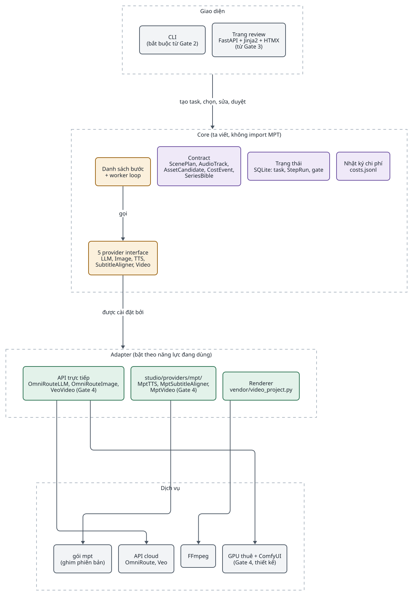
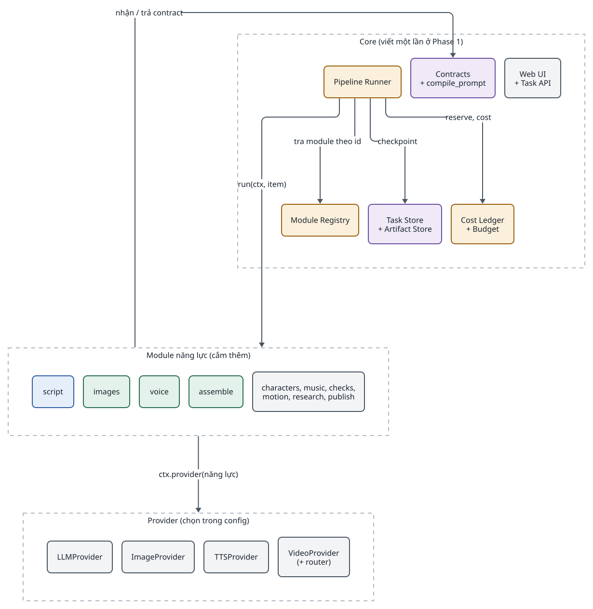
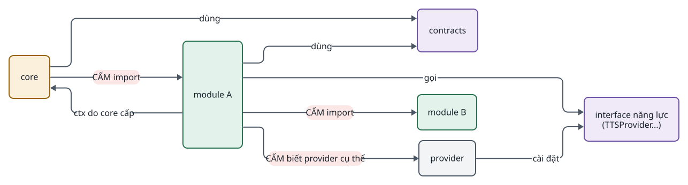
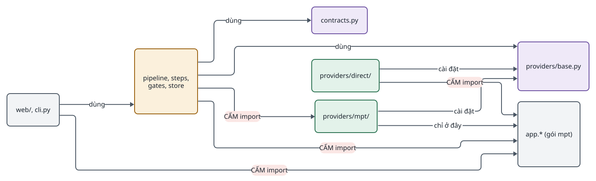
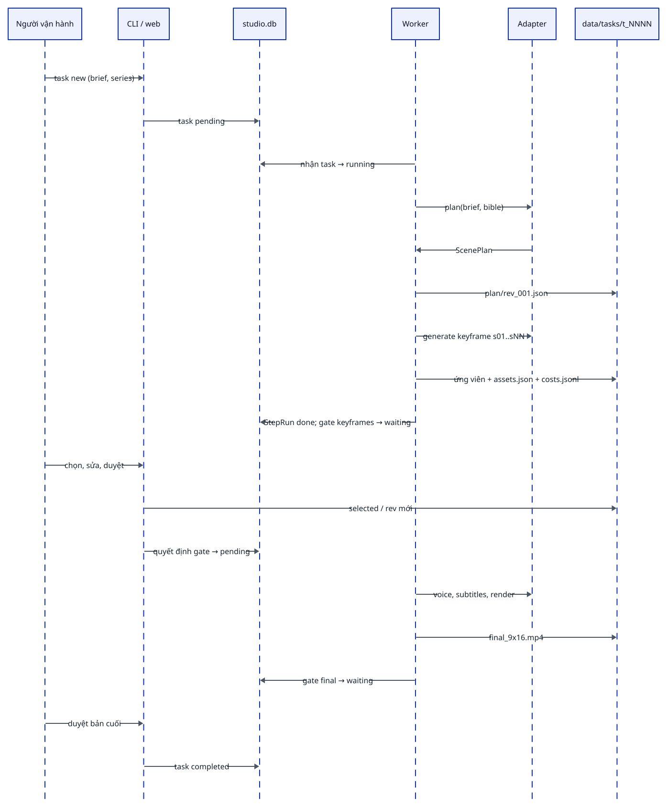
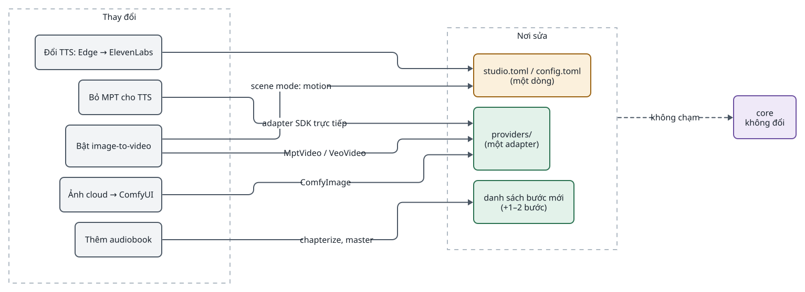
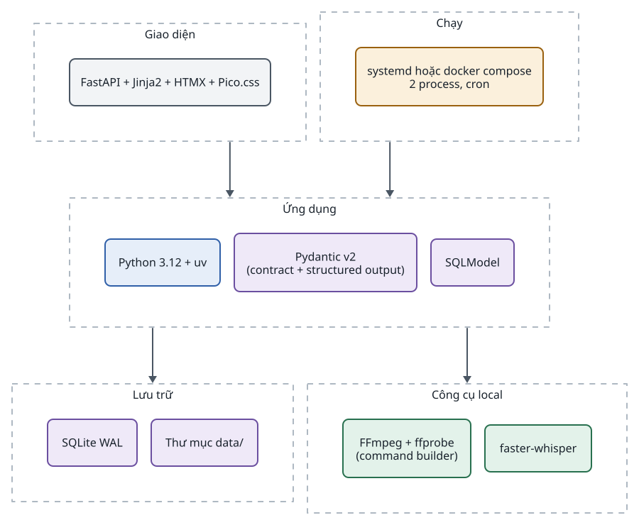
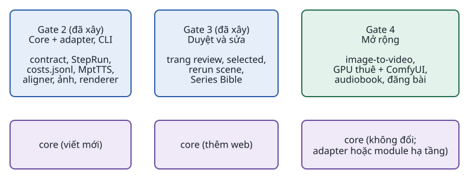

<!-- id:s1 -->
## Nguyên tắc kiến trúc

<!-- id:s1.b1 -->
```cards
- h: Core tối thiểu
  chip: core
  p: "Core chỉ giữ cái cần để không phụ thuộc MPT và để người dùng kiểm soát từng scene. Thứ tổng quát chưa có nhu cầu bị bỏ hoặc hoãn."
  ul: [Contract Pydantic, 5 provider interface, Danh sách bước Python, StepRun trong SQLite, selected và revision, Gate, costs.jsonl]
- h: MPT chỉ sau adapter
  chip: boundary
  p: "Chỉ studio/providers/mpt/ được import app.*. Bỏ MPT cho một năng lực = viết adapter khác cùng interface."
- h: Không ghi đè
  chip: data
  p: "Mỗi lần sinh là một ứng viên, mỗi lần sửa là một revision. Luôn quay lại được bản cũ."
- h: Danh sách bước cố định
  chip: runner
  p: "Worker là một vòng lặp đơn giản qua danh sách bước Python. Retry, resume, gate là nhánh của vòng lặp, không cần workflow engine."
- h: Không agent mặc định
  chip: llm
  p: "Kịch bản, chấm điểm, sửa prompt là lời gọi LLM có schema (AD-13)."
- h: Kiểm chứng trước khi xây
  chip: scope
  p: "Chưa viết code trước Gate 2; mỗi năng lực mới ở Gate 4 là một adapter, không đổi core (AD-12)."
```

<!-- id:s1.b2 -->
```req
NFR-01
NFR-06
CON-01
CON-03
```

<!-- id:s2 -->
## Bốn tầng

<!-- id:s2.b1 -->
Mũi tên chỉ đi một chiều từ trên xuống: giao diện gọi core, core gọi interface, adapter cài interface, MPT và API chỉ nằm dưới adapter.

<!-- id:s2.b2 -->
<!-- report-kit:d2
```d2
# cap: Bốn tầng, phụ thuộc một chiều; MPT chỉ xuất hiện ở tầng dịch vụ, sau adapter
direction: down
ui: Giao diện {
  class: zone
  cli: "CLI\n(bắt buộc từ Gate 2)" {class: plain}
  web: "Trang review\nFastAPI + Jinja2 + HTMX\n(từ Gate 3)" {class: plain}
}
core: Core (ta viết, không import MPT) {
  class: zone
  stp: "Danh sách bước\n+ worker loop" {class: gate}
  con: "Contract\nScenePlan, AudioTrack,\nAssetCandidate, CostEvent,\nSeriesBible" {class: data}
  state: "Trạng thái\nSQLite: task, StepRun, gate" {class: data}
  ledger: "Nhật ký chi phí\ncosts.jsonl" {class: data}
  iface: "5 provider interface\nLLM, Image, TTS,\nSubtitleAligner, Video" {class: gate}
}
adp: Adapter (bật theo năng lực đang dùng) {
  class: zone
  direct: "API trực tiếp\nOmniRouteLLM, OmniRouteImage,\nVeoVideo (Gate 4)" {class: hands}
  mpta: "studio/providers/mpt/\nMptTTS, MptSubtitleAligner,\nMptVideo (Gate 4)" {class: hands}
  rend: "Renderer\nvendor/video_project.py" {class: hands}
}
svc: Dịch vụ {
  class: zone
  mpt: "gói mpt\n(ghim phiên bản)" {class: plain}
  api: "API cloud\nOmniRoute, Veo" {class: plain}
  ff: FFmpeg {class: plain}
  gpu: "ComfyUI\n(chỉ khi mở rộng)" {class: plain}
}
ui -> core: "tạo task, chọn, sửa, duyệt"
core.stp -> core.iface: gọi
core.iface -> adp: "được cài đặt bởi"
adp.direct -> svc.api
adp.direct -> svc.gpu
adp.mpta -> svc.mpt
adp.rend -> svc.ff
```
-->
<picture>
<source media="(prefers-color-scheme: dark)" srcset="02-architecture.figs/s2.b2-dark.svg">

</picture>

<!-- id:s2.b3 -->
Table: Tầng và thành phần
| Tầng | Thành phần | Bắt buộc / tùy chọn |
| --- | --- | --- |
| Giao diện | CLI; trang review (FastAPI + Jinja2 + HTMX) | CLI bắt buộc từ Gate 2; trang review từ Gate 3 |
| Core | Danh sách bước, contract, trạng thái SQLite, gate, nhật ký chi phí, 5 provider interface | Bắt buộc |
| Adapter | API trực tiếp (LLM, ảnh có tham chiếu nhân vật); MPT (TTS, phụ đề, video); renderer `video_project` | Mỗi adapter bật theo năng lực đang dùng |
| Dịch vụ | Gói `mpt` ghim phiên bản; API cloud; FFmpeg; GPU tự host qua ComfyUI | GPU tự host chỉ khi mở rộng |

<!-- id:s3 -->
## Góc nhìn process và lưu trữ

<!-- id:s3.b1 -->
Toàn bộ chạy trên một máy với 2 process. Web và worker không gọi nhau trực tiếp: chúng chỉ gặp nhau qua SQLite và thư mục `data/`.

<!-- id:s3.b2 -->
<!-- report-kit:d2
```d2
# cap: Góc nhìn container: web và worker chỉ chia sẻ studio.db và data/
direction: right
op: Người vận hành {class: hands}
host: Một máy {
  class: zone
  web: "web process\nFastAPI + Jinja2 + HTMX" {class: brain}
  cli: "CLI\npython -m studio ..." {class: plain}
  worker: "worker process\nworker loop + adapter" {class: brain}
  db: "data/studio.db\nSQLite WAL" {shape: cylinder; class: data}
  files: "data/tasks/, data/series/\nplan, assets.json, costs.jsonl,\nkeyframes, voice, project" {shape: cylinder; class: data}
  cfg: "studio.toml\n+ MPT_HOME/config.toml\n(API key)" {shape: page; class: gate}
}
ext: Bên ngoài {
  class: zone
  cloud: "API AI cloud" {class: plain}
  gpu: "ComfyUI\n(Gate 4)" {class: hands}
}
op -> host.web: HTTP
op -> host.cli: shell
host.web -> host.db: "tạo task, quyết định gate, đọc trạng thái"
host.cli -> host.db: "tạo task, quyết định gate"
host.web -> host.files: "đọc, ghi selected và revision"
host.worker -> host.db: "nhận task, ghi StepRun"
host.worker -> host.files: "ghi ứng viên, chi phí, MP4"
host.worker -> host.cfg: đọc
host.worker -> ext.cloud: HTTPS
host.worker -> ext.gpu: HTTP
```
-->
<picture>
<source media="(prefers-color-scheme: dark)" srcset="02-architecture.figs/s3.b2-dark.svg">

</picture>

<!-- id:s3.b3 -->
Table: Thành phần chạy và trách nhiệm
| Thành phần | Trách nhiệm | Không làm |
| --- | --- | --- |
| web | Hiển thị task, storyboard, chi phí; ghi quyết định gate, selected, ScenePlan revision mới, phiếu duyệt | Không gọi provider, không chạy bước; không ghi vào task đang `running` |
| CLI | Tạo task, chạy worker, duyệt gate, chạy một bước khi debug | Không có logic riêng: gọi cùng hàm core như web |
| worker | Nhận task `pending`, chạy danh sách bước, checkpoint, retry, dừng ở gate | Không render HTML |
| `studio.db` | Task, StepRun, quyết định gate | Không chứa file nhị phân |
| `data/` | ScenePlan revision, `assets.json`, `costs.jsonl`, ứng viên, dự án render, MP4 | Không ghi đè file đã có |
| Cấu hình | `studio.toml` (adapter mặc định, giới hạn song song); `config.toml` của MPT (API key, provider MPT) | Không có khóa trong `studio.toml` |

<!-- id:s4 -->
## Góc nhìn thành phần

<!-- id:s4.b1 -->
Core là phần ta viết ở Gate 2; adapter là phần cắm thêm theo năng lực. Chi tiết từng phần: worker ở [03](03-runner.md), contract và lưu trữ ở [04](04-data-contracts.md), interface và adapter ở [05](05-modules-providers.md), giao diện ở [06](06-web-ui.md).

<!-- id:s4.b2 -->
<!-- report-kit:d2
```d2
# cap: Thành phần của core và cách chúng dùng nhau; adapter chỉ thấy interface và contract
direction: down
core: studio (core) {
  class: zone
  pipeline: "pipeline.py\ndanh sách bước + worker loop" {class: gate}
  stp: "steps/\nplan, keyframes, voice,\nsubtitles, motion,\nanimate, render" {class: hands}
  gates: "gates.py\nkeyframes, final" {class: gate}
  store: "store.py\nSQLite: task, StepRun" {class: data}
  files: "taskdir.py\nplan rev, assets.json" {class: data}
  costs: "costs.py\nghi pending / kết quả" {class: data}
  contracts: "contracts.py\nPydantic" {class: data}
  prompt: "prompt.py\nghép prompt xác định" {class: gate}
  ifaces: "providers/base.py\n5 Protocol + lỗi chung" {class: gate}
  reg: "providers/__init__.py\ntên adapter → lớp" {class: gate}
}
adapters: Adapter {
  class: zone
  a1: "providers/direct/" {class: hands}
  a2: "providers/mpt/" {class: hands}
  a3: "providers/fake/" {class: plain}
  a4: "render/ + vendor/" {class: hands}
}
core.pipeline -> core.stp: "gọi từng bước"
core.pipeline -> core.gates: "dừng"
core.pipeline -> core.store: checkpoint
core.stp -> core.files: "ghi ứng viên"
core.stp -> core.prompt
core.stp -> core.reg: "lấy adapter theo cấu hình"
core.reg -> core.ifaces
core.stp -> core.costs
core.stp -> core.contracts
core.ifaces -> adapters: "được cài đặt bởi"
```
-->
<picture>
<source media="(prefers-color-scheme: dark)" srcset="02-architecture.figs/s4.b2-dark.svg">

</picture>

<!-- id:s4.b3 -->
Table: Phần core và giới hạn trách nhiệm (tên module là đề xuất)
| Phần | Làm gì | Không làm gì |
| --- | --- | --- |
| `pipeline.py` | Danh sách bước, vòng lặp worker, retry, resume, song song theo scene | Không biết provider nào, không gọi API |
| `steps/` | Một hàm mỗi bước: đọc ScenePlan và selected, gọi interface, ghi ứng viên | Không import adapter cụ thể |
| `gates.py` | Đặt task `waiting`, ghi quyết định, áp hành động sửa | Không render giao diện |
| `store.py` | SQLite: task, StepRun, gate; nhận task bằng cập nhật có điều kiện | Không chứa file |
| `taskdir.py` | Thư mục task: ScenePlan revision, `assets.json`, đường dẫn ứng viên | Không ghi đè |
| `costs.py` | Ghi `pending` trước lượt gọi trả phí, kết quả sau; phát hiện `pending` mồ côi | Không tra giá, không chặn ngân sách |
| `contracts.py` | Schema Pydantic có `schema_version` | Không có hành vi |
| `prompt.py` | Ghép prompt keyframe xác định từ Series Bible và scene | Không gọi LLM |
| `providers/` | 5 Protocol, lỗi chung, bảng tên adapter → lớp | Không chứa logic nghiệp vụ |

<!-- id:s5 -->
## Quy tắc phụ thuộc

<!-- id:s5.b1 -->
Phụ thuộc chỉ có một chiều. Core không import adapter cụ thể; chỉ `studio/providers/mpt/` được import package `app` của MPT. Một test quét import kiểm tra quy tắc này trong CI (NFR-01).

<!-- id:s5.b2 -->
<!-- report-kit:d2
```d2
# cap: Import được phép (liền) và bị cấm (đỏ)
direction: right
ui: "web/, cli.py" {class: plain}
core: "pipeline, steps,\ngates, store" {class: gate}
contracts: "contracts.py" {class: data}
iface: "providers/base.py" {class: data}
direct: "providers/direct/" {class: hands}
mpta: "providers/mpt/" {class: hands}
app: "app.* (gói mpt)" {class: plain}
ui -> core: dùng
core -> contracts: dùng
core -> iface: dùng
direct -> iface: "cài đặt"
mpta -> iface: "cài đặt"
mpta -> app: "chỉ ở đây"
core -> mpta: "CẤM import" {class: bad}
core -> app: "CẤM import" {class: bad}
direct -> app: "CẤM import" {class: bad}
ui -> app: "CẤM import" {class: bad}
```
-->
<picture>
<source media="(prefers-color-scheme: dark)" srcset="02-architecture.figs/s5.b2-dark.svg">

</picture>

<!-- id:s5.b3 -->
- Bước chỉ gọi adapter qua interface lấy từ bảng tên (`providers.get("tts")`), không import lớp adapter.
- Bước đọc đầu ra trước đó qua thư mục task (ScenePlan revision hiện hành, `selected`), không qua biến trong bộ nhớ, nên resume chỉ cần đọc lại file.
- Web và worker không cùng ghi một task: hành động của người bị từ chối khi task đang `running`; mọi lần ghi `assets.json` đi qua một hàm có khóa file ([04 · Ai ghi gì](04-data-contracts.md#s1)).
- Route `/files/*` chỉ phục vụ file nằm trong `data/` sau khi chuẩn hóa bằng `realpath` và so `commonpath`, không so tiền tố chuỗi (cách MPT làm trong `file_security.py`).
- Package của ta tên `studio`, không bao giờ `app` (gói `mpt` cài vào tên `app`).
- API key và cấu hình provider MPT nằm trong `config.toml` của MPT (`MPT_HOME`); adapter chỉ truyền tham số như giọng, tốc độ, văn bản.

<!-- id:s5.b4 -->
Bố cục package đề xuất (chốt khi khởi tạo repo ở Gate 2):

<!-- id:s5.b5 -->
```text
igniterra/
├── studio/
│   ├── pipeline.py        # danh sách bước, worker loop, retry, resume
│   ├── steps/             # plan.py, keyframes.py, voice.py, subtitles.py, motion.py, animate.py, render.py
│   ├── gates.py           # gate keyframes, final; hành động sửa
│   ├── contracts.py       # ScenePlan, AudioTrack, AssetCandidate, CostEvent, SeriesBible
│   ├── store.py           # SQLite: tasks, step_runs, gate_decisions
│   ├── taskdir.py         # plan/rev_NNN.json, assets.json, đường dẫn ứng viên
│   ├── costs.py           # costs.jsonl: pending trước, kết quả sau
│   ├── prompt.py          # ghép prompt keyframe xác định
│   ├── providers/
│   │   ├── base.py        # 5 Protocol + Retryable, QualityFail, Unconfirmed, Fatal
│   │   ├── direct/        # omniroute.py (LLM + ảnh), veo.py (Gate 4)
│   │   ├── mpt/           # tts.py, subtitle.py, video.py — chỉ nơi này import app.*
│   │   └── fake/          # FakeLLM, FakeImage, FakeTTS, FakeAligner, FakeVideo
│   ├── render/            # adapter renderer gọi vendor/video_project.py
│   ├── vendor/            # video_project.py (copy MPT 82bb4a7 = mpt 1.3.9) + LICENSE-MPT
│   ├── web/               # FastAPI routes, Jinja2 templates (Gate 3)
│   └── cli.py             # python -m studio task new | worker | gate | run-step
├── studio.toml
├── data/                  # không commit; sao lưu riêng
└── tests/                 # test core với fake, test từng adapter, test quét import
```

<!-- id:s6 -->
## Luồng một task qua các thành phần

<!-- id:s6.b1 -->
<!-- report-kit:d2
```d2
# cap: Một task từ lúc tạo đến khi xong, qua CLI hoặc web, SQLite, worker, adapter và data/
shape: sequence_diagram
op: Người vận hành
ui: "CLI / web"
db: "studio.db"
wk: Worker
ad: Adapter
fs: "data/tasks/t_NNNN"
op -> ui: "task new (brief, series)"
ui -> db: "task pending"
wk -> db: "nhận task → running"
wk -> ad: "plan(brief, bible)"
ad -> wk: "ScenePlan"
wk -> fs: "plan/rev_001.json"
wk -> ad: "generate keyframe s01..sNN"
wk -> fs: "ứng viên + assets.json + costs.jsonl"
wk -> db: "StepRun done; gate keyframes → waiting"
op -> ui: "chọn, sửa, duyệt"
ui -> fs: "selected / rev mới"
ui -> db: "quyết định gate → pending"
wk -> ad: "voice, subtitles, render"
wk -> fs: "final_9x16.mp4"
wk -> db: "gate final → waiting"
op -> ui: "duyệt bản cuối"
ui -> db: "task completed"
```
-->
<picture>
<source media="(prefers-color-scheme: dark)" srcset="02-architecture.figs/s6.b1-dark.svg">

</picture>

<!-- id:s7 -->
## Mở rộng không chạm core

<!-- id:s7.b1 -->
Core không biết "video" là gì: một quy trình mới là một danh sách bước mới, dùng lại adapter sẵn có. Các thay đổi phổ biến nhất nằm ở cấu hình hoặc một adapter.

<!-- id:s7.b2 -->
<!-- report-kit:d2
```d2
# cap: Thay đổi phổ biến rơi vào cấu hình, adapter hoặc danh sách bước; core không đổi
direction: right
ch: Thay đổi {
  class: zone
  c1: "Đổi TTS: Edge → ElevenLabs" {class: plain}
  c2: "Bỏ MPT cho TTS" {class: plain}
  c3: "Bật image-to-video" {class: plain}
  c4: "Ảnh cloud → ComfyUI" {class: plain}
  c5: "Thêm audiobook" {class: plain}
}
where: Nơi sửa {
  class: zone
  cfg: "studio.toml / config.toml\n(một dòng)" {class: gate}
  adp: "providers/\n(một adapter)" {class: hands}
  lst: "danh sách bước mới\n(+1–2 bước)" {class: hands}
}
core: "core\nkhông đổi" {class: data}
ch.c1 -> where.cfg
ch.c2 -> where.adp: "adapter SDK trực tiếp"
ch.c3 -> where.adp: "MptVideo / VeoVideo"
ch.c3 -> where.cfg: "scene mode: motion"
ch.c4 -> where.adp: "ComfyImage"
ch.c5 -> where.lst: "chapterize, master"
where -> core: "không chạm" {style.stroke-dash: 3}
```
-->
<picture>
<source media="(prefers-color-scheme: dark)" srcset="02-architecture.figs/s7.b2-dark.svg">

</picture>

<!-- id:s7.b3 -->
Table: Kiểm chứng tính ổn định của core
| Tình huống | Thay đổi | Core | Test |
| --- | --- | --- | --- |
| Đổi giọng Edge TTS sang ElevenLabs | Cấu hình giọng trong Series Bible và `config.toml` của MPT | Không đổi | T07 |
| Bỏ MPT cho TTS | Viết `providers/direct/elevenlabs.py` cùng `TTSProvider`, đổi một dòng `studio.toml` | Không đổi | Test adapter |
| Bật image-to-video | Adapter `MptVideo` hoặc `VeoVideo`; scene `mode: motion` | Bước `motion` đã có, tự bỏ qua scene ảnh tĩnh | T06 |
| Ảnh cloud → GPU tự host | Adapter `ComfyImage` (FLUX.2 klein 4B) | Không đổi | Test adapter |
| Thêm audiobook | Danh sách bước mới với `chapterize`, `master` | Không đổi | Gate 4 |

<!-- id:s8 -->
## Công nghệ

<!-- id:s8.b1 -->
Mỗi thành phần có một lựa chọn ưu tiên và tối đa hai phương án thay thế. Toàn bộ hệ thống chỉ cần Python, FFmpeg, gói `mpt` và các API key. Model và adapter mặc định cho từng năng lực ở [05 · Model mặc định](05-modules-providers.md#s6).

<!-- id:s8.b2 -->
<!-- report-kit:d2
```d2
# cap: Ngăn xếp công nghệ theo tầng
direction: down
ui: Giao diện {
  class: zone
  a: "FastAPI + Jinja2 + HTMX\n(không bước build frontend)" {class: plain}
}
app: Ứng dụng {
  class: zone
  b: "Python 3.11+ + uv" {class: brain}
  c: "Pydantic v2\n(contract + structured output)" {class: data}
}
store: Lưu trữ {
  class: zone
  e: "SQLite WAL" {class: data}
  f: "Thư mục data/ + JSON" {class: data}
}
prov: Provider {
  class: zone
  g: "gói mpt ghim phiên bản\n(TTS, phụ đề, video)" {class: hands}
  h: "API trực tiếp\n(OmniRoute, Veo)" {class: hands}
}
tools: Công cụ local {
  class: zone
  i: "FFmpeg\n+ vendor/video_project.py" {class: hands}
  j: "faster-whisper\n(qua MPT)" {class: hands}
}
ui -> app -> store
app -> prov
app -> tools
```
-->
<picture>
<source media="(prefers-color-scheme: dark)" srcset="02-architecture.figs/s8.b2-dark.svg">

</picture>

<!-- id:s8.b3 -->
Table: Nền tảng
| Thành phần | Chọn | Thay thế | Khi nào đổi |
| --- | --- | --- | --- |
| Ngôn ngữ | Python 3.11+ với `uv`; một `uv.lock` chung với gói `mpt` | — | Cùng yêu cầu Python của MPT (`>=3.11`; pilot chạy 3.13). Các thư viện `mpt` ghim cứng (FastAPI, Starlette, uvicorn, openai) là bản studio dùng |
| Giao diện | FastAPI + Jinja2 + HTMX | NiceGUI | Khi muốn viết UI hoàn toàn bằng Python |
| Contract | Pydantic v2 | — | Dùng luôn làm schema structured output của LLM |
| Trạng thái | SQLite (WAL) + file JSON | Postgres | Khi có worker trên nhiều máy; phải sửa phần nhận task, không chỉ đổi URL (AD-11) |
| Artifact | Thư mục `data/` | S3 / R2 | Khi nhiều máy cần chung file |
| Dựng video | `vendor/video_project.py` + FFmpeg | MoviePy; Remotion | Remotion khi cần template đồ họa động (có phí với công ty từ 4 người) |
| Provider TTS, phụ đề, video | Gói `mpt` ghim phiên bản | Gọi SDK trực tiếp | Khi một provider cần tính năng MPT chưa có |
| GPU tự host | ComfyUI chế độ API | Script `diffusers` | Chỉ từ Gate 4 |
| Agent framework | Không dùng | Claude Agent SDK; LangGraph | Khi một bước cần nhiều lượt dùng tool |
| Triển khai | 2 process trên một máy (systemd hoặc docker compose) | VPS | Khi cần chạy 24/7 |

<!-- id:s9 -->
## Quyết định kiến trúc

<!-- id:s9.b1 -->
Các quyết định AD-01 đến AD-13 của ADD-AIVIDEO-003 được xem là chốt khi tài liệu được duyệt. Ba nhóm khó đảo ngược nhất có ADR riêng chờ duyệt trước Gate 2.

<!-- id:s9.b2 -->
Table: Quyết định kiến trúc AD-01..AD-13
| Mã | Quyết định | Lý do | Phương án đã loại | ADR |
| --- | --- | --- | --- | --- |
| AD-01 | Modular monolith Python trên một máy | Một người vận hành; không cần phân tán | Microservices, Kubernetes | [ADR-0004](../adr/0004-minimal-core-mpt-adapters.md) |
| AD-02 | Core tối thiểu + adapter | Giữ quyền kiểm soát contract và trạng thái, không tự viết provider | Tự xây toàn bộ (v1.1); dùng nguyên MPT | [ADR-0004](../adr/0004-minimal-core-mpt-adapters.md) |
| AD-03 | MPT là thư viện provider, ghim phiên bản | 14 TTS, căn phụ đề, provider video được bảo trì liên tục | Fork MPT; copy toàn bộ mã | [ADR-0004](../adr/0004-minimal-core-mpt-adapters.md) |
| AD-04 | Copy duy nhất `video_project.py` | Tự chứa, làm đúng revision và dựng lại theo scene; đã kiểm thử | Tự viết renderer; dùng `video.py` của MPT | [ADR-0004](../adr/0004-minimal-core-mpt-adapters.md) |
| AD-05 | Danh sách bước cố định bằng Python | Bản rà soát F01: chưa cần runner tổng quát | Profile YAML, registry động, cú pháp parallel | [ADR-0001](../adr/0001-generic-fan-out.md), [ADR-0003](../adr/0003-parallel-step-groups.md) (bị loại) |
| AD-06 | ScenePlan là contract kịch bản duy nhất | Bản rà soát F02; lời đọc lấy từ `narration` | Hai contract ScenePlan + SpeechScript | [ADR-0005](../adr/0005-sceneplan-revisions-selected.md) |
| AD-07 | Render dùng ứng viên selected | Bản rà soát F04 | "Lấy bản mới nhất" | [ADR-0005](../adr/0005-sceneplan-revisions-selected.md) |
| AD-08 | Sửa scene tạo revision mới | Bản rà soát F05 | Ghi đè output | [ADR-0005](../adr/0005-sceneplan-revisions-selected.md) |
| AD-09 | Ghi pending trước lượt gọi trả phí; kết quả không rõ thì hỏi người | Bản rà soát F03 | Hứa "không bao giờ trả tiền hai lần" | [ADR-0006](../adr/0006-paid-call-ledger.md) |
| AD-10 | Ghi nhật ký chi phí, không đặt ngân sách trước | Bản rà soát F10: giá đổi, ước tính lệch hóa đơn | `pricing.yaml` + reservation | [ADR-0006](../adr/0006-paid-call-ledger.md) |
| AD-11 | SQLite + file; không hứa chuyển Postgres bằng đổi URL | Bản rà soát F08 | Postgres + S3 từ đầu | — |
| AD-12 | Lộ trình theo decision gate, có lối ra "dừng xây" | Bản rà soát mục 7 | 5 phase cố định | [08 · Lộ trình](08-roadmap.md) |
| AD-13 | Không dùng AI agent mặc định | Kịch bản, chấm điểm, sửa prompt đều là lời gọi LLM có schema | Multi-agent, LangGraph | — |

<!-- id:s10 -->
## Truy vết yêu cầu

<!-- id:s10.b1 -->
Table: Yêu cầu → thành phần → tài liệu thiết kế
| Yêu cầu | Thành phần chính | Tài liệu |
| --- | --- | --- |
| FR-01 tạo task | CLI, web, `store.py` | [06](06-web-ui.md), [04](04-data-contracts.md) |
| FR-02 ScenePlan | `steps/plan.py`, `LLMProvider`, `contracts.py` | [04](04-data-contracts.md), [05](05-modules-providers.md) |
| FR-03 danh sách bước, resume | `pipeline.py`, StepRun | [03](03-runner.md) |
| FR-04, FR-11, FR-12 ứng viên, revision, upload | `taskdir.py`, `gates.py` | [04](04-data-contracts.md), [06](06-web-ui.md) |
| FR-05, FR-06 giọng, phụ đề, render | `MptTTS`, `MptSubtitleAligner`, renderer | [05](05-modules-providers.md), [03](03-runner.md) |
| FR-07, FR-08 chi phí, unknown | `costs.py`, `gates.py` | [03](03-runner.md), [04](04-data-contracts.md) |
| FR-09 retry | `pipeline.py`, lỗi chung | [03](03-runner.md) |
| FR-13 Series Bible | `contracts.py`, `prompt.py` | [04](04-data-contracts.md) |
| FR-15 image-to-video | `VideoProvider` submit / poll | [03](03-runner.md), [05](05-modules-providers.md) |
| NFR-01 ranh giới import | Toàn bộ | Mục Quy tắc phụ thuộc ở trên |
| NFR-02 không tự gửi lại | `costs.py`, `VideoProvider` | [03](03-runner.md) |

<!-- id:s11 -->
## Tiến hóa kiến trúc

<!-- id:s11.b1 -->
Kiến trúc lớn lên theo decision gate, không theo phase cố định. Mỗi gate chỉ thêm phần đã được số liệu của gate trước biện minh; mỗi năng lực mới ở Gate 4 là một adapter. Kế hoạch chi tiết ở [08 · Lộ trình](08-roadmap.md).

<!-- id:s11.b2 -->
<!-- report-kit:d2
```d2
# cap: Thành phần xuất hiện theo gate; core chỉ được viết ở Gate 2 và không đổi ở Gate 4
grid-rows: 2
grid-columns: 5
g0: "Gate 0\nMục tiêu\n\nchưa có code\n5 brief + checklist" {class: plain}
g1: "Gate 1\nPilot MPT\n\nđã đóng: bỏ baseline,\nD-01 = build" {class: plain}
g2: "Gate 2\nCore + adapter, CLI\n\ncontract, StepRun,\ncosts.jsonl, MptTTS,\naligner, ảnh, renderer" {class: brain}
g3: "Gate 3\nDuyệt và sửa\n\ntrang review, selected,\nrerun scene,\nSeries Bible" {class: brain}
g4: "Gate 4\nMở rộng\n\nimage-to-video,\nComfyUI, audiobook,\nđăng bài" {class: hands}
c0: "—" {class: plain}
c1: "—" {class: plain}
c2: "core (viết mới)" {class: data}
c3: "core (thêm web)" {class: data}
c4: "core (không đổi;\nmỗi năng lực một adapter)" {class: data}
```
-->
<picture>
<source media="(prefers-color-scheme: dark)" srcset="02-architecture.figs/s11.b2-dark.svg">

</picture>

<!-- id:s11.b3 -->
Table: Thành phần bị bỏ hoặc hoãn so với v1.1 và điều kiện thêm lại
| Thành phần | Thêm lại khi |
| --- | --- |
| Registry module động; profile YAML | Có từ 2 loại video với danh sách bước khác nhau |
| Fan-out tổng quát; cú pháp parallel | Đo được thời gian chờ là nút thắt |
| Router local/cloud; fallback tự động giữa provider | Có số liệu A/B chi phí–chất lượng trên asset được duyệt |
| Reservation ngân sách; `pricing.yaml` | Chạy song song nhiều scene với API đắt |
| Module audiobook, publish, research | Có workload thật |
| VLM chấm mọi scene | Người duyệt thành nút thắt |
| Đa người dùng, phân quyền | Có người dùng thứ hai |
| Postgres, S3 / R2 | Có worker trên hơn một máy |
