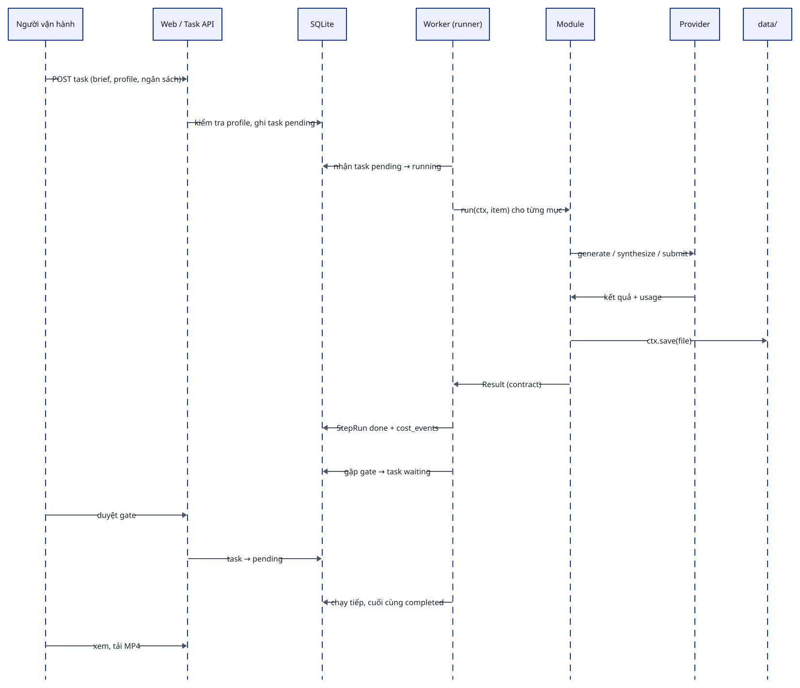
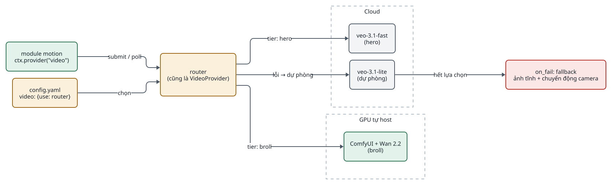
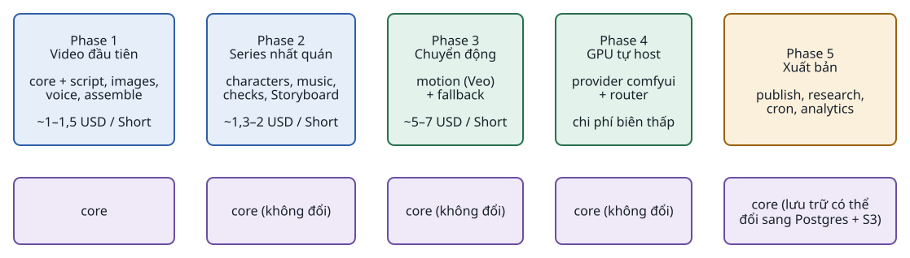

<!-- id:s1 -->
## Nguyên tắc kiến trúc

<!-- id:s1.b1 -->
```cards
- h: "Core nhỏ, không đổi"
  chip: core
  p: "Core chỉ làm 5 việc. Mọi mở rộng là thêm module, provider hoặc một dòng config."
  ul: [Lưu task, Lưu artifact, Chạy bước theo profile (checkpoint, retry, gate), Ghi chi phí, Hiển thị]
- h: Hybrid ở tầng provider
  chip: provider
  p: Local hay cloud chỉ là lựa chọn trong config; bộ định tuyến cũng là một provider.
- h: Không agent mặc định
  chip: llm
  p: "Kịch bản, kiểm tra, sửa prompt là lời gọi LLM có schema. Agent, nếu cần, nằm bên trong một module hoặc provider."
- h: SQLite là hàng đợi
  chip: data
  p: Worker đọc task trực tiếp từ SQLite. Đổi sang Postgres bằng DATABASE_URL khi có worker ở nhiều máy.
- h: Series Bible dùng chung
  chip: data
  p: Mẫu nhân vật và từ vựng camera tạo một lần; prompt ghép theo công thức nên nhân vật không trôi.
- h: Trì hoãn có điều kiện
  chip: scope
  p: "Postgres, S3, hàng đợi riêng, agent, VLM chấm mọi scene chỉ thêm khi điều kiện ở mục cuối xảy ra."
```

<!-- id:s1.b2 -->
```req
NFR-01
NFR-05
CON-01
```

<!-- id:s2 -->
## Góc nhìn process và lưu trữ

<!-- id:s2.b1 -->
Hệ thống chỉ có 2 process. Web và worker không gọi nhau trực tiếp: chúng chỉ chia sẻ SQLite và thư mục `data/`. Mọi lời gọi model đi qua provider.

<!-- id:s2.b2 -->
```d2
# cap: Góc nhìn container: 2 process chia sẻ trạng thái qua SQLite và data/
direction: right
op: Người vận hành {class: hands}
host: Một máy {
  class: zone
  web: "web process\nFastAPI + Jinja2 + HTMX\n(Web UI + Task API)" {class: brain}
  worker: "worker process\nPipeline Runner\n+ module + provider" {class: brain}
  db: "app.db\nSQLite WAL" {shape: cylinder; class: data}
  files: "data/\nartifact, Series Bible" {shape: cylinder; class: data}
  cfg: "config.yaml\npricing.yaml\n.env" {shape: page; class: gate}
}
ext: Bên ngoài {
  class: zone
  cloud: "API AI cloud" {class: plain}
  gpu: "ComfyUI\n(GPU tự host)" {class: hands}
}
op -> host.web: HTTP
host.web -> host.db: "tạo task, duyệt, đọc trạng thái"
host.web -> host.files: "đọc file để hiển thị"
host.worker -> host.db: "nhận task, ghi StepRun, chi phí"
host.worker -> host.files: "ghi artifact"
host.worker -> host.cfg: đọc
host.web -> host.cfg: "đọc (Phase 2: ghi + .bak)"
host.worker -> ext.cloud: HTTPS
host.worker -> ext.gpu: HTTP
```
<picture>
<source media="(prefers-color-scheme: dark)" srcset="02-architecture.figs/s2.b2-dark.svg">

</picture>

<!-- id:s2.b3 -->
Table: Thành phần và trách nhiệm
| Thành phần | Trách nhiệm | Thuộc |
| --- | --- | --- |
| Web UI + Task API | Tạo task, xem trạng thái và artifact, duyệt gate, chạy lại, chỉnh profile | Core |
| Worker (Pipeline Runner) | Nhận task đang chờ, chạy từng bước, checkpoint, retry, kiểm tra ngân sách | Core |
| SQLite | Trạng thái task, từng lần chạy bước, sự kiện chi phí | Core |
| Thư mục `data/` | File ảnh, audio, video, JSON đầu ra và Series Bible | Core |
| `config.yaml` | Profile, provider cho từng năng lực, chính sách retry, ngân sách | Core (dữ liệu) |
| Module năng lực | Một việc mỗi module: kịch bản, ảnh, giọng, dựng... | Tùy chọn, bật theo profile |
| Provider | Adapter tới một dịch vụ hoặc công cụ cụ thể | Tùy chọn, chọn trong config |

<!-- id:s2.b4 -->
> [!NOTE]
> GPU tự host (máy riêng hoặc pod RunPod) chỉ là một HTTP endpoint ComfyUI. File được gửi và tải qua API của ComfyUI, nên không cần object storage chung giữa các máy.

<!-- id:s3 -->
## Góc nhìn thành phần

<!-- id:s3.b1 -->
Core là phần code viết một lần ở Phase 1; module và provider là phần cắm thêm.

<!-- id:s3.b2 -->
```d2
# cap: Ba tầng: core cố định, module năng lực, provider adapter
direction: down
core: Core (viết một lần ở Phase 1) {
  class: zone
  runner: "Pipeline Runner" {class: gate}
  registry: "Module Registry" {class: gate}
  contracts: "Contracts\n+ compile_prompt" {class: data}
  store: "Task Store\n+ Artifact Store" {class: data}
  ledger: "Cost Ledger\n+ Budget" {class: gate}
  web: "Web UI\n+ Task API" {class: plain}
}
modules: Module năng lực (cắm thêm) {
  class: zone
  script: script {class: brain}
  images: images {class: hands}
  voice: voice {class: hands}
  assemble: assemble {class: hands}
  more: "characters, music, checks,\nmotion, research, publish" {class: plain}
}
providers: Provider (chọn trong config) {
  class: zone
  llm: "LLMProvider" {class: plain}
  img: "ImageProvider" {class: plain}
  tts: "TTSProvider" {class: plain}
  vid: "VideoProvider\n(+ router)" {class: plain}
}
core.runner -> core.registry: "tra module theo id"
core.runner -> modules: "run(ctx, item)"
modules -> core.contracts: "nhận / trả contract"
modules -> providers: "ctx.provider(năng lực)"
core.runner -> core.store: checkpoint
core.runner -> core.ledger: "reserve, cost"
```
<picture>
<source media="(prefers-color-scheme: dark)" srcset="02-architecture.figs/s3.b2-dark.svg">

</picture>

<!-- id:s3.b3 -->
Table: Phần core và giới hạn trách nhiệm
| Phần core | Làm gì | Không làm gì |
| --- | --- | --- |
| Pipeline Runner | Đọc profile, chạy bước, fan-out, checkpoint, retry, gate, kiểm tra ngân sách | Không biết model nào, không gọi API |
| Module Registry | Tìm module trong `modules/` theo `id`; kiểm tra profile hợp lệ | Không chứa logic nghiệp vụ |
| Contracts | Schema Pydantic: Task, StepRun, Artifact và contract nghiệp vụ | Không có hành vi |
| Task Store + Artifact Store | SQLite cho trạng thái; `data/` cho file, tên theo `step/item_aN` | Không object storage, không cache riêng |
| Cost Ledger + Budget | Ghi từng sự kiện chi phí; chặn lời gọi vượt ngân sách | Không tự tra giá: giá nằm trong `pricing.yaml` |
| Web UI | Xem và điều khiển task | Không có workflow editor kéo thả |

<!-- id:s3.b4 -->
Chi tiết từng phần: runner ở [03 · Pipeline Runner](03-runner.md), contract và lưu trữ ở [04 · Contract và dữ liệu](04-data-contracts.md), module và provider ở [05](05-modules-providers.md), UI ở [06](06-web-ui.md).

<!-- id:s4 -->
## Quy tắc phụ thuộc

<!-- id:s4.b1 -->
Phụ thuộc chỉ có một chiều: module phụ thuộc vào contract, core không bao giờ import một module cụ thể.

<!-- id:s4.b2 -->
```d2
# cap: Phụ thuộc được phép (liền) và bị cấm (đỏ)
direction: right
core: core {class: gate}
contracts: contracts {class: data}
mod_a: "module A" {class: hands}
mod_b: "module B" {class: hands}
prov: "provider" {class: plain}
iface: "interface năng lực\n(TTSProvider...)" {class: data}
mod_a -> contracts: dùng
mod_a -> core: "ctx do core cấp"
core -> contracts: dùng
prov -> iface: cài đặt
mod_a -> iface: gọi
mod_a -> mod_b: "CẤM import" {class: bad}
core -> mod_a: "CẤM import" {class: bad}
mod_a -> prov: "CẤM biết provider cụ thể" {class: bad}
```
<picture>
<source media="(prefers-color-scheme: dark)" srcset="02-architecture.figs/s4.b2-dark.svg">

</picture>

<!-- id:s4.b3 -->
- Module chỉ dùng contracts và đối tượng `ctx` do core cấp; không import module khác.
- Module đọc đầu ra trước đó theo tên contract (`ctx.input("ScenePlan")`), không theo tên module, nên thay `script` bằng module khác cùng contract không ảnh hưởng ai.
- Provider chỉ cài đặt interface của năng lực mình; module không biết provider nào đang chạy.
- `motion` và `images` cùng trả `SceneVisual`; `assemble` lấy bản mới nhất của mỗi scene, nên bật hay tắt image-to-video không cần sửa `assemble`.
- Quy tắc được kiểm bằng test import trong CI (NFR-01).

<!-- id:s4.b4 -->
Bố cục package đề xuất (tên thư mục cụ thể chốt khi khởi tạo repo):

<!-- id:s4.b5 -->
```text
igniterra/
├── app/
│   ├── core/            # runner, registry, store, ledger, context, errors
│   ├── contracts/       # Pydantic: Task, StepRun, ScenePlan, SpeechScript... + compile_prompt
│   ├── modules/         # script.py, images.py, voice.py, assemble.py ...
│   ├── providers/       # llm/, image/, tts/, video/ (router.py), fake/
│   ├── web/             # FastAPI routes, templates Jinja2, static
│   └── __main__.py      # python -m app web | worker | run-step
├── workflows/           # workflow JSON của ComfyUI (Phase 4)
├── config.yaml
├── pricing.yaml
├── .env                 # API key, không commit
├── data/                # không commit; sao lưu riêng
└── tests/
```

<!-- id:s5 -->
## Luồng một task qua các thành phần

<!-- id:s5.b1 -->
```d2
# cap: Một task từ lúc tạo đến khi xong, qua web, SQLite, worker, module và provider
shape: sequence_diagram
op: Người vận hành
web: Web / Task API
db: SQLite
wk: Worker (runner)
mod: Module
prov: Provider
fs: "data/"
op -> web: "POST task (brief, profile, ngân sách)"
web -> db: "kiểm tra profile, ghi task pending"
wk -> db: "nhận task pending → running"
wk -> mod: "run(ctx, item) cho từng mục"
mod -> prov: "generate / synthesize / submit"
prov -> mod: "kết quả + usage"
mod -> fs: "ctx.save(file)"
mod -> wk: "Result (contract)"
wk -> db: "StepRun done + cost_events"
wk -> db: "gặp gate → task waiting"
op -> web: "duyệt gate"
web -> db: "task → pending"
wk -> db: "chạy tiếp, cuối cùng completed"
op -> web: "xem, tải MP4"
```
<picture>
<source media="(prefers-color-scheme: dark)" srcset="02-architecture.figs/s5.b1-dark.svg">

</picture>

<!-- id:s6 -->
## Hybrid local và cloud

<!-- id:s6.b1 -->
"Hybrid" nằm ở tầng provider. Module `images` gọi Nano Banana 2 (cloud) hay ComfyUI + FLUX.2 klein (GPU tự host) chỉ bằng cách đổi config.

<!-- id:s6.b2 -->
```d2
# cap: Cùng một module, provider khác nhau theo config hoặc theo tier của scene
direction: right
mod: "module motion\nctx.provider(\"video\")" {class: hands}
cfg: "config.yaml\nvideo: {use: router}" {class: gate}
router: "router\n(cũng là VideoProvider)" {class: gate}
cloud: Cloud {
  class: zone
  veo_fast: "veo-3.1-fast\n(hero)" {class: plain}
  veo_lite: "veo-3.1-lite\n(dự phòng)" {class: plain}
}
local: GPU tự host {
  class: zone
  wan: "ComfyUI + Wan 2.2\n(broll)" {class: hands}
}
fb: "on_fail: fallback\nảnh tĩnh + chuyển động camera" {class: bad}
cfg -> router: chọn
mod -> router: "submit / poll"
router -> cloud.veo_fast: "tier: hero"
router -> local.wan: "tier: broll"
router -> cloud.veo_lite: "lỗi → dự phòng"
cloud.veo_lite -> fb: "hết lựa chọn"
```
<picture>
<source media="(prefers-color-scheme: dark)" srcset="02-architecture.figs/s6.b2-dark.svg">

</picture>

<!-- id:s6.b3 -->
Mặc định mỗi năng lực một provider. Router chỉ xuất hiện ở Phase 4; runner và module không biết đến nó. Chi tiết ở [05 · Router](05-modules-providers.md#s7).

<!-- id:s7 -->
## Mở rộng không chạm core

<!-- id:s7.b1 -->
Năm thay đổi phổ biến nhất đều nằm ngoài core:

<!-- id:s7.b2 -->
```d2
# cap: Thay đổi phổ biến rơi vào config, module hoặc provider; core không đổi
direction: right
ch: Thay đổi {
  class: zone
  c1: "Thay TTS provider" {class: plain}
  c2: "Ảnh cloud → local" {class: plain}
  c3: "Bật image-to-video" {class: plain}
  c4: "Tắt nhạc nền" {class: plain}
  c5: "Thêm module thumbnail" {class: plain}
}
where: Nơi sửa {
  class: zone
  cfg: "config.yaml\n(một dòng)" {class: gate}
  prov: "providers/\n(một adapter)" {class: hands}
  mods: "modules/\n(một file)" {class: hands}
}
core: "core\nkhông đổi" {class: data}
ch.c1 -> where.cfg
ch.c1 -> where.prov: "nếu chưa có"
ch.c2 -> where.cfg
ch.c3 -> where.cfg: "thêm - motion"
ch.c4 -> where.cfg: "xóa - music"
ch.c5 -> where.mods
ch.c5 -> where.cfg: "thêm vào profile"
where -> core: "không chạm" {style.stroke-dash: 3}
```
<picture>
<source media="(prefers-color-scheme: dark)" srcset="02-architecture.figs/s7.b2-dark.svg">

</picture>

<!-- id:s7.b3 -->
Table: Kiểm chứng tính ổn định của core
| Tình huống | Thay đổi | Core | Module khác |
| --- | --- | --- | --- |
| Thay TTS provider | `tts: {use: gemini_tts}`; thêm `providers/tts/gemini_tts.py` nếu chưa có | Không đổi | Không đổi (`voice` gọi qua `TTSProvider`) |
| Ảnh cloud → local | `image: {use: comfyui, url: http://gpu-box:8188, workflow: workflows/flux2_klein.json}` | Không đổi | Không đổi |
| Bật image-to-video | Thêm `- motion` sau `images` trong profile | Không đổi | `assemble` tự lấy SceneVisual dạng video nếu có |
| Tắt nhạc nền | Xóa `- music` | Không đổi | `assemble` coi bgm là đầu vào tùy chọn |
| Thêm module `thumbnail` | Tạo `modules/thumbnail.py` (`consumes`, `produces`), thêm một dòng profile | Không đổi | Không đổi |

<!-- id:s7.b4 -->
> [!WARNING]
> Ngoại lệ duy nhất: chuyển sang Postgres hoặc S3 thay phần lưu trữ của core, nhưng không chạm runner hay module vì module chỉ dùng `ctx.save` và `ctx.input`.

<!-- id:s8 -->
## Công nghệ

<!-- id:s8.b1 -->
Mỗi thành phần có một lựa chọn ưu tiên và tối đa hai phương án thay thế. Toàn bộ hệ thống chỉ cần Python, FFmpeg và các API key.

<!-- id:s8.b2 -->
```d2
# cap: Ngăn xếp công nghệ Phase 1, theo tầng
direction: down
ui: Giao diện {
  class: zone
  a: "FastAPI + Jinja2 + HTMX + Pico.css" {class: plain}
}
app: Ứng dụng {
  class: zone
  b: "Python 3.12 + uv" {class: brain}
  c: "Pydantic v2\n(contract + structured output)" {class: data}
  d: "SQLModel" {class: data}
}
store: Lưu trữ {
  class: zone
  e: "SQLite WAL" {class: data}
  f: "Thư mục data/" {class: data}
}
tools: Công cụ local {
  class: zone
  g: "FFmpeg + ffprobe\n(command builder)" {class: hands}
  h: "faster-whisper" {class: hands}
}
run: Chạy {
  class: zone
  i: "systemd hoặc docker compose\n2 process, cron" {class: gate}
}
ui -> app -> store
app -> tools
run -> app
```
<picture>
<source media="(prefers-color-scheme: dark)" srcset="02-architecture.figs/s8.b2-dark.svg">

</picture>

<!-- id:s8.b3 -->
Table: Nền tảng
| Thành phần | Chọn | Thay thế | Khi nào đổi |
| --- | --- | --- | --- |
| Ngôn ngữ | Python 3.12 + `uv` | — | — |
| Web UI + Task API | FastAPI + Jinja2 + HTMX (+ Pico.css) | NiceGUI; Streamlit | NiceGUI nếu muốn UI thuần Python; Streamlit chỉ hợp prototype |
| Contract / validation | Pydantic v2 | — | Dùng luôn làm schema structured output của LLM |
| Task store | SQLite (WAL) qua SQLModel | Postgres | Worker trên nhiều máy: đổi `DATABASE_URL`, nhận task bằng `SELECT ... FOR UPDATE SKIP LOCKED` |
| Artifact store | Thư mục `data/` | S3 / Cloudflare R2 | Nhiều máy cần chung file hoặc cần link chia sẻ |
| Thực thi / hàng đợi | Worker đọc task từ SQLite | Huey (SQLite); Temporal | Huey khi cần lịch và ưu tiên phức tạp; Temporal khi job kéo dài nhiều giờ trên nhiều máy |
| Lập lịch | cron gọi Task API | APScheduler | Khi muốn quản lý lịch trong UI |
| Dựng video | FFmpeg + ffprobe qua command builder (LLM không viết lệnh) | MoviePy; Remotion | Remotion khi cần template đồ họa động |
| GPU tự host | ComfyUI chế độ API | Script `diffusers` | Khi chỉ chạy 1–2 model cố định |
| Agent framework | Không dùng | Claude Agent SDK; LangGraph | Khi một module cần nhiều lượt dùng tool |
| Triển khai | 2 process trên một máy | VPS | Khi cần chạy 24/7 |

<!-- id:s8.b4 -->
Model và provider cho từng năng lực nằm ở [05 · Module và provider](05-modules-providers.md#s6).

<!-- id:s9 -->
## Truy vết yêu cầu

<!-- id:s9.b1 -->
Table: Yêu cầu → thành phần → tài liệu thiết kế
| Yêu cầu | Thành phần chính | Tài liệu |
| --- | --- | --- |
| FR-01 tạo task | Task API, Task Store | [06](06-web-ui.md), [04](04-data-contracts.md) |
| FR-02, FR-03 chạy bước, fan-out | Pipeline Runner, Registry | [03](03-runner.md), [ADR-0001](../adr/0001-generic-fan-out.md) |
| FR-04, FR-05 checkpoint, retry | Runner, StepRun | [03](03-runner.md) |
| FR-06, FR-12 gate, sửa output | Runner, Web UI | [03](03-runner.md), [06](06-web-ui.md) |
| FR-07 chi phí, ngân sách | Cost Ledger | [03](03-runner.md), [04](04-data-contracts.md) |
| FR-10, FR-16 đổi provider, router | Provider | [05](05-modules-providers.md) |
| FR-11 Series Bible | Contracts, `compile_prompt` | [04](04-data-contracts.md) |
| FR-18 quy trình khác | Profile, module mới | [05](05-modules-providers.md), [ADR-0002](../adr/0002-speechscript-contract.md) |
| NFR-01 quy tắc phụ thuộc | Toàn bộ | Mục Quy tắc phụ thuộc ở trên |
| NFR-02 resume không trả tiền hai lần | VideoProvider submit / poll, `ctx.checkpoint` | [03](03-runner.md) |

<!-- id:s10 -->
## Tiến hóa kiến trúc

<!-- id:s10.b1 -->
Toàn bộ core được dựng ở Phase 1; các phase sau chỉ thêm module, provider và dòng config. Kế hoạch chi tiết ở [08 · Lộ trình](08-roadmap.md).

<!-- id:s10.b2 -->
```d2
# cap: Tiến hóa qua 5 phase trên cùng một core; chi phí là ước tính từ báo cáo nghiên cứu
grid-rows: 2
grid-columns: 5
p1: "Phase 1\nVideo đầu tiên\n\ncore + script, images,\nvoice, assemble\n\n~1–1,5 USD / Short" {class: brain}
p2: "Phase 2\nSeries nhất quán\n\ncharacters, music,\nchecks, Storyboard\n\n~1,3–2 USD / Short" {class: brain}
p3: "Phase 3\nChuyển động\n\nmotion (Veo)\n+ fallback\n\n~5–7 USD / Short" {class: hands}
p4: "Phase 4\nGPU tự host\n\nprovider comfyui\n+ router\n\nchi phí biên thấp" {class: hands}
p5: "Phase 5\nXuất bản\n\npublish, research,\ncron, analytics" {class: gate}
c1: "core" {class: data}
c2: "core (không đổi)" {class: data}
c3: "core (không đổi)" {class: data}
c4: "core (không đổi)" {class: data}
c5: "core (lưu trữ có thể\nđổi sang Postgres + S3)" {class: data}
```
<picture>
<source media="(prefers-color-scheme: dark)" srcset="02-architecture.figs/s10.b2-dark.svg">

</picture>

<!-- id:s10.b3 -->
Table: Thành phần trì hoãn và điều kiện thêm
| Thành phần | Thêm khi |
| --- | --- |
| Postgres, S3 / R2 | Có worker trên hơn một máy |
| Hàng đợi riêng (Huey, Celery) hoặc Temporal | SQLite không theo kịp số task, hoặc job kéo dài nhiều giờ trên nhiều máy |
| LangGraph hoặc agent | Một module cần nhiều lượt dùng tool mà lời gọi LLM đơn không giải quyết được |
| VLM chấm mọi scene | Người duyệt trở thành nút thắt (từ Phase 3) |
| Dashboard thống kê | Truy vấn `cost_events` bằng tay trở nên thường xuyên |
| Microservices, workflow editor kéo thả | Không có kế hoạch; modular monolith và profile YAML là đủ |
