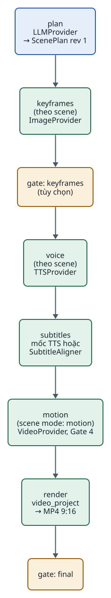
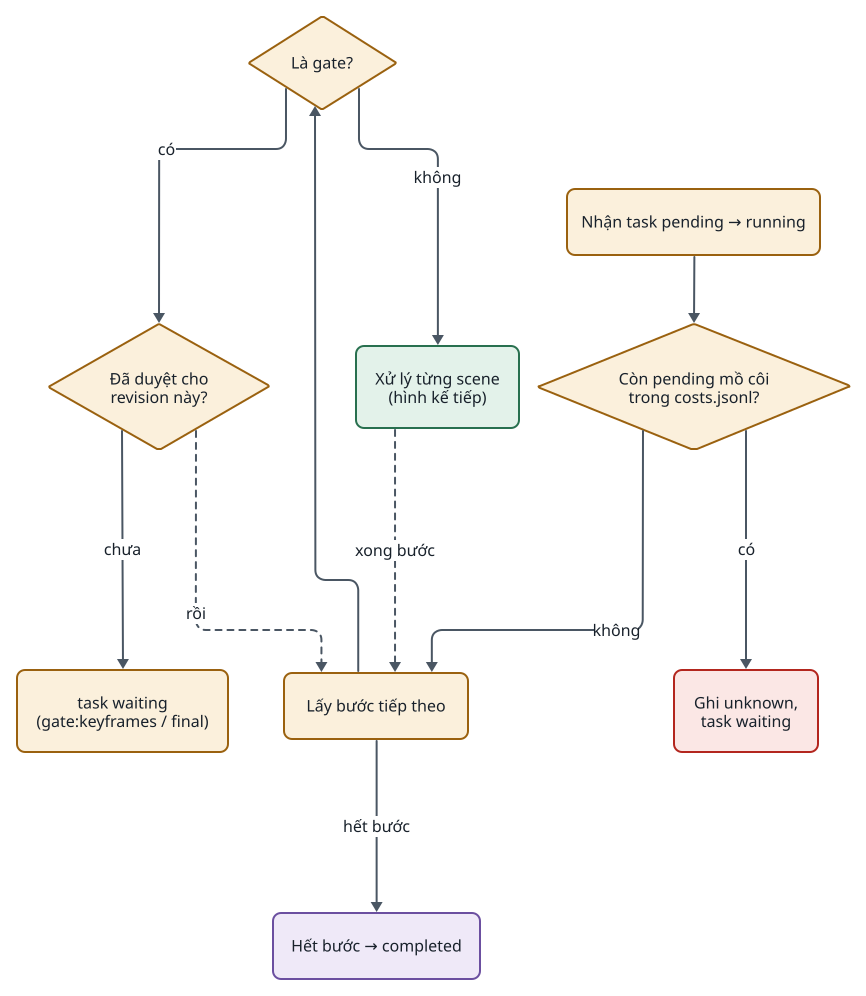
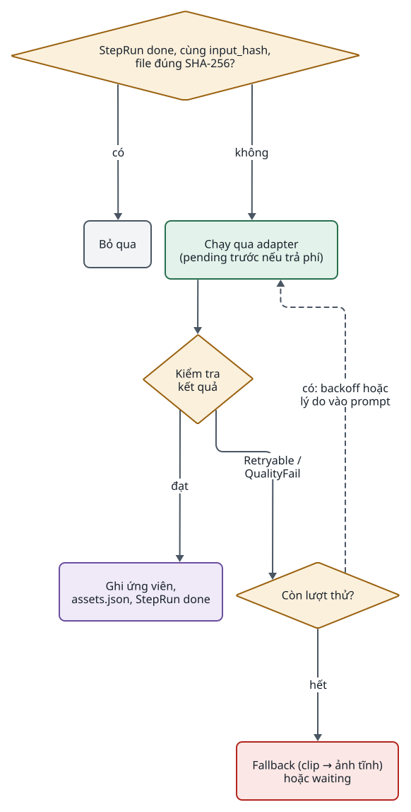
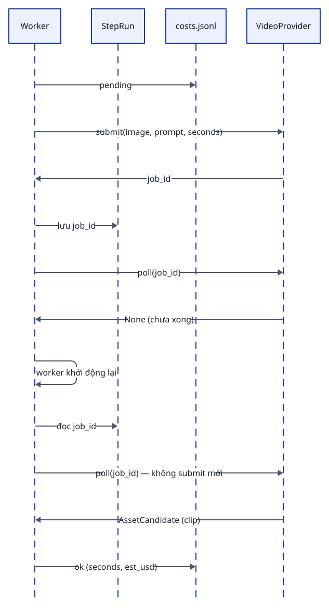
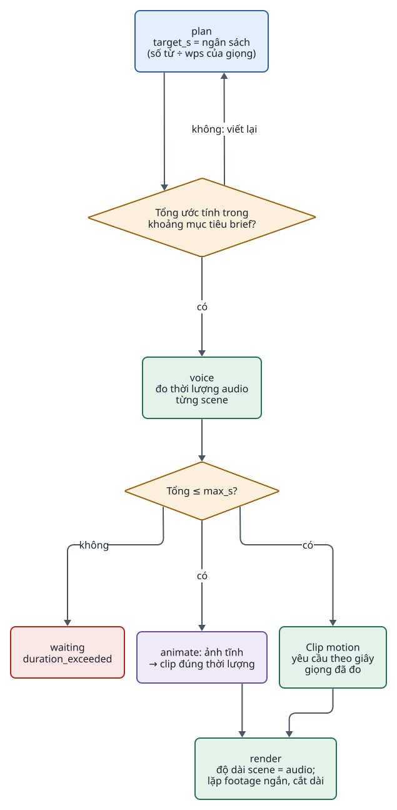
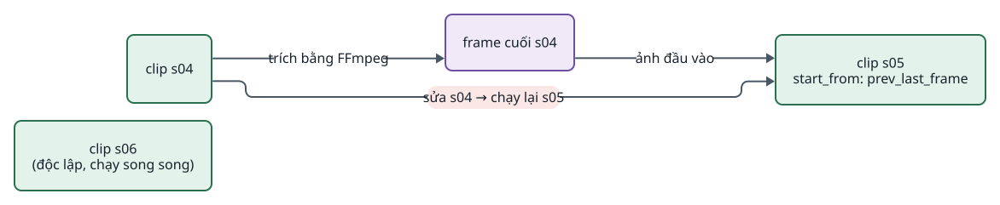
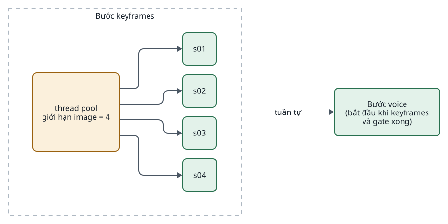

<!-- id:s1 -->
## Trách nhiệm

<!-- id:s1.b1 -->
Worker nhận task đang chờ, chạy lần lượt các bước, lặp theo scene trong bước, và dừng ở gate để người quyết định. Nó không biết provider nào đang chạy và không cần workflow engine: trạng thái là các StepRun trong SQLite cùng file trong thư mục task.

<!-- id:s1.b2 -->
Table: Worker làm và không làm
| Làm | Không làm |
| --- | --- |
| Chạy danh sách bước cố định, lặp theo scene | Đọc profile YAML hay tìm module động (AD-05) |
| Bỏ qua StepRun `done` có file hợp lệ và cùng đầu vào | Lưu state riêng ngoài StepRun và file |
| Retry lỗi tạm thời và lỗi chất lượng cho từng scene | Tự fallback giữa provider |
| Ghi `pending` trước lượt gọi trả phí qua `costs.py` | Chặn theo ngân sách (AD-10) |
| Dừng ở gate và khi có lượt gọi `unknown` | Tự gửi lại lượt gọi không rõ kết quả |
| Song song các scene trong một bước, giới hạn theo adapter | Chạy hai bước cùng lúc |

<!-- id:s1.b3 -->
```req
FR-03
FR-07
FR-08
FR-09
NFR-02
NFR-10
```

<!-- id:s2 -->
## Danh sách bước

<!-- id:s2.b1 -->
Danh sách bước của video là mã Python cố định. Giọng đọc chạy trước bước motion để clip được yêu cầu theo độ dài thật của lời đọc ([Đồng bộ thời lượng](#s9)).

<!-- id:s2.b2 -->
<!-- report-kit:d2
```d2
# cap: Danh sách bước video: 2 gate, 4 bước theo scene, motion chỉ cho scene mode motion
direction: down
plan: "plan\nLLMProvider\n→ ScenePlan rev 1" {class: brain}
kf: "keyframes\n(theo scene)\nImageProvider" {class: hands}
g1: "gate: keyframes\n(tùy chọn)" {class: gate}
voice: "voice\n(theo scene)\nTTSProvider" {class: hands}
sub: "subtitles\nmốc TTS hoặc\nSubtitleAligner" {class: hands}
mot: "motion\n(scene mode: motion)\nVideoProvider, Gate 4" {class: hands}
render: "render\nvideo_project\n→ MP4 9:16" {class: hands}
g2: "gate: final" {class: gate}
plan -> kf -> g1 -> voice -> sub -> mot -> render -> g2
```
-->
<picture>
<source media="(prefers-color-scheme: dark)" srcset="03-runner.figs/s2.b2-dark.svg">

</picture>

<!-- id:s2.b3 -->
Table: Bước, interface và đầu ra
| Bước | Theo scene | Interface dùng | Đầu ra | Gate xây |
| --- | --- | --- | --- | --- |
| `plan` | Không | `LLMProvider` | ScenePlan revision 1 | 2 |
| `keyframes` | Có | `ImageProvider` | Ứng viên ảnh; ứng viên đầu tiên mặc định là selected | 2 |
| gate `keyframes` | — | — | Người chọn, sửa, chạy lại; tùy chọn | 2 (CLI), 3 (web) |
| `voice` | Có | `TTSProvider` | `vo_sXX` + mốc thời gian | 2 |
| `subtitles` | Không | `SubtitleAligner` (khi TTS không trả mốc) | File phụ đề cả video | 2 |
| `motion` (tùy chọn) | Có, chỉ scene `mode: motion` | `VideoProvider` | Ứng viên clip; lỗi thì giữ ảnh tĩnh | 4 |
| `render` | Không | Renderer `video_project` | MP4 9:16, phụ đề burn-in | 2 |
| gate `final` | — | — | Duyệt bản cuối | 2 |

<!-- id:s2.b4 -->
```python
# studio/pipeline.py (đề xuất) — danh sách bước là dữ liệu Python, không phải YAML
VIDEO_STEPS = [
    Step("plan",      run=steps.plan,      per_scene=False),
    Step("keyframes", run=steps.keyframes, per_scene=True,  paid=True),
    Gate("keyframes", optional=True),
    Step("voice",     run=steps.voice,     per_scene=True),
    Step("subtitles", run=steps.subtitles, per_scene=False),
    Step("motion",    run=steps.motion,    per_scene=True,  paid=True, applies=lambda s: s.mode == "motion"),
    Step("render",    run=steps.render,    per_scene=False),
    Gate("final"),
]
```

<!-- id:s3 -->
## Vòng lặp worker

<!-- id:s3.b1 -->
Mỗi vòng: nhận một task, đi qua danh sách bước, với mỗi bước đi qua các scene áp dụng, bỏ qua mục đã xong, chạy và kiểm tra mục còn lại. Mọi nhánh lỗi kết thúc ở một trong ba chỗ: thử lại, chờ người, hoặc task `failed`.

<!-- id:s3.b2 -->
<!-- report-kit:d2
```d2
# cap: Vòng ngoài: kiểm lượt gọi mồ côi, rồi đi qua từng bước; gate chưa duyệt thì dừng
direction: down
pick: "Nhận task pending → running" {class: gate}
orphan: "Còn pending mồ côi\ntrong costs.jsonl?" {shape: diamond; class: gate}
unk: "Ghi unknown,\ntask waiting" {class: bad}
nxt: "Lấy bước tiếp theo" {class: gate}
isgate: "Là gate?" {shape: diamond; class: gate}
gok: "Đã duyệt cho\nrevision này?" {shape: diamond; class: gate}
wait: "task waiting\n(gate:keyframes / final)" {class: gate}
items: "Xử lý từng scene\n(hình kế tiếp)" {class: hands}
fin: "Hết bước → completed" {class: data}
pick -> orphan
orphan -> unk: có
orphan -> nxt: không
nxt -> isgate
isgate -> gok: có
gok -> wait: chưa
isgate -> items: không
gok -> nxt: "rồi" {style.stroke-dash: 3}
nxt -> fin: "hết bước"
items -> nxt: "xong bước" {style.stroke-dash: 3}
```
-->
<picture>
<source media="(prefers-color-scheme: dark)" srcset="03-runner.figs/s3.b2-dark.svg">

</picture>

<!-- id:s3.b3-2 -->
<!-- report-kit:d2
```d2
# cap: Vòng trong cho một scene: bỏ qua nếu đã xong, chạy, kiểm tra, thử lại hoặc fallback
direction: down
done: "StepRun done, cùng input_hash,\nfile đúng SHA-256?" {shape: diamond; class: gate}
skip: "Bỏ qua" {class: plain}
run: "Chạy qua adapter\n(pending trước nếu trả phí)" {class: hands}
check: "Kiểm tra\nkết quả" {shape: diamond; class: gate}
save: "Ghi ứng viên,\nassets.json, StepRun done" {class: data}
retry: "Còn lượt thử?" {shape: diamond; class: gate}
fb: "Fallback (clip → ảnh tĩnh)\nhoặc waiting" {class: bad}
done -> skip: có
done -> run: không
run -> check
check -> save: đạt
check -> retry: "Retryable /\nQualityFail"
retry -> run: "có: backoff hoặc\nlý do vào prompt" {style.stroke-dash: 3}
retry -> fb: hết
```
-->
<picture>
<source media="(prefers-color-scheme: dark)" srcset="03-runner.figs/s3.b3-2-dark.svg">

</picture>

<!-- id:s3.b3 -->
```python
# Phác thảo (đề xuất). Lỗi Fatal không bắt ở đây: nó làm task failed.
def run_task(task):
    if costs.orphan_pending(task):            # lượt gọi trả phí đã gửi, chưa có kết quả
        return gates.wait(task, reason="unknown_call")
    for step in VIDEO_STEPS:
        if isinstance(step, Gate):
            if not gates.approved(task, step):
                return gates.wait(task, reason=f"gate:{step.name}")
            continue
        for scene in items_for(task, step):   # một mục "_" nếu per_scene=False
            if store.is_done(task, step, scene, input_hash(task, step, scene)):
                continue
            run_with_retry(task, step, scene) # thread pool khi per_scene=True
    store.complete(task)
```

<!-- id:s4 -->
## Trạng thái của task

<!-- id:s4.b1 -->
Task có 5 trạng thái. Chỉ worker chuyển `pending → running`; chỉ người (CLI hoặc web) chuyển `waiting → pending`. Khởi động lại worker đưa mọi task `running` về `pending`.

<!-- id:s4.b2 -->
<!-- report-kit:d2
```d2
# cap: Trạng thái task: 5 trạng thái, waiting luôn có lý do và chỉ người đưa task ra khỏi waiting
direction: right
pending: pending {class: plain}
running: running {class: hands}
waiting: "waiting\n(gate:keyframes, gate:final,\nunknown_call, retries_exhausted)" {class: gate}
completed: completed {class: data}
failed: failed {class: bad}
pending -> running: "worker nhận"
running -> waiting: "gặp gate, unknown,\nhết lượt thử"
waiting -> pending: "người duyệt, sửa,\nquyết định"
waiting -> completed: "duyệt gate final"
waiting -> failed: "người hủy"
running -> failed: "Fatal"
running -> pending: "worker khởi động lại"
```
-->
<picture>
<source media="(prefers-color-scheme: dark)" srcset="03-runner.figs/s4.b2-dark.svg">

</picture>

<!-- id:s4.b3 -->
Table: Trạng thái task
| Trạng thái | Nghĩa | Ai chuyển ra |
| --- | --- | --- |
| `pending` | Chờ worker nhận | Worker |
| `running` | Worker đang chạy một bước | Worker; khởi động lại worker đưa về `pending` |
| `waiting` | Chờ người; trường `wait_reason` cho biết vì sao | Người (CLI, trang review) |
| `completed` | Gate `final` đã duyệt; MP4 là sản phẩm | — (sửa sau khi duyệt đưa task về `pending`) |
| `failed` | Lỗi `Fatal` hoặc người hủy | Người có thể tạo task mới từ cùng brief |

<!-- id:s5 -->
## StepRun, checkpoint và resume

<!-- id:s5.b1 -->
StepRun `done` kèm hash file là checkpoint; không cần lưu state riêng. Một StepRun là một lần chạy một bước cho một scene và một lượt thử. Nó được coi là xong cho đầu vào hiện tại khi `input_hash` khớp và file đầu ra còn đúng SHA-256.

<!-- id:s5.b2 -->
<!-- report-kit:d2
```d2
# cap: Trạng thái StepRun; unknown chỉ xuất hiện ở bước trả phí
direction: right
running: running {class: hands}
done: "done\n(output_sha256)" {class: data}
failed: "failed\n(error, reason)" {class: bad}
unknown: "unknown\n(lượt gọi trả phí\nkhông rõ kết quả)" {class: bad}
running -> done: "kiểm tra đạt"
running -> failed: "Retryable / QualityFail /\nFatal"
running -> unknown: "worker chết sau pending,\nUnconfirmedTaskError"
failed -> running: "lượt thử mới\n(attempt + 1)" {style.stroke-dash: 3}
unknown -> running: "người chọn sinh lại\n(attempt + 1)" {style.stroke-dash: 3}
```
-->
<picture>
<source media="(prefers-color-scheme: dark)" srcset="03-runner.figs/s5.b2-dark.svg">

</picture>

<!-- id:s5.b3 -->
Table: Khóa và đầu vào của StepRun (đề xuất)
| Trường | Ý nghĩa |
| --- | --- |
| `task_id`, `step`, `scene` | Định danh mục; `scene = "_"` cho bước cả video |
| `attempt` | Lượt thử, tăng khi thử lại hoặc chạy lại; khớp hậu tố `_aN` của ứng viên |
| `input_hash` | Hash của phần ScenePlan mà bước đọc cho scene đó cùng id các ứng viên selected làm đầu vào |
| `plan_rev` | Revision ScenePlan lúc chạy |
| `output_path`, `output_sha256` | File đầu ra và hash để kiểm khi resume |
| `job_id` | Với bước bất đồng bộ (`motion`): lưu ngay sau `submit` |

<!-- id:s5.b4 -->
Nhờ `input_hash`, sửa một scene chỉ làm thay đổi đầu vào của chính scene đó và các bước cả video phụ thuộc vào nó; scene khác giữ StepRun `done` và được bỏ qua.

<!-- id:s6 -->
## Lượt gọi trả phí và job bất đồng bộ

<!-- id:s6.b1 -->
Mọi lượt gọi trả phí đi qua `costs.py`: ghi dòng `pending` trước khi gửi và dòng kết quả sau. Khi resume mà còn `pending` không có kết quả, task chuyển `waiting`; người quyết định, hệ thống không tự gửi lại (ADR-0006).

<!-- id:s6.b2 -->
<!-- report-kit:d2
```d2
# cap: Lượt gọi trả phí: pending luôn ghi trước, worker chết giữa chừng thì người quyết định
shape: sequence_diagram
wk: Worker
cost: "costs.jsonl"
ad: Adapter
api: "Provider (trả phí)"
op: Người vận hành
wk -> cost: "pending (request_id t_0042:s06:keyframes:1)"
wk -> ad: "generate(prompt, refs)"
ad -> api: "HTTP request"
api -> ad: "ảnh"
ad -> wk: AssetCandidate
wk -> cost: "ok (units, est_usd)"
wk -> wk: "Trường hợp worker chết sau khi gửi"
wk -> cost: "khởi động lại: thấy pending mồ côi"
wk -> cost: "unknown"
wk -> op: "task waiting: sinh lại s06?"
op -> wk: "sinh lại hoặc bỏ qua"
```
-->
<picture>
<source media="(prefers-color-scheme: dark)" srcset="03-runner.figs/s6.b2-dark.svg">

</picture>

<!-- id:s6.b3 -->
Job video bất đồng bộ tách `submit` và `poll` để resume không gửi lại job: `job_id` được lưu vào StepRun ngay sau `submit`, và resume luôn poll job cũ trước.

<!-- id:s6.b4 -->
<!-- report-kit:d2
```d2
# cap: Bước motion: lưu job_id ngay sau submit; resume poll job cũ, không submit lại
shape: sequence_diagram
wk: Worker
db: "StepRun"
cost: "costs.jsonl"
vp: "VideoProvider"
wk -> cost: "pending"
wk -> vp: "submit(image, prompt, seconds)"
vp -> wk: "job_id"
wk -> db: "lưu job_id"
wk -> vp: "poll(job_id)"
vp -> wk: "None (chưa xong)"
wk -> wk: "worker khởi động lại"
wk -> db: "đọc job_id"
wk -> vp: "poll(job_id) — không submit mới"
vp -> wk: "AssetCandidate (clip)"
wk -> cost: "ok (seconds, est_usd)"
```
-->
<picture>
<source media="(prefers-color-scheme: dark)" srcset="03-runner.figs/s6.b4-dark.svg">

</picture>

<!-- id:s7 -->
## Gate, sửa và chạy lại

<!-- id:s7.b1 -->
Gate là điểm dừng chờ người duyệt, từ chối hoặc sửa. Mọi hành động sửa là bản ghi mới (ScenePlan revision, ứng viên, quyết định gate), nên luôn quay lại được bản cũ. Sau một hành động, task về `pending` và worker chạy lại đúng những mục có `input_hash` đổi.

<!-- id:s7.b2 -->
<!-- report-kit:d2
```d2
# cap: Phạm vi chạy lại sau từng hành động của người
direction: right
act: Hành động {
  class: zone
  a1: "Chọn ứng viên khác" {class: plain}
  a2: "Sửa visual / góc máy sNN" {class: plain}
  a3: "Sửa narration sNN" {class: plain}
  a4: "Upload asset sNN" {class: plain}
  a5: "Chạy lại sNN + ghi chú" {class: plain}
}
rerun: Chạy lại {
  class: zone
  kf: "keyframes sNN" {class: hands}
  vo: "voice sNN" {class: hands}
  sb: "subtitles" {class: hands}
  rd: "render\n(video_project chỉ dựng\nlại scene đổi + ghép)" {class: hands}
}
act.a1 -> rerun.rd
act.a2 -> rerun.kf: "rev mới"
act.a3 -> rerun.vo: "rev mới"
act.a4 -> rerun.rd
act.a5 -> rerun.kf
rerun.kf -> rerun.rd
rerun.vo -> rerun.sb
rerun.sb -> rerun.rd
```
-->
<picture>
<source media="(prefers-color-scheme: dark)" srcset="03-runner.figs/s7.b2-dark.svg">

</picture>

<!-- id:s7.b3 -->
Table: Hành động và phạm vi chạy lại
| Hành động | Ghi gì | Chạy lại |
| --- | --- | --- |
| Duyệt gate `keyframes` | Quyết định gate cho revision hiện hành | Tiếp từ `voice` |
| Chọn ứng viên khác | `selected` trong `assets.json` | Chỉ `render` |
| Sửa `visual`, `shot` của sNN | ScenePlan revision mới | `keyframes` sNN; dừng lại ở gate `keyframes` |
| Sửa `narration` của sNN | ScenePlan revision mới | `voice` sNN, `subtitles`, `render` |
| Upload ảnh, clip, nhạc | Ứng viên `provider: user`, đặt làm selected | Chỉ `render` |
| Chạy lại sNN kèm ghi chú | Ghi chú lưu vào StepRun mới, đưa vào prompt | Bước được chọn của sNN và các bước sau phụ thuộc |
| Quyết định lượt gọi `unknown` | Dòng chi phí `unknown` giữ nguyên; quyết định ghi vào gate | Sinh lại mục đó, hoặc bỏ qua và dùng ứng viên có sẵn |
| Sửa sau khi duyệt `final` | Revision mới; task về `pending` | Như các dòng trên, rồi dừng lại ở gate `final` |

<!-- id:s7.b4 -->
> [!NOTE]
> Gate duyệt gắn với revision: duyệt gate `keyframes` ở rev 2 rồi sửa visual tạo rev 3 thì gate cần duyệt lại. Sửa narration không đổi ảnh nên không mở lại gate `keyframes` (đề xuất; chốt ở Gate 3).

<!-- id:s8 -->
## Retry và xử lý lỗi

<!-- id:s8.b1 -->
Adapter chuyển mọi lỗi về 4 loại chung định nghĩa trong `providers/base.py`. Worker chỉ hiểu 4 loại này.

<!-- id:s8.b2 -->
<!-- report-kit:d2
```d2
# cap: Bốn loại lỗi chung và cách worker phản ứng
direction: right
err: Lỗi từ adapter {
  class: zone
  r: "Retryable\n429, 5xx, timeout" {class: plain}
  q: "QualityFail(reason)" {class: plain}
  u: "Unconfirmed\njob trả phí không rõ kết quả" {class: plain}
  f: Fatal {class: plain}
}
act: Phản ứng {
  class: zone
  r1: "Thử lại cùng đầu vào\nbackoff, tối đa 3 lần" {class: hands}
  q1: "Chạy lại riêng scene đó\nlý do đưa vào prompt" {class: hands}
  u1: "Ghi unknown\ntask waiting" {class: gate}
  f1: "task failed" {class: bad}
  x: "Hết lượt thử:\nfallback hoặc chờ người" {class: gate}
}
err.r -> act.r1
err.q -> act.q1
err.u -> act.u1
err.f -> act.f1
act.r1 -> act.x: hết lượt
act.q1 -> act.x: hết lượt
```
-->
<picture>
<source media="(prefers-color-scheme: dark)" srcset="03-runner.figs/s8.b2-dark.svg">

</picture>

<!-- id:s8.b3 -->
Table: Cơ chế chịu lỗi
| Cơ chế | Cách làm |
| --- | --- |
| Checkpoint | StepRun `done` kèm hash file; không cần lưu state riêng |
| Resume | Khởi động lại worker → task `running` về hàng đợi → bỏ qua mục đã `done` |
| Retry lỗi tạm thời | `Retryable` (429, 5xx, timeout): thử lại cùng đầu vào, có backoff, tối đa 3 lần |
| Retry vì chất lượng | `QualityFail(reason)` → chạy lại riêng scene đó, lý do đưa vào prompt |
| Hết lượt thử | Fallback (clip lỗi → giữ ảnh tĩnh có chuyển động camera) hoặc `waiting` lý do `retries_exhausted` |
| Lượt gọi trả phí không rõ kết quả | Còn `pending` không có kết quả, hoặc MPT ném `UnconfirmedTaskError` → `unknown`, task `waiting`; không tự gửi lại |
| Job video bất đồng bộ | Lưu `job_id` ngay sau `submit`; resume thì poll job cũ trước |

<!-- id:s9 -->
## Đồng bộ thời lượng: giọng đọc là đồng hồ chủ

<!-- id:s9.b1 -->
Kịch bản không cần khớp chính xác theo giây. LLM đếm giây kém, nên `plan` giới hạn theo số từ (tiếng Việt khoảng 2,5–3 từ/giây) và kiểm tra tổng thời lượng ước tính trong ±10% mục tiêu. Thời lượng thật chỉ biết sau bước `voice`.

<!-- id:s9.b2 -->
<!-- report-kit:d2
```d2
# cap: Thời lượng đi một chiều: số từ → ước tính → giọng đo được → độ dài scene và clip
direction: down
plan: "plan\ntarget_s = ngân sách\n(số từ ÷ 2,5–3)" {class: brain}
chk: "Tổng ước tính\ntrong ±10% mục tiêu?" {shape: diamond; class: gate}
voice: "voice\nđo thời lượng audio\ntừng scene" {class: hands}
still: "Ảnh tĩnh\nco giãn tùy ý" {class: data}
clip: "Clip motion\nyêu cầu theo giây\ngiọng đã đo" {class: hands}
render: "render\nđộ dài scene = audio;\nlặp footage ngắn, cắt dài" {class: hands}
plan -> chk
chk -> plan: "không: viết lại"
chk -> voice: có
voice -> still
voice -> clip
still -> render
clip -> render
```
-->
<picture>
<source media="(prefers-color-scheme: dark)" srcset="03-runner.figs/s9.b2-dark.svg">

</picture>

<!-- id:s10 -->
## Nối frame cuối vào frame đầu (tùy chọn, Gate 4)

<!-- id:s10.b1 -->
Trường `start_from: "prev_last_frame"` trong ScenePlan cho phép dùng frame cuối của clip trước làm ảnh đầu vào của clip sau: cảnh dài hơn một clip, hai shot liền mạch cùng nhân vật và bối cảnh, hoặc chuyển cảnh mượt.

<!-- id:s10.b2 -->
<!-- report-kit:d2
```d2
# cap: Nối frame tạo phụ thuộc tuần tự giữa các scene; chỉ dùng cho cảnh cần liền mạch
direction: right
s04: "clip s04" {class: hands}
lf: "frame cuối s04" {class: data}
s05: "clip s05\nstart_from: prev_last_frame" {class: hands}
s06: "clip s06\n(độc lập, chạy song song)" {class: hands}
s04 -> lf: "trích bằng FFmpeg"
lf -> s05: "ảnh đầu vào"
s04 -> s05: "sửa s04 → chạy lại s05" {class: bad}
```
-->
<picture>
<source media="(prefers-color-scheme: dark)" srcset="03-runner.figs/s10.b2-dark.svg">

</picture>

<!-- id:s10.b3 -->
Đánh đổi: scene sau phải chờ scene trước, sửa clip trước kéo theo chạy lại clip sau (`input_hash` của s05 chứa id clip s04), và chất lượng giảm dần qua mỗi lần nối. Không nối cả video.

<!-- id:s11 -->
## Song song

<!-- id:s11.b1 -->
Các scene trong một bước chạy trong thread pool, giới hạn theo adapter (`studio.toml`, ví dụ `image = 4`, `tts = 2`, `video = 2`); các bước vẫn tuần tự. Chạy song song thêm chỉ khi đo được thời gian chờ là nút thắt. Test T08 đo chi phí khi chạy nhiều scene song song.

<!-- id:s11.b2 -->
<!-- report-kit:d2
```d2
# cap: Song song chỉ trong một bước; giới hạn đặt theo adapter vì rate limit thuộc provider
direction: right
kf: Bước keyframes {
  class: zone
  pool: "thread pool\ngiới hạn image = 4" {class: gate}
  s1: s01 {class: hands}
  s2: s02 {class: hands}
  s3: s03 {class: hands}
  s4: s04 {class: hands}
}
voice: "Bước voice\n(bắt đầu khi keyframes\nvà gate xong)" {class: hands}
kf.pool -> kf.s1
kf.pool -> kf.s2
kf.pool -> kf.s3
kf.pool -> kf.s4
kf -> voice: "tuần tự"
```
-->
<picture>
<source media="(prefers-color-scheme: dark)" srcset="03-runner.figs/s11.b2-dark.svg">

</picture>

<!-- id:s12 -->
## Kiểm tra trước khi chạy

<!-- id:s12.b1 -->
Lỗi cấu hình và schema phải lộ ra trước lượt gọi trả phí đầu tiên.

<!-- id:s12.b2 -->
```chk
- [ ] Brief hợp lệ: thời lượng, ngôn ngữ, series (nếu có) tồn tại
- [ ] Series Bible hợp lệ: ảnh tham chiếu tồn tại, khóa camera đầy đủ
- [ ] Mỗi năng lực dùng tới có adapter trong `studio.toml` và adapter khởi tạo được
- [ ] `MPT_HOME` trỏ tới `config.toml` có khóa cho provider đang chọn (adapter MPT tự kiểm)
- [ ] FFmpeg chạy được
- [ ] ScenePlan trả về qua Pydantic; tổng thời lượng ước tính trong ±10% mục tiêu
```
