<!-- id:s1 -->
## Trách nhiệm

<!-- id:s1.b1 -->
Runner đọc profile, chạy từng bước, tách bước theo mục, lưu checkpoint, retry, dừng ở gate và kiểm tra ngân sách. Runner không biết model nào và không gọi API.

<!-- id:s1.b2 -->
```req
FR-02
FR-03
FR-04
FR-05
FR-06
FR-07
FR-09
NFR-02
NFR-06
NFR-09
NFR-10
```

<!-- id:s2 -->
## Vòng lặp runner

<!-- id:s2.b1 -->
```d2
# cap: Vòng lặp chính của worker: một task, từng bước, từng mục
direction: down
pick: "Nhận task pending\n→ running" {class: gate}
next: "Bước kế tiếp\ntrong profile?" {shape: diamond; class: gate}
done: "Task completed" {class: data}
isgate: "Bước là gate?" {shape: diamond; class: gate}
wait: "Task waiting\n(gate)" {class: hands}
items: "Lấy danh sách mục\n(fan_out hoặc \"_\")" {class: gate}
skip: "Bỏ qua mục\nđã done" {class: plain}
run: "Chạy module.run(ctx, item)\ntrong thread pool" {class: brain}
res: "Kết quả?" {shape: diamond; class: gate}
ok: "StepRun done = checkpoint\n↺ mọi mục done: về bước kế tiếp" {class: data}
err: "Xử lý lỗi (retry / on_fail)\n↺ còn lượt: chạy lại mục đó" {class: bad}
pick -> next
next -> done: hết bước
next -> isgate: còn
isgate -> wait: có
isgate -> items: không
items -> skip
skip -> run: mục chưa xong
run -> res
res -> ok: Result
res -> err: "Retryable, QualityFail, Fatal"
```
<picture>
<source media="(prefers-color-scheme: dark)" srcset="03-runner.figs/s2.b1-dark.svg">
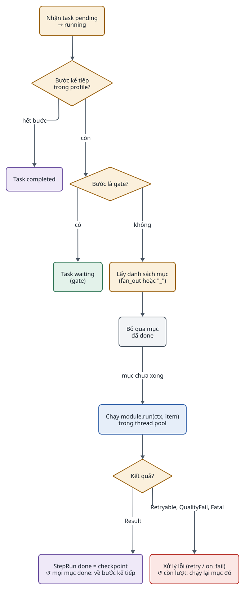
</picture>

<!-- id:s2.b2 -->
Vòng lặp chạy các bước tuần tự; song song chỉ xảy ra giữa các mục của một bước (và, khi được bật, giữa các bước trong một nhóm `parallel:`, xem mục Song song). Worker hỏi SQLite định kỳ để nhận task `pending`; không có broker.

<!-- id:s3 -->
## Trạng thái của task

<!-- id:s3.b1 -->
```d2
# cap: Task có 5 trạng thái; waiting dùng cho cả gate và ngân sách
direction: right
pending: pending {class: plain}
running: running {class: brain}
waiting: "waiting\n(gate | budget | on_fail: wait)" {class: hands}
completed: completed {class: data}
failed: failed {class: bad}
pending -> running: "worker nhận"
running -> waiting: "gặp gate, vượt ngân sách"
waiting -> pending: "duyệt, nâng ngân sách"
running -> completed: "hết bước"
running -> failed: "Fatal, on_fail: fail"
running -> pending: "worker khởi động lại"
completed -> pending: "sửa output, chạy lại"
failed -> pending: "chạy lại từ UI"
waiting -> failed: "hủy"
```
<picture>
<source media="(prefers-color-scheme: dark)" srcset="03-runner.figs/s3.b1-dark.svg">
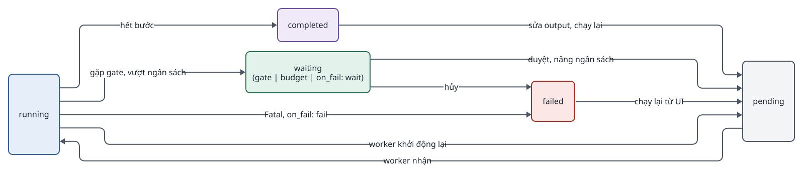
</picture>

<!-- id:s3.b2 -->
Table: Chuyển trạng thái của task
| Từ | Sang | Khi | Ai gây ra |
| --- | --- | --- | --- |
| pending | running | Worker nhận task | Worker |
| running | waiting | Gặp bước `gate`; hoặc `ctx.reserve` vượt `budget_usd`; hoặc hết lượt với `on_fail: wait` | Runner |
| waiting | pending | Duyệt gate, từ chối kèm ghi chú, nâng ngân sách | Người vận hành |
| running | completed | Không còn bước | Runner |
| running | failed | Lỗi `Fatal` hoặc hết lượt với `on_fail: fail` | Runner |
| running | pending | Worker khởi động lại (resume) | Worker lúc khởi động |
| completed, failed | pending | Sửa output, chạy lại bước hoặc scene | Người vận hành |

<!-- id:s4 -->
## Trạng thái của StepRun

<!-- id:s4.b1 -->
Mỗi StepRun là một lần chạy của một bước cho một mục và một lượt thử. Khóa của StepRun là `(task_id, step, item, attempt)`.

<!-- id:s4.b2 -->
```d2
# cap: Vòng đời của một StepRun
direction: right
pending: pending {class: plain}
running: running {class: brain}
done: "done\n(checkpoint)" {class: data}
failed: failed {class: bad}
waiting: "waiting\n(gate, job ngoài)" {class: hands}
skipped: "skipped\n(mục không áp dụng)" {class: plain}
pending -> running
running -> done: Result
running -> failed: "lỗi; lượt mới attempt+1"
running -> waiting: "chờ người hoặc poll"
waiting -> running: "duyệt, job xong"
pending -> skipped: "module bỏ qua mục"
```
<picture>
<source media="(prefers-color-scheme: dark)" srcset="03-runner.figs/s4.b2-dark.svg">
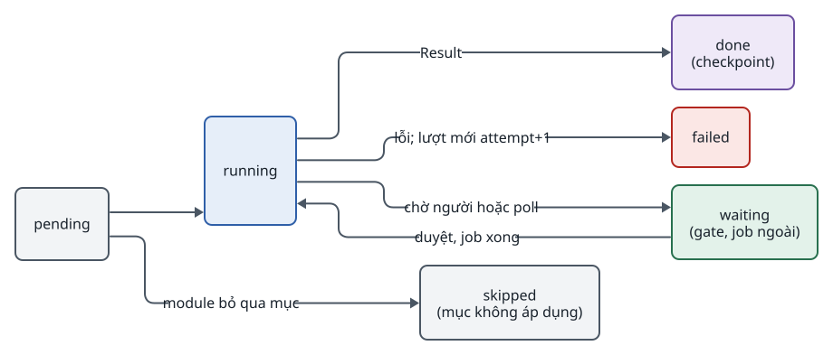
</picture>

<!-- id:s4.b3 -->
> [!NOTE]
> Lượt thử mới không ghi đè lượt cũ: tạo StepRun mới với `attempt + 1` và file `step/item_aN.ext` mới. Bản dùng cho bước sau là StepRun `done` có `attempt` lớn nhất (hoặc lượt người dùng chọn trên UI).

<!-- id:s5 -->
## Fan-out tổng quát

<!-- id:s5.b1 -->
Fan-out là việc runner tách một bước thành nhiều lần chạy nhỏ, một cho mỗi phần tử của danh sách mà module khai báo. Video tách theo scene, audiobook tách theo đoạn, cùng một cơ chế. Quyết định ở [ADR-0001](../adr/0001-generic-fan-out.md).

<!-- id:s5.b2 -->
```d2
# cap: Module khai báo fan_out; runner tạo một StepRun cho mỗi phần tử theo id
direction: right
plan: "ScenePlan.scenes\n[s01 … s08]" {class: data}
speech: "SpeechScript.segments\n[s01 … | ch01_p003 …]" {class: data}
img: "images\nfan_out: ScenePlan.scenes" {class: hands}
voice: "voice\nfan_out: SpeechScript.segments" {class: hands}
asm: "assemble\nfan_out: None" {class: hands}
runs: StepRun {
  class: zone
  r1: "images · s01 · a1" {class: brain}
  r2: "images · s02 · a1" {class: brain}
  r3: "images · … · a1" {class: brain}
  v1: "voice · s01 · a1" {class: brain}
  v2: "voice · … · a1" {class: brain}
  a1: "assemble · _ · a1" {class: brain}
}
plan -> img
speech -> voice
img -> runs.r1
img -> runs.r2
img -> runs.r3
voice -> runs.v1
voice -> runs.v2
asm -> runs.a1
```
<picture>
<source media="(prefers-color-scheme: dark)" srcset="03-runner.figs/s5.b2-dark.svg">
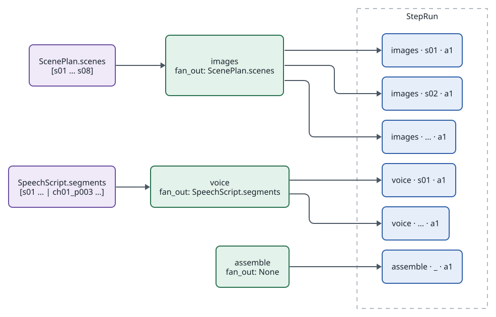
</picture>

<!-- id:s5.b3 -->
- Giá trị `fan_out` là đường dẫn `Contract.field` tới một danh sách; mỗi phần tử phải có `id` duy nhất. Runner đọc danh sách từ output mới nhất của contract đó.
- Profile có thể ghi đè `fan_out` của một bước (ví dụ `voice: {fan_out: "SpeechScript.segments"}`).
- `item` của StepRun là `id` của phần tử, hoặc `"_"` khi bước chạy một lần.

<!-- id:s6 -->
## Checkpoint và resume

<!-- id:s6.b1 -->
Checkpoint không cần lưu state riêng: mỗi StepRun có `status: done` cùng hash file là một checkpoint. Job bất đồng bộ (Veo, ComfyUI) lưu `external_job_id` trước khi poll, nên sau sự cố provider chỉ poll job cũ.

<!-- id:s6.b2 -->
```d2
# cap: Resume giữa lúc chờ job video không gửi lại job và không ghi chi phí hai lần
shape: sequence_diagram
wk: Worker
mod: "module motion"
db: SQLite
veo: "Veo API"
wk -> mod: "run(ctx, s07)"
mod -> veo: "submit(image, prompt)"
veo -> mod: "job_id"
mod -> db: "ctx.checkpoint(external_job_id) TRƯỚC khi poll"
mod -> veo: poll
wk -> wk: "worker bị khởi động lại" {class: bad}
wk -> db: "task running → pending → running"
wk -> db: "bỏ qua mọi mục done"
wk -> mod: "run(ctx, s07) lần nữa"
mod -> db: "đọc external_job_id đã có"
mod -> veo: "chỉ poll job cũ"
veo -> mod: clip
mod -> db: "StepRun done + một dòng cost_events"
```
<picture>
<source media="(prefers-color-scheme: dark)" srcset="03-runner.figs/s6.b2-dark.svg">
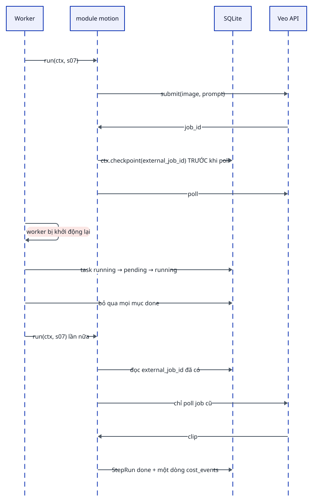
</picture>

<!-- id:s6.b3 -->
Table: Cơ chế chịu lỗi
| Cơ chế | Cách làm | Ghi chú |
| --- | --- | --- |
| Checkpoint | Mỗi StepRun `done` cùng hash file | Không cần state riêng |
| Resume | Khởi động worker → task `running` về hàng đợi → runner bỏ qua mục `done` | File `step/item_aN.ext` nên không ghi đè |
| Job bất đồng bộ | `submit` → lưu `external_job_id` bằng `ctx.checkpoint` → poll; sau sự cố poll job cũ | Tránh trả tiền hai lần |
| Chi phí đúng một lần | Dòng `cost_events` ghi cùng lúc StepRun chuyển `done`, khóa theo `(task, step, item, attempt)` | Kiểm bằng tiêu chí Phase 1 |

<!-- id:s7 -->
## Retry và xử lý lỗi

<!-- id:s7.b1 -->
Module chỉ báo lỗi bằng ba loại; runner quyết định phần còn lại theo cấu hình của bước.

<!-- id:s7.b2 -->
```d2
# cap: Ba loại lỗi và cách runner xử lý
direction: right
e: "Lỗi từ module" {class: bad}
r: "Retryable\n429, 5xx, timeout" {class: plain}
q: "QualityFail(reason)\ntừ check" {class: plain}
f: "Fatal" {class: bad}
same: "Thử lại cùng đầu vào\nbackoff, tối đa max_attempts" {class: gate}
fb: "Lượt mới chỉ cho mục đó\nreason → ctx.feedback" {class: brain}
remain: "Còn lượt?" {shape: diamond; class: gate}
onfail: on_fail {
  class: zone
  fallback: "fallback\n(ví dụ motion → ảnh tĩnh,\ndegraded: true)" {class: hands}
  wait: "wait\n(task waiting)" {class: hands}
  fail: "fail\n(task failed)" {class: bad}
}
e -> r
e -> q
e -> f
r -> same -> remain
q -> fb -> remain
remain -> onfail: hết lượt
f -> onfail.fail
```
<picture>
<source media="(prefers-color-scheme: dark)" srcset="03-runner.figs/s7.b2-dark.svg">
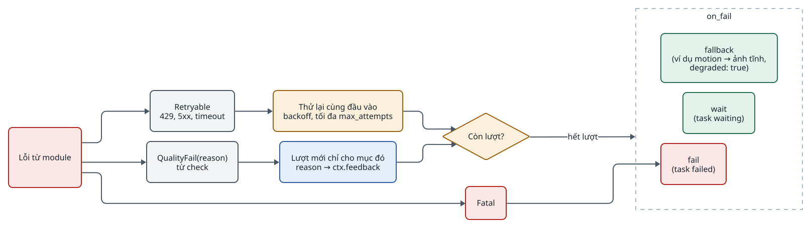
</picture>

<!-- id:s7.b3 -->
```yaml
steps:
  - images: {retry: {max_attempts: 3}}
  - motion: {on_fail: fallback, retry: {max_attempts: 3}, checks: [vlm_identity]}
```

<!-- id:s7.b4 -->
Mặc định `on_fail` của `motion` là `fallback`; của các bước khác là `fail`. Lý do check thất bại luôn được lưu trong StepRun để hiện trên UI.

<!-- id:s8 -->
## Gate, sửa output và chạy lại

<!-- id:s8.b1 -->
Gate là một loại bước của core, không phải module. Bước `gate` đặt task thành `waiting`; người vận hành duyệt, từ chối kèm ghi chú, hoặc sửa output.

<!-- id:s8.b2 -->
```d2
# cap: Ba cách người vận hành trả lời một gate
shape: sequence_diagram
op: Người vận hành
ui: Web UI
db: SQLite
wk: Runner
wk -> db: "bước gate → task waiting"
op -> ui: "mở Task detail / Storyboard"
op -> ui: "Duyệt"
ui -> db: "task → pending"
op -> ui: "Từ chối s04 + ghi chú \"tay lộ ra\""
ui -> db: "ghi chú → feedback của bước được chọn; StepRun s04 mới pending"
op -> ui: "Sửa narration s03"
ui -> db: "StepRun mới của script cho s03, meta.source: human (kiểm schema)"
wk -> db: "chạy lại phần bị ảnh hưởng rồi tiếp tục"
```
<picture>
<source media="(prefers-color-scheme: dark)" srcset="03-runner.figs/s8.b2-dark.svg">
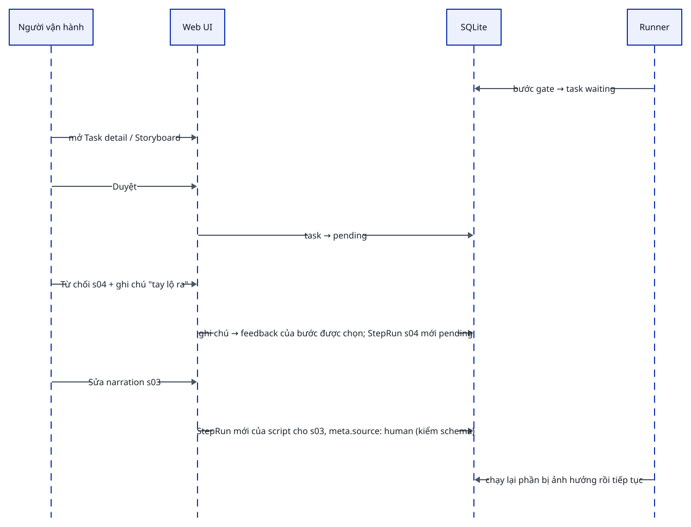
</picture>

<!-- id:s8.b3 -->
Phạm vi chạy lại khi rerun bước X hoặc scene sNN:

<!-- id:s8.b4 -->
```d2
# cap: Chạy lại scene s03 của images: chỉ các bước sau theo cùng scene và các bước không chia theo scene
direction: right
img: images {
  class: zone
  i1: s01 {class: data}
  i3: "s03 (chạy lại)" {class: bad}
  i5: s05 {class: data}
}
mot: motion {
  class: zone
  m1: s01 {class: data}
  m3: "s03 → pending" {class: hands}
  m5: s05 {class: data}
}
asm: "assemble (_)\n→ pending" {class: hands}
g: "gate: final\n→ pending" {class: hands}
img.i3 -> mot.m3
mot.m3 -> asm
asm -> g
```
<picture>
<source media="(prefers-color-scheme: dark)" srcset="03-runner.figs/s8.b4-dark.svg">
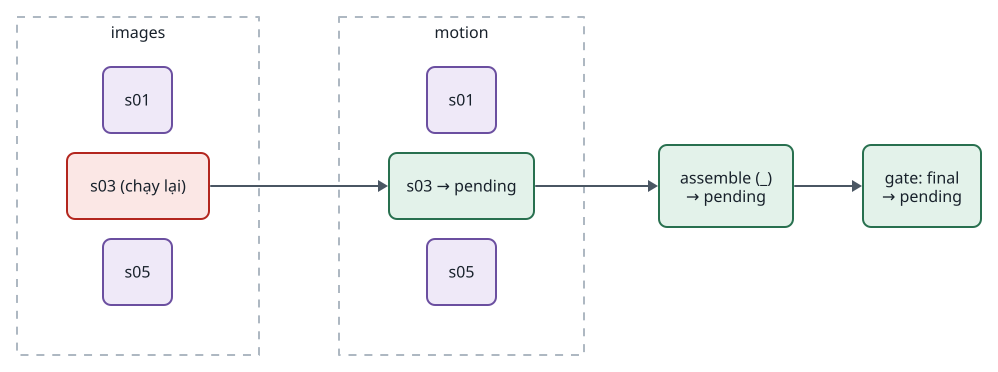
</picture>

<!-- id:s8.b5 -->
- Các bước sau theo cùng scene và các bước sau không chia theo scene chuyển về `pending`; scene khác giữ nguyên.
- Sửa được khi task đang ở gate, hoặc khi task đã `completed` (task về `pending`).
- Mỗi lần sửa là một lượt thử mới; có thể quay lại lượt cũ bất kỳ lúc nào.

<!-- id:s9 -->
## Ngân sách và chi phí

<!-- id:s9.b1 -->
```d2
# cap: Trước lời gọi đắt, module xin giữ ngân sách; vượt thì task chờ thay vì thất bại
direction: right
mod: "module\nctx.reserve(ước tính)" {class: hands}
chk: "đã tiêu + ước tính\n> budget_usd?" {shape: diamond; class: gate}
call: "Gọi provider" {class: brain}
cost: "ctx.cost(usd, units)\n→ cost_events" {class: data}
wait: "task waiting\nlý do: budget" {class: hands}
price: "pricing.yaml" {shape: page; class: gate}
op: "Người vận hành\nnâng ngân sách / dừng" {class: hands}
mod -> chk
chk -> call: không
chk -> wait: có
call -> cost
price -> cost: "giá theo đơn vị"
wait -> op
```
<picture>
<source media="(prefers-color-scheme: dark)" srcset="03-runner.figs/s9.b1-dark.svg">
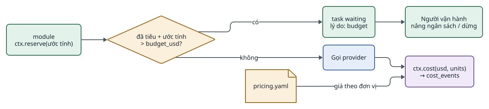
</picture>

<!-- id:s9.b2 -->
- Provider trả lượng dùng (giây video, ký tự TTS, token, số ảnh); module gọi `ctx.cost(...)`, tạo một dòng `cost_events` gắn `task / step / item / attempt / provider / model`.
- Giá nằm trong `pricing.yaml`, không nằm trong code.
- `Task.cost_usd` là tổng của `cost_events`; UI hiển thị chi phí / ngân sách cho từng task.

<!-- id:s10 -->
## Song song

<!-- id:s10.b1 -->
```d2
# cap: Song song trong một bước (theo mục) và giữa các bước trong nhóm parallel
direction: right
script: script {class: brain}
grp: "parallel:" {
  class: zone
  images: "images\n8 mục, concurrency theo provider" {class: hands}
  voice: "voice\n8 mục" {class: hands}
}
g: "gate: keyframes" {class: gate}
asm: assemble {class: hands}
script -> grp
grp -> g -> asm
```
<picture>
<source media="(prefers-color-scheme: dark)" srcset="03-runner.figs/s10.b1-dark.svg">
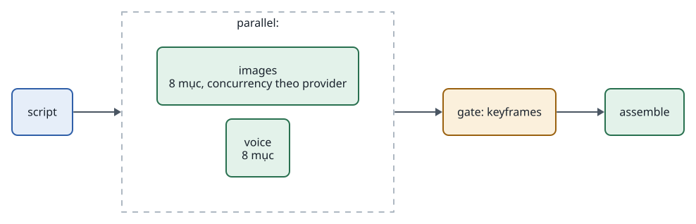
</picture>

<!-- id:s10.b2 -->
- Các mục trong một bước chạy trong thread pool; `concurrency` giới hạn theo provider để tôn trọng rate limit (ví dụ `video: {concurrency: 2}`).
- Cú pháp nhóm `parallel:` được chấp nhận ngay từ Phase 1; Phase 1 runner được phép chạy các bước trong nhóm lần lượt. Quyết định ở [ADR-0003](../adr/0003-parallel-step-groups.md).

<!-- id:s10.b3 -->
```yaml
steps:
  - script
  - parallel:
      - images
      - voice
  - gate: keyframes
  - assemble: {subtitles: true, aspect: "9:16"}
```

<!-- id:s11 -->
## Cấu hình hiệu lực của một bước

<!-- id:s11.b1 -->
```d2
# cap: Thứ tự ưu tiên cấu hình; model thật đã chạy luôn ghi vào StepRun.meta
direction: right
c: "config.yaml\n(mặc định)" {class: plain}
p: "profile\n(theo bước)" {class: plain}
o: "Task.overrides\n(theo task)" {class: plain}
eff: "Cấu hình hiệu lực" {class: gate}
meta: "StepRun.meta\nprovider, model, cost_usd" {class: data}
c -> p: bị ghi đè bởi
p -> o: bị ghi đè bởi
o -> eff
eff -> meta: ghi lại
```
<picture>
<source media="(prefers-color-scheme: dark)" srcset="03-runner.figs/s11.b1-dark.svg">
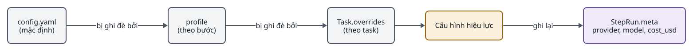
</picture>

<!-- id:s12 -->
## Kiểm tra trước khi chạy

<!-- id:s12.b1 -->
Runner kiểm tra lúc tạo task, để lỗi lộ ra trước khi tốn tiền:

<!-- id:s12.b2 -->
1. Mọi bước trong profile tồn tại trong Module Registry (hoặc là `gate`, `parallel`).
2. Mọi contract trong `consumes` của một bước được một bước trước đó `produces` (hoặc là input của task).
3. Mọi `fan_out` trỏ tới một danh sách có trong contract.
4. Mọi provider trong cấu hình hiệu lực tồn tại; khóa API cần thiết có trong `.env`.
5. `schema_version` của contract khớp với module; nếu không, có hàm chuyển đổi.
6. Ước tính chi phí của profile nằm dưới `budget_usd`.

<!-- id:s12.b3 -->
Ví dụ: profile `shorts_motion` được chấp nhận vì `motion` cần `SceneVisual` dạng ảnh và `images` cung cấp nó trước đó.
