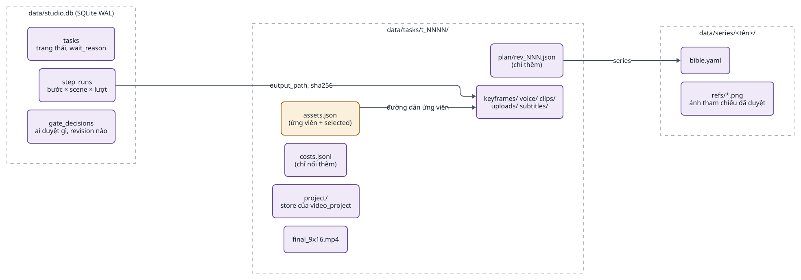
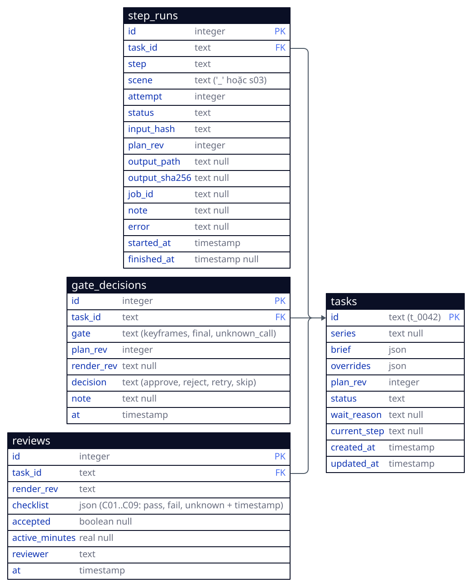
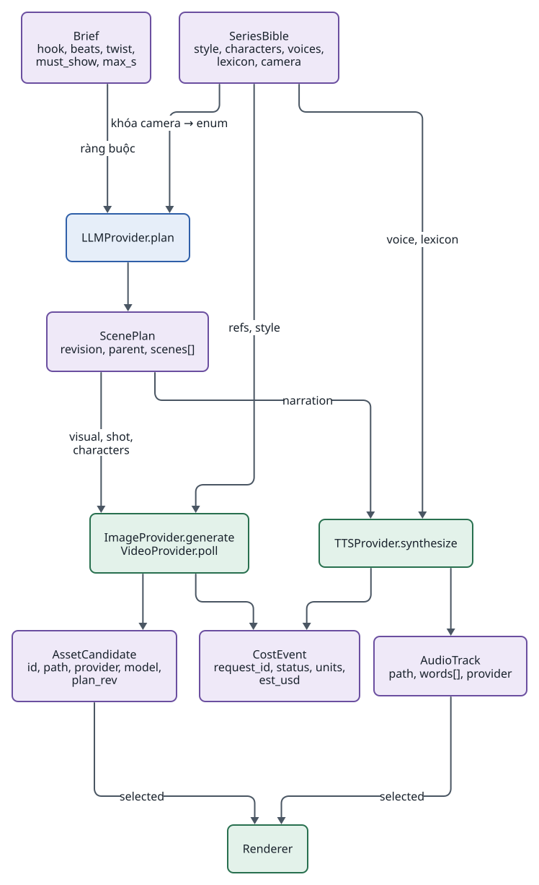
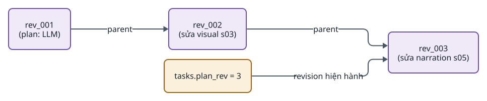
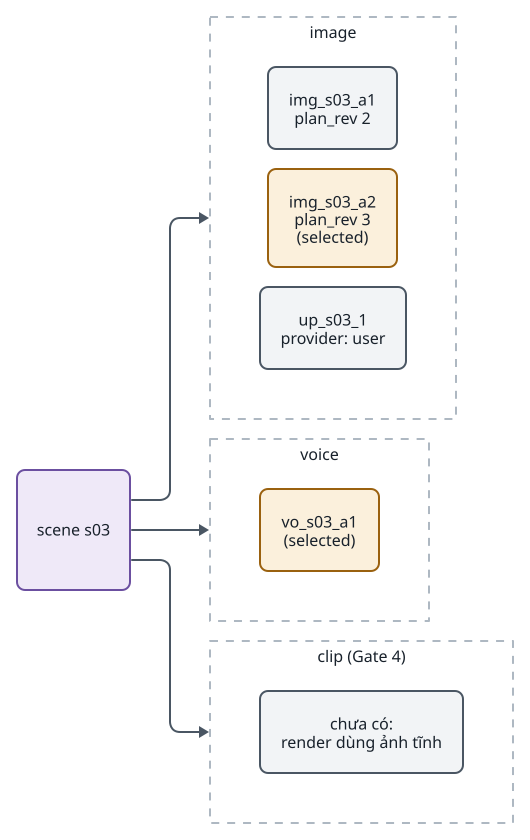
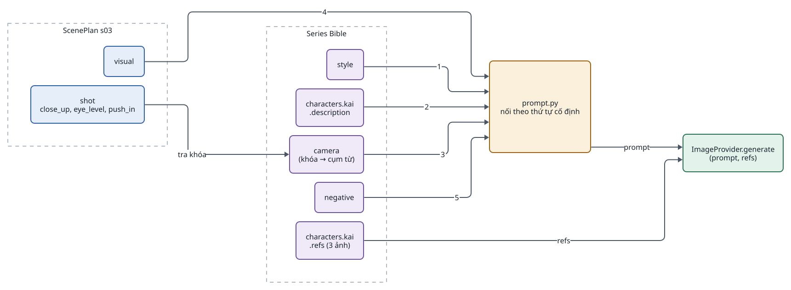
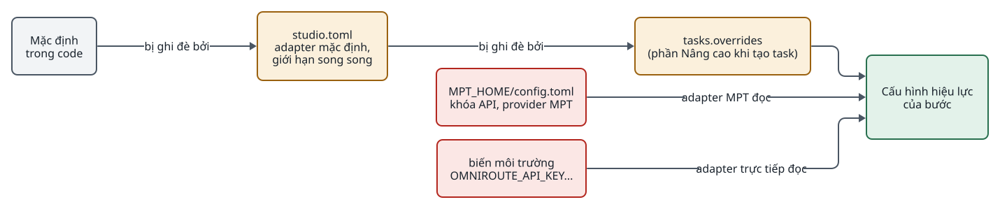
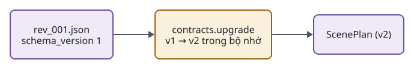

<!-- id:s1 -->
## Dữ liệu nằm ở đâu

<!-- id:s1.b1 -->
Dữ liệu chia theo người đọc: SQLite cho trạng thái mà worker và web cùng hỏi ("task nào đang chờ?"), file cho mọi thứ thuộc về một task. Không có gì bị ghi đè: file mới được thêm, chỉ `assets.json` được cập nhật và luôn qua file tạm rồi đổi tên.

<!-- id:s1.b2 -->
```d2
# cap: Ba nơi lưu: SQLite cho trạng thái, thư mục task cho nội dung, thư mục series cho dữ liệu dùng chung
direction: right
db: "data/studio.db (SQLite WAL)" {
  class: zone
  t: "tasks\ntrạng thái, wait_reason" {class: data}
  r: "step_runs\nbước × scene × lượt" {class: data}
  g: "gate_decisions\nai duyệt gì, revision nào" {class: data}
}
task: "data/tasks/t_NNNN/" {
  class: zone
  plan: "plan/rev_NNN.json\n(chỉ thêm)" {class: data}
  assets: "assets.json\n(ứng viên + selected)" {class: gate}
  costs: "costs.jsonl\n(chỉ nối thêm)" {class: data}
  files: "keyframes/ voice/ clips/\nuploads/ subtitles/" {class: data}
  proj: "project/\nstore của video_project" {class: data}
  mp4: "final_9x16.mp4" {class: data}
}
series: "data/series/<tên>/" {
  class: zone
  bible: "bible.yaml" {class: data}
  refs: "refs/*.png\nảnh tham chiếu đã duyệt" {class: data}
}
db.r -> task.files: "output_path, sha256"
task.assets -> task.files: "đường dẫn ứng viên"
task.plan -> series.bible: "series"
```
<picture>
<source media="(prefers-color-scheme: dark)" srcset="04-data-contracts.figs/s1.b2-dark.svg">

</picture>

<!-- id:s1.b3 -->
Table: Ai ghi gì
| Dữ liệu | Ghi bởi | Kiểu ghi |
| --- | --- | --- |
| `tasks`, `step_runs` | Worker; web/CLI chỉ đổi `status` khi người quyết định | Cập nhật có điều kiện |
| `gate_decisions` | Web, CLI | Thêm dòng |
| `plan/rev_NNN.json` | Worker (`plan`), web (sửa scene) | Thêm file, không sửa |
| `assets.json` | Worker (thêm ứng viên), web (đổi selected, upload) | Ghi file tạm rồi đổi tên, khóa theo task |
| `costs.jsonl` | Worker qua `costs.py` | Nối thêm dòng |
| Ứng viên (`keyframes/`, `voice/`, `clips/`, `uploads/`) | Worker, web (upload) | Thêm file, tên có hậu tố lượt `_aN` |
| `project/` | Renderer `video_project` | Store bất biến có revision và SHA-256 |

<!-- id:s2 -->
## Lược đồ SQLite (đề xuất)

<!-- id:s2.b1 -->
ADD-AIVIDEO-003 chỉ chốt "StepRun trong SQLite". Lược đồ dưới đây là đề xuất của tài liệu này; chốt khi viết migration đầu tiên ở Gate 2.

<!-- id:s2.b2 -->
```d2
# cap: Ba bảng của core; nội dung nằm trong thư mục task, bảng chỉ trỏ tới
direction: right
tasks: {
  shape: sql_table
  id: "text (t_0042)" {constraint: primary_key}
  series: "text null"
  brief: json
  overrides: json
  plan_rev: integer
  status: text
  wait_reason: "text null"
  current_step: "text null"
  created_at: timestamp
  updated_at: timestamp
}
step_runs: {
  shape: sql_table
  id: integer {constraint: primary_key}
  task_id: text {constraint: foreign_key}
  step: text
  scene: "text ('_' hoặc s03)"
  attempt: integer
  status: text
  input_hash: text
  plan_rev: integer
  output_path: "text null"
  output_sha256: "text null"
  job_id: "text null"
  note: "text null"
  error: "text null"
  started_at: timestamp
  finished_at: "timestamp null"
}
gate_decisions: {
  shape: sql_table
  id: integer {constraint: primary_key}
  task_id: text {constraint: foreign_key}
  gate: "text (keyframes, final, unknown_call)"
  plan_rev: integer
  decision: "text (approve, reject, retry, skip)"
  note: "text null"
  at: timestamp
}
step_runs.task_id -> tasks.id
gate_decisions.task_id -> tasks.id
```
<picture>
<source media="(prefers-color-scheme: dark)" srcset="04-data-contracts.figs/s2.b2-dark.svg">

</picture>

<!-- id:s2.b3 -->
- Ràng buộc duy nhất `(task_id, step, scene, attempt)` trên `step_runs`.
- Nhận task: `UPDATE tasks SET status='running' WHERE id=? AND status='pending'`, kiểm số dòng bị đổi; không cần khóa riêng khi chỉ có một worker.
- `wait_reason` là `gate:keyframes`, `gate:final`, `unknown_call` hoặc `retries_exhausted`; giao diện dùng nó để hiện đúng nút.
- Chi phí không nằm trong SQLite: `costs.jsonl` trong thư mục task là nguồn duy nhất (ADR-0006).

<!-- id:s3 -->
## Contract Pydantic

<!-- id:s3.b1 -->
Core có 5 contract. Mỗi contract mang `schema_version`; Pydantic v2 vừa kiểm dữ liệu vừa làm schema structured output cho LLM.

<!-- id:s3.b2 -->
```d2
# cap: Contract và nơi chúng được tạo, đọc
direction: down
bible: "SeriesBible\nstyle, characters, voices,\nlexicon, camera" {class: data}
plan: "ScenePlan\nrevision, parent, scenes[]" {class: data}
cand: "AssetCandidate\nid, path, provider, model,\nplan_rev" {class: data}
audio: "AudioTrack\npath, words[], provider" {class: data}
cost: "CostEvent\nrequest_id, status, units,\nest_usd" {class: data}
llm: "LLMProvider.plan" {class: brain}
img: "ImageProvider.generate\nVideoProvider.poll" {class: hands}
tts: "TTSProvider.synthesize" {class: hands}
rend: "Renderer" {class: hands}
bible -> llm: "khóa camera → enum"
llm -> plan
plan -> img: "visual, shot,\ncharacters"
bible -> img: "refs, style"
img -> cand
plan -> tts: narration
bible -> tts: "voice, lexicon"
tts -> audio
cand -> rend: "selected"
audio -> rend: "selected"
img -> cost
tts -> cost
```
<picture>
<source media="(prefers-color-scheme: dark)" srcset="04-data-contracts.figs/s3.b2-dark.svg">

</picture>

<!-- id:s3.b3 -->
Table: Danh mục contract
| Contract | Tạo bởi | Dùng bởi | Mục đích |
| --- | --- | --- | --- |
| `ScenePlan` | `LLMProvider.plan`, người (sửa) | Mọi bước theo scene, renderer | Kịch bản và shot list theo scene; contract kịch bản duy nhất (AD-06) |
| `AssetCandidate` | `ImageProvider`, `VideoProvider`, upload | Gate, renderer | Một ảnh hoặc clip; ghi provider, model và `plan_rev` |
| `AudioTrack` | `TTSProvider` | `subtitles`, renderer | File giọng của một scene và mốc thời gian từng từ (có thể rỗng) |
| `CostEvent` | `costs.py` | Người, báo cáo tháng | Một dòng `costs.jsonl` |
| `SeriesBible` | Người (trang Series) | `plan`, `keyframes`, `voice` | Phong cách, nhân vật, giọng, từ vựng camera, lexicon |

<!-- id:s4 -->
## ScenePlan

<!-- id:s4.b1 -->
ScenePlan có revision bất biến: sửa luôn tạo `plan/rev_NNN.json` mới với `parent` là revision trước. `shot` là enum lấy từ khóa trong Series Bible, nên structured output của LLM không thể viết lệch. `target_s` là ngân sách thời lượng, không phải ràng buộc; thời lượng thật do giọng đọc quyết định.

<!-- id:s4.b2 -->
```json
// data/tasks/t_0042/plan/rev_003.json — sửa luôn tạo file revision mới
{
  "schema_version": 1, "revision": 3, "parent": 2, "series": "lyra7",
  "title": "Tín hiệu từ năm 2126",
  "scenes": [{
    "id": "s03",
    "narration": "Rồi gương mặt ấy hiện lên...",
    "visual": "Kai turns toward the flickering monitor, hands out of frame",
    "shot": {"size": "close_up", "angle": "eye_level", "movement": "push_in"},
    "characters": ["kai"], "mode": "still", "target_s": 7.5
  }]
}
```

<!-- id:s4.b3 -->
Table: Trường của một scene
| Trường | Kiểu | Ghi chú |
| --- | --- | --- |
| `id` | `s01`..`sNN` | Ổn định qua các revision; là khóa của ứng viên và StepRun |
| `narration` | chuỗi | Lời đọc; nguồn duy nhất cho `voice` và phụ đề |
| `visual` | chuỗi | Mô tả hình cho prompt keyframe |
| `shot` | `{size, angle, movement}` | Enum lấy từ `camera` của Series Bible |
| `characters` | danh sách khóa | Khóa trong `characters` của Series Bible |
| `mode` | `still` \| `motion` | `motion` chỉ có tác dụng từ Gate 4 |
| `target_s` | số giây | Ngân sách; `plan` giới hạn theo số từ (2,5–3 từ/giây) |
| `start_from` | `null` \| `"prev_last_frame"` | Nối frame, tùy chọn, Gate 4 |

<!-- id:s4.b4 -->
```d2
# cap: Chuỗi revision của ScenePlan: mỗi sửa đổi một nút mới, không nút nào bị sửa
direction: right
r1: "rev_001\n(plan: LLM)" {class: data}
r2: "rev_002\n(sửa visual s03)" {class: data}
r3: "rev_003\n(sửa narration s05)" {class: data}
cur: "tasks.plan_rev = 3" {class: gate}
r1 -> r2: parent
r2 -> r3: parent
cur -> r3: "revision hiện hành"
```
<picture>
<source media="(prefers-color-scheme: dark)" srcset="04-data-contracts.figs/s4.b4-dark.svg">

</picture>

<!-- id:s5 -->
## Ứng viên và selected

<!-- id:s5.b1 -->
Mỗi lần sinh ảnh, audio hay clip là một ứng viên; render chỉ dùng ứng viên được chọn (AD-07). Ứng viên đầu tiên của một scene mặc định là selected; sinh lại sau khi sửa scene đặt ứng viên mới làm selected. Upload của người dùng là ứng viên `provider: user`.

<!-- id:s5.b2 -->
```json
// data/tasks/t_0042/assets.json — render chỉ đọc "selected"
{"s03": {"image": {"selected": "img_s03_a2", "candidates": [
   {"id": "img_s03_a1", "path": "keyframes/s03_a1.png", "provider": "gemini", "model": "nano-banana-2", "plan_rev": 2},
   {"id": "img_s03_a2", "path": "keyframes/s03_a2.png", "provider": "gemini", "model": "nano-banana-2", "plan_rev": 3},
   {"id": "up_s03_1", "path": "uploads/s03.png", "provider": "user"}]},
  "voice": {"selected": "vo_s03_a1", "candidates": [{"id": "vo_s03_a1", "path": "voice/vo_s03_a1.mp3", "provider": "mpt:vi-VN-NamMinhNeural", "plan_rev": 3}]}}}
```

<!-- id:s5.b3 -->
```d2
# cap: Một scene giữ nhiều ứng viên cho mỗi loại asset; đúng một ứng viên được chọn
direction: right
scene: "scene s03" {class: data}
img: "image" {
  class: zone
  a1: "img_s03_a1\nplan_rev 2" {class: plain}
  a2: "img_s03_a2\nplan_rev 3\n(selected)" {class: gate}
  u1: "up_s03_1\nprovider: user" {class: plain}
}
vo: "voice" {
  class: zone
  v1: "vo_s03_a1\n(selected)" {class: gate}
}
clip: "clip (Gate 4)" {
  class: zone
  c0: "chưa có:\nrender dùng ảnh tĩnh" {class: plain}
}
scene -> img
scene -> vo
scene -> clip
```
<picture>
<source media="(prefers-color-scheme: dark)" srcset="04-data-contracts.figs/s5.b3-dark.svg">

</picture>

<!-- id:s5.b4 -->
- Id ứng viên: `<loại>_<scene>_a<lượt>` cho ứng viên sinh ra, `up_<scene>_<n>` cho upload; trùng hậu tố `attempt` của StepRun.
- Mọi ứng viên ghi `provider` và `model` thật (NFR-05), kể cả khi người ghi đè adapter cho task.
- Ứng viên có `plan_rev` cũ hơn revision hiện hành của scene được đánh dấu "lệch revision" trên Storyboard.

<!-- id:s6 -->
## Chi phí

<!-- id:s6.b1 -->
Mỗi adapter ghi lượng dùng (số ảnh, ký tự, giây video, token) vào `costs.jsonl`. Dòng `pending` ghi TRƯỚC lượt gọi, dòng kết quả ghi SAU, cùng `request_id`. Không có bảng giá hay ngân sách: `est_usd` do adapter ước tính, giới hạn chi tiêu đặt ở tài khoản provider (ADR-0006).

<!-- id:s6.b2 -->
```json
// data/tasks/t_0042/costs.jsonl — dòng pending ghi TRƯỚC lượt gọi, dòng kết quả ghi SAU
{"ts": "2026-10-19T10:12:01", "request_id": "t_0042:s03:keyframes:2", "provider": "gemini", "model": "nano-banana-2", "status": "pending"}
{"ts": "2026-10-19T10:12:03", "request_id": "t_0042:s03:keyframes:2", "status": "ok", "units": {"images": 1}, "est_usd": 0.067}
```

<!-- id:s6.b3 -->
Table: Trạng thái dòng chi phí
| `status` | Khi nào | Hệ quả |
| --- | --- | --- |
| `pending` | Ngay trước lượt gọi trả phí | Không có dòng kết quả cùng `request_id` khi resume = mồ côi |
| `ok` | Nhận kết quả | Có `units`, `est_usd` |
| `failed` | Lỗi rõ ràng (4xx, `Fatal`) | Không tính phí |
| `unknown` | Mồ côi khi resume, hoặc MPT ném `UnconfirmedTaskError` | Task `waiting`, người quyết định |

<!-- id:s6.b4 -->
`request_id` = `<task>:<scene>:<bước>:<lượt>`. Chỉ số chính đọc từ file này: chi phí trên mỗi video được duyệt, đối chiếu với hóa đơn cuối tháng ([07 · Quan sát](07-operations.md#s4)).

<!-- id:s7 -->
## Series Bible và ghép prompt

<!-- id:s7.b1 -->
Series Bible tạo một lần cho cả series. Mẫu nhân vật là 2–3 ảnh tham chiếu đã duyệt (chính diện, nghiêng, 3/4); từ vựng camera là danh sách khóa cố định để LLM chỉ được chọn, không viết tự do.

<!-- id:s7.b2 -->
```yaml
# data/series/lyra7/bible.yaml
style: "neo-noir sci-fi, teal-orange palette, 35mm anamorphic, volumetric haze"
negative: "no text, no logo, no extra fingers"
characters:
  kai:
    description: "man ~40, shaved head, scar on left eyebrow, grey flight jacket, orange patch"
    refs: [refs/kai_front.png, refs/kai_side.png, refs/kai_3q.png]
voices: {narrator: {provider: mpt, name: vi-VN-NamMinhNeural, rate: 1.0}}
lexicon: {"Lyra-7": "Lai-ra bảy"}          # từ điển phát âm
camera:
  size:     {wide: "wide shot", medium: "medium shot", close_up: "close-up"}
  angle:    {eye_level: "eye-level", low: "low angle", high: "high angle", top_down: "top-down view"}
  movement: {static: "static camera", push_in: "slow push-in", pull_out: "slow pull-out", pan_left: "slow pan left", pan_right: "slow pan right"}
```

<!-- id:s7.b3 -->
Prompt keyframe được ghép xác định trong `prompt.py`: style + mô tả nhân vật + cụm từ camera + visual + negative, kèm ảnh refs. LLM không bao giờ viết lại mô tả nhân vật.

<!-- id:s7.b4 -->
```d2
# cap: Ghép prompt keyframe xác định: LLM chỉ đóng góp visual và khóa shot, phần còn lại lấy từ Series Bible
direction: right
bible: Series Bible {
  class: zone
  st: style {class: data}
  ch: "characters.kai\n.description" {class: data}
  cam: "camera\n(khóa → cụm từ)" {class: data}
  ng: negative {class: data}
  rf: "characters.kai\n.refs (3 ảnh)" {class: data}
}
scene: "ScenePlan s03" {
  class: zone
  vis: visual {class: brain}
  shot: "shot\nclose_up, eye_level, push_in" {class: brain}
}
comp: "prompt.py\nnối theo thứ tự cố định" {class: gate}
out: "ImageProvider.generate\n(prompt, refs)" {class: hands}
bible.st -> comp: 1
bible.ch -> comp: 2
scene.shot -> bible.cam: "tra khóa"
bible.cam -> comp: 3
scene.vis -> comp: 4
bible.ng -> comp: 5
comp -> out: prompt
bible.rf -> out: refs
```
<picture>
<source media="(prefers-color-scheme: dark)" srcset="04-data-contracts.figs/s7.b4-dark.svg">

</picture>

<!-- id:s7.b5 -->
```text
neo-noir sci-fi, teal-orange palette, 35mm anamorphic, volumetric haze.
Kai: man ~40, shaved head, scar on left eyebrow, grey flight jacket, orange patch.
close-up, eye-level, slow push-in.
Kai turns toward the flickering monitor, hands out of frame.
no text, no logo, no extra fingers.
```

<!-- id:s7.b6 -->
Cùng một khóa `movement` điều khiển hai nơi, nên ảnh tĩnh và clip AI có ngôn ngữ camera thống nhất:

<!-- id:s7.b7 -->
Table: Khóa movement
| Khóa | Cụm từ trong prompt image-to-video | Chuyển động FFmpeg khi scene là ảnh tĩnh |
| --- | --- | --- |
| `static` | static camera | Giữ khung |
| `push_in` | slow push-in | Zoom 1.00 → 1.12 |
| `pull_out` | slow pull-out | Zoom 1.12 → 1.00 |
| `pan_left` / `pan_right` | slow pan left / right | Trượt ngang |

<!-- id:s7.b8 -->
> [!WARNING]
> Series Bible giảm trôi nhân vật nhưng không đảm bảo nhất quán (bản rà soát F11). Mức hiệu quả được đo ở Gate 3 bằng test T09 trước khi nghĩ tới LoRA.

<!-- id:s8 -->
## Thư mục task

<!-- id:s8.b1 -->
```text
data/
├── studio.db                     # task, StepRun, gate
├── series/lyra7/bible.yaml, refs/
└── tasks/t_0042/
    ├── brief.json
    ├── plan/rev_001.json … rev_003.json
    ├── assets.json   costs.jsonl
    ├── keyframes/  voice/  clips/  uploads/
    ├── subtitles/full.ass
    ├── project/                  # store của video_project: revision, artifact SHA-256
    └── final_9x16.mp4
```

<!-- id:s8.b2 -->
- Tên file ứng viên mang hậu tố lượt (`s03_a2.png`, `vo_s03_a1.mp3`); không file nào bị ghi lại.
- `project/` thuộc renderer `video_project`: nó tự giữ revision dự án render và hash từng artifact để chỉ dựng lại scene đổi.
- Sao lưu một task = chép thư mục của nó; sao lưu tất cả = `.backup` SQLite rồi chép `data/` ([07 · Sao lưu](07-operations.md#s5)).

<!-- id:s9 -->
## Cấu hình

<!-- id:s9.b1 -->
Có hai file cấu hình, theo hai chủ sở hữu. Khóa API chỉ nằm ở file của MPT và biến môi trường cho SDK trực tiếp; `studio.toml` không chứa bí mật.

<!-- id:s9.b2 -->
```d2
# cap: Thứ tự ưu tiên cấu hình: ghi đè theo task > studio.toml > mặc định trong code
direction: right
code: "Mặc định\ntrong code" {class: plain}
toml: "studio.toml\nadapter mặc định,\ngiới hạn song song" {class: gate}
task: "tasks.overrides\n(phần Nâng cao khi tạo task)" {class: gate}
eff: "Cấu hình hiệu lực\ncủa bước" {class: hands}
mpt: "MPT_HOME/config.toml\nkhóa API, provider MPT" {class: bad}
env: "biến môi trường\nGEMINI_API_KEY..." {class: bad}
code -> toml: "bị ghi đè bởi"
toml -> task: "bị ghi đè bởi"
task -> eff
mpt -> eff: "adapter MPT đọc"
env -> eff: "adapter trực tiếp đọc"
```
<picture>
<source media="(prefers-color-scheme: dark)" srcset="04-data-contracts.figs/s9.b2-dark.svg">

</picture>

<!-- id:s9.b3 -->
```toml
# studio.toml (đề xuất) — không chứa khóa API
[adapters]
llm       = "gemini"            # providers/direct/gemini_llm.py
image     = "nano_banana"       # providers/direct/nano_banana.py
tts       = "mpt"               # providers/mpt/tts.py, giọng lấy từ Series Bible
subtitles = "mpt"               # providers/mpt/subtitle.py
video     = "none"              # Gate 4: "mpt" hoặc "veo"

[concurrency]                   # số scene chạy song song trong một bước, theo adapter
image = 4
tts   = 2
video = 2

[retry]
max_attempts = 3
```

<!-- id:s9.b4 -->
Ghi đè theo task lưu trong `tasks.overrides` và không đổi cấu hình chung; model thật được ghi vào ứng viên và chi phí. Chọn adapter mặc định qua file cấu hình ở Gate 2, qua trang Settings đơn giản từ Gate 3.

<!-- id:s10 -->
## Version của contract

<!-- id:s10.b1 -->
Mọi file JSON mang `schema_version`. Thêm trường tùy chọn không tăng version; đổi nghĩa hay bỏ trường thì tăng và thêm hàm đọc bản cũ trong `contracts.py`. Không chuyển đổi file cũ tại chỗ, vì file trong thư mục task là bất biến.

<!-- id:s10.b2 -->
```d2
# cap: Đọc file cũ qua hàm chuyển đổi, không sửa file trên đĩa
direction: right
f1: "rev_001.json\nschema_version 1" {class: data}
up: "contracts.upgrade\nv1 → v2 trong bộ nhớ" {class: gate}
m: "ScenePlan (v2)" {class: data}
f1 -> up -> m
```
<picture>
<source media="(prefers-color-scheme: dark)" srcset="04-data-contracts.figs/s10.b2-dark.svg">

</picture>
