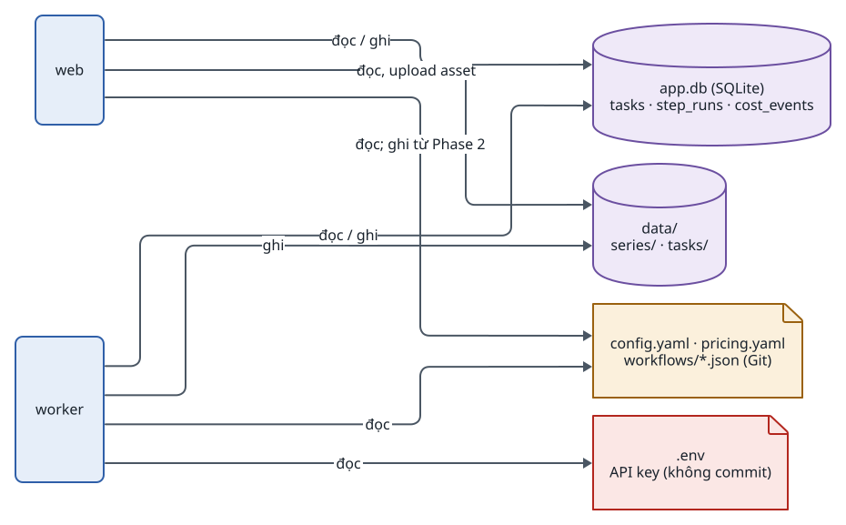
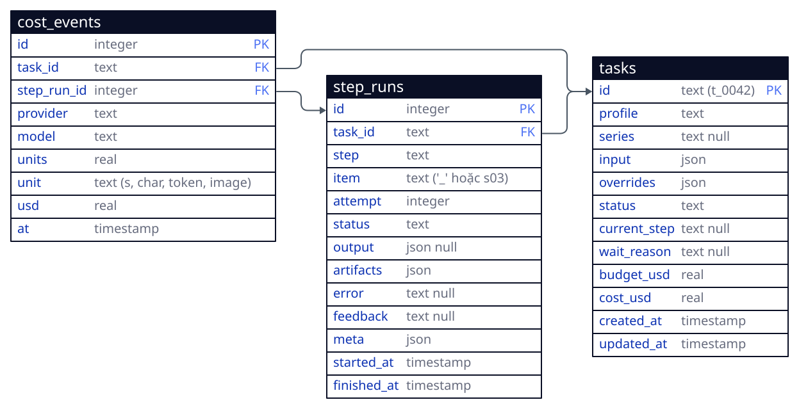
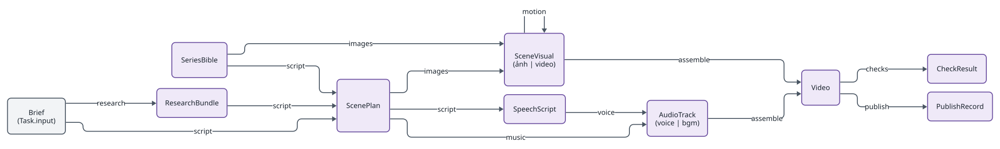
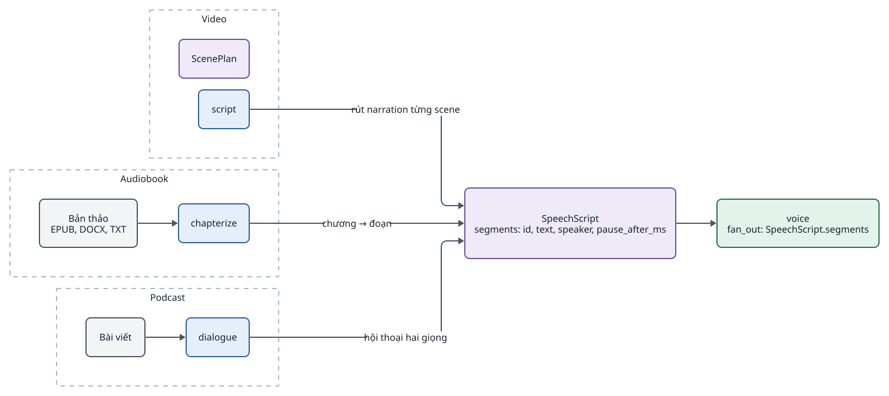
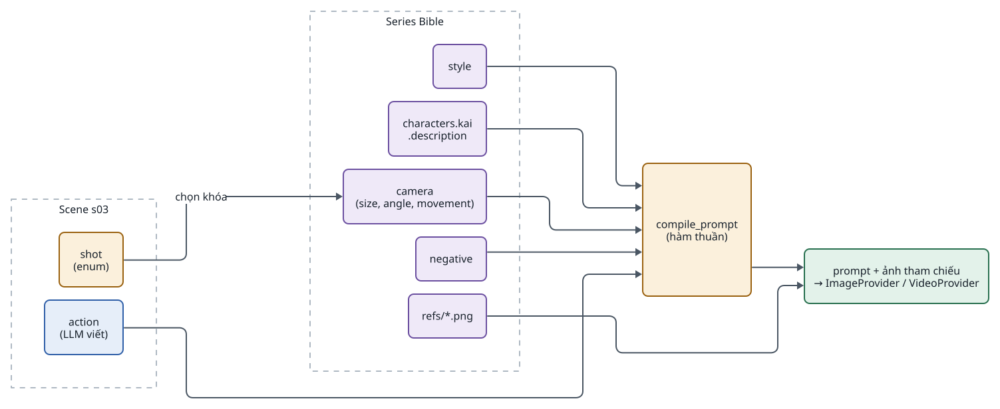
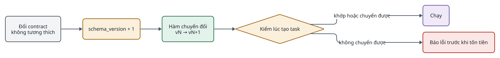

<!-- id:s1 -->
## Dữ liệu nằm ở đâu

<!-- id:s1.b1 -->
```d2
# cap: Bốn nơi chứa dữ liệu và ai đọc, ai ghi
direction: right
web: web {class: brain}
worker: worker {class: brain}
db: "app.db (SQLite)\ntasks · step_runs · cost_events" {shape: cylinder; class: data}
fs: "data/\nseries/ · tasks/" {shape: cylinder; class: data}
cfg: "config.yaml · pricing.yaml\nworkflows/*.json (Git)" {shape: page; class: gate}
env: ".env\nAPI key (không commit)" {shape: page; class: bad}
web -> db: "đọc / ghi"
worker -> db: "đọc / ghi"
worker -> fs: ghi
web -> fs: "đọc, upload asset"
worker -> cfg: đọc
web -> cfg: "đọc; ghi từ Phase 2"
worker -> env: đọc
```
<picture>
<source media="(prefers-color-scheme: dark)" srcset="04-data-contracts.figs/s1.b1-dark.svg">

</picture>

<!-- id:s1.b2 -->
Table: Nơi lưu và quy tắc
| Nơi | Chứa | Quy tắc |
| --- | --- | --- |
| `app.db` | Trạng thái task, StepRun, sự kiện chi phí | SQLite chế độ WAL; truy cập qua SQLModel; đổi Postgres bằng `DATABASE_URL` |
| `data/series/<id>/` | Series Bible, ảnh tham chiếu nhân vật | Tạo một lần, mọi task trong series dùng lại |
| `data/tasks/<task_id>/` | Mọi artifact của task, theo bước | Không ghi đè; tên `step/item_aN.ext` |
| `config.yaml`, `pricing.yaml`, `workflows/` | Profile, provider, giá, workflow ComfyUI | Trong Git; UI ghi `config.yaml` kèm bản `.bak` |
| `.env` | API key | Không commit, không hiển thị trên UI |

<!-- id:s2 -->
## Lược đồ SQLite

<!-- id:s2.b1 -->
```d2
# cap: Ba bảng của core; output và artifact của StepRun lưu dạng JSON
direction: right
tasks: {
  shape: sql_table
  id: "text (t_0042)" {constraint: primary_key}
  profile: text
  series: "text null"
  input: json
  overrides: json
  status: text
  current_step: "text null"
  wait_reason: "text null"
  budget_usd: real
  cost_usd: real
  created_at: timestamp
  updated_at: timestamp
}
step_runs: {
  shape: sql_table
  id: integer {constraint: primary_key}
  task_id: text {constraint: foreign_key}
  step: text
  item: "text ('_' hoặc s03)"
  attempt: integer
  status: text
  output: "json null"
  artifacts: json
  error: "text null"
  feedback: "text null"
  meta: json
  started_at: timestamp
  finished_at: timestamp
}
cost_events: {
  shape: sql_table
  id: integer {constraint: primary_key}
  task_id: text {constraint: foreign_key}
  step_run_id: integer {constraint: foreign_key}
  provider: text
  model: text
  units: real
  unit: "text (s, char, token, image)"
  usd: real
  at: timestamp
}
step_runs.task_id -> tasks.id
cost_events.task_id -> tasks.id
cost_events.step_run_id -> step_runs.id
```
<picture>
<source media="(prefers-color-scheme: dark)" srcset="04-data-contracts.figs/s2.b1-dark.svg">

</picture>

<!-- id:s2.b2 -->
- Ràng buộc duy nhất `(task_id, step, item, attempt)` trên `step_runs`; một dòng `cost_events` cho mỗi lời gọi tính tiền, ghi trong cùng transaction với việc chuyển StepRun sang `done`.
- `wait_reason` là `gate`, `budget` hoặc `on_fail`; UI dùng nó để hiển thị đúng nút.
- `meta` luôn có `provider`, `model`, `cost_usd`, `duration_ms`; tùy chọn `external_job_id`, `source` (`human` khi người sửa), `degraded`.
- Các cột ngoài schema trong ADD-AIVIDEO-001 (`wait_reason`, `feedback`, thời gian) là đề xuất của tài liệu này; chốt khi viết migration đầu tiên.

<!-- id:s3 -->
## Bản ghi Task và StepRun

<!-- id:s3.b1 -->
```python
class Task(BaseModel):
    id: str                      # "t_0042"
    profile: str                 # "shorts_stills"
    series: str | None           # "lyra7" -> data/series/lyra7/
    input: dict                  # brief của người dùng
    overrides: dict = {}         # ghi đè theo task (mục Cấu hình)
    status: Literal["pending", "running", "waiting", "completed", "failed"]
    current_step: str | None
    budget_usd: float
    cost_usd: float = 0

class StepRun(BaseModel):        # một lần chạy một module cho một mục
    task_id: str
    step: str                    # id bước trong profile, ví dụ "images"
    item: str = "_"              # id phần tử fan-out, hoặc "_" nếu chạy một lần
    attempt: int = 1
    status: Literal["pending", "running", "done", "failed", "waiting", "skipped"]
    output: dict | None          # JSON theo contract đầu ra của module
    artifacts: list[str] = []    # đường dẫn trong data/
    error: str | None = None
    meta: dict = {}              # provider, model, cost_usd, duration_ms, external_job_id
```

<!-- id:s3.b2 -->
Schema là tối thiểu; chỉ thêm trường khi có nhu cầu thật.

<!-- id:s4 -->
## Contract nghiệp vụ

<!-- id:s4.b1 -->
Module đọc đầu vào theo tên contract, không theo tên module. Đồ thị dưới đây là luồng contract của profile video; audiobook dùng lại phần giữa từ `SpeechScript`.

<!-- id:s4.b2 -->
```d2
# cap: Luồng contract giữa các module (nhãn trên mũi tên là module tạo ra contract đích)
direction: right
brief: "Brief\n(Task.input)" {class: plain}
bible: SeriesBible {class: data}
research: ResearchBundle {class: data}
plan: ScenePlan {class: data}
speech: SpeechScript {class: data}
visual: "SceneVisual\n(ảnh | video)" {class: data}
audio: "AudioTrack\n(voice | bgm)" {class: data}
video: Video {class: data}
check: CheckResult {class: data}
pub: PublishRecord {class: data}
brief -> research: research
brief -> plan: script
research -> plan: script
bible -> plan: script
plan -> speech: script
plan -> visual: images
bible -> visual: images
visual -> visual: motion
speech -> audio: voice
plan -> audio: music
visual -> video: assemble
audio -> video: assemble
video -> check: checks
video -> pub: publish
```
<picture>
<source media="(prefers-color-scheme: dark)" srcset="04-data-contracts.figs/s4.b2-dark.svg">

</picture>

<!-- id:s4.b3 -->
Table: Danh mục contract
| Contract | Tạo bởi | Dùng bởi | Mục đích |
| --- | --- | --- | --- |
| Brief | Task.input | script, research, chapterize | Yêu cầu của người dùng |
| ResearchBundle | research | script | Dữ kiện có nguồn cho nội dung thực tế |
| ScenePlan | script | images, motion, music, assemble | Kịch bản và shot list theo scene |
| SpeechScript | script, chapterize, dialogue | voice | Danh sách đoạn cần đọc, trung lập với quy trình |
| SceneVisual | images, motion | motion, assemble | Ảnh hoặc clip của một scene; bản mới nhất thắng |
| AudioTrack | voice, music | assemble, master | Audio kèm mốc thời gian từng từ (voice) |
| Video | assemble | checks, publish | MP4 cuối và phụ đề |
| CheckResult | checks | runner, UI | Đạt / không đạt kèm lý do |
| SeriesBible | characters, người dùng | script, images, motion, voice | Dữ liệu dùng chung cho series |
| PublishRecord | publish | analytics | Kết quả upload, id video, lịch đăng |

<!-- id:s5 -->
## ScenePlan

<!-- id:s5.b1 -->
```json
{
  "schema_version": 1,
  "title": "Tín hiệu từ năm 2126",
  "scenes": [{
    "id": "s03",
    "narration": "Rồi gương mặt ấy hiện lên...",
    "target_s": 7.5,
    "mode": "motion",
    "tier": "hero",
    "characters": ["kai"],
    "action": "Kai turns toward the flickering monitor",
    "shot": {"size": "close_up", "angle": "eye_level", "movement": "push_in"},
    "mood": "tense"
  }]
}
```

<!-- id:s5.b2 -->
Table: Trường của một scene
| Trường | Kiểu | Ý nghĩa |
| --- | --- | --- |
| `id` | str | Khóa fan-out, ví dụ `s03` |
| `narration` | str | Lời đọc; được rút sang SpeechScript |
| `target_s` | float | Thời lượng mong muốn |
| `mode` | `still` hoặc `motion` | Ảnh tĩnh có chuyển động camera, hay clip image-to-video |
| `tier` | `hero` hoặc `broll` | Router chọn provider theo hạng (Phase 4) |
| `characters` | list[str] | Khóa nhân vật trong Series Bible |
| `action` | str | Hành động; phần duy nhất LLM viết tự do trong prompt |
| `shot` | `size`, `angle`, `movement` | Enum lấy từ từ vựng camera của Series Bible |
| `mood` | str | Dùng chọn nhạc nền |

<!-- id:s6 -->
## SpeechScript

<!-- id:s6.b1 -->
`voice` nhận contract trung lập này thay vì ScenePlan, nên cùng một module đọc cho video, audiobook và podcast. Quyết định ở [ADR-0002](../adr/0002-speechscript-contract.md).

<!-- id:s6.b2 -->
```d2
# cap: Mỗi quy trình tự sinh SpeechScript; voice không biết nó đến từ đâu
direction: right
v: Video {
  class: zone
  plan: ScenePlan {class: data}
  script: script {class: brain}
}
a: Audiobook {
  class: zone
  book: "Bản thảo\nEPUB, DOCX, TXT" {class: plain}
  chap: chapterize {class: brain}
}
p: Podcast {
  class: zone
  art: "Bài viết" {class: plain}
  dia: dialogue {class: brain}
}
ss: "SpeechScript\nsegments: id, text, speaker, pause_after_ms" {class: data}
voice: "voice\nfan_out: SpeechScript.segments" {class: hands}
v.script -> ss: "rút narration từng scene"
a.book -> a.chap
a.chap -> ss: "chương → đoạn"
p.art -> p.dia
p.dia -> ss: "hội thoại hai giọng"
ss -> voice
```
<picture>
<source media="(prefers-color-scheme: dark)" srcset="04-data-contracts.figs/s6.b2-dark.svg">

</picture>

<!-- id:s6.b3 -->
```json
{
  "schema_version": 1,
  "segments": [
    {"id": "ch01_p003", "text": "...", "speaker": "narrator", "pause_after_ms": 600},
    {"id": "ch01_p004", "text": "\"Ai đó?\" Kai hỏi.", "speaker": "kai"}
  ]
}
```

<!-- id:s6.b4 -->
`speaker` được map sang giọng qua `voices` của Series Bible; tên riêng, từ viết tắt, con số được chuẩn hóa qua `lexicon`.

<!-- id:s7 -->
## Series Bible và ghép prompt

<!-- id:s7.b1 -->
Series Bible là dữ liệu của cả series, tạo một lần. LLM chỉ được chọn khóa camera trong danh sách; prompt được ghép theo công thức bởi hàm thuần `compile_prompt`, nên mô tả nhân vật không bao giờ bị viết lại.

<!-- id:s7.b2 -->
```yaml
# data/series/lyra7/bible.yaml
style: "neo-noir sci-fi, teal-orange palette, 35mm anamorphic, volumetric haze"
negative: "no text, no logo, no extra fingers"
characters:
  kai:
    description: "man ~40, shaved head, scar on left eyebrow, grey flight jacket, orange patch"
    refs: [refs/kai_front.png, refs/kai_side.png, refs/kai_3q.png]   # do module characters tạo, người duyệt chọn
voices: {narrator: {voice_id: "..."}, kai: {voice_id: "..."}}
lexicon: {"2126": "hai một hai sáu"}
camera:          # từ vựng cố định: LLM chỉ được chọn khóa
  size:     {wide: "wide shot", medium: "medium shot", close_up: "close-up", extreme_close_up: "extreme close-up"}
  angle:    {eye_level: "eye-level", low: "low angle", high: "high angle", top_down: "top-down view"}
  movement: {static: "static camera", push_in: "slow push-in", pull_out: "slow pull-out", pan_left: "slow pan left", pan_right: "slow pan right"}
```

<!-- id:s7.b3 -->
```d2
# cap: compile_prompt ghép prompt xác định từ Series Bible và scene; chỉ action do LLM viết
direction: right
bible: "Series Bible" {
  class: zone
  sty: style {class: data}
  char: "characters.kai\n.description" {class: data}
  cam: "camera\n(size, angle, movement)" {class: data}
  neg: negative {class: data}
  refs: "refs/*.png" {class: data}
}
scene: "Scene s03" {
  class: zone
  shot: "shot\n(enum)" {class: gate}
  action: "action\n(LLM viết)" {class: brain}
}
cp: "compile_prompt\n(hàm thuần)" {class: gate}
out: "prompt + ảnh tham chiếu\n→ ImageProvider / VideoProvider" {class: hands}
bible.sty -> cp
bible.char -> cp
bible.cam -> cp
scene.shot -> bible.cam: "chọn khóa"
scene.action -> cp
bible.neg -> cp
bible.refs -> out
cp -> out
```
<picture>
<source media="(prefers-color-scheme: dark)" srcset="04-data-contracts.figs/s7.b3-dark.svg">

</picture>

<!-- id:s7.b4 -->
Kết quả cho s03:

<!-- id:s7.b5 -->
```text
neo-noir sci-fi, teal-orange palette, 35mm anamorphic, volumetric haze.
Kai: man ~40, shaved head, scar on left eyebrow, grey flight jacket, orange patch.
close-up, eye-level, slow push-in.
Kai turns toward the flickering monitor.
no text, no logo, no extra fingers.
```

<!-- id:s7.b6 -->
Table: Một từ vựng camera điều khiển hai nơi
| Khóa `movement` | Cụm từ trong prompt image-to-video | Chuyển động FFmpeg khi scene là ảnh tĩnh |
| --- | --- | --- |
| `static` | static camera | Giữ khung |
| `push_in` | slow push-in | Zoom 1.00 → 1.12 |
| `pull_out` | slow pull-out | Zoom 1.12 → 1.00 |
| `pan_left` / `pan_right` | slow pan left / right | Trượt ngang khung |

<!-- id:s8 -->
## Cấu hình

<!-- id:s8.b1 -->
```yaml
# config.yaml
providers:
  llm:   {use: gemini, model: gemini-3.8-flash}
  image: {use: gemini_image, model: nano-banana-2}
  tts:   {use: elevenlabs, model: eleven_v4}
  video: {use: veo, model: veo-3.1-fast, resolution: 720p, concurrency: 2}

profiles:
  shorts_stills:
    budget_usd: 3
    steps:
      - script
      - images: {retry: {max_attempts: 3}}
      - gate: keyframes          # dừng cho người duyệt; xóa dòng này để bỏ
      - voice
      - music
      - assemble: {subtitles: true, aspect: "9:16"}
      - gate: final
```

<!-- id:s8.b2 -->
Ghi đè theo task nằm trong `Task.overrides` và không đổi cấu hình chung. Thứ tự ưu tiên: `config.yaml` → profile → `Task.overrides`.

<!-- id:s8.b3 -->
```json
{
  "profile": "shorts_motion",
  "overrides": {
    "providers": {"video": {"model": "veo-3.1-standard", "resolution": "1080p"}},
    "steps": {"music": {"enabled": false}},
    "budget_usd": 40
  }
}
```

<!-- id:s8.b4 -->
`pricing.yaml` giữ giá theo `provider.model` và đơn vị (giây, ký tự, token, ảnh); cập nhật thủ công và đối chiếu hóa đơn hằng tháng. Giá trong bộ tài liệu là ước tính tháng 10/2026.

<!-- id:s9 -->
## Artifact store

<!-- id:s9.b1 -->
```text
data/
├── app.db                          # trạng thái task, step run, chi phí
├── series/lyra7/
│   ├── bible.yaml
│   └── refs/kai_front.png  kai_side.png  kai_3q.png
└── tasks/t_0042/
    ├── input.json
    ├── script/plan.json
    ├── images/s01_a1.png … s04_a2.png … s08_a1.png
    ├── motion/s01_a1.mp4  s03_a1.mp4  s03_a2.mp4  s03_a3.mp4  s05_a1.mp4  s07_a1.mp4
    ├── voice/vo_s01.wav … vo_s08.wav  words.json
    ├── music/bgm.mp3
    ├── assemble/timeline.json  subs.ass  final_9x16.mp4
    ├── checks/*.json
    └── logs/*.log
```

<!-- id:s9.b2 -->
- Tên file: `<step>/<item>_a<attempt>.<ext>`; bước chạy một lần dùng tên cố định trong thư mục bước.
- Module chỉ ghi qua `ctx.save(data, name)`; core quyết định đường dẫn và tính hash.
- Upload của người dùng (thay asset) là artifact của một StepRun mới `meta.source: human`.

<!-- id:s10 -->
## Version của contract

<!-- id:s10.b1 -->
```d2
# cap: Đổi contract không tương thích: tăng schema_version, viết hàm chuyển đổi, kiểm lúc tạo task
direction: right
change: "Đổi contract\nkhông tương thích" {class: plain}
bump: "schema_version + 1" {class: gate}
mig: "Hàm chuyển đổi\nvN → vN+1" {class: hands}
check: "Kiểm lúc tạo task" {shape: diamond; class: gate}
ok: "Chạy" {class: data}
err: "Báo lỗi trước khi tốn tiền" {class: bad}
change -> bump -> mig -> check
check -> ok: "khớp hoặc chuyển được"
check -> err: "không chuyển được"
```
<picture>
<source media="(prefers-color-scheme: dark)" srcset="04-data-contracts.figs/s10.b1-dark.svg">

</picture>

<!-- id:s10.b2 -->
Mỗi contract nghiệp vụ có `schema_version` (số nguyên). Dữ liệu cũ trong `step_runs.output` được chuyển khi đọc, không ghi lại hàng loạt.
