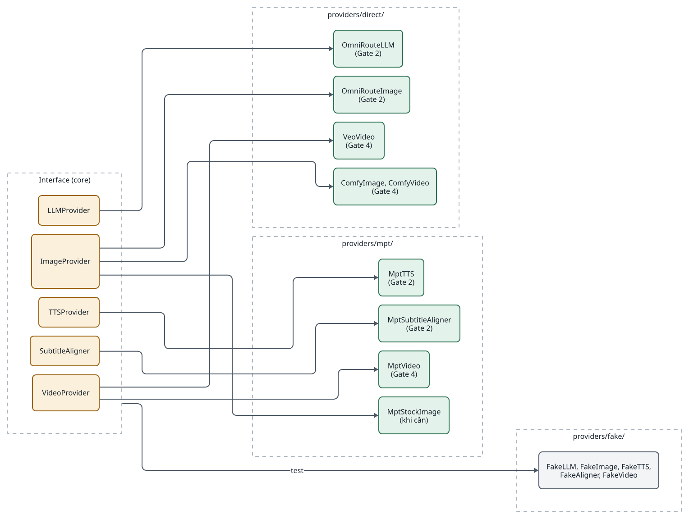
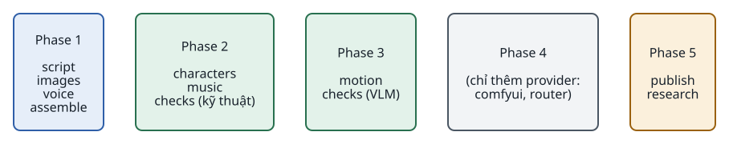
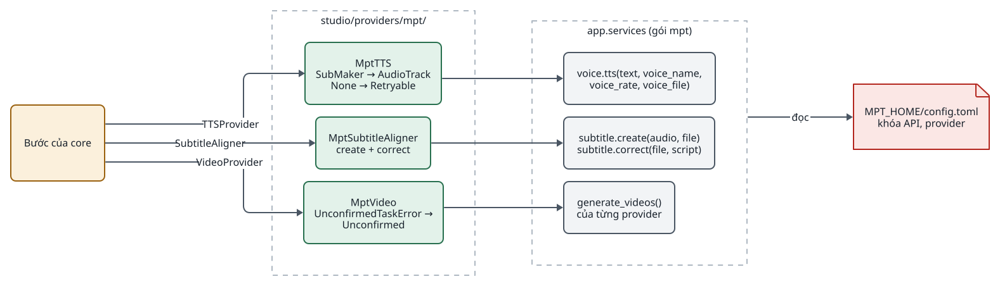
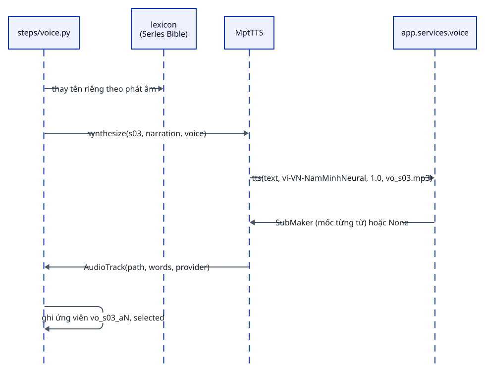
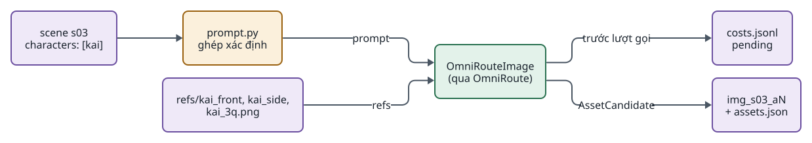
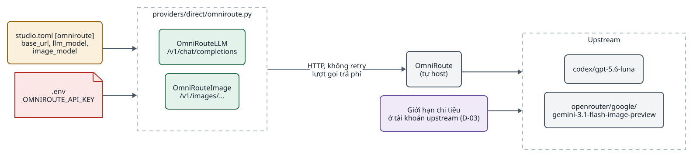
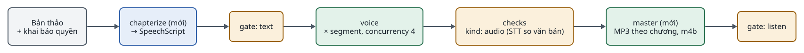
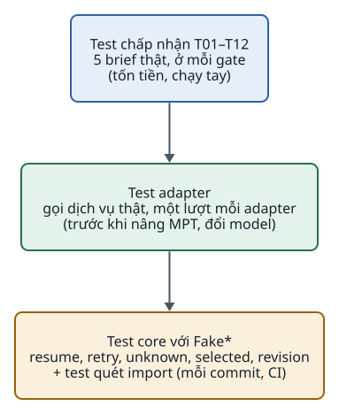

<!-- id:s1 -->
## Provider interface

<!-- id:s1.b1 -->
Core định nghĩa 5 interface năng lực bằng `typing.Protocol`. Bước chỉ thấy interface; adapter cụ thể được chọn bằng cấu hình. `VideoProvider` tách `submit` và `poll` để resume không gửi lại job.

<!-- id:s1.b2 -->
```python
# studio/providers/base.py
class LLMProvider(Protocol):
    def plan(self, brief: Brief, bible: SeriesBible | None) -> ScenePlan: ...      # structured output, kiểm tra Pydantic

class ImageProvider(Protocol):
    def generate(self, prompt: str, refs: list[Path], size: str, out: Path) -> AssetCandidate: ...

class TTSProvider(Protocol):
    def synthesize(self, seg_id: str, text: str, voice: VoiceSpec, out_dir: Path) -> AudioTrack: ...  # words có thể rỗng

class SubtitleAligner(Protocol):
    def align(self, audio: Path, script: str, out: Path) -> Path: ...

class VideoProvider(Protocol):                       # tách submit/poll để resume không gửi lại job
    def submit(self, image: Path, prompt: str, seconds: int) -> str: ...
    def poll(self, job_id: str) -> AssetCandidate | None: ...

# Lỗi chung: Retryable (chắc chắn chưa gửi) · QualityFail(reason) · Unconfirmed (lượt gọi trả phí có thể đã tới provider) · Fatal
```

<!-- id:s1.b3 -->
<!-- report-kit:d2
```d2
# cap: Mỗi interface có adapter thật và bản giả; adapter MPT chỉ là một lựa chọn trong số đó
direction: right
ifc: Interface (core) {
  class: zone
  llm: LLMProvider {class: gate}
  img: ImageProvider {class: gate}
  tts: TTSProvider {class: gate}
  al: SubtitleAligner {class: gate}
  vid: VideoProvider {class: gate}
}
direct: "providers/direct/" {
  class: zone
  gem: "OmniRouteLLM\n(Gate 2)" {class: hands}
  nb: "OmniRouteImage\n(Gate 2)" {class: hands}
  veo: "VeoVideo\n(Gate 4)" {class: hands}
  comfy: "ComfyImage, ComfyVideo\n(Gate 4)" {class: hands}
}
mpt: "providers/mpt/" {
  class: zone
  mtts: "MptTTS\n(Gate 2)" {class: hands}
  mal: "MptSubtitleAligner\n(Gate 2)" {class: hands}
  mvid: "MptVideo\n(Gate 4)" {class: hands}
  mstock: "MptStockImage\n(khi cần)" {class: hands}
}
fake: "providers/fake/" {
  class: zone
  fk: "FakeLLM, FakeImage, FakeTTS,\nFakeAligner, FakeVideo" {class: plain}
}
ifc.llm -> direct.gem
ifc.img -> direct.nb
ifc.img -> direct.comfy
ifc.img -> mpt.mstock
ifc.tts -> mpt.mtts
ifc.al -> mpt.mal
ifc.vid -> direct.veo
ifc.vid -> mpt.mvid
ifc -> fake.fk: "test"
```
-->
<picture>
<source media="(prefers-color-scheme: dark)" srcset="05-modules-providers.figs/s1.b3-dark.svg">

</picture>

<!-- id:s1.b4 -->
Table: Lỗi chung
| Lỗi | Khi nào adapter ném | Worker làm gì |
| --- | --- | --- |
| `Retryable` | Lượt gọi không trả phí bị 429, 5xx, timeout; MPT TTS trả `None`. Lượt gọi trả phí: chỉ khi chắc chắn chưa gửi (không kết nối được, 429 bị từ chối trước khi xử lý) | Thử lại cùng đầu vào, backoff, tối đa 3 lần |
| `QualityFail(reason)` | Kết quả có nhưng không đạt kiểm tra | Chạy lại riêng scene đó, lý do vào prompt |
| `Unconfirmed` | Lượt gọi trả phí đã có thể tới provider nhưng không có kết quả chắc chắn: đọc timeout, mất kết nối giữa chừng, 5xx, response thiếu id; MPT ném lỗi unconfirmed của provider | Ghi `unknown`, task `waiting` |
| `Fatal` | Cấu hình sai, khóa API sai, nội dung bị từ chối | Task `failed` |

<!-- id:s2 -->
## MPT có gì và ta dùng gì

<!-- id:s2.b1 -->
MPT (khoảng 36.000 dòng Python, MIT, 203 file test, cập nhật gần như hằng ngày) mạnh ở hạ tầng provider và render, yếu đúng ở phần sản phẩm ta cần khác biệt. Vì vậy MPT được dùng như thư viện sau adapter, không phải nền tảng chính.

<!-- id:s2.b2 -->
<!-- report-kit:d2
```d2
# cap: Phần của MPT ta dùng, chỉ dùng ở Gate 1, và không dùng
direction: right
use: Dùng qua adapter {
  class: zone
  v: "voice.tts\n14 provider TTS" {class: hands}
  s: "subtitle.create / correct\nfaster-whisper, font Việt" {class: hands}
  g: "generate_videos()\nprovider video AI" {class: hands}
  m: "material.py\nstock footage (khi cần)" {class: hands}
  l: "llm.py\n(tùy chọn)" {class: hands}
}
copy: Copy (vendor) {
  class: zone
  vp: "video_project.py\nrevision, dựng lại theo scene" {class: data}
}
g1: Chỉ dùng nguyên ở Gate 1 {
  class: zone
  ui: "WebUI Streamlit, REST API,\nCLI" {class: plain}
}
no: Không dùng {
  class: zone
  x1: "task.py, state.py\n(trạng thái trong process)" {class: bad}
  x2: "video.py\n(MoviePy, một file giọng)" {class: bad}
  x3: "upload_post.py" {class: bad}
}
```
-->
<picture>
<source media="(prefers-color-scheme: dark)" srcset="05-modules-providers.figs/s2.b2-dark.svg">

</picture>

<!-- id:s2.b3 -->
Table: MPT có gì và ta dùng gì
| Nhóm | Có trong MPT | Ta dùng? |
| --- | --- | --- |
| Kịch bản | LLM viết kịch bản dạng một khối văn bản; tách từ khóa tìm hình | Chỉ lớp kết nối LLM (tùy chọn); schema ScenePlan do ta viết |
| Giọng đọc | 14 provider TTS: Edge TTS miễn phí (2 giọng tiếng Việt), Azure, Gemini, ElevenLabs, MiniMax, Fish Audio, Kokoro, VoxCPM... | Có, qua `MptTTS` |
| Phụ đề | Mốc thời gian Edge TTS; faster-whisper rồi sửa theo kịch bản; font tiếng Việt (Be Vietnam Pro) | Có, qua `MptSubtitleAligner` |
| Hình ảnh | Stock footage (Pexels, Pixabay, Coverr); ảnh AI OpenAI-compatible rồi zoom thành clip | Tùy chọn cho scene không có nhân vật |
| Video AI | Seedance, MiniMax H3, WaveSpeed, MuAPI, OFox; lỗi riêng cho job trả phí chưa xác nhận | Có ở Gate 4, qua `MptVideo` |
| Revision theo scene | `video_project.py`: revision bất biến, chỉ dựng lại scene đổi, kiểm tra SHA-256, khóa, retry | Có, copy làm renderer |
| Dựng video chính | MoviePy, một file giọng cho cả bài, chuyển cảnh, nhiều biến thể | Không |
| Giao diện, API | WebUI Streamlit, REST API, CLI, skill cho AI agent | Chỉ dùng nguyên bản ở Gate 1 |
| Trạng thái | Bộ nhớ trong process (mất khi khởi động lại) hoặc Redis | Không |
| Đăng bài | Qua dịch vụ trung gian upload-post.com | Hoãn |

<!-- id:s3 -->
## Ranh giới và bảng adapter

<!-- id:s3.b1 -->
Chỉ các file trong `studio/providers/mpt/` được import `app.*`; một test quét import kiểm tra điều này. Bỏ MPT cho một năng lực = viết adapter khác cùng interface, đổi một dòng cấu hình.

<!-- id:s3.b2 -->
<!-- report-kit:d2
```d2
# cap: Adapter MPT dịch giữa interface của ta và hàm của MPT; lỗi MPT được đổi thành lỗi chung
direction: right
core: "Bước của core" {class: gate}
adp: "studio/providers/mpt/" {
  class: zone
  t: "MptTTS\nSubMaker → AudioTrack\nNone → Retryable" {class: hands}
  a: "MptSubtitleAligner\ncreate + correct" {class: hands}
  v: "MptVideo\n*UnconfirmedTaskError →\nUnconfirmed" {class: hands}
}
mpt: "app.services (gói mpt)" {
  class: zone
  voice: "voice.tts(text, voice_name,\nvoice_rate, voice_file)" {class: plain}
  sub: "subtitle.create(audio, file)\nsubtitle.correct(file, script)" {class: plain}
  vid: "generate_videos()\ncủa từng provider" {class: plain}
}
cfg: "MPT_HOME/config.toml\nkhóa API, provider" {shape: page; class: bad}
core -> adp.t: "TTSProvider"
core -> adp.a: "SubtitleAligner"
core -> adp.v: "VideoProvider"
adp.t -> mpt.voice
adp.a -> mpt.sub
adp.v -> mpt.vid
mpt -> cfg: đọc
```
-->
<picture>
<source media="(prefers-color-scheme: dark)" srcset="05-modules-providers.figs/s3.b2-dark.svg">

</picture>

<!-- id:s3.b3 -->
Table: Bảng adapter
| Interface | Hàm được gọi | Adapter chuyển đổi | Khi nào viết |
| --- | --- | --- | --- |
| `TTSProvider` | MPT `voice.tts(text, voice_name, voice_rate, voice_file)` | `SubMaker` → `AudioTrack` kèm mốc thời gian; trả `None` → `Retryable` | Gate 2 |
| `SubtitleAligner` | MPT `subtitle.create(audio_file, subtitle_file)` rồi `subtitle.correct(subtitle_file, script)` | Dùng khi TTS không trả mốc từ | Gate 2 |
| `LLMProvider` | `OmniRouteLLM` qua OmniRoute (mặc định); hoặc lớp kết nối trong `llm.py` của MPT | Prompt và schema do ta viết | Gate 2 |
| `ImageProvider` (nhân vật) | `OmniRouteImage` qua OmniRoute (`openrouter/google/gemini-nano-banana-2.1`, cần ảnh tham chiếu) | Trả `AssetCandidate`; MPT không có khái niệm nhân vật | Gate 2 |
| `ImageProvider` (phụ) | MPT stock footage trong `material.py` | Trả ứng viên cho scene không cần nhân vật | Khi cần |
| `VideoProvider` | MPT `generate_videos()` của từng provider, hoặc SDK Veo | `UnconfirmedTaskError` → `CostEvent unknown`, task `waiting` | Gate 4 |
| Renderer | `vendor/video_project.py` (bản copy tại `82bb4a7`) | `render(plan, assets)` → manifest (mỗi scene: clip selected dạng MP4, giọng selected, narration) → `create_revision`, `plan`, `render` | Gate 2 |

<!-- id:s3.b4 -->
Quy tắc giữ ranh giới:

<!-- id:s3.b5 -->
- Chỉ các file trong `studio/providers/mpt/` được import `app.*`; test quét import chạy trong CI.
- Package của ta tên `studio`, không bao giờ `app` (gói `mpt` cài vào tên `app`).
- API key và cấu hình provider nằm trong `config.toml` của MPT (`MPT_HOME`); adapter chỉ truyền tham số như giọng, tốc độ, văn bản.
- Ghim phiên bản MPT; mỗi adapter có test riêng chạy trước khi nâng ([07 · Nâng MPT](07-operations.md#s3)).
- MPT không có một lớp lỗi unconfirmed chung: mỗi provider có lớp riêng (`MuAPIUnconfirmedTaskError`, `VolcEngineSeedanceUnconfirmedTaskError`, `MetasoMiniMaxUnconfirmedTaskError`, `OFoxUnconfirmedTaskError`, `WaveSpeedUnconfirmedTaskError`, `InfistarVideoUnconfirmedError`, `OpenAIImageUnconfirmedError` tại `82bb4a7`). `MptVideo` giữ danh sách này và test adapter kiểm nó khi nâng MPT.
- Gói `mpt` 1.3.9 ghim cứng các thư viện dùng chung với studio (`fastapi==0.136.3`, `starlette==1.2.1`, `uvicorn==0.32.1`, `openai==2.24.0`, `requests==2.33.1`, `pyyaml==6.0.3`) và kéo theo Streamlit, faster-whisper, Azure Speech, Redis client. Studio dùng đúng các bản đó trong một `uv.lock`; nâng MPT cũng là nâng web của ta, nên test web chạy cùng test adapter.
- Test adapter kiểm cả cách ánh xạ tham số: pilot Gate 1 gặp `bgm_type="none"` bị từ chối trong manifest batch trong khi CLI `--bgm-type none` chạy được.

<!-- id:s4 -->
## Ví dụ: adapter MptTTS

<!-- id:s4.b1 -->
```python
# studio/providers/mpt/tts.py — chỉ thư mục này biết MPT tồn tại
class MptTTS(TTSProvider):
    def synthesize(self, seg_id, text, voice, out_dir):
        from app.services import voice as mpt_voice        # package của MPT tên là "app"
        out = out_dir / f"vo_{seg_id}.mp3"
        sub = mpt_voice.tts(text, voice.name, voice.rate, str(out))
        if sub is None:
            raise Retryable("MPT TTS returned no audio")
        return AudioTrack(path=out, words=to_word_timings(sub), provider="mpt:" + voice.name)
```

<!-- id:s4.b2 -->
<!-- report-kit:d2
```d2
# cap: Một lượt gọi qua MptTTS, từ bước voice tới file giọng và mốc thời gian
shape: sequence_diagram
step: "steps/voice.py"
lex: "lexicon\n(Series Bible)"
tts: MptTTS
mpt: "app.services.voice"
step -> lex: "thay tên riêng theo phát âm"
step -> tts: "synthesize(s03, narration, voice)"
tts -> mpt: "tts(text, vi-VN-NamMinhNeural, 1.0, vo_s03.mp3)"
mpt -> tts: "SubMaker (mốc từng từ) hoặc None"
tts -> step: "AudioTrack(path, words, provider)"
step -> step: "ghi ứng viên vo_s03_aN, selected"
```
-->
<picture>
<source media="(prefers-color-scheme: dark)" srcset="05-modules-providers.figs/s4.b2-dark.svg">

</picture>

<!-- id:s5 -->
## Keyframe có nhân vật: adapter trực tiếp

<!-- id:s5.b1 -->
Keyframe có nhân vật dùng adapter gọi API ảnh hỗ trợ ảnh tham chiếu (mặc định `openrouter/google/gemini-nano-banana-2.1` qua OmniRoute), vì MPT không có khái niệm nhân vật. Adapter nhận prompt đã ghép xác định và đường dẫn ảnh refs từ Series Bible ([04 · Ghép prompt](04-data-contracts.md#s7)), ghi `pending` trước lượt gọi và trả `AssetCandidate`.

<!-- id:s5.b2 -->
<!-- report-kit:d2
```d2
# cap: Bước keyframes cho một scene có nhân vật
direction: right
scene: "scene s03\ncharacters: [kai]" {class: data}
prompt: "prompt.py\nghép xác định" {class: gate}
refs: "refs/kai_front, kai_side,\nkai_3q.png" {class: data}
cost: "costs.jsonl\npending" {class: data}
nb: "OmniRouteImage\n(qua OmniRoute)" {class: hands}
cand: "img_s03_aN\n+ assets.json" {class: data}
scene -> prompt
prompt -> nb: prompt
refs -> nb: refs
nb -> cost: "trước lượt gọi"
nb -> cand: "AssetCandidate"
```
-->
<picture>
<source media="(prefers-color-scheme: dark)" srcset="05-modules-providers.figs/s5.b2-dark.svg">

</picture>

<!-- id:s5.b3 -->
### Gate 2b qua OmniRoute

<!-- id:s5.b4 -->
Tuan chọn ngày 24/10/2026: Gate 2b gọi LLM và ảnh qua OmniRoute, một gateway tự host có API kiểu OpenAI (mặc định cổng 20128, model đặt tên dạng `provider/model`). Model ban đầu là `codex/gpt-5.6-luna` cho ScenePlan và `openrouter/google/gemini-nano-banana-2.1` cho keyframe. Model có thể đổi, nên chúng là chuỗi trong `studio.toml` ([04 · Cấu hình](04-data-contracts.md#s9)); đổi model không sửa code. Một module `providers/direct/omniroute.py` có hai lớp `OmniRouteLLM` và `OmniRouteImage` dùng chung client HTTP.

<!-- id:s5.b5 -->
<!-- report-kit:d2
```d2
# cap: Hai adapter dùng chung một gateway OmniRoute; model nằm trong studio.toml, tiền bị trừ ở tài khoản upstream
direction: right
cfg: "studio.toml [omniroute]\nbase_url, llm_model,\nimage_model" {class: gate}
key: ".env\nOMNIROUTE_API_KEY" {shape: page; class: bad}
st: "providers/direct/omniroute.py" {
  class: zone
  llm: "OmniRouteLLM\n/v1/chat/completions" {class: hands}
  img: "OmniRouteImage\n/v1/images/..." {class: hands}
}
gw: "OmniRoute\n(tự host)" {class: plain}
up: "Upstream" {
  class: zone
  codex: "codex/gpt-5.6-luna" {class: plain}
  cinf: "openrouter/google/gemini-nano-banana-2.1" {class: plain}
}
lim: "Giới hạn chi tiêu\nở tài khoản upstream (D-03)" {class: data}
cfg -> st
key -> st
st -> gw: "HTTP, không retry\nlượt gọi trả phí"
gw -> up
lim -> up
```
-->
<picture>
<source media="(prefers-color-scheme: dark)" srcset="05-modules-providers.figs/s5.b5-dark.svg">

</picture>

<!-- id:s5.b6 -->
Table: Ánh xạ adapter OmniRoute
| Interface | Endpoint | Đầu ra | Ánh xạ lỗi |
| --- | --- | --- | --- |
| `LLMProvider` | `POST /v1/chat/completions`, `model = llm_model` | JSON ScenePlan, kiểm bằng Pydantic | Sai schema → `QualityFail`; 401, 403, model không tồn tại → `Fatal`; 429 hoặc lỗi kết nối trước khi gửi → `Retryable`; timeout, 5xx sau khi gửi → `Unconfirmed` |
| `ImageProvider` (nhân vật) | `POST /v1/images/edits` (multipart, `image[]` là ảnh tham chiếu); `POST /v1/images/generations` cho scene không có nhân vật | `AssetCandidate` ghi `provider = "omniroute"` và `model` trả về | Như trên; thiếu ảnh trong response → `Unconfirmed` vì có thể đã bị tính tiền |

<!-- id:s5.b7 -->
> [!IMPORTANT]
> OmniRoute có combo và fallback: khi một provider hết hạn mức, request có thể được chuyển sang model khác. Với lượt gọi trả phí, điều đó vừa đổi model mà không báo, vừa có thể làm một lượt gọi bị tính tiền hai lần. Adapter chỉ gọi đúng tên model cụ thể (không dùng alias `auto/...` hay combo), tắt retry và fallback cho hai model này, và so `model` trong response với model đã cấu hình; khác thì báo `Fatal`.

<!-- id:s5.b8 -->
Việc cần kiểm trước việc 7 của Gate 2. Ngày 25/10/2026 đã kiểm trên OmniRoute 3.8.52 ở máy Tuan, có khóa API nhưng chưa gọi sinh nội dung (chỉ đọc `/v1/models`, gửi body thiếu prompt và đọc mã nguồn trong container); các mục còn lại cần vài lượt gọi thử (dưới 0,5 USD).

<!-- id:s5.b9 -->
```chk
- [x] `GET /v1/models` có khóa (25/10/2026): 343 model. `codex/gpt-5.6-luna` có, nhận text và ảnh, context 872k, có JSON tool calling; kết nối codex qua OAuth (gói thuê bao có hạn mức)
- [ ] `openrouter/google/gemini-nano-banana-2.1` không có trong `/v1/models`, dù endpoint ảnh nhận nó là model ảnh. Cần một lượt gọi thử (khoảng 0,07 USD) sau khi đặt giới hạn credit để biết nó chạy thật không. Dự phòng có trong danh sách: `openrouter/google/gemini-3.1-flash-image-preview`. Prefix `cinf/` không tồn tại; `cheaperinference/nano-banana-2` chỉ nhận text nên không dùng được ảnh tham chiếu
- [x] Ảnh tham chiếu: `/v1/images/edits` nhận multipart với nhiều trường `image[]`; `/v1/images/generations` nhận JSON với `reference_images`, `input_images`, `image_urls` (và các tên tương tự). OmniRoute chuyển chúng xuống provider dưới tên `referenceImages`. Adapter dùng `/v1/images/edits` khi scene có nhân vật
- [x] Giới hạn số ảnh tham chiếu ở `/v1/images/edits` (lượt thử 25/10/2026, bị chặn tại OmniRoute nên không tốn tiền): OpenRouter và đa số provider chỉ nhận 1 ảnh; `codex/gpt-image-*` và `codex/gpt-5.6-*-image` không giới hạn; adobe-firefly tối đa 4. Vì vậy adapter có `max_refs` theo model; khi model chỉ nhận 1 ảnh, nó ghép các ảnh tham chiếu của Series Bible thành một character sheet (`refs/<nhân vật>_sheet.png`, các góc nhìn đặt cạnh nhau) và gửi ảnh đó
- [x] Gọi thẳng model id có dấu `/` không đi qua combo, retry hay fallback; combo chỉ áp dụng khi `model` là tên combo. Adapter luôn gọi model id đầy đủ
- [ ] Response ảnh trả `b64_json` hay `url`, kích thước có đạt 9:16 hoặc cắt được về 1080×1920 (lượt gọi thử)
- [ ] LLM có hỗ trợ JSON schema hoặc JSON mode qua gateway không; nếu không, dựa vào kiểm Pydantic và `QualityFail`
- [ ] Response có khối `usage`; adapter ghi vào `costs.jsonl`. OmniRoute không báo số USD, nên `est_usd` để `null` và đối chiếu ở hóa đơn upstream
- [ ] Giới hạn credit 5 USD đặt ở openrouter.ai (Keys) cho khóa OpenRouter mà OmniRoute dùng: kết nối openrouter trong OmniRoute không có giới hạn credit hay hạn mức nào. Codex là gói thuê bao nên bị giới hạn bằng hạn mức, không tính theo lượt
- [ ] Điều khoản của gói thuê bao codex có cho dùng qua gateway cho việc sản xuất video không
- [x] Dashboard OmniRoute: mật khẩu không phải mặc định, bắt đăng nhập, `REQUIRE_API_KEY=true`, chỉ nghe ở 127.0.0.1
```

<!-- id:s6 -->
## Model và adapter mặc định

<!-- id:s6.b1 -->
Giá lấy từ các báo cáo nghiên cứu tháng 10/2026, chưa đối chiếu hóa đơn. Lưu ý giấy phép model tự host: Wan 2.2 và FLUX.2 klein 4B dùng Apache 2.0; các biến thể FLUX.2 khác, LTX-2 và HunyuanVideo có điều kiện riêng.

<!-- id:s6.b2 -->
Table: Model và adapter mặc định
| Năng lực | Mặc định | Thay thế | Giá tham khảo (10/2026, cần kiểm tra lại) |
| --- | --- | --- | --- |
| LLM (ScenePlan) | `codex/gpt-5.6-luna` qua OmniRoute | Model khác qua OmniRoute (đổi `llm_model`); LLM qua adapter MPT | Theo tài khoản upstream; chưa có số |
| Keyframe có nhân vật | `openrouter/google/gemini-nano-banana-2.1` qua OmniRoute (ảnh tham chiếu) | Model khác qua OmniRoute (đổi `image_model`); FLUX.2 klein 4B qua ComfyUI (Apache 2.0) | Nano Banana 2 gọi thẳng khoảng $0,067/ảnh 1K; qua cinf chưa có số |
| Giọng đọc | Edge TTS tiếng Việt qua `MptTTS` (miễn phí) | ElevenLabs, Gemini TTS qua `MptTTS` | ElevenLabs v4 khoảng $0,08/1.000 ký tự |
| Căn phụ đề | Mốc thời gian Edge TTS; faster-whisper qua `MptSubtitleAligner` | — | Chạy local, không tốn phí API |
| Image-to-video (Gate 4) | Veo 3.1 Fast qua SDK, hoặc provider video qua `MptVideo` | Wan 2.2 qua ComfyUI | Veo 3.1 Fast 720p khoảng $0,10/giây |
| Nhạc nền | Thư viện nhạc có license | Lyria, Eleven Music | Miễn phí với thư viện có sẵn |

<!-- id:s6.b3 -->
Table: Chi phí ước tính một Short 60 giây theo cấu hình (báo cáo nghiên cứu, chưa đo thực tế)
| Cấu hình | Chi phí ước tính | Nguồn |
| --- | --- | --- |
| Gate 3: ảnh tĩnh + chuyển động camera, Edge TTS | Khoảng $0,53 cho 6 scene, nhạc tắt | Ví dụ t_0042 ([08](08-roadmap.md#s6)) |
| Ảnh tĩnh có chuyển động camera (ước tính chung) | Khoảng $1–1,5 | ADD-AIVIDEO-003 mục 1 |
| Gate 4: thêm 4 clip Veo 3.1 Fast 720p | Khoảng $5–7 | ADD-AIVIDEO-003 mục 11 |

<!-- id:s7 -->
## Chính sách dùng lại mã và giấy phép

<!-- id:s7.b1 -->
Table: Cách dùng lại mã MPT
| Cách | Áp dụng cho | Điều kiện |
| --- | --- | --- |
| Dùng nguyên | WebUI/CLI của MPT ở Gate 1 | Không viết code |
| Phụ thuộc pip, ghim phiên bản | `voice`, `subtitle`, `llm`, provider video | Chỉ gọi từ `studio/providers/mpt/` |
| Copy (vendor) | `video_project.py` | Giữ header bản quyền, kèm `LICENSE-MPT`, ghi commit gốc `82bb4a7` (trùng gói `mpt` 1.3.9 đã chạy ở Gate 1; khác `9e7d8b7` đúng một dòng sửa `fsync`) |
| Không dùng | `webui/Main.py`, `task.py`, `state.py`, `video.py`, `upload_post.py` | — |

<!-- id:s7.b2 -->
Giấy phép MIT cho phép sao chép, sửa, dùng thương mại khi giữ thông báo bản quyền. Khi dùng thêm dependency của MPT, kiểm tra giấy phép từng gói.

<!-- id:s7.b3 -->
> [!NOTE]
> `video_project.py` tại `82bb4a7` (đã kiểm ngày 24/10/2026): footage phải là video, vì đầu vào bị lọc bằng `-format_whitelist` gồm mov, matroska, avi, mpegts, mpegvideo, ogg, flv và các định dạng âm thanh; PNG bị từ chối với "Format not on whitelist". Stage scene chỉ scale/crop/fps rồi lặp footage tới hết thời lượng giọng; không có chuyển động camera, phụ đề hay chuyển cảnh. Vì vậy: bước `animate` dựng clip MP4 có chuyển động từ ảnh selected; phụ đề burn-in sau export; chuyển cảnh thêm bằng `xfade` khi cần. Giữ bản copy không sửa để so được với upstream; nếu buộc phải sửa, ghi lại trong header.

<!-- id:s8 -->
## Khi nào dùng AI agent

<!-- id:s8.b1 -->
Không dùng AI agent mặc định (AD-13). Kịch bản, chấm điểm, sửa prompt đều là một lời gọi LLM có schema Pydantic. Agent (Claude Agent SDK, LangGraph) chỉ xét khi một bước cần nhiều lượt dùng tool mà lời gọi LLM đơn không giải quyết được, và khi đó nó nằm bên trong một adapter, không điều khiển worker.

<!-- id:s9 -->
## Thêm adapter mới

<!-- id:s9.b1 -->
Mỗi năng lực mới ở Gate 4 là một adapter mới, không đổi core.

<!-- id:s9.b2 -->
```chk
- [ ] Cài đúng một interface trong `providers/base.py`; không thêm phương thức mới vào interface
- [ ] Đổi mọi lỗi của dịch vụ về `Retryable`, `QualityFail`, `Unconfirmed`, `Fatal`
- [ ] Ghi `pending` trước mỗi lượt gọi trả phí qua `costs.py`; ghi `units` thật
- [ ] Ghi `provider` và `model` thật vào ứng viên
- [ ] Bất đồng bộ: tách `submit` / `poll`, không chờ trong `submit`
- [ ] Đọc khóa từ `config.toml` của MPT hoặc biến môi trường, không từ `studio.toml`
- [ ] Đăng ký tên trong `providers/__init__.py`; chọn bằng một dòng `studio.toml`
- [ ] Test riêng của adapter (gọi thật, đánh dấu chạy tay) và test quét import vẫn xanh
```

<!-- id:s10 -->
## Quy trình ngoài video

<!-- id:s10.b1 -->
Core không biết "video" là gì: nó chạy một danh sách bước qua các adapter. Một quy trình mới là một danh sách bước mới, dùng lại adapter sẵn có và thêm 1–2 bước khi cần. Tất cả thuộc Gate 4, chỉ làm khi có workload thật.

<!-- id:s10.b2 -->
<!-- report-kit:d2
```d2
# cap: Danh sách bước audiobook: 2 bước mới, 2 gate, giọng qua MptTTS
direction: down
in: "Nhập bản thảo\nEPUB, DOCX, TXT\n+ khai báo quyền" {class: plain}
ch: "chapterize (mới)\ntách chương, đoạn, lexicon,\ngán người nói → ScenePlan" {class: brain}
g1: "Gate duyệt văn bản" {class: gate}
vo: "voice (dùng lại)\nMptTTS theo đoạn" {class: hands}
ck: "checks (dùng lại aligner)\nSTT so văn bản" {class: hands}
ms: "master (mới)\nFFmpeg: chương, âm lượng,\nMP3 / M4B" {class: hands}
g2: "Gate nghe duyệt" {class: gate}
in -> ch -> g1 -> vo -> ck -> ms -> g2
```
-->
<picture>
<source media="(prefers-color-scheme: dark)" srcset="05-modules-providers.figs/s10.b2-dark.svg">

</picture>

<!-- id:s10.b3 -->
Table: Bước audiobook
| Bước | Mới / tái sử dụng | Việc làm |
| --- | --- | --- |
| Nhập bản thảo | — | EPUB, DOCX hoặc TXT; khai báo quyền chuyển thể audio |
| `chapterize` | Mới | Tách chương và đoạn; chuẩn hóa số và từ viết tắt theo lexicon; LLM gán người nói cho hội thoại. Trả về ScenePlan với mỗi "scene" là một đoạn (chỉ có narration và speaker) |
| Gate duyệt văn bản | Tái sử dụng | Sửa văn bản, người nói trên Storyboard (dạng danh sách đoạn) |
| `voice` | Tái sử dụng (`MptTTS`) | Theo đoạn; giọng theo nhân vật từ `voices`; resume theo từng đoạn |
| `checks` | Tái sử dụng adapter `SubtitleAligner` | STT so với văn bản để bắt đọc sót, lặp; độ ồn, khoảng lặng |
| `master` | Mới | FFmpeg ghép đoạn thành chương, chuẩn hóa âm lượng, xuất MP3 theo chương hoặc `M4B` có chapter marker |
| Gate nghe duyệt | Tái sử dụng | Nghe từng chương, chạy lại đoạn lỗi |

<!-- id:s10.b4 -->
Chi phí giọng đọc ước tính: Edge TTS miễn phí; ElevenLabs khoảng $20–40 cho cuốn 500.000 ký tự. Phân phối cần kiểm tra trước khi sản xuất cả cuốn: ACX (Audible, Amazon) yêu cầu giọng người trừ khi được cho phép (quy định cập nhật 15/04/2026); Google Play Books chỉ nhận giọng AI qua công cụ riêng, chưa có tiếng Việt; Kobo và Spotify nhận sách đọc bằng AI kèm khai báo.

<!-- id:s10.b5 -->
Table: Các quy trình khác
| Quy trình | Mức phù hợp | Cần thêm | Ghi chú |
| --- | --- | --- | --- |
| Video giáo dục từ slide | Rất phù hợp | Bước render slide thành ảnh | Ảnh tĩnh + lời đọc, chi phí thấp |
| Podcast hai giọng từ bài viết | Rất phù hợp | Bước chuyển bài viết thành hội thoại | Dùng chung `master` với audiobook |
| Video stock footage kiểu MPT | Phù hợp | Adapter `ImageProvider` gọi stock footage của MPT | Không cần nhân vật |
| Video sản phẩm từ ảnh thật | Phù hợp | — | Gate kiểm tra tuyên bố sản phẩm, logo |
| Lồng tiếng, dịch video có sẵn | Một phần | Bước STT có mốc thời gian, bước dịch khớp độ dài | Khớp môi chưa có trong thiết kế |
| Video avatar người nói | Một phần | Adapter lip-sync | Cần quyền hình ảnh |
| Phim dài toàn cảnh chuyển động | Kém | — | Chi phí tăng theo giây video AI; nhất quán dài hạn còn yếu |
| Livestream thời gian thực | Không phù hợp | — | Kiến trúc xử lý theo lô |

<!-- id:s11 -->
## Kiểm thử

<!-- id:s11.b1 -->
Mỗi interface phải có một bản giả để test core không tốn tiền (NFR-04). Test chia ba tầng: core với bản giả chạy mọi lần commit; adapter gọi thật chạy tay trước khi nâng MPT hay đổi model; test chấp nhận T01–T10 chạy ở các gate ([08 · Kiểm thử](08-roadmap.md#s4)).

<!-- id:s11.b2 -->
<!-- report-kit:d2
```d2
# cap: Ba tầng test: rẻ và thường xuyên ở dưới, đắt và hiếm ở trên
direction: down
acc: "Test chấp nhận T01–T10\n5 brief thật, ở mỗi gate\n(tốn tiền, chạy tay)" {class: brain}
adp: "Test adapter\ngọi dịch vụ thật, một lượt mỗi adapter\n(trước khi nâng MPT, đổi model)" {class: hands}
core: "Test core với Fake*\nresume, retry, unknown, selected, revision\n+ test quét import (mỗi commit, CI)" {class: gate}
acc -> adp -> core
```
-->
<picture>
<source media="(prefers-color-scheme: dark)" srcset="05-modules-providers.figs/s11.b2-dark.svg">

</picture>

<!-- id:s11.b3 -->
Table: Test core bắt buộc (với bản giả)
| Test | Bản giả làm gì | Khẳng định |
| --- | --- | --- |
| Quét import | — | Chỉ `studio/providers/mpt/` có `import app` |
| Resume | `FakeImage` chậm, worker bị dừng giữa bước | Scene `done` không chạy lại |
| Lượt gọi mồ côi | `FakeImage` dừng sau khi `pending` được ghi | `unknown`, task `waiting`, không có lượt gọi thứ hai |
| Poll sau resume | `FakeVideo.poll` trả `None` rồi clip | Không có `submit` thứ hai |
| Retry | `FakeTTS` ném `Retryable` 2 lần | Lượt 3 thành công; backoff được gọi |
| QualityFail | `FakeImage` trả ảnh trượt kiểm tra | Chỉ scene đó chạy lại; lý do có trong prompt lượt sau |
| Sửa scene | Đổi narration s05 | Chỉ voice s05, subtitles, render chạy lại |
| Đổi adapter | Đổi `tts` trong cấu hình sang `FakeTTS` khác | Không sửa code core (T07) |
