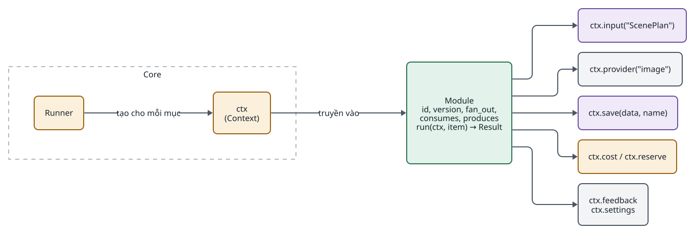
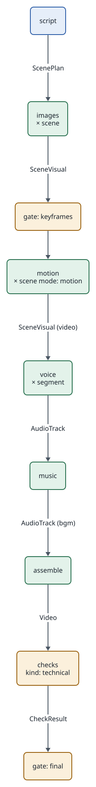
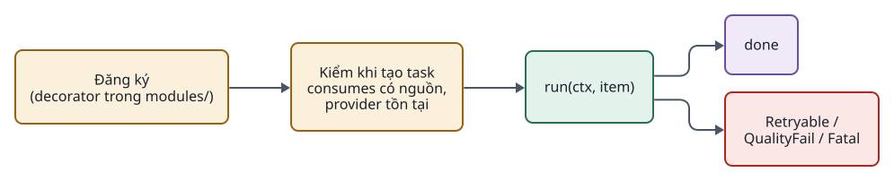
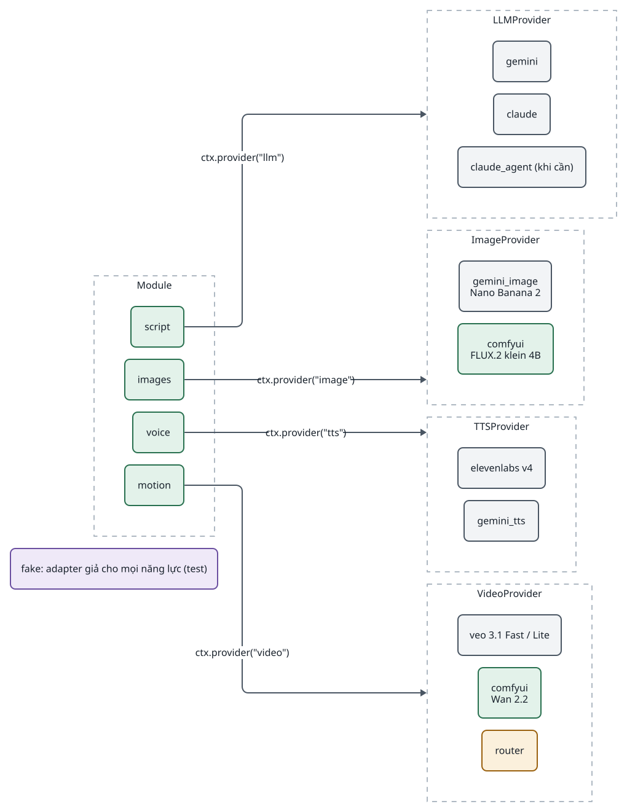
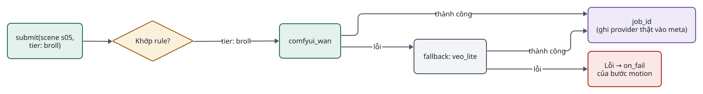
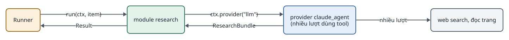
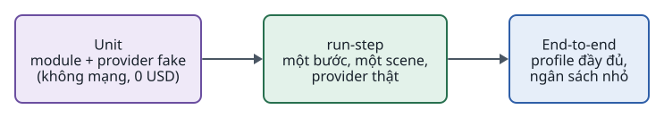

<!-- id:s1 -->
## Mô hình module

<!-- id:s1.b1 -->
Mọi module tuân theo một hợp đồng duy nhất: Task Input → Module → Task Output. Module không giữ trạng thái; mọi trạng thái đi qua `ctx`.

<!-- id:s1.b2 -->
```d2
# cap: Một module chỉ thấy ctx; core cấp đầu vào, provider, nơi lưu và sổ chi phí
direction: right
core: Core {
  class: zone
  runner: Runner {class: gate}
  ctx: "ctx\n(Context)" {class: gate}
}
m: "Module\nid, version, fan_out,\nconsumes, produces\nrun(ctx, item) → Result" {class: hands}
ins: "ctx.input(\"ScenePlan\")" {class: data}
prov: "ctx.provider(\"image\")" {class: plain}
save: "ctx.save(data, name)" {class: data}
cost: "ctx.cost / ctx.reserve" {class: gate}
fb: "ctx.feedback\nctx.settings" {class: plain}
core.runner -> core.ctx: tạo cho mỗi mục
core.ctx -> m: truyền vào
m -> ins
m -> prov
m -> save
m -> cost
m -> fb
```
<picture>
<source media="(prefers-color-scheme: dark)" srcset="05-modules-providers.figs/s1.b2-dark.svg">

</picture>

<!-- id:s1.b3 -->
```python
class Module(Protocol):
    id: str                      # "images"
    version: str
    fan_out: str | None          # ví dụ "ScenePlan.scenes"; None = chạy một lần
    consumes: list[str]          # tên contract cần có trước, ví dụ ["ScenePlan"]
    produces: str                # "SceneVisual"
    def run(self, ctx: Context, item: str) -> Result: ...

# Lỗi: Retryable (429, 5xx, timeout) · QualityFail(reason) · Fatal
```

<!-- id:s1.b4 -->
```req
FR-10
NFR-01
NFR-04
NFR-08
```

<!-- id:s2 -->
## Danh mục module

<!-- id:s2.b1 -->
11 năng lực trong yêu cầu được gộp còn 10 module, phân tách theo contract đầu ra, không theo tên công đoạn. Gate, retry và chạy lại thuộc core.

<!-- id:s2.b2 -->
```d2
# cap: Module thêm vào ở từng phase
grid-rows: 1
grid-columns: 5
p1: "Phase 1\n\nscript\nimages\nvoice\nassemble" {class: brain}
p2: "Phase 2\n\ncharacters\nmusic\nchecks (kỹ thuật)" {class: hands}
p3: "Phase 3\n\nmotion\nchecks (VLM)" {class: hands}
p4: "Phase 4\n\n(chỉ thêm provider:\ncomfyui, router)" {class: plain}
p5: "Phase 5\n\npublish\nresearch" {class: gate}
```
<picture>
<source media="(prefers-color-scheme: dark)" srcset="05-modules-providers.figs/s2.b2-dark.svg">

</picture>

<!-- id:s2.b3 -->
Table: Module năng lực
| Module | Trách nhiệm | Nhận → Trả | Fan-out | Bắt buộc | Phase |
| --- | --- | --- | --- | --- | --- |
| `script` | Kịch bản và shot list trong một lời gọi LLM có schema | Brief (+ ResearchBundle, SeriesBible) → ScenePlan + SpeechScript | Không | Có | 1 |
| `images` | Keyframe từ prompt đã ghép, kèm ảnh tham chiếu nhân vật | ScenePlan + SeriesBible → SceneVisual (ảnh) | `ScenePlan.scenes` | Có | 1 |
| `voice` | Đọc từng đoạn, trả kèm mốc thời gian từng từ | SpeechScript → AudioTrack (voice) | `SpeechScript.segments` | Có | 1 |
| `assemble` | FFmpeg: chuyển động ảnh tĩnh, ghép cảnh, trộn âm, phụ đề, MP4 | ScenePlan + SceneVisual[] + AudioTrack[] → Video | Không | Có | 1 |
| `characters` | Mẫu nhân vật (chính diện, nghiêng, 3/4); một lần mỗi series | SeriesBible (mô tả) → ảnh tham chiếu | Không | Không | 2 |
| `music` | Chọn hoặc tạo nhạc nền theo mood | ScenePlan → AudioTrack (bgm) | Không | Không | 2 |
| `checks` | Kiểm kỹ thuật (ffprobe, độ ồn, khung đen); tùy chọn VLM | Artifact → CheckResult | Theo bước | Không | 2–3 |
| `motion` | Image-to-video cho scene `mode: motion` | SceneVisual (ảnh) + ScenePlan → SceneVisual (video) | `ScenePlan.scenes` | Không | 3 |
| `research` | Dữ kiện có nguồn cho nội dung thực tế | Brief → ResearchBundle | Không | Không | Khi cần |
| `publish` | Upload, hẹn giờ, gắn cờ nội dung AI | Video + metadata → PublishRecord | Không | Không | 5 |

<!-- id:s3 -->
## Profile video: module và contract

<!-- id:s3.b1 -->
```d2
# cap: Profile shorts_motion: các bước, contract truyền giữa chúng và hai gate
direction: down
script: script {class: brain}
images: "images\n× scene" {class: hands}
g1: "gate: keyframes" {class: gate}
motion: "motion\n× scene mode: motion" {class: hands}
voice: "voice\n× segment" {class: hands}
music: music {class: hands}
asm: assemble {class: hands}
chk: "checks\nkind: technical" {class: gate}
g2: "gate: final" {class: gate}
script -> images: ScenePlan
images -> g1: SceneVisual
g1 -> motion
motion -> voice: "SceneVisual (video)"
voice -> music: AudioTrack
music -> asm: "AudioTrack (bgm)"
asm -> chk: Video
chk -> g2: CheckResult
```
<picture>
<source media="(prefers-color-scheme: dark)" srcset="05-modules-providers.figs/s3.b1-dark.svg">

</picture>

<!-- id:s3.b2 -->
```yaml
shorts_motion:
  budget_usd: 8
  steps:
    - script
    - images
    - gate: keyframes
    - motion: {on_fail: fallback, retry: {max_attempts: 3}, checks: [vlm_identity]}
    - voice
    - music
    - assemble: {subtitles: true, aspect: "9:16"}
    - checks: {kind: technical}
    - gate: final
```

<!-- id:s3.b3 -->
Mũi tên ở hình trên là thứ tự bước; contract thật được đọc theo tên từ mọi bước trước đó, ví dụ `assemble` đọc ScenePlan của `script` và SceneVisual mới nhất của mỗi scene.

<!-- id:s4 -->
## Vòng đời module

<!-- id:s4.b1 -->
```d2
# cap: Từ lúc đăng ký đến khi một mục xong
direction: right
reg: "Đăng ký\n(decorator trong modules/)" {class: gate}
val: "Kiểm khi tạo task\nconsumes có nguồn,\nprovider tồn tại" {class: gate}
run: "run(ctx, item)" {class: hands}
done: done {class: data}
err: "Retryable /\nQualityFail / Fatal" {class: bad}
reg -> val -> run
run -> done
run -> err
```
<picture>
<source media="(prefers-color-scheme: dark)" srcset="05-modules-providers.figs/s4.b1-dark.svg">

</picture>

<!-- id:s5 -->
## ctx: giao diện core cấp cho module

<!-- id:s5.b1 -->
Table: API của ctx
| Lời gọi | Làm gì | Ghi chú |
| --- | --- | --- |
| `ctx.input(name)` | Output mới nhất của contract `name` (theo mục nếu có) | Không theo tên module |
| `ctx.item` | Phần tử fan-out hiện tại | `"_"` khi chạy một lần |
| `ctx.provider(capability)` | Provider của năng lực theo cấu hình hiệu lực | `llm`, `image`, `tts`, `video` |
| `ctx.save(data, name)` | Lưu file vào `data/tasks/<id>/<step>/`, trả đường dẫn | Core đặt tên `item_aN`, tính hash |
| `ctx.cost(usd, units)` | Ghi một sự kiện chi phí | Giá lấy từ `pricing.yaml` nếu chỉ có units |
| `ctx.reserve(usd)` | Xin giữ ngân sách trước lời gọi đắt | Vượt thì task `waiting` lý do budget |
| `ctx.checkpoint(key, value)` | Lưu giá trị bền vào StepRun, ví dụ `external_job_id` | Đọc lại khi resume |
| `ctx.feedback` | Ghi chú từ gate hoặc lý do QualityFail | Dùng sửa prompt |
| `ctx.settings` | Tham số của bước trong profile | Ví dụ `subtitles`, `aspect` |
| `ctx.log` | Logger ghi vào `logs/` | Hiển thị 50 dòng cuối trên UI |

<!-- id:s6 -->
## Provider và model

<!-- id:s6.b1 -->
Provider chỉ cài đặt interface của năng lực mình. Interface chỉ viết cho 4 năng lực đang dùng.

<!-- id:s6.b2 -->
```python
class LLMProvider(Protocol):
    def generate(self, prompt: str, schema: type[BaseModel]) -> Structured: ...  # structured output + usage

class TTSProvider(Protocol):
    def synthesize(self, text: str, voice: VoiceSpec) -> Speech: ...   # audio + mốc thời gian từng từ + usage

class ImageProvider(Protocol):
    def generate(self, prompt: str, refs: list[Path], size: str) -> Image: ...

class VideoProvider(Protocol):   # tách submit/poll để resume không trả tiền hai lần
    def submit(self, image: Path, prompt: str, seconds: int) -> str: ...  # external_job_id
    def poll(self, job_id: str) -> Clip | None: ...
```

<!-- id:s6.b3 -->
`LLMProvider` không có code mẫu trong ADD-AIVIDEO-001; chữ ký trên là đề xuất.

<!-- id:s6.b4 -->
```d2
# cap: Module gọi interface năng lực; mỗi interface có nhiều adapter, config chọn một
direction: right
llm: LLMProvider {
  class: zone
  a1: "gemini" {class: plain}
  a2: "claude" {class: plain}
  a3: "claude_agent (khi cần)" {class: plain}
}
img: ImageProvider {
  class: zone
  b1: "gemini_image\nNano Banana 2" {class: plain}
  b2: "comfyui\nFLUX.2 klein 4B" {class: hands}
}
tts: TTSProvider {
  class: zone
  c1: "elevenlabs v4" {class: plain}
  c2: "gemini_tts" {class: plain}
}
vid: VideoProvider {
  class: zone
  d1: "veo 3.1 Fast / Lite" {class: plain}
  d2: "comfyui\nWan 2.2" {class: hands}
  d3: "router" {class: gate}
}
m: Module {
  class: zone
  script: script {class: hands}
  images: images {class: hands}
  voice: voice {class: hands}
  motion: motion {class: hands}
}
fake: "fake: adapter giả cho mọi năng lực (test)" {class: data}
m.script -> llm: "ctx.provider(\"llm\")"
m.images -> img: "ctx.provider(\"image\")"
m.voice -> tts: "ctx.provider(\"tts\")"
m.motion -> vid: "ctx.provider(\"video\")"
```
<picture>
<source media="(prefers-color-scheme: dark)" srcset="05-modules-providers.figs/s6.b4-dark.svg">

</picture>

<!-- id:s6.b5 -->
Table: Model và provider cho từng năng lực
| Năng lực | Chọn | Thay thế | Ghi chú |
| --- | --- | --- | --- |
| LLM (kịch bản, shot list, chấm điểm) | Gemini 3.8 Flash (0,75 / 3,75 USD mỗi 1M token đến 31/12/2026) | Claude Sonnet 5.5; model OpenAI | Gộp billing với ảnh, video, TTS nếu dùng Gemini API |
| Tạo ảnh | Nano Banana 2 (cloud, 0,067 USD/ảnh 1K) | FLUX.2 klein 4B qua ComfyUI; Nano Banana Pro | Pro mạnh về chữ trong ảnh, hợp thumbnail |
| Image-to-video | Veo 3.1 Fast 720p (0,10 USD/giây) / Lite (0,05 USD/giây) | Wan 2.2 qua ComfyUI; Kling 3.0 | Qua aggregator thì vẫn phải lưu model thật vào `meta` |
| TTS + mốc thời gian | ElevenLabs v4 (0,08 USD/1.000 ký tự) | Gemini TTS + căn chỉnh bằng STT | Mốc từng từ dùng làm phụ đề |
| STT | faster-whisper local | Gemini 3.5 Transcribe | Khi TTS không trả mốc; đo WER |
| Nhạc nền | Thư viện có license (provider `library`) | Lyria 3 Clip; Eleven Music | Bắt đầu bằng thư viện: miễn phí, quyền rõ |
| Xuất bản | YouTube Data API | TikTok Content Posting API | TikTok chưa audit chỉ đăng riêng tư |

<!-- id:s6.b6 -->
> [!WARNING]
> Giá lấy từ hai báo cáo nghiên cứu (10/2026), phải kiểm lại khi lập ngân sách. Giá thuê RTX 4090 trên RunPod lệch giữa hai nguồn; dùng 0,89 USD/giờ khi lập kế hoạch.

<!-- id:s7 -->
## Router local và cloud

<!-- id:s7.b1 -->
Router cũng cài đặt `VideoProvider`; nó chọn provider con theo `tier` của scene và có chuỗi dự phòng, nên runner và module không biết đến nó.

<!-- id:s7.b2 -->
```yaml
video:
  use: router
  rules:
    - {when: {tier: hero},  use: veo_fast}
    - {when: {tier: broll}, use: comfyui_wan}
  fallback: [veo_lite]     # hết lựa chọn thì on_fail của bước motion xử lý (giữ ảnh tĩnh)
```

<!-- id:s7.b3 -->
```d2
# cap: Router chọn provider theo tier, dự phòng khi lỗi, cuối cùng trả lỗi cho on_fail
direction: right
req: "submit(scene s05,\ntier: broll)" {class: hands}
rule: "Khớp rule?" {shape: diamond; class: gate}
p1: "comfyui_wan" {class: hands}
ok: "job_id\n(ghi provider thật vào meta)" {class: data}
fb: "fallback: veo_lite" {class: plain}
fail: "Lỗi → on_fail\ncủa bước motion" {class: bad}
req -> rule
rule -> p1: "tier: broll"
p1 -> ok: thành công
p1 -> fb: lỗi
fb -> ok: thành công
fb -> fail: lỗi
```
<picture>
<source media="(prefers-color-scheme: dark)" srcset="05-modules-providers.figs/s7.b3-dark.svg">

</picture>

<!-- id:s7.b4 -->
Router chỉ thêm ở Phase 4; quyết định route phải dựa trên số liệu `cost_events` (chi phí trên mỗi scene được duyệt), không dựa trên cảm tính.

<!-- id:s8 -->
## Khi nào dùng AI agent

<!-- id:s8.b1 -->
```d2
# cap: Agent, nếu có, nằm bên trong provider hoặc module; runner vẫn chỉ nhận một Result
direction: right
runner: Runner {class: gate}
mod: "module research" {class: hands}
prov: "provider claude_agent\n(nhiều lượt dùng tool)" {class: brain}
tools: "web search, đọc trang" {class: plain}
runner -> mod: "run(ctx, item)"
mod -> prov: "ctx.provider(\"llm\")"
prov -> tools: "nhiều lượt"
prov -> mod: "ResearchBundle"
mod -> runner: Result
```
<picture>
<source media="(prefers-color-scheme: dark)" srcset="05-modules-providers.figs/s8.b1-dark.svg">

</picture>

<!-- id:s8.b2 -->
Kịch bản, chấm điểm và sửa prompt theo feedback đều là lời gọi LLM có schema. Chỉ dùng agent khi một module cần nhiều lượt dùng tool mà lời gọi LLM đơn không giải quyết được.

<!-- id:s9 -->
## Thêm module hoặc provider

<!-- id:s9.b1 -->
1. Xác định contract đầu ra. Nếu contract hiện có diễn đạt được, dùng lại; nếu không, thêm contract mới có `schema_version: 1` trong `contracts/`.
2. Tạo `modules/<id>.py`: khai báo `id`, `version`, `fan_out`, `consumes`, `produces`; cài `run(ctx, item)` chỉ dùng `ctx`.
3. Nếu cần năng lực mới, thêm interface và ít nhất hai adapter: một thật, một `fake`.
4. Thêm giá vào `pricing.yaml` cho mọi model tính tiền.
5. Thêm một dòng vào profile; chạy thử bằng CLI với provider giả rồi với provider thật.

<!-- id:s9.b2 -->
```chk
- [ ] Module không import module khác (test import xanh)
- [ ] Có test chạy với provider fake, không gọi mạng
- [ ] Mọi lời gọi tính tiền đi qua ctx.cost; lời gọi đắt có ctx.reserve
- [ ] Job bất đồng bộ lưu external_job_id bằng ctx.checkpoint trước khi poll
- [ ] Lỗi được phân loại Retryable / QualityFail / Fatal
- [ ] StepRun.meta ghi provider và model thật
- [ ] Tài liệu này cập nhật bảng danh mục module
```

<!-- id:s10 -->
## Quy trình ngoài video

<!-- id:s10.b1 -->
Core không biết "video" là gì. Thêm quy trình là thêm profile; chỉ thêm module khi contract hiện có không diễn đạt được.

<!-- id:s10.b2 -->
```d2
# cap: Profile audiobook: 6 bước, 2 module mới, 2 gate
direction: right
in: "Bản thảo\n+ khai báo quyền" {class: plain}
chap: "chapterize (mới)\n→ SpeechScript" {class: brain}
g1: "gate: text" {class: gate}
voice: "voice\n× segment, concurrency 4" {class: hands}
chk: "checks\nkind: audio (STT so văn bản)" {class: gate}
master: "master (mới)\nMP3 theo chương, m4b" {class: hands}
g2: "gate: listen" {class: gate}
in -> chap -> g1 -> voice -> chk -> master -> g2
```
<picture>
<source media="(prefers-color-scheme: dark)" srcset="05-modules-providers.figs/s10.b2-dark.svg">

</picture>

<!-- id:s10.b3 -->
```yaml
audiobook:
  budget_usd: 60
  steps:
    - chapterize
    - gate: text
    - voice: {fan_out: "SpeechScript.segments", concurrency: 4}
    - checks: {kind: audio}
    - master: {formats: [mp3_per_chapter, m4b]}
    - gate: listen
```

<!-- id:s10.b4 -->
Chi phí giọng đọc ước tính theo giá niêm yết ElevenLabs: khoảng 8 USD (v4) hoặc 4 USD (v4 Turbo) cho mỗi 100.000 ký tự, chưa tính đoạn đọc lại. Kênh phân phối có chính sách riêng về giọng AI (ACX không nhận giọng AI tự tạo; Google Play Books chưa có tiếng Việt); kiểm tra trước khi sản xuất cả cuốn.

<!-- id:s10.b5 -->
Table: Các quy trình khác và module cần thêm
| Quy trình | Mức phù hợp | Module tái sử dụng | Module cần thêm |
| --- | --- | --- | --- |
| Video giáo dục từ slide | Rất phù hợp | script, voice, assemble, checks | `slides` |
| Podcast hai giọng từ bài viết | Rất phù hợp | voice, music, checks, master | `dialogue` |
| Truyện kể, truyện tranh động | Phù hợp | script, images, motion, voice, assemble | — |
| Video sản phẩm từ ảnh thật | Phù hợp | images, motion, voice, assemble | — (gate kiểm tuyên bố, logo) |
| Tin tức theo lịch | Phù hợp | research, script, voice, assemble, publish | — |
| Lồng tiếng, dịch video | Một phần | voice, assemble, checks | `transcribe`, `translate` |
| Avatar người nói | Một phần | voice, assemble | `avatar` (lip-sync) |
| Phim dài toàn cảnh chuyển động | Kém | — | Chi phí theo giây quá cao |
| Livestream, thời gian thực | Không phù hợp | — | Kiến trúc xử lý theo lô |

<!-- id:s11 -->
## Kiểm thử module

<!-- id:s11.b1 -->
```d2
# cap: Ba mức kiểm thử, từ rẻ đến đắt
direction: right
u: "Unit\nmodule + provider fake\n(không mạng, 0 USD)" {class: data}
s: "run-step\nmột bước, một scene,\nprovider thật" {class: hands}
e: "End-to-end\nprofile đầy đủ,\nngân sách nhỏ" {class: brain}
u -> s -> e
```
<picture>
<source media="(prefers-color-scheme: dark)" srcset="05-modules-providers.figs/s11.b1-dark.svg">

</picture>

<!-- id:s11.b2 -->
- Mỗi module chạy riêng qua CLI: `python -m app run-step images --task t_0042 --scene s03`.
- Provider `fake` trả dữ liệu cố định và usage giả, cho phép test runner, retry, resume và ngân sách không tốn tiền.
- Test quy tắc phụ thuộc chạy trong CI cùng unit test.
