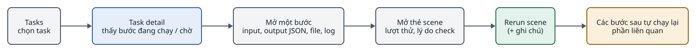
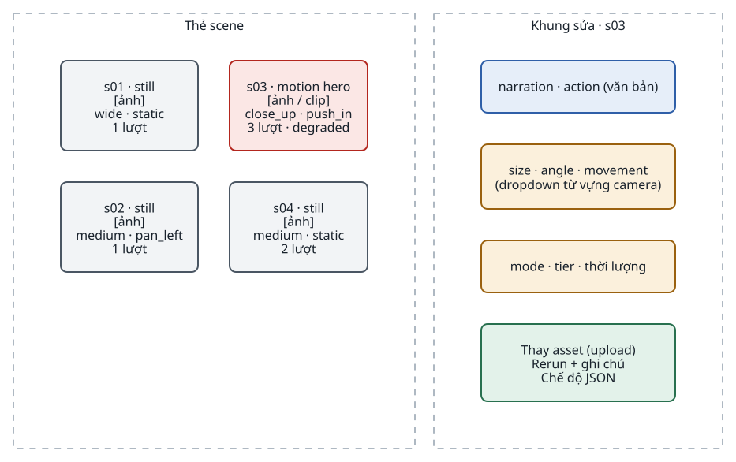
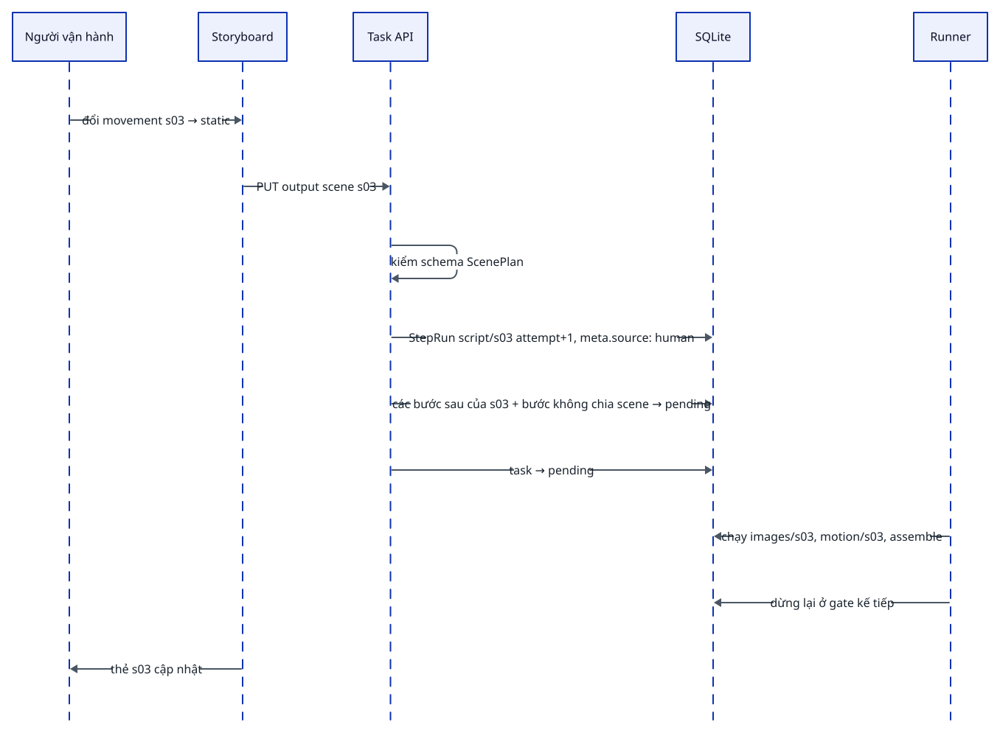

<!-- id:s1 -->
## Kiến trúc giao diện

<!-- id:s1.b1 -->
Không có bước build frontend. Trang do server render; HTMX tự làm mới phần trạng thái mỗi vài giây; ảnh, audio, video hiển thị bằng thẻ ``, `<audio>`, `<video>` trỏ tới file trong `data/`.

<!-- id:s1.b2 -->
```d2
# cap: Web process: route HTML cho người, route JSON cho cron, cùng đọc ghi SQLite
direction: right
browser: "Trình duyệt\n(HTMX, Pico.css)" {class: hands}
cron: cron {class: gate}
web: "FastAPI" {
  class: zone
  pages: "Route HTML\nJinja2 templates" {class: brain}
  partials: "Partial HTMX\n(trạng thái, lưới scene)" {class: brain}
  api: "Task API (JSON)" {class: brain}
  files: "/files/*\nphục vụ data/ chỉ đọc" {class: plain}
}
db: SQLite {shape: cylinder; class: data}
fs: "data/" {shape: cylinder; class: data}
cfg: "config.yaml" {shape: page; class: gate}
browser -> web.pages: "GET trang"
browser -> web.partials: "hx-get mỗi vài giây"
browser -> web.api: "hx-post hành động"
cron -> web.api: "POST /api/tasks"
web.pages -> db
web.partials -> db
web.api -> db
web.files -> fs
web.api -> cfg: "Settings (Phase 2)"
```
<picture>
<source media="(prefers-color-scheme: dark)" srcset="06-web-ui.figs/s1.b2-dark.svg">

</picture>

<!-- id:s1.b3 -->
```req
FR-01
FR-06
FR-08
FR-09
FR-12
FR-13
NFR-07
```

<!-- id:s2 -->
## Sơ đồ trang

<!-- id:s2.b1 -->
```d2
# cap: 4 trang và các hành động chính; Storyboard là một chế độ của Task detail
direction: right
tasks: "Tasks\n(danh sách)" {class: brain}
new: "Form tạo task\n(+ Nâng cao: ghi đè)" {class: plain}
detail: "Task detail" {class: brain}
story: "Storyboard\n(sửa output)" {class: hands}
series: "Series\n(Series Bible)" {class: brain}
settings: "Settings\n(module, profile, provider)" {class: brain}
tasks -> new: "Tạo task"
tasks -> detail: "chọn task"
detail -> story: "mở ở gate hoặc khi xong"
detail -> series: "xem series của task"
series -> new: "tạo mẫu nhân vật\n(profile create_character)"
settings -> tasks: "profile mới dùng cho task mới"
```
<picture>
<source media="(prefers-color-scheme: dark)" srcset="06-web-ui.figs/s2.b1-dark.svg">

</picture>

<!-- id:s3 -->
## Trang và hành động

<!-- id:s3.b1 -->
Table: Trang, nội dung và hành động
| Trang | Hiển thị | Hành động |
| --- | --- | --- |
| Tasks | Tên, profile, trạng thái, bước hiện tại, chi phí / ngân sách, thời gian cập nhật | Tạo task (brief, profile, series, ngân sách, ghi đè nâng cao) |
| Task detail | Input; dòng thời gian các bước; mỗi bước mở được: input, output JSON, artifact, log, lỗi; lưới scene; video cuối | Duyệt / từ chối gate, chạy lại bước, chạy lại scene, hủy, tải zip |
| Series | Style, nhân vật kèm ảnh tham chiếu, giọng, từ vựng camera, lexicon | Chạy `characters`, chọn ảnh tham chiếu được duyệt |
| Settings | Module đã đăng ký (id, version, nhận → trả); profile với các bước; provider của từng năng lực | Phase 1 chỉ đọc. Phase 2: bật / tắt bước, chọn provider, kiểm tra trước khi lưu `config.yaml` (giữ `.bak`) |

<!-- id:s4 -->
## Task detail

<!-- id:s4.b1 -->
Nơi dùng nhiều nhất để vận hành và debug: mọi thông tin (input, output, log, lỗi, từng lượt thử) nằm ở đây.

<!-- id:s4.b2 -->
```text
┌─ t_0042 · Tín hiệu từ năm 2126 ───── waiting (gate: keyframes) ── $1.12 / $8.00 ─┐
│ [Approve] [Reject + note] [Cancel] [Download zip]                                │
├──────────────────────────────────────────────────────────────────────────────────┤
│ ✔ script      1 run   $0.06   ▸ input  ▸ output (ScenePlan)  ▸ log               │
│ ✔ images      8 scenes $0.67                                                     │
│    ┌─s01─┐ ┌─s02─┐ ┌─s03─┐ ┌─s04─┐ ...   mỗi thẻ: ảnh, số lượt thử, [Rerun scene] │
│ ⏸ gate: keyframes   chờ duyệt                                                    │
│ · voice · music · assemble · gate: final                (pending)                │
├──────────────────────────────────────────────────────────────────────────────────┤
│ Final video: <video>  ·  Subtitles: subs.ass  ·  Error/log: 50 dòng cuối         │
└──────────────────────────────────────────────────────────────────────────────────┘
```

<!-- id:s4.b3 -->
```d2
# cap: Đi từ danh sách tới nguyên nhân một scene hỏng trong ba lần bấm
direction: right
a: "Tasks\nchọn task" {class: plain}
b: "Task detail\nthấy bước đang chạy / chờ" {class: brain}
c: "Mở một bước\ninput, output JSON, file, log" {class: plain}
d: "Mở thẻ scene\nlượt thử, lý do check" {class: plain}
e: "Rerun scene\n(+ ghi chú)" {class: hands}
f: "Các bước sau tự chạy lại\nphần liên quan" {class: gate}
a -> b -> c -> d -> e -> f
```
<picture>
<source media="(prefers-color-scheme: dark)" srcset="06-web-ui.figs/s4.b3-dark.svg">

</picture>

<!-- id:s5 -->
## Storyboard và sửa output

<!-- id:s5.b1 -->
Người dùng phải can thiệp được vào từng bước, không chỉ duyệt hoặc từ chối. Storyboard gộp kịch bản, keyframe / clip và sửa output vào một chỗ.

<!-- id:s5.b2 -->
```d2
# cap: Bố cục Storyboard: lưới thẻ scene bên trái, khung sửa của scene đang chọn bên phải
grid-columns: 2
grid-gap: 24
cards: "Thẻ scene" {
  class: zone
  grid-columns: 2
  s01: "s01 · still\n[ảnh]\nwide · static\n1 lượt" {class: plain}
  s02: "s02 · still\n[ảnh]\nmedium · pan_left\n1 lượt" {class: plain}
  s03: "s03 · motion hero\n[ảnh / clip]\nclose_up · push_in\n3 lượt · degraded" {class: bad}
  s04: "s04 · still\n[ảnh]\nmedium · static\n2 lượt" {class: plain}
}
panel: "Khung sửa · s03" {
  class: zone
  grid-columns: 1
  f1: "narration · action (văn bản)" {class: brain}
  f2: "size · angle · movement\n(dropdown từ vựng camera)" {class: gate}
  f3: "mode · tier · thời lượng" {class: gate}
  f4: "Thay asset (upload)\nRerun + ghi chú\nChế độ JSON" {class: hands}
}
```
<picture>
<source media="(prefers-color-scheme: dark)" srcset="06-web-ui.figs/s5.b2-dark.svg">

</picture>

<!-- id:s5.b3 -->
Table: Hành động sửa và kết quả trong hệ thống
| Hành động | Cách làm | Kết quả trong hệ thống |
| --- | --- | --- |
| Sửa nội dung scene | Sửa narration, action, góc máy (dropdown), `mode`, `tier`, thời lượng | StepRun mới của `script` cho scene đó, `meta.source: human`, kiểm theo schema |
| Sửa lời đọc | Sửa văn bản, người nói, khoảng nghỉ trong SpeechScript | Chỉ đoạn đó được đọc lại |
| Thay asset | Upload ảnh, clip hoặc nhạc | StepRun mới với file upload làm artifact |
| Chạy lại có hướng dẫn | Rerun kèm ghi chú | Ghi chú vào `ctx.feedback` |
| Sửa nâng cao | Chế độ JSON cho toàn bộ output một bước | Từ chối lưu nếu sai schema |

<!-- id:s5.b4 -->
```d2
# cap: Một lần sửa tạo lượt thử mới; runner chỉ chạy lại phần bị ảnh hưởng
shape: sequence_diagram
op: Người vận hành
ui: Storyboard
api: Task API
db: SQLite
wk: Runner
op -> ui: "đổi movement s03 → static"
ui -> api: "PUT output scene s03"
api -> api: "kiểm schema ScenePlan"
api -> db: "StepRun script/s03 attempt+1, meta.source: human"
api -> db: "các bước sau của s03 + bước không chia scene → pending"
api -> db: "task → pending"
wk -> db: "chạy images/s03, motion/s03, assemble"
wk -> db: "dừng lại ở gate kế tiếp"
ui -> op: "thẻ s03 cập nhật"
```
<picture>
<source media="(prefers-color-scheme: dark)" srcset="06-web-ui.figs/s5.b4-dark.svg">

</picture>

<!-- id:s5.b5 -->
Sửa được khi task đang chờ ở gate, hoặc khi task đã hoàn tất. Mỗi lần sửa là một lượt thử mới, không ghi đè; có thể quay lại lượt cũ. Việc này nằm hoàn toàn ở lớp UI và StepRun, không đổi kiến trúc core. Với audiobook, Storyboard hiển thị dạng danh sách đoạn.

<!-- id:s6 -->
## Task API

<!-- id:s6.b1 -->
Form trên UI và cron gửi cùng một JSON. Danh sách endpoint dưới đây là đề xuất của tài liệu này (ADD-AIVIDEO-001 chỉ nêu hành động); tên đường dẫn chốt khi code Phase 1.

<!-- id:s6.b2 -->
```json
{
  "profile": "shorts_motion",
  "series": "lyra7",
  "budget_usd": 8,
  "input": {
    "brief": "Người gác cuối cùng trên trạm quỹ đạo nhận tín hiệu từ chính mình của 100 năm sau",
    "duration_s": 60,
    "language": "vi"
  }
}
```

<!-- id:s6.b3 -->
Table: Endpoint đề xuất
| Phương thức | Đường dẫn | Làm gì | Phase |
| --- | --- | --- | --- |
| POST | `/api/tasks` | Tạo task; kiểm profile, provider, ước tính chi phí; trả `id` | 1 |
| GET | `/api/tasks`, `/api/tasks/{id}` | Danh sách, chi tiết task kèm StepRun | 1 |
| POST | `/api/tasks/{id}/gate` | `{action: approve \| reject, note, step}` | 1 |
| POST | `/api/tasks/{id}/rerun` | `{step, item?, note?}` chạy lại bước hoặc mục | 1 |
| POST | `/api/tasks/{id}/cancel` | Hủy task | 1 |
| POST | `/api/tasks/{id}/budget` | Nâng ngân sách khi task chờ vì budget | 1 |
| GET | `/api/tasks/{id}/artifacts.zip` | Tải toàn bộ artifact | 1 |
| PUT | `/api/tasks/{id}/steps/{step}/items/{item}` | Sửa output hoặc thay asset (lượt thử mới) | 2 |
| GET, PUT | `/api/settings` | Đọc, ghi `config.yaml` sau khi kiểm hợp lệ | 1 đọc, 2 ghi |

<!-- id:s6.b4 -->
Hành động trên trang gọi đúng các endpoint này (HTMX `hx-post`), nên mọi thứ làm được bằng tay cũng tự động hóa được.

<!-- id:s7 -->
## Nguyên tắc giữ UI nhỏ

<!-- id:s7.b1 -->
- Chỉ quan sát và điều khiển task; không có dashboard thống kê ở các phase đầu (bảng `cost_events` đủ để truy vấn khi cần).
- Giữ 4 trang; mọi thống kê thêm phải chứng minh nhu cầu trước.
- Không có workflow editor kéo thả; profile YAML cùng checkbox trong Settings là đủ.
- Chạy ở `localhost` hoặc sau Tailscale / basic auth; API key nằm trong `.env`, không hiển thị trên UI.
