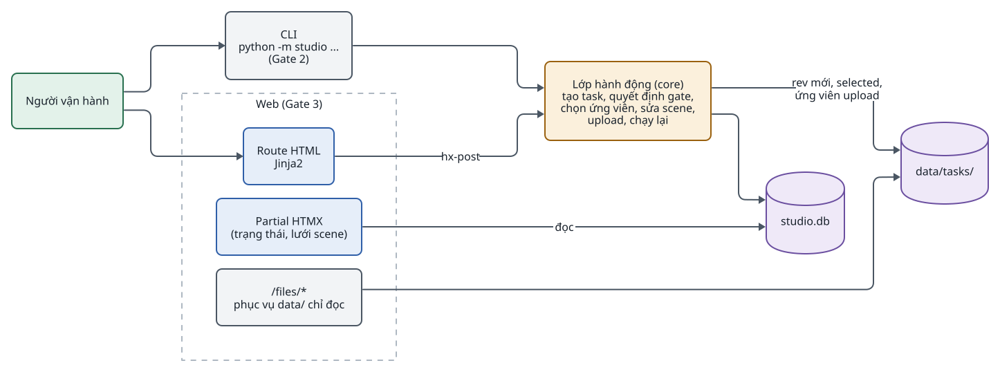
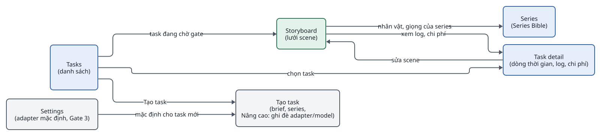
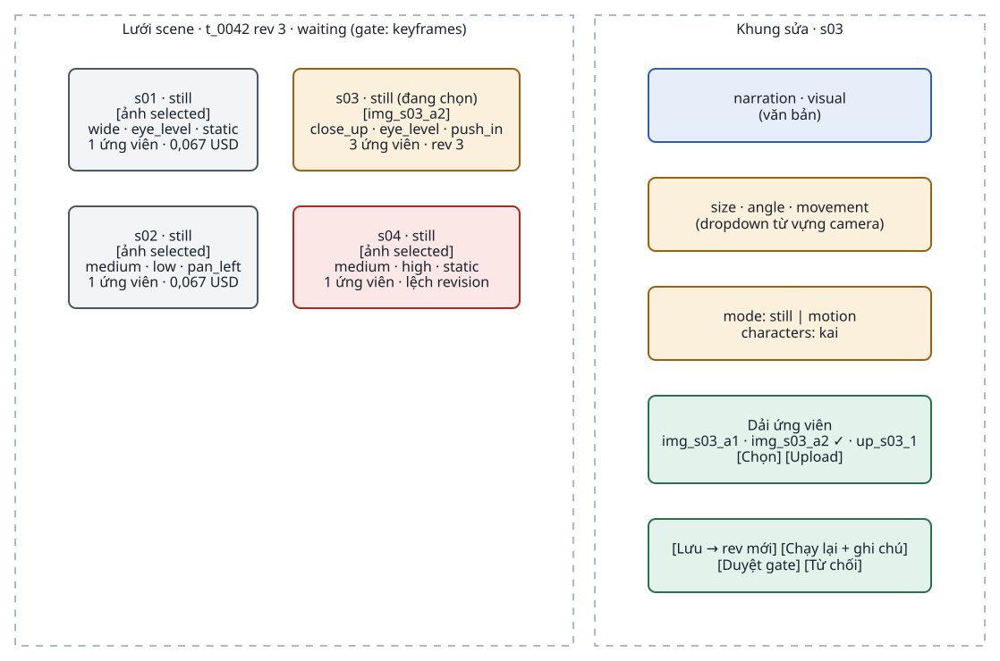
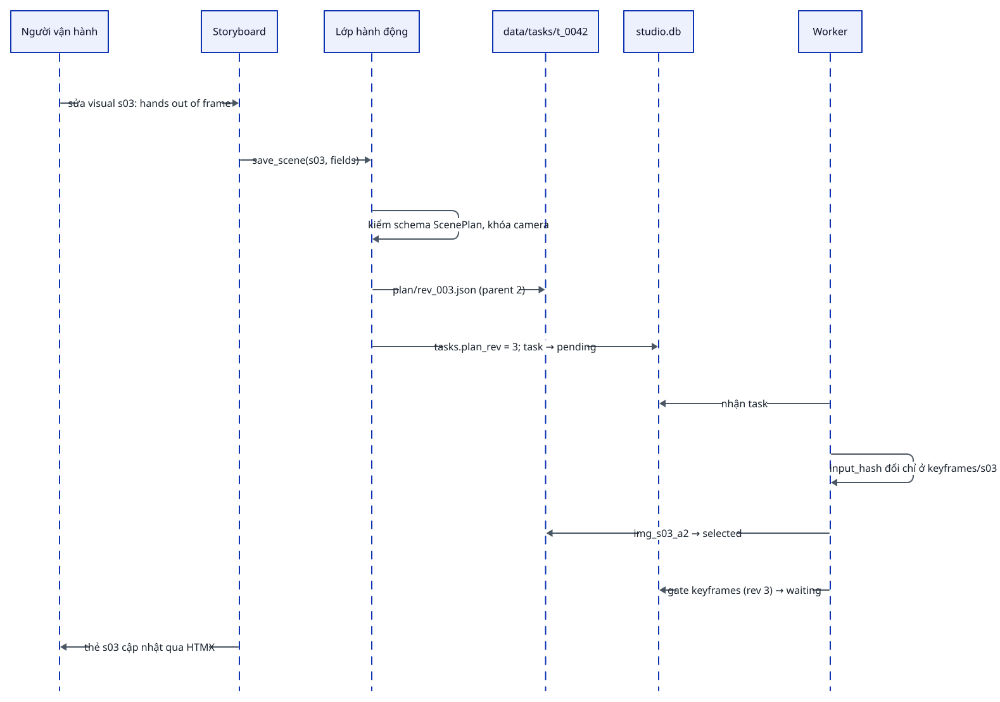

<!-- id:s1 -->
## Kiến trúc giao diện

<!-- id:s1.b1 -->
Không có bước build frontend. CLI và web gọi cùng một lớp hành động trong core (`gates.py`, `taskdir.py`), nên mọi thứ làm được trên web cũng làm được bằng CLI. Ảnh, audio, video hiển thị bằng thẻ ``, `<audio>`, `<video>` trỏ tới file trong `data/`.

<!-- id:s1.b2 -->
<!-- report-kit:d2
```d2
# cap: CLI và web dùng chung lớp hành động của core; không ai trong hai gọi provider
direction: right
op: Người vận hành {class: hands}
cli: "CLI\npython -m studio ...\n(Gate 2)" {class: plain}
web: "Web (Gate 3)" {
  class: zone
  pages: "Route HTML\nJinja2" {class: brain}
  part: "Partial HTMX\n(trạng thái, lưới scene)" {class: brain}
  files: "/files/*\nphục vụ data/ chỉ đọc" {class: plain}
}
act: "Lớp hành động (core)\ntạo task, quyết định gate,\nchọn ứng viên, sửa scene,\nupload, chạy lại" {class: gate}
db: "studio.db" {shape: cylinder; class: data}
fs: "data/tasks/" {shape: cylinder; class: data}
op -> cli
op -> web.pages
cli -> act
web.pages -> act: "hx-post"
web.part -> db: đọc
act -> db
act -> fs: "rev mới, selected,\nứng viên upload"
web.files -> fs
```
-->
<picture>
<source media="(prefers-color-scheme: dark)" srcset="06-web-ui.figs/s1.b2-dark.svg">

</picture>

<!-- id:s1.b3 -->
```req
FR-01
FR-08
FR-10
FR-11
FR-12
FR-14
NFR-07
```

<!-- id:s2 -->
## Sơ đồ trang

<!-- id:s2.b1 -->
<!-- report-kit:d2
```d2
# cap: 4 trang; Storyboard là nơi làm việc chính ở gate keyframes và gate final
direction: right
tasks: "Tasks\n(danh sách)" {class: brain}
new: "Tạo task\n(brief, series,\nNâng cao: ghi đè adapter/model)" {class: plain}
story: "Storyboard\n(lưới scene)" {class: hands}
detail: "Task detail\n(dòng thời gian, log, chi phí)" {class: brain}
series: "Series\n(Series Bible)" {class: brain}
settings: "Settings\n(adapter mặc định, Gate 3)" {class: plain}
tasks -> new: "Tạo task"
tasks -> story: "task đang chờ gate"
tasks -> detail: "chọn task"
story -> detail: "xem log, chi phí"
detail -> story: "sửa scene"
story -> series: "nhân vật, giọng của series"
settings -> new: "mặc định cho task mới"
```
-->
<picture>
<source media="(prefers-color-scheme: dark)" srcset="06-web-ui.figs/s2.b1-dark.svg">

</picture>

<!-- id:s3 -->
## Trang và hành động

<!-- id:s3.b1 -->
Table: Trang, nội dung và hành động
| Trang | Hiển thị | Hành động |
| --- | --- | --- |
| Tasks | Danh sách task: tiêu đề, trạng thái, bước hiện tại, chi phí đã ghi | Tạo task (brief, series, phần Nâng cao để ghi đè adapter/model) |
| Storyboard | Lưới scene: ảnh được chọn, số ứng viên, narration, góc máy, revision, chi phí | Chọn ứng viên, sửa scene, upload asset riêng, chạy lại, duyệt/từ chối gate |
| Task detail | Các bước và gate theo thứ tự, StepRun từng lượt (trạng thái, output, lỗi), `costs.jsonl`, 50 dòng cuối `worker.log`, revision plan và render | Quyết định lượt gọi `unknown`: sinh lại hoặc bỏ qua |
| Series | Series Bible: style, nhân vật kèm ảnh tham chiếu, giọng, từ vựng camera, từ điển phát âm | Tạo ảnh tham chiếu, chọn ảnh được duyệt |
| Settings | Adapter mặc định cho từng năng lực, model OmniRoute, giới hạn song song, bật gate `keyframes` | Lưu lớp phủ `data/settings.toml` sau khi kiểm mọi adapter khởi tạo được; không sửa `studio.toml` |

<!-- id:s4 -->
## Storyboard

<!-- id:s4.b1 -->
Storyboard gộp kịch bản, ứng viên và hành động sửa vào một chỗ. Bên trái là lưới thẻ scene; bên phải là khung sửa của scene đang chọn với dải ứng viên.

<!-- id:s4.b2 -->
<!-- report-kit:d2
```d2
# cap: Bố cục Storyboard: lưới thẻ scene, khung sửa và dải ứng viên của scene đang chọn
grid-columns: 2
grid-gap: 24
cards: "Lưới scene · t_0042 rev 3 · waiting (gate: keyframes)" {
  class: zone
  grid-columns: 2
  s01: "s01 · still\n[ảnh selected]\nwide · eye_level · static\n1 ứng viên · 0,067 USD" {class: plain}
  s02: "s02 · still\n[ảnh selected]\nmedium · low · pan_left\n1 ứng viên · 0,067 USD" {class: plain}
  s03: "s03 · still (đang chọn)\n[img_s03_a2]\nclose_up · eye_level · push_in\n3 ứng viên · rev 3" {class: gate}
  s04: "s04 · still\n[ảnh selected]\nmedium · high · static\n1 ứng viên · lệch revision" {class: bad}
}
panel: "Khung sửa · s03" {
  class: zone
  grid-columns: 1
  f1: "narration · visual\n(văn bản)" {class: brain}
  f2: "size · angle · movement\n(dropdown từ vựng camera)" {class: gate}
  f3: "mode: still | motion\ncharacters: kai" {class: gate}
  f4: "Dải ứng viên\nimg_s03_a1 · img_s03_a2 ✓ · up_s03_1\n[Chọn] [Upload]" {class: hands}
  f5: "[Lưu → rev mới] [Chạy lại + ghi chú]\n[Duyệt gate] [Từ chối]" {class: hands}
}
```
-->
<picture>
<source media="(prefers-color-scheme: dark)" srcset="06-web-ui.figs/s4.b2-dark.svg">

</picture>

<!-- id:s4.b3 -->
- Thẻ scene mang huy hiệu "lệch revision" khi ứng viên selected có `plan_rev` cũ hơn nội dung hiện tại của scene.
- Lưu khung sửa luôn tạo ScenePlan revision mới; nút chỉ bật khi có thay đổi.
- Dropdown góc máy chỉ chứa khóa có trong `camera` của Series Bible, nên người cũng không viết lệch được.
- Với audiobook (Gate 4), Storyboard hiển thị dạng danh sách đoạn: narration, speaker, nút nghe.

<!-- id:s5 -->
## Người dùng can thiệp thế nào

<!-- id:s5.b1 -->
Mọi thay đổi là bản ghi mới, không ghi đè, nên luôn quay lại được bản cũ. Phạm vi chạy lại của từng hành động ở [03 · Gate, sửa và chạy lại](03-runner.md#s7).

<!-- id:s5.b2 -->
Table: Hành động và kết quả trong hệ thống
| Hành động | Kết quả trong hệ thống |
| --- | --- |
| Chọn ứng viên khác | Đổi `selected` trong `assets.json`; ảnh thì `animate` rồi `render`, clip hoặc giọng thì chỉ `render` |
| Sửa narration, visual, góc máy (dropdown theo từ vựng camera), mode | Tạo ScenePlan revision mới; chỉ scene bị sửa sinh lại ảnh và/hoặc giọng |
| Upload ảnh, clip, nhạc của riêng mình | Thêm ứng viên `provider: user` kèm nguồn và quyền người khai báo, rồi chọn nó |
| Chạy lại kèm ghi chú | Ghi chú đưa vào prompt của lượt sau |
| Ghi đè adapter/model cho một task | Lưu trong task; không đổi cấu hình chung; model thật được ghi vào ứng viên và chi phí |
| Quyết định lượt gọi `unknown` | Sinh lại mục đó hoặc bỏ qua; quyết định ghi vào `gate_decisions` |
| Duyệt gate `final` | Ghi phiếu duyệt vào `reviews`: từng tiêu chí C01–C09 đạt, trượt hoặc chưa rõ kèm timestamp, `accepted`, phút công; rồi quyết định gate |

<!-- id:s5.b3-2 -->
Mọi nút sửa bị tắt khi task đang `running`; thẻ trạng thái hiện "đang chạy bước X" và nút "Tạm dừng". Worker dừng ở ranh giới mục kế tiếp, task về `waiting` lý do `paused`, rồi người mới sửa được. Cách này giữ một người ghi cho mỗi task mà không cần khóa phức tạp.

<!-- id:s5.b3 -->
<!-- report-kit:d2
```d2
# cap: Sửa visual của s03 trên Storyboard: revision mới, worker chỉ chạy lại s03 rồi dừng lại ở gate
shape: sequence_diagram
op: Người vận hành
ui: Storyboard
act: "Lớp hành động"
fs: "data/tasks/t_0042"
db: "studio.db"
wk: Worker
op -> ui: "sửa visual s03: hands out of frame"
ui -> act: "save_scene(s03, fields)"
act -> act: "kiểm schema ScenePlan, khóa camera"
act -> fs: "plan/rev_003.json (parent 2)"
act -> db: "tasks.plan_rev = 3; task → pending"
wk -> db: "nhận task"
wk -> wk: "input_hash đổi chỉ ở keyframes/s03"
wk -> fs: "img_s03_a2 → selected"
wk -> db: "gate keyframes (rev 3) → waiting"
ui -> op: "thẻ s03 cập nhật qua HTMX"
```
-->
<picture>
<source media="(prefers-color-scheme: dark)" srcset="06-web-ui.figs/s5.b3-dark.svg">

</picture>

<!-- id:s6 -->
## Task detail và lượt gọi không rõ kết quả

<!-- id:s6.b1 -->
Task detail là nơi vận hành và debug: dòng thời gian các bước, mỗi bước mở được input, output, log, lỗi, chi phí từng lượt gọi. Khi task `waiting` vì `unknown_call`, trang hiện câu hỏi kèm dòng `pending` gốc.

<!-- id:s6.b2 -->
```text
┌─ t_0042 · Tín hiệu từ năm 2126 ──── waiting (unknown_call) ── đã ghi ~$0,40 ─┐
│ ⚠ Lượt gọi t_0042:s06:keyframes:1 (omniroute·gemini-flash) gửi lúc 10:14:07, │
│   không có kết quả. Có thể đã bị tính phí.                                    │
│   [Sinh lại s06]  [Bỏ qua, giữ ứng viên hiện có]                              │
├────────────────────────────────────────────────────────────────────────────────┤
│ ✔ plan        1 lượt   $0,06   ▸ input  ▸ ScenePlan rev 1  ▸ log              │
│ ◐ keyframes   s01–s05 ✔  s06 ?                                                │
│ · gate: keyframes · voice · subtitles · animate · render · gate: final        │
├────────────────────────────────────────────────────────────────────────────────┤
│ costs.jsonl (12 dòng) · log worker (50 dòng cuối) · revision plan, render      │
└────────────────────────────────────────────────────────────────────────────────┘
```

<!-- id:s7 -->
## CLI

<!-- id:s7.b1 -->
CLI (`studio/cli.py`) làm được mọi việc của web và gọi cùng lớp `gates.Actions` / `series.SeriesActions`.

<!-- id:s7.b2 -->
Table: Lệnh CLI (`python -m studio ...`)
| Lệnh | Làm gì |
| --- | --- |
| `task new --brief briefs/brief-01.json [--series lyra7] [--overrides '{...}']` | Tạo task `pending`, in id |
| `task list`, `task show t_0042 [--runs]` | Danh sách; trạng thái, `wait_reason`, ứng viên, render, chi phí, pending mồ côi |
| `task pause\|resume t_0042`, `task cancel t_0042 [--note]` | Dừng ở ranh giới mục kế tiếp; chạy tiếp; hủy (task `failed`) |
| `worker [--once] [--task t_0042] [--skip-preflight]` | Chạy worker; preflight kiểm FFmpeg và khởi tạo adapter trước |
| `gate t_0042 approve\|reject [--note]` | Quyết định gate hiện tại |
| `review t_0042 --checklist review.json [--minutes 12]` | Ghi phiếu duyệt C01–C09 cho render hiện tại; bắt buộc trước khi duyệt gate `final` |
| `select t_0042 s03 img_s03_a2` | Đổi selected |
| `scene edit t_0042 s03 [--narration\|--visual\|--size\|--angle\|--movement\|--mode\|--note]` | Tạo ScenePlan revision mới |
| `rerun t_0042 s03 --note "..." [--step keyframes]` | Chạy lại một bước của scene, ghi chú vào prompt |
| `upload t_0042 s03 image\|clip\|voice file --source ... --rights ... [--ai-generated]` | Thêm ứng viên `provider: user` và chọn |
| `unknown t_0042 s06 retry\|skip [--note]` | Quyết định lượt gọi `unknown` |
| `series list\|new\|show\|character\|ref\|approve` | Series Bible và job ảnh tham chiếu |
| `web [--host 127.0.0.1 --port 8600]` | Trang review |
| `run-step keyframes --task t_0042 [--scene s03]` | Chạy một bước khi debug |

<!-- id:s8 -->
## Đã xây ở Gate 3

<!-- id:s8.b1-2 -->
Table: Route của trang review (`studio/web/`)
| Route | Trang / hành động |
| --- | --- |
| `GET /`, `POST /tasks` | Tasks; tạo task từ `briefs/*.json` hoặc JSON dán vào, series, ghi đè |
| `GET /tasks/{id}?scene=sNN`, `GET /tasks/{id}/status` | Storyboard: lưới scene, khung sửa, dải ứng viên, video của render hiện tại, phiếu C01–C09; partial trạng thái cho HTMX |
| `POST /tasks/{id}/scenes/{s}/edit\|select\|rerun\|upload` | Sửa → revision mới; chọn; chạy lại kèm ghi chú; upload kèm nguồn, quyền, cờ AI |
| `POST /tasks/{id}/gate\|review\|pause\|resume\|cancel` | Gate, phiếu duyệt (phút chủ động tự điền theo thời gian mở trang), điều khiển task |
| `GET /tasks/{id}/detail`, `POST /tasks/{id}/unknown/{s}` | Task detail: bước, lượt chạy, `costs.jsonl`, `worker.log`; quyết định `unknown` |
| `GET /series/{tên}`, `POST /series...` | Series Bible: style, giọng, lexicon, nhân vật, job ảnh tham chiếu, duyệt → character sheet |
| `GET/POST /settings` | Adapter mặc định, model, song song, gate keyframes → `data/settings.toml` |
| `GET /files/{path}` | File trong `data/`, `realpath` + `commonpath`; symlink ra ngoài bị chặn |

<!-- id:s8.b2 -->
Giao diện "Editorial Light" (`studio/web/static/style.css`, CSS thuần, không bước build, không tải tài nguyên ngoài): sidebar cố định với Tasks, Series, Settings; Storyboard và Task detail mở từ Tasks. `tests/test_editorial_ui.py` giữ hợp đồng tên trường và `action` của các form POST, không kiểm pixel. Basic auth bật bằng biến `STUDIO_BASIC_AUTH=user:pass`.

<!-- id:s9-2 -->
## Truy cập và bảo mật

<!-- id:s8.b1 -->
Giao diện chạy ở `127.0.0.1` hoặc sau Tailscale/basic auth; API key không hiển thị trên UI. Không có đa người dùng, phân quyền hay CSRF token; chấp nhận được khi chỉ một người dùng trên localhost, phải thêm CSRF trước khi có route tốn tiền như thuê GPU ([09](09-gpu-comfyui.md#s7)).

<!-- id:s9 -->
## Nguyên tắc giữ UI nhỏ

<!-- id:s9.b1 -->
- Giữ 4 trang và Settings; mọi trang mới phải chứng minh nhu cầu bằng một lỗi đã thấy ở gate trước. Khi D-05 mở, thêm đúng hai mục sidebar GPU Rentals (`/gpu`) và ComfyUI Workflows (`/comfyui/workflows`) theo [09](09-gpu-comfyui.md#s7).
- Không dashboard thống kê: `costs.jsonl` và `jq` đủ cho báo cáo tháng.
- Không workflow editor: danh sách bước là mã Python; ComfyUI workflow chỉ nhập, duyệt và chạy, sửa graph mở ComfyUI gốc.
- Không thay trình dựng phim: chỉnh nhịp từng khung phải sửa dữ liệu rồi render lại, hoặc xuất timeline sang trình dựng ngoài.
