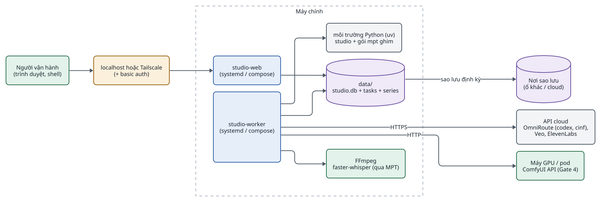
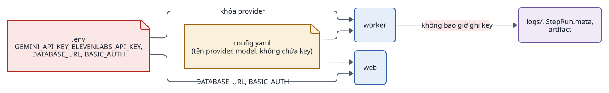
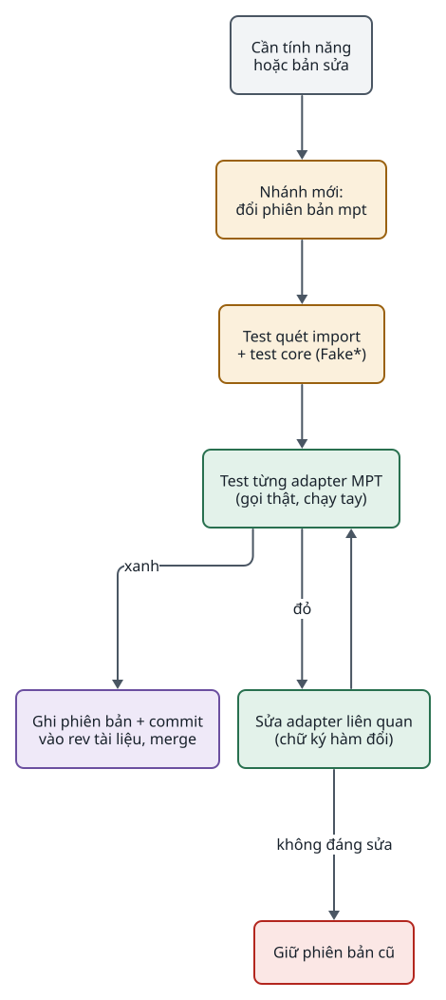
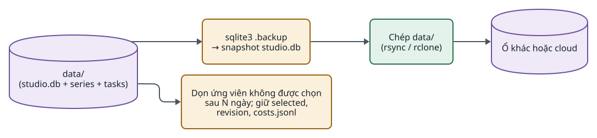
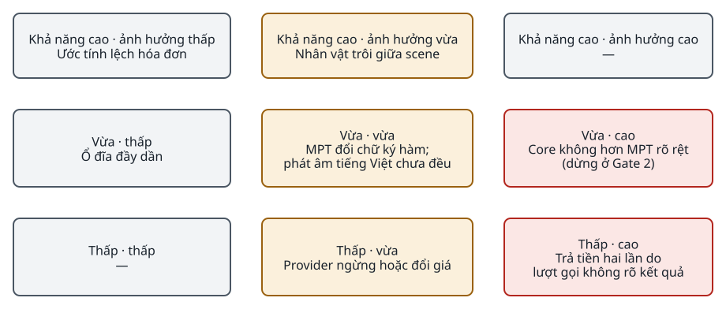
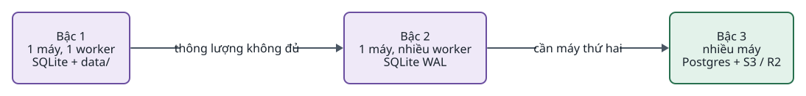

<!-- id:s1 -->
## Triển khai

<!-- id:s1.b1 -->
<!-- report-kit:d2
```d2
# cap: Triển khai: một máy chạy 2 process; MPT là thư viện trong cùng môi trường Python, cloud và GPU chỉ là endpoint
direction: right
op: "Người vận hành\n(trình duyệt, shell)" {class: hands}
net: "localhost hoặc Tailscale\n(+ basic auth)" {class: gate}
main: Máy chính {
  class: zone
  web: "studio-web\n(systemd / compose)" {class: brain}
  worker: "studio-worker\n(systemd / compose)" {class: brain}
  venv: "môi trường Python (uv)\nstudio + gói mpt ghim" {class: plain}
  data: "data/\nstudio.db + tasks + series" {shape: cylinder; class: data}
  ff: "FFmpeg\nfaster-whisper (qua MPT)" {class: hands}
}
gpu: "Máy GPU / pod\nComfyUI API (Gate 4)" {class: hands}
cloud: "API cloud\nOmniRoute (codex, openrouter),\nVeo, ElevenLabs" {class: plain}
backup: "Nơi sao lưu\n(ổ khác / cloud)" {shape: cylinder; class: data}
op -> net -> main.web
main.worker -> main.venv
main.worker -> main.data
main.web -> main.data
main.worker -> main.ff
main.worker -> gpu: HTTP
main.worker -> cloud: HTTPS
main.data -> backup: "sao lưu định kỳ"
```
-->
<picture>
<source media="(prefers-color-scheme: dark)" srcset="07-operations.figs/s1.b1-dark.svg">

</picture>

<!-- id:s1.b2 -->
Table: Process và lệnh chạy (đề xuất)
| Process | Lệnh | Khởi động lại |
| --- | --- | --- |
| web | `python -m studio web` (uvicorn) | Bất kỳ lúc nào; không giữ trạng thái |
| worker | `python -m studio worker` | Bất kỳ lúc nào; task `running` về hàng đợi; lượt gọi trả phí dở dang thành `unknown` |
| một bước | `python -m studio run-step <bước> --task <id> --scene <sNN>` | Dùng khi debug |

<!-- id:s1.b3 -->
Gate 2 chỉ cần CLI và worker. Web xuất hiện ở Gate 3. GPU tự host chỉ từ Gate 4; ComfyUI chạy trong image Docker ghim phiên bản custom node.

<!-- id:s2 -->
## Cấu hình và bí mật

<!-- id:s2.b1 -->
<!-- report-kit:d2
```d2
# cap: Khóa chỉ nằm ở config.toml của MPT và biến môi trường; studio.toml và log không bao giờ chứa khóa
direction: right
mptcfg: "MPT_HOME/config.toml\nkhóa ElevenLabs, Azure...,\nprovider MPT" {shape: page; class: bad}
env: ".env\nOMNIROUTE_API_KEY, BASIC_AUTH,\nMPT_HOME" {shape: page; class: bad}
toml: "studio.toml\nadapter, song song, retry\n(không khóa)" {shape: page; class: gate}
worker: worker {class: brain}
web: web {class: brain}
log: "log, costs.jsonl,\nứng viên, StepRun" {class: data}
mptcfg -> worker
env -> worker
env -> web: "BASIC_AUTH"
toml -> worker
toml -> web
worker -> log: "không bao giờ ghi khóa" {class: bad}
```
-->
<picture>
<source media="(prefers-color-scheme: dark)" srcset="07-operations.figs/s2.b1-dark.svg">

</picture>

<!-- id:s2.b2 -->
- `.env` và `config.toml` của MPT không commit; có `.env.example` liệt kê tên biến.
- Cấu hình MPT là toàn cục: một người vận hành, một cấu hình; không chạy hai cấu hình MPT song song.
- Logger lọc mọi giá trị trùng với biến bí mật trước khi ghi (NFR-07).
- `MPT_HOME` là thư mục riêng (ví dụ `~/.config/studio/mpt/`), quyền `600` cho `config.toml`, ngoài `data/` để sao lưu `data/` không mang theo khóa. MPT nạp file này một lần lúc import và có thể tự ghi lại nó.
- Trước lượt gọi trả phí đầu tiên của mỗi adapter: đặt giới hạn chi tiêu ở tài khoản provider (D-03, pilot 5 USD). Với OmniRoute, giới hạn đặt ở tài khoản upstream (openrouter, codex), vì gateway chỉ theo dõi hạn mức. Ở báo cáo G0/G1 giới hạn này chưa được đặt.
- FFmpeg và ffprobe cài từ hệ thống (bản 6 trở lên). `imageio-ffmpeg` đi kèm MPT chỉ có `ffmpeg`, còn renderer gọi cả `ffprobe`.

<!-- id:s3 -->
## Nâng phiên bản MPT

<!-- id:s3.b1 -->
MPT cập nhật gần như hằng ngày. Ghim phiên bản (P-01) và chỉ nâng khi cần một tính năng hay bản sửa; mỗi adapter có test riêng chạy trước khi nâng. Rủi ro lớn nhất của hệ thống là phụ thuộc vào dự án này, được giảm bằng quy trình dưới đây và ranh giới adapter.

<!-- id:s3.b2 -->
<!-- report-kit:d2
```d2
# cap: Nâng MPT: chỉ test adapter có thể đỏ; core không ảnh hưởng
direction: down
need: "Cần tính năng\nhoặc bản sửa" {class: plain}
br: "Nhánh mới:\nđổi phiên bản mpt" {class: gate}
imp: "Test quét import\n+ test core (Fake*)" {class: gate}
adp: "Test từng adapter MPT\n(gọi thật, chạy tay)" {class: hands}
ok: "Ghi phiên bản + commit\nvào rev tài liệu, merge" {class: data}
fix: "Sửa adapter liên quan\n(chữ ký hàm đổi)" {class: hands}
stay: "Giữ phiên bản cũ" {class: bad}
need -> br -> imp -> adp
adp -> ok: xanh
adp -> fix: đỏ
fix -> adp
fix -> stay: "không đáng sửa"
```
-->
<picture>
<source media="(prefers-color-scheme: dark)" srcset="07-operations.figs/s3.b2-dark.svg">

</picture>

<!-- id:s3.b3 -->
`vendor/video_project.py` không nâng theo gói `mpt`: nó là bản copy tại commit `82bb4a7` (gói `mpt` 1.3.9, bản đã chạy ở Gate 1). Chỉ cập nhật bản copy khi upstream sửa lỗi liên quan, ghi commit mới vào header. Vì `mpt` ghim FastAPI, Starlette và uvicorn mà web của ta cũng dùng, nhánh nâng MPT chạy thêm test web.

<!-- id:s4 -->
## Quan sát và debug

<!-- id:s4.b1 -->
Mọi thông tin debug nằm trong SQLite, `costs.jsonl` và log của từng task; Task detail hiển thị chúng. Không có hệ thống monitoring riêng.

<!-- id:s4.b2 -->
```sh
# Chi phí ước tính theo task trong tháng (đối chiếu hóa đơn cuối tháng)
cat data/tasks/*/costs.jsonl | jq -s '[.[] | select(.status=="ok" and (.ts|startswith("2026-10")))]
  | group_by(.request_id | split(":")[0]) | map({task: .[0].request_id | split(":")[0], usd: (map(.est_usd) | add)})'

# Lượt gọi pending mồ côi (không có dòng kết quả cùng request_id)
jq -s 'group_by(.request_id) | map(select(length == 1 and .[0].status == "pending")) | .[][0]' data/tasks/t_0042/costs.jsonl
```

<!-- id:s4.b3 -->
```sql
-- Scene tốn nhiều lượt thử nhất
SELECT task_id, step, scene, MAX(attempt) AS attempts
FROM step_runs GROUP BY task_id, step, scene HAVING attempts > 1 ORDER BY attempts DESC;

-- Task đang chờ người và lý do
SELECT id, wait_reason, updated_at FROM tasks WHERE status = 'waiting' ORDER BY updated_at;
```

<!-- id:s4.b4 -->
Table: Tín hiệu cần nhìn
| Tín hiệu | Ở đâu | Hành động |
| --- | --- | --- |
| Task `waiting` lâu | Trang Tasks, truy vấn trên | Duyệt gate hoặc quyết định `unknown` |
| Nhiều lượt thử ở một scene | Truy vấn trên, thẻ scene | Sửa visual, đổi model, xem lý do `QualityFail` |
| Ước tính lệch hóa đơn | So `costs.jsonl` với hóa đơn tháng | Sửa hệ số ước tính trong adapter |
| `Retryable` dồn dập | Log worker | Giảm giới hạn song song của adapter, kiểm rate limit |
| Dòng `unknown` | `costs.jsonl`, Task detail | Kiểm dashboard provider trước khi sinh lại |

<!-- id:s4.b5 -->
Chỉ số chính, đo ở mỗi gate: chi phí trên mỗi video được duyệt và phút công trên mỗi video được duyệt (mẫu nhật ký pilot ở [08 · Gate 0–1](08-roadmap.md#s2)).

<!-- id:s5 -->
## Sao lưu và dọn dẹp

<!-- id:s5.b1 -->
<!-- report-kit:d2
```d2
# cap: Toàn bộ trạng thái là thư mục data/; sao lưu bằng chép, dọn ứng viên không được chọn theo tuổi
direction: right
data: "data/\n(studio.db + series + tasks)" {shape: cylinder; class: data}
snap: "sqlite3 .backup\n→ snapshot studio.db" {class: gate}
copy: "Chép data/\n(rsync / rclone)" {class: hands}
dest: "Ổ khác hoặc cloud" {shape: cylinder; class: data}
clean: "Dọn ứng viên không được chọn\nsau N ngày; giữ selected,\nrevision, costs.jsonl" {class: gate}
data -> snap -> copy -> dest
data -> clean
```
-->
<picture>
<source media="(prefers-color-scheme: dark)" srcset="07-operations.figs/s5.b1-dark.svg">

</picture>

<!-- id:s5.b2 -->
- Sao lưu SQLite bằng `.backup` (an toàn khi WAL đang ghi), rồi chép cả `data/`.
- Khôi phục: dừng hai process, chép `data/` về, khởi động lại; worker resume như sau sự cố.
- Dọn dẹp chỉ xóa file ứng viên không được chọn, cũ hơn N ngày; giữ ScenePlan revision, `assets.json` (đánh dấu ứng viên đã dọn) và `costs.jsonl` để lịch sử chi phí đúng.

<!-- id:s6 -->
## Bảo mật, pháp lý và nền tảng

<!-- id:s6.b1 -->
Table: Kiểm soát bảo mật và tuân thủ
| Chủ đề | Kiểm soát | Gate |
| --- | --- | --- |
| Truy cập UI | Chỉ `localhost`, hoặc sau Tailscale/basic auth; không mở ra Internet | 3 |
| API key | `config.toml` của MPT và `.env`; không hiện trên UI, không vào log | 2 |
| Lệnh shell | FFmpeg chỉ qua renderer, bước `animate` và adapter, gọi bằng danh sách đối số (không qua shell); LLM không bao giờ viết lệnh | 2 |
| Đường dẫn file | `/files/*` và upload chuẩn hóa bằng `realpath` + `commonpath` trong `data/` | 3 |
| Công bố nội dung AI | Mỗi ứng viên mang `ai_generated`; phiếu duyệt C09 kiểm mô tả phát hành ghi "truyện hư cấu, hình và giọng AI" khi áp dụng | 2 |
| Quyền giọng nói, hình ảnh, văn bản, nhạc | Chỉ clone giọng có đồng ý bằng văn bản; khai báo quyền khi tạo task; hệ thống chỉ lưu hồ sơ, không tự xác minh | 2 |
| YouTube không trả tiền cho nội dung hàng loạt, lặp lại | Gate cuối do người duyệt; đa dạng format và góc nhìn | 2 |
| TikTok: app chưa audit chỉ đăng chế độ riêng tư | Upload tay hoặc nháp; nộp audit sớm nếu cần | 4 |
| EU AI Act Điều 50 (áp dụng từ 02/08/2026): công bố nội dung deepfake | Gắn cờ nội dung AI khi đăng (YouTube có trường `containsSyntheticMedia`) | 4 |
| Model tự host | Chỉ Wan 2.2 và FLUX.2 klein 4B (Apache 2.0) cho thương mại; FLUX.2 khác, LTX-2, HunyuanVideo có điều kiện riêng | 4 |

<!-- id:s6.b2 -->
Tài liệu này không phải tư vấn pháp lý; nghĩa vụ cụ thể phụ thuộc thị trường phát hành. Nên nộp audit YouTube Data API và TikTok Content Posting API sớm nếu định đăng tự động, vì thời gian duyệt không được công bố.

<!-- id:s7 -->
## Rủi ro và hạn chế đã biết

<!-- id:s7.b1 -->
Phần lớn hạn chế là đánh đổi có chủ đích để giữ hệ thống nhỏ. Rủi ro lớn nhất là phụ thuộc vào một dự án thay đổi rất nhanh (MPT), được giảm bằng ghim phiên bản và ranh giới adapter.

<!-- id:s7.b2 -->
<!-- report-kit:d2
```d2
# cap: Rủi ro chính theo khả năng và ảnh hưởng (đánh giá định tính, chưa có số đo)
grid-rows: 3
grid-columns: 3
h1: "Khả năng cao · ảnh hưởng thấp\nƯớc tính lệch hóa đơn" {class: plain}
h2: "Khả năng cao · ảnh hưởng vừa\nNhân vật trôi giữa scene" {class: gate}
h3: "Khả năng cao · ảnh hưởng cao\n—" {class: plain}
m1: "Vừa · thấp\nỔ đĩa đầy dần" {class: plain}
m2: "Vừa · vừa\nMPT đổi chữ ký hàm;\nphát âm tiếng Việt chưa đều" {class: gate}
m3: "Vừa · cao\nCore không hơn MPT rõ rệt\n(dừng ở Gate 2)" {class: bad}
l1: "Thấp · thấp\n—" {class: plain}
l2: "Thấp · vừa\nProvider ngừng hoặc đổi giá" {class: gate}
l3: "Thấp · cao\nTrả tiền hai lần do\nlượt gọi không rõ kết quả" {class: bad}
```
-->
<picture>
<source media="(prefers-color-scheme: dark)" srcset="07-operations.figs/s7.b2-dark.svg">

</picture>

<!-- id:s7.b3 -->
Table: Hạn chế kỹ thuật
| Hạn chế | Ảnh hưởng | Cách giảm hoặc gỡ |
| --- | --- | --- |
| Các bước chạy tuần tự; chỉ song song giữa các scene trong một bước | Thời gian chờ dài hơn | Thêm chạy song song khi đo được là nút thắt |
| Danh sách bước cố định, không rẽ nhánh có điều kiện | Mỗi quy trình cần danh sách riêng | Bước tự bỏ qua mục không áp dụng (như motion với scene ảnh tĩnh) |
| Một máy, SQLite | Thông lượng giới hạn; dừng khi máy hỏng | Postgres + S3 + nhiều worker, chấp nhận sửa phần lưu trữ |
| `video_project` chưa có phụ đề và chuyển cảnh | Burn-in phụ đề sau export; không có chuyển cảnh giữa scene | Thêm bước FFmpeg `xfade` vào bản copy khi cần |
| Không phải trình dựng phim | Chỉnh nhịp từng khung phải sửa dữ liệu rồi render lại | Xuất timeline sang trình dựng ngoài |
| Không đa người dùng, phân quyền | Chỉ hợp một người hoặc nhóm tin cậy | Thêm đăng nhập ở lớp web |
| Dung lượng tăng theo mọi ứng viên và revision | Ổ đĩa đầy dần | Dọn ứng viên không được chọn sau N ngày; sao lưu `data/` |

<!-- id:s7.b4 -->
Table: Hạn chế chất lượng
| Hạn chế | Cách giảm |
| --- | --- |
| Nhân vật vẫn có thể trôi; model video còn lỗi tay, mặt | Series Bible, ảnh tham chiếu, gate keyframe; đo ở Gate 3 trước khi nghĩ tới LoRA |
| Phát âm tiếng Việt (tên riêng, số, từ mượn) chưa đều | `lexicon` trong Series Bible; nghe duyệt ở gate cuối |
| Chưa có lip-sync, hội thoại trên hình | Adapter lip-sync ở Gate 4 nếu cần |

<!-- id:s7.b5 -->
Table: Phụ thuộc và vận hành
| Rủi ro | Ảnh hưởng | Cách giảm |
| --- | --- | --- |
| MPT đổi chữ ký hàm khi nâng cấp | Chỉ adapter liên quan hỏng; core không ảnh hưởng | Ghim phiên bản; test riêng từng adapter trước khi nâng |
| Cấu hình MPT là toàn cục | Khó chạy hai cấu hình MPT song song | Một người vận hành, một cấu hình |
| Gói `mpt` dùng tên package `app` | Trùng tên với code của ta | Package của ta tên `studio` |
| Provider đổi giá hoặc ngừng (OpenAI đã gỡ Sora 2 khỏi API ngày 24/09/2026) | Chi phí đổi, adapter hỏng | Adapter theo năng lực; lưu model thật vào mỗi ứng viên; đối chiếu hóa đơn |
| Lượt gọi trả phí không rõ kết quả | Có thể trả tiền hai lần nếu gửi lại | Ghi `pending` trước lượt gọi; người quyết định khi `unknown` |

<!-- id:s8 -->
## Runbook sự cố thường gặp

<!-- id:s8.b1 -->
Table: Triệu chứng, nguyên nhân và cách xử lý
| Triệu chứng | Nguyên nhân thường gặp | Xử lý |
| --- | --- | --- |
| Task đứng ở `running`, không có log mới | Worker chết | Khởi động lại worker; task về hàng đợi và resume |
| Task `waiting` lý do `unknown_call` | Worker chết sau khi gửi lượt gọi trả phí, hoặc MPT ném `UnconfirmedTaskError` | Kiểm dashboard provider; chọn "Sinh lại" hoặc "Bỏ qua" trên Task detail |
| Task `waiting` lý do `retries_exhausted` | Provider lỗi liên tục hoặc ảnh trượt kiểm tra 3 lần | Đọc lý do; sửa visual, đổi model cho task, hoặc upload asset |
| Adapter MPT lỗi sau khi nâng | Chữ ký hàm đổi | Quay về phiên bản ghim cũ; sửa adapter theo [quy trình nâng](#s3) |
| `database is locked` | Hai writer ghi lâu cùng lúc | Kiểm WAL; giữ giao dịch ngắn; một worker |
| Video thiếu phụ đề | TTS không trả mốc thời gian | Kiểm `SubtitleAligner` (faster-whisper) đã bật |
| Phụ đề lệch dần về cuối video | Mốc từng scene cộng dồn từ thời lượng đo khác cách renderer đo, hoặc khoảng đệm AAC khi ghép scene | Tính offset từ bản ghi timing của `video_project`; kiểm câu cuối của scene cuối trong T01 |
| Task `waiting` lý do `duration_exceeded` | Tổng giọng vượt `max_s` của brief | Rút gọn narration scene dài nhất (revision mới) hoặc tăng nhẹ tốc độ đọc trong Series Bible |
| Render báo "Format not on whitelist" | Footage của scene là ảnh, chưa qua `animate` | Kiểm bước `animate` đã chạy và clip là selected |
| `ffprobe` không tìm thấy | Chỉ có `ffmpeg` từ `imageio-ffmpeg` | Cài FFmpeg hệ thống |
| Phát âm sai tên riêng | Thiếu mục `lexicon` | Thêm vào Series Bible; chạy lại `voice` của scene đó |
| Ổ đĩa gần đầy | Ứng viên tích lũy | Chạy dọn ứng viên không được chọn; sao lưu trước |

<!-- id:s9 -->
## Mở rộng quy mô

<!-- id:s9.b1 -->
<!-- report-kit:d2
```d2
# cap: Ba bậc mở rộng; bậc 3 sửa phần nhận task và lưu trữ, không chỉ đổi URL
direction: right
s1: "Bậc 1\n1 máy, 1 worker\nSQLite + data/" {class: data}
s2: "Bậc 2\n1 máy, nhiều worker\nSQLite WAL" {class: data}
s3: "Bậc 3\nnhiều máy\nPostgres + S3 / R2" {class: hands}
s1 -> s2: "thông lượng không đủ"
s2 -> s3: "cần máy thứ hai"
```
-->
<picture>
<source media="(prefers-color-scheme: dark)" srcset="07-operations.figs/s9.b1-dark.svg">

</picture>

<!-- id:s9.b2 -->
Table: Điều kiện và thay đổi cho từng bậc
| Bậc | Khi nào | Thay đổi |
| --- | --- | --- |
| 1 → 2 | Một worker không đủ nhanh | Thêm process worker; nhận task bằng cập nhật có điều kiện trên SQLite; kiểm khóa ghi `assets.json` |
| 2 → 3 | Cần worker trên máy khác | Postgres với `SELECT ... FOR UPDATE SKIP LOCKED`; artifact sang S3 / R2; `costs.jsonl` và `assets.json` cần nơi ghi chung (AD-11: không chỉ đổi URL) |
