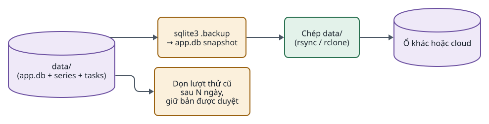
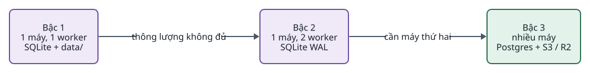

<!-- id:s1 -->
## Triển khai

<!-- id:s1.b1 -->
```d2
# cap: Triển khai mục tiêu: một máy chạy 2 process; GPU và cloud chỉ là endpoint
direction: right
op: "Người vận hành\n(trình duyệt)" {class: hands}
net: "localhost hoặc Tailscale\n(+ basic auth)" {class: gate}
main: Máy chính {
  class: zone
  web: "igniterra-web\n(systemd / compose)" {class: brain}
  worker: "igniterra-worker\n(systemd / compose)" {class: brain}
  data: "data/\napp.db + artifact" {shape: cylinder; class: data}
  ff: "FFmpeg, ffprobe,\nfaster-whisper" {class: hands}
  cron: cron {class: gate}
}
gpu: "Máy GPU riêng / pod RunPod\nComfyUI API (Phase 4)" {class: hands}
cloud: "API cloud\nGemini, ElevenLabs, Veo" {class: plain}
backup: "Nơi sao lưu\n(ổ khác / cloud)" {shape: cylinder; class: data}
op -> net -> main.web
main.cron -> main.web: "POST /api/tasks"
main.worker -> main.data
main.web -> main.data
main.worker -> main.ff
main.worker -> gpu: HTTP
main.worker -> cloud: HTTPS
main.data -> backup: "sao lưu định kỳ"
```
<picture>
<source media="(prefers-color-scheme: dark)" srcset="07-operations.figs/s1.b1-dark.svg">

</picture>

<!-- id:s1.b2 -->
Table: Process và lệnh chạy (đề xuất)
| Process | Lệnh | Khởi động lại |
| --- | --- | --- |
| web | `python -m app web` (uvicorn) | Bất kỳ lúc nào; không giữ trạng thái |
| worker | `python -m app worker` | Bất kỳ lúc nào; task `running` về hàng đợi và resume |
| một bước | `python -m app run-step <step> --task <id> --scene <item>` | Dùng khi debug |

<!-- id:s1.b3 -->
Phase 1 đến Phase 3 chỉ cần máy chính. GPU tự host xuất hiện từ Phase 4; ComfyUI chạy trong image Docker ghim phiên bản custom node.

<!-- id:s2 -->
## Cấu hình môi trường và bí mật

<!-- id:s2.b1 -->
```d2
# cap: Bí mật chỉ nằm trong .env và chỉ worker đọc khóa provider
direction: right
env: ".env\nGEMINI_API_KEY, ELEVENLABS_API_KEY,\nDATABASE_URL, BASIC_AUTH" {shape: page; class: bad}
cfg: "config.yaml\n(tên provider, model; không chứa key)" {shape: page; class: gate}
worker: worker {class: brain}
web: web {class: brain}
log: "logs/, StepRun.meta,\nartifact" {class: data}
env -> worker: "khóa provider"
env -> web: "DATABASE_URL, BASIC_AUTH"
cfg -> worker
cfg -> web
worker -> log: "không bao giờ ghi key" {class: bad}
```
<picture>
<source media="(prefers-color-scheme: dark)" srcset="07-operations.figs/s2.b1-dark.svg">

</picture>

<!-- id:s2.b2 -->
- `.env` không commit; có `.env.example` liệt kê tên biến.
- `config.yaml` chỉ chứa tên provider và model; khóa nằm ở `.env` theo quy ước tên.
- Logger lọc mọi giá trị trùng với biến bí mật trước khi ghi (NFR-07).

<!-- id:s3 -->
## Quan sát và debug

<!-- id:s3.b1 -->
Mọi thông tin debug nằm trong SQLite và `data/tasks/<id>/logs/`; Task detail hiển thị chúng. Không có hệ thống monitoring riêng ở các phase đầu.

<!-- id:s3.b2 -->
```sql
-- Chi phí theo task và bước
SELECT task_id, step, SUM(usd) AS usd, COUNT(*) AS calls
FROM cost_events GROUP BY task_id, step ORDER BY task_id;

-- Scene tốn nhiều lượt thử nhất
SELECT task_id, step, item, MAX(attempt) AS attempts
FROM step_runs GROUP BY task_id, step, item HAVING attempts > 1 ORDER BY attempts DESC;

-- Chi phí theo route model trong tháng (so sánh local và cloud ở Phase 4)
SELECT provider, model, SUM(usd) AS usd, COUNT(DISTINCT step_run_id) AS runs
FROM cost_events WHERE at >= date('now', 'start of month') GROUP BY provider, model;
```

<!-- id:s3.b3 -->
Table: Tín hiệu cần nhìn
| Tín hiệu | Ở đâu | Hành động |
| --- | --- | --- |
| Task `waiting` lâu | Trang Tasks | Duyệt gate hoặc nâng ngân sách |
| Nhiều lượt thử ở một bước | Truy vấn trên, thẻ scene | Sửa prompt, đổi model, xem lý do check |
| Chi phí ước tính lệch hóa đơn | So `cost_events` với hóa đơn tháng | Cập nhật `pricing.yaml` |
| Lỗi `Retryable` dồn dập | Log worker | Giảm `concurrency`, kiểm rate limit |
| `degraded: true` | Gate cuối | Chấp nhận hoặc chạy lại scene |

<!-- id:s4 -->
## Sao lưu và dọn dẹp

<!-- id:s4.b1 -->
```d2
# cap: Toàn bộ trạng thái là thư mục data/; sao lưu bằng chép, dọn lượt thử cũ theo tuổi
direction: right
data: "data/\n(app.db + series + tasks)" {shape: cylinder; class: data}
snap: "sqlite3 .backup\n→ app.db snapshot" {class: gate}
copy: "Chép data/\n(rsync / rclone)" {class: hands}
dest: "Ổ khác hoặc cloud" {shape: cylinder; class: data}
clean: "Dọn lượt thử cũ\nsau N ngày,\ngiữ bản được duyệt" {class: gate}
data -> snap -> copy -> dest
data -> clean
```
<picture>
<source media="(prefers-color-scheme: dark)" srcset="07-operations.figs/s4.b1-dark.svg">

</picture>

<!-- id:s4.b2 -->
- Sao lưu SQLite bằng `.backup` (an toàn khi WAL đang ghi), rồi chép cả `data/`.
- Khôi phục: dừng hai process, chép `data/` về, khởi động lại; runner resume như sau sự cố.
- Dọn dẹp chỉ xóa artifact của lượt thử không được chọn, cũ hơn N ngày; StepRun vẫn giữ để lịch sử chi phí đúng.

<!-- id:s5 -->
## Bảo mật và pháp lý

<!-- id:s5.b1 -->
Table: Kiểm soát bảo mật và tuân thủ
| Chủ đề | Kiểm soát | Phase |
| --- | --- | --- |
| Truy cập UI | Chỉ `localhost`, hoặc sau Tailscale / basic auth; không mở ra Internet | 1 |
| API key | `.env`, không hiện trên UI, không vào log | 1 |
| Lệnh shell | FFmpeg qua command builder; LLM không bao giờ viết lệnh | 1 |
| Quyền nội dung | Bắt buộc khai báo quyền văn bản, giọng, hình ảnh khi tạo task; hệ thống chỉ lưu hồ sơ, không tự xác minh | 1 |
| Clone giọng | Lưu bằng chứng đồng ý | 2 |
| Nội dung AI | Gate cuối do người; cờ `containsSyntheticMedia` khi đăng YouTube; EU AI Act Điều 50 áp dụng từ 02/08/2026 | 5 |
| Model tự host | Chỉ Wan 2.2 và FLUX.2 klein 4B (Apache 2.0) cho thương mại | 4 |

<!-- id:s5.b2 -->
Table: Giấy phép model tự host
| Model | Giấy phép | Lưu ý |
| --- | --- | --- |
| Wan 2.2 | Apache 2.0 | An toàn nhất để dùng thương mại |
| FLUX.2 klein 4B | Apache 2.0 | Các biến thể FLUX.2 khác dùng giấy phép phi thương mại |
| LTX-2.x | LTX-2 Community License | Có ngưỡng doanh thu; open weights không có nghĩa là mã nguồn mở |
| HunyuanVideo 1.5 | Tencent Hunyuan Community License | Không áp dụng tại EU, UK và Hàn Quốc |

<!-- id:s5.b3 -->
Nên nộp audit YouTube Data API và TikTok Content Posting API ngay từ Phase 1, vì thời gian duyệt không được công bố.

<!-- id:s6 -->
## Mở rộng quy mô

<!-- id:s6.b1 -->
```d2
# cap: Ba bậc mở rộng; chỉ bậc 3 đổi phần lưu trữ của core
direction: right
s1: "Bậc 1\n1 máy, 1 worker\nSQLite + data/" {class: data}
s2: "Bậc 2\n1 máy, 2 worker\nSQLite WAL" {class: data}
s3: "Bậc 3\nnhiều máy\nPostgres + S3 / R2" {class: hands}
s1 -> s2: "thông lượng không đủ"
s2 -> s3: "cần máy thứ hai"
```
<picture>
<source media="(prefers-color-scheme: dark)" srcset="07-operations.figs/s6.b1-dark.svg">

</picture>

<!-- id:s6.b2 -->
Table: Điều kiện và thay đổi cho từng bậc
| Bậc | Khi nào | Thay đổi | Chạm core? |
| --- | --- | --- | --- |
| 1 → 2 | Một worker không đủ nhanh | Chạy thêm process worker; nhận task bằng cập nhật có điều kiện trên SQLite | Không |
| 2 → 3 | Cần worker trên máy khác | `DATABASE_URL` sang Postgres, nhận task bằng `SELECT ... FOR UPDATE SKIP LOCKED`; artifact sang S3 / R2 | Chỉ tầng lưu trữ |
| Hàng đợi riêng | SQLite / Postgres không theo kịp, cần lịch và ưu tiên phức tạp | Huey; Temporal chỉ khi job kéo dài nhiều giờ trên nhiều máy | Có (worker) |

<!-- id:s6.b3 -->
YouTube mặc định 100 lượt upload mỗi ngày cho một project; đây là giới hạn ngoài của Phase 5.

<!-- id:s7 -->
## Rủi ro và hạn chế đã biết

<!-- id:s7.b1 -->
Phần lớn hạn chế là đánh đổi có chủ đích để giữ hệ thống đơn giản. Cột cuối cho biết gỡ bỏ có phải sửa core không.

<!-- id:s7.b2 -->
Table: Hạn chế kỹ thuật
| Hạn chế | Ảnh hưởng | Cách giảm hoặc gỡ | Sửa core? |
| --- | --- | --- | --- |
| Các bước chạy tuần tự; chỉ song song trong một bước | Chờ lâu hơn | Cú pháp `parallel:` từ Phase 1 (ADR-0003) | Có, chốt cú pháp ở Phase 1 |
| Profile tuyến tính, không rẽ nhánh | Không diễn đạt "nếu X thì Y" | Nhiều profile; module tự bỏ qua mục không áp dụng | Có, chưa khuyến nghị |
| Một máy, SQLite, 1–2 worker | Thông lượng giới hạn; dừng khi máy hỏng | Postgres + S3 + nhiều worker | Chỉ tầng lưu trữ |
| Không đa người dùng, phân quyền | Chỉ hợp một người / nhóm tin cậy | Đăng nhập, phân quyền ở lớp web | Không |
| Không phải trình dựng phim | Cắt chính xác từng khung phải render lại | Xuất `timeline.json` sang trình dựng ngoài | Không |
| Dung lượng tăng theo lượt thử | Ổ đầy dần | Dọn lượt thử cũ, giữ bản được duyệt | Không |
| Dữ liệu trên một ổ | Mất dữ liệu khi hỏng ổ | Sao lưu định kỳ `data/` | Không |

<!-- id:s7.b3 -->
Table: Hạn chế chất lượng
| Hạn chế | Ảnh hưởng | Cách giảm | Sửa core? |
| --- | --- | --- | --- |
| Nhân vật có thể trôi; model video lỗi tay, mặt | Cần người duyệt | Series Bible, image-to-video từ keyframe, gate keyframe; LoRA ở Phase 4 | Không |
| VLM chấm có thể sai | Lọt lỗi hoặc loại nhầm | Hiệu chỉnh ngưỡng; luôn giữ gate cuối | Không |
| Phát âm tiếng Việt chưa đều | Đọc sai tên riêng, số | `lexicon`; đo WER | Không |
| Chưa có lip-sync | Không có cảnh nhân vật nói | Module `avatar` hoặc model có audio gốc | Không |

<!-- id:s7.b4 -->
Table: Rủi ro vận hành và pháp lý
| Rủi ro | Giảm thiểu |
| --- | --- |
| Provider đổi giá hoặc ngừng (OpenAI gỡ Sora 2 khỏi API ngày 24/09/2026) | Adapter theo năng lực; lưu model thật trong `meta`; giá trong `pricing.yaml`; ít nhất 2 provider cho video |
| `pricing.yaml` cập nhật thủ công | Đối chiếu hóa đơn hằng tháng |
| SQLite giới hạn ghi đồng thời | WAL, tối đa 1–2 worker; Postgres khi nhiều máy |
| Contract quá cứng | `schema_version` + hàm chuyển đổi; kiểm lúc tạo task |
| Custom node ComfyUI hỏng khi cập nhật | Ghim phiên bản trong image Docker; workflow JSON trong Git |
| Chính sách nền tảng (YouTube nội dung hàng loạt, TikTok chưa audit, ACX) | Gate cuối; cờ nội dung AI; đa dạng format; kiểm chính sách trước kênh mới |

<!-- id:s8 -->
## Runbook sự cố thường gặp

<!-- id:s8.b1 -->
Table: Triệu chứng, nguyên nhân và cách xử lý
| Triệu chứng | Nguyên nhân thường gặp | Xử lý |
| --- | --- | --- |
| Task đứng ở `running`, không có log mới | Worker chết | Khởi động lại worker; runner resume |
| Task `waiting` lý do budget | Ước tính vượt `budget_usd` | Nâng ngân sách trên UI hoặc hủy |
| Bước `motion` lỗi liên tục | Rate limit hoặc provider lỗi | Giảm `concurrency`; router chuyển dự phòng; `on_fail: fallback` |
| Chi phí trùng trong ledger | Lỗi idempotency (vi phạm NFR-02) | Dừng worker, kiểm ràng buộc duy nhất, mở issue |
| `database is locked` | Quá nhiều writer trên SQLite | Kiểm WAL; giảm số worker |
| Video thiếu phụ đề | TTS không trả mốc thời gian | Bật căn chỉnh bằng faster-whisper |
| ComfyUI trả lỗi node | Custom node lệch phiên bản | Dựng lại image Docker đã ghim |
