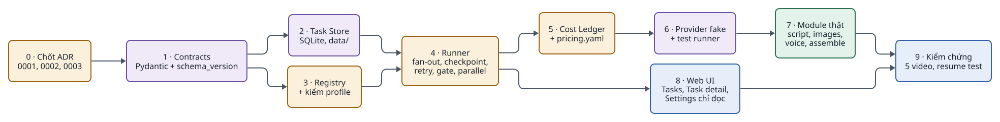
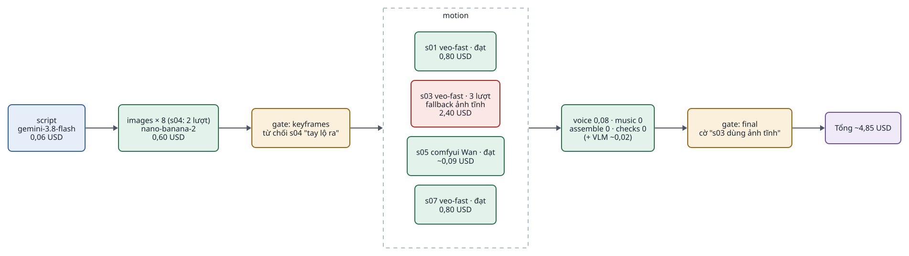

<!-- id:s1 -->
## Tổng quan

<!-- id:s1.b1 -->
Ra sản phẩm trước (Phase 1), rồi làm nhân vật nhất quán (Phase 2) trước khi chi tiền cho chuyển động (Phase 3), vì chuyển động đắt gấp nhiều lần và cần cổng duyệt keyframe để không đốt tiền. GPU tự host (Phase 4) chỉ đáng khi số lượng đủ lớn. Xuất bản tự động (Phase 5) để cuối vì upload tay ổn ở số lượng nhỏ.

<!-- id:s1.b2 -->
```d2
# cap: 5 phase, mỗi phase một trục năng lực và một điều kiện để sang phase kế
direction: right
p1: "Phase 1\nVideo đầu tiên" {class: brain}
p2: "Phase 2\nSeries nhất quán" {class: brain}
p3: "Phase 3\nChuyển động" {class: hands}
p4: "Phase 4\nHybrid GPU tự host" {class: hands}
p5: "Phase 5\nXuất bản và mở rộng" {class: gate}
p1 -> p2: "cần nhiều video\ncùng nhân vật"
p2 -> p3: "series ổn định,\ncần chuyển động thật"
p3 -> p4: "~100 video/tháng\nhoặc đã có GPU"
p4 -> p5: "upload tay\nthành nút thắt"
```
<picture>
<source media="(prefers-color-scheme: dark)" srcset="08-roadmap.figs/s1.b2-dark.svg">

</picture>

<!-- id:s1.b3 -->
```kpi
Phase | 5 | mỗi phase một trục năng lực
Module ở Phase 1 | 4 | script, images, voice, assemble
Chi phí Phase 1 | ~1–1,5 USD | mỗi Short 60 giây (ước tính)
Quyết định chặn Phase 1 | 3 | ADR-0001, 0002, 0003
```

<!-- id:s1.b4 -->
```kpi
Thời gian Phase 1 | 1–2 tuần | một người (ước tính)
Chi phí Phase 3 | ~5–7 USD | mỗi Short với 4 clip
```

<!-- id:s2 -->
## Phase 1 — Video đầu tiên

<!-- id:s2.b1 -->
Table: Phase 1
| Mục | Nội dung |
| --- | --- |
| Mục tiêu | Từ một brief ra MP4 9:16 có hình, giọng đọc và phụ đề, không thao tác file thủ công |
| Phạm vi | Toàn bộ core (runner với fan-out tổng quát, nhóm `parallel:`, contract SpeechScript, checkpoint, retry, gate, cost ledger, UI cơ bản) + 4 module; Settings chỉ đọc |
| Module | `script`, `images`, `voice`, `assemble` |
| Công nghệ | FastAPI + HTMX, SQLite, FFmpeg, Gemini 3.8 Flash, Nano Banana 2, ElevenLabs v4 |
| Đầu ra kiểm chứng | 5 video 60 giây từ 5 brief khác nhau, xem và tải được trên UI |
| Độ phức tạp / chi phí | Thấp; khoảng 1–2 tuần cho một người (ước tính); khoảng 1–1,5 USD mỗi Short |
| Sang Phase 2 khi | Muốn làm nhiều video cùng nhân vật, hoặc phải sửa ảnh lệch nhân vật bằng tay |

<!-- id:s2.b2 -->
Thứ tự công việc trong Phase 1, theo phụ thuộc:

<!-- id:s2.b3 -->
```d2
# cap: Thứ tự dựng Phase 1: contract và lưu trữ trước, runner với provider giả, rồi module thật và UI
direction: right
a: "0 · Chốt ADR\n0001, 0002, 0003" {class: gate}
b: "1 · Contracts\nPydantic + schema_version" {class: data}
c: "2 · Task Store\nSQLite, data/" {class: data}
d: "3 · Registry\n+ kiểm profile" {class: gate}
e: "4 · Runner\nfan-out, checkpoint,\nretry, gate, parallel" {class: gate}
f: "5 · Cost Ledger\n+ pricing.yaml" {class: gate}
g: "6 · Provider fake\n+ test runner" {class: data}
h: "7 · Module thật\nscript, images,\nvoice, assemble" {class: hands}
i: "8 · Web UI\nTasks, Task detail,\nSettings chỉ đọc" {class: brain}
j: "9 · Kiểm chứng\n5 video, resume test" {class: brain}
a -> b
b -> c
b -> d
c -> e
d -> e
e -> f
f -> g
g -> h
e -> i
h -> j
i -> j
```
<picture>
<source media="(prefers-color-scheme: dark)" srcset="08-roadmap.figs/s2.b3-dark.svg">

</picture>

<!-- id:s2.b4 -->
```chk
- [ ] Tắt worker giữa chừng rồi bật lại: task chạy tiếp, ledger không có chi phí trùng
- [ ] Đổi TTS provider chỉ bằng config
- [ ] Mỗi task hiển thị chi phí / ngân sách
- [ ] Test quy tắc phụ thuộc (core không import module) chạy trong CI
- [ ] Profile có nhóm parallel: được chấp nhận (chạy lần lượt cũng được)
- [ ] voice nhận SpeechScript, fan-out theo SpeechScript.segments
- [ ] 5 video 60 giây từ 5 brief, xem và tải được trên UI
- [ ] Đã nộp audit YouTube Data API và TikTok Content Posting API
```

<!-- id:s3 -->
## Phase 2 — Series nhất quán

<!-- id:s3.b1 -->
Table: Phase 2
| Mục | Nội dung |
| --- | --- |
| Mục tiêu | Nhiều video cùng series giữ đúng nhân vật, phong cách và ngôn ngữ camera |
| Phạm vi | Series Bible; enum camera trong ScenePlan; gate duyệt keyframe; chạy lại scene; bật / tắt bước trong Settings; Storyboard và sửa output; ghi đè model theo task |
| Module | `characters`, `music` (provider `library`), `checks` (thời lượng, độ phân giải, độ ồn, khung đen) |
| Core tái sử dụng | Toàn bộ; mẫu nhân vật tạo bằng chính runner (task với profile `create_character`) |
| Đầu ra kiểm chứng | 20 video của một series |
| Tiêu chí hoàn thành | Người duyệt nhận ra đúng nhân vật ở hầu hết các scene (tự đặt ngưỡng, ví dụ 90%); chạy lại một scene không đụng scene khác |
| Độ phức tạp / chi phí | Thấp; thêm chi phí tạo mẫu nhân vật một lần; khoảng 1,3–2 USD mỗi Short |
| Sang Phase 3 khi | Chất lượng series ổn định và cần chuyển động thật cho cảnh quan trọng |

<!-- id:s4 -->
## Phase 3 — Chuyển động

<!-- id:s4.b1 -->
Table: Phase 3
| Mục | Nội dung |
| --- | --- |
| Mục tiêu | 20–40% thời lượng là clip image-to-video, phần còn lại là ảnh tĩnh có chuyển động camera |
| Phạm vi | Trường `mode` và `tier` dùng thật; `on_fail: fallback` về ảnh tĩnh; giới hạn `concurrency` cho video |
| Module | `motion` (Veo 3.1 Fast / Lite qua `submit` / `poll`); tùy chọn check VLM cho clip |
| Đầu ra kiểm chứng | Video có clip chuyển động; ledger hiển thị chi phí theo scene và số lượt thử |
| Tiêu chí hoàn thành | Fallback hoạt động; trần ngân sách dừng task đúng lúc; resume giữa lúc chờ job video không gửi lại job |
| Độ phức tạp / chi phí | Trung bình; khoảng 5–7 USD mỗi Short với 4 clip |
| Sang Phase 4 khi | Chi phí video hằng tháng đáng kể hoặc khoảng 100 video/tháng; hoặc đã có GPU |

<!-- id:s5 -->
## Phase 4 — Hybrid GPU tự host

<!-- id:s5.b1 -->
Table: Phase 4
| Mục | Nội dung |
| --- | --- |
| Mục tiêu | Chuyển b-roll và keyframe sang GPU tự host, giữ cloud cho cảnh hero |
| Phạm vi | Provider `comfyui` (ảnh và video, workflow JSON trong Git); provider `router` theo `tier` với chuỗi dự phòng |
| Module | Không thêm module; chỉ thêm provider |
| Công nghệ | ComfyUI + FLUX.2 klein 4B + Wan 2.2 trên RTX 4090/5090 hoặc pod RunPod |
| Đầu ra kiểm chứng | So sánh A/B khoảng 20 scene local và cloud, có chi phí trên mỗi scene được duyệt theo route |
| Tiêu chí hoàn thành | Quyết định route ghi lại dựa trên số liệu ledger (nên viết thành ADR) |
| Độ phức tạp / chi phí | Cao (driver, VRAM, phiên bản custom node); chi phí biên thấp khi GPU dùng nhiều |
| Sang Phase 5 khi | Sản xuất đều đặn và upload tay trở thành nút thắt |

<!-- id:s6 -->
## Phase 5 — Xuất bản và mở rộng

<!-- id:s6.b1 -->
Table: Phase 5
| Mục | Nội dung |
| --- | --- |
| Mục tiêu | Lịch sản xuất và đăng tự động, có dữ liệu phản hồi |
| Phạm vi | YouTube (riêng tư rồi `publishAt`, cờ `containsSyntheticMedia`); TikTok upload nháp tới khi audit; cron gọi Task API; nhập analytics vào SQLite |
| Module | `publish`; `research` nếu làm nội dung thực tế |
| Mở rộng hạ tầng | Worker thứ hai trên cùng máy trước; nhiều máy thì Postgres + S3 |
| Đầu ra kiểm chứng | Một tuần video được đăng theo lịch, chỉ còn bước duyệt thủ công |
| Tiêu chí hoàn thành | Analytics gắn được với profile, route model và kiểu hook |
| Độ phức tạp / chi phí | Trung bình; YouTube mặc định 100 lượt upload mỗi ngày cho một project |

<!-- id:s7 -->
## Ví dụ kiểm chứng đầu-cuối

<!-- id:s7.b1 -->
Task `t_0042` "Tín hiệu từ năm 2126" chạy profile `shorts_motion` (cấu hình Phase 4) trong series `lyra7`, ra MP4 1080×1920 khoảng 60 giây với chi phí ước tính khoảng 4,9 USD kể cả retry. Đây là kịch bản kiểm thử chấp nhận cho Phase 3–4.

<!-- id:s7.b2 -->
```d2
# cap: t_0042: các bước, scene và chi phí ước tính; s03 hết lượt nên dùng ảnh tĩnh
direction: right
script: "script\ngemini-3.8-flash\n0,06 USD" {class: brain}
images: "images × 8 (s04: 2 lượt)\nnano-banana-2\n0,60 USD" {class: hands}
g1: "gate: keyframes\ntừ chối s04 \"tay lộ ra\"" {class: gate}
motion: motion {
  class: zone
  m1: "s01 veo-fast · đạt\n0,80 USD" {class: hands}
  m3: "s03 veo-fast · 3 lượt\nfallback ảnh tĩnh\n2,40 USD" {class: bad}
  m5: "s05 comfyui Wan · đạt\n~0,09 USD" {class: hands}
  m7: "s07 veo-fast · đạt\n0,80 USD" {class: hands}
}
rest: "voice 0,08 · music 0\nassemble 0 · checks 0\n(+ VLM ~0,02)" {class: hands}
g2: "gate: final\ncờ \"s03 dùng ảnh tĩnh\"" {class: gate}
total: "Tổng ~4,85 USD" {class: data}
script -> images -> g1 -> motion -> rest -> g2 -> total
```
<picture>
<source media="(prefers-color-scheme: dark)" srcset="08-roadmap.figs/s7.b2-dark.svg">

</picture>

<!-- id:s7.b3 -->
Table: Kết quả từng bước của t_0042
| Bước | Scene | Lượt | Provider | Kết quả | Chi phí ước tính (USD) |
| --- | --- | --- | --- | --- | --- |
| script | — | 1 | gemini-3.8-flash | ScenePlan 8 scene | 0,06 |
| images | s01–s08 | 1 (s04: 2) | nano-banana-2 | 9 ảnh | 0,60 |
| gate: keyframes | — | — | người duyệt | Từ chối s04 kèm ghi chú, chạy lại s04, rồi duyệt | — |
| motion | s01 | 1 | veo-3.1-fast (router: hero) | Đạt | 0,80 |
| motion | s03 | 3 | veo-3.1-fast (router: hero) | Không đạt cả 3 lượt → fallback ảnh tĩnh | 2,40 |
| motion | s05 | 1 | comfyui + Wan 2.2 (router: broll) | Đạt, khoảng 6 phút GPU RTX 4090 | ~0,09 |
| motion | s07 | 1 | veo-3.1-fast (router: hero) | Đạt | 0,80 |
| check VLM | 6 clip | — | gemini-3.8-flash | 5 lượt không đạt ở s03 và chấm các clip đạt | ~0,02 |
| voice | s01–s08 | 1 | eleven_v4 | ~1.000 ký tự, kèm mốc thời gian từng từ | 0,08 |
| music | — | 1 | library | `bgm_dark_ambient_03.mp3` | 0 |
| assemble | — | 1 | FFmpeg | `final_9x16.mp4`, `subs.ass` | 0 |
| checks | — | 1 | ffprobe + loudnorm | Đạt | 0 |
| Tổng |  |  |  |  | ~4,85 |

<!-- id:s7.b4 -->
Xử lý s03: lượt 1 check VLM trả `QualityFail("scar on right eyebrow")`; lượt 2 thêm feedback "keep the scar on the left eyebrow, keep the face static" nhưng lỗi bàn tay; lượt 3 vẫn không đạt, `on_fail: fallback` giữ `s03_a1.png` và `assemble` dùng khóa `push_in` để zoom 1.00 → 1.12, StepRun ghi `degraded: true`. Worker bị khởi động lại khi job Veo của s07 đang chạy: StepRun đã có `external_job_id` nên provider chỉ poll job cũ, ledger có một dòng chi phí cho s07.

<!-- id:s8 -->
## Quyết định cần chốt

<!-- id:s8.b1 -->
```q
Chốt ba quyết định ADR-0001, ADR-0002, ADR-0003 trước khi bắt đầu code Phase 1?
1. Chốt cả ba như khuyến nghị
2. Chốt từng ADR riêng (xem trang ADR)
3. Cần thảo luận thêm
rec: 1
```
