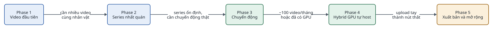
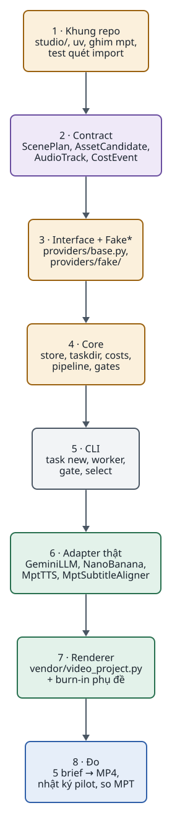
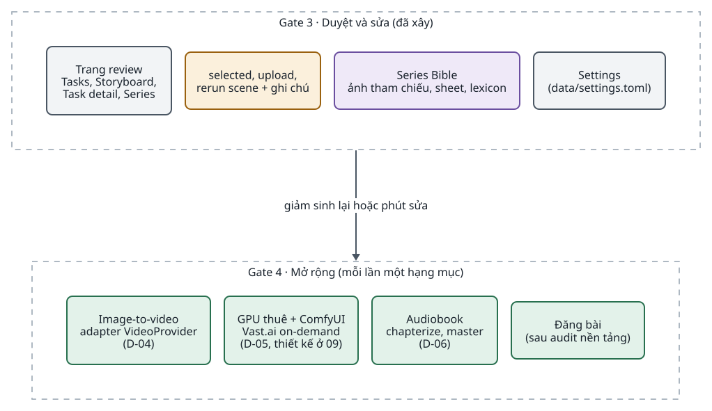
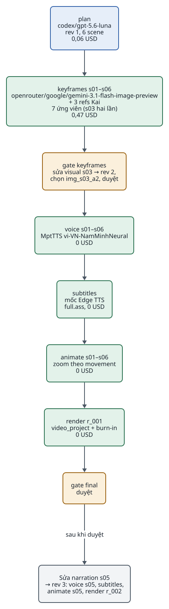

<!-- id:s1 -->
## Lộ trình theo decision gate

<!-- id:s1.b1 -->
Chưa viết dòng code nào trước Gate 2, và mỗi cổng đều có lối ra "dừng xây". Các gate thay cho 5 phase cố định của v1.1 (AD-12); mỗi năng lực mới ở Gate 4 là một adapter mới, không đổi core.

<!-- id:s1.b2 -->
<!-- report-kit:d2
```d2
# cap: Năm decision gate; code chỉ bắt đầu ở Gate 2, mỗi gate có lối ra dừng xây
direction: down
g0: "Gate 0 · Mục tiêu\n1 thể loại, 5 brief,\nchecklist viết trước\n(1–2 ngày)" {class: plain}
g1: "Gate 1 · Pilot MPT\nđóng 24/10/2026:\nbỏ baseline, D-01 = build" {class: plain}
g2: "Gate 2 · Core + adapter, CLI\ncùng 5 brief ra MP4\n(1–2 tuần)" {class: brain}
g3: "Gate 3 · Duyệt và sửa\ntrang review, selected,\nrerun, Series Bible\n(1–2 tuần)" {class: brain}
g4: "Gate 4 · Mở rộng\nmột adapter mỗi lần" {class: hands}
x0: "Dừng: không nói rõ\ngiá trị loại video" {class: bad}
x2: "Dừng hoặc quay lại MPT\n(không đạt mục tiêu)" {class: bad}
x3: "Bỏ tính năng\nkhông giải quyết lỗi đã thấy" {class: bad}
g0 -> g1: "tiêu chí độc lập công cụ"
g1 -> g2: "D-01 = build\n(lỗi C06 của pilot)"
g2 -> g3: "đạt mục tiêu\nGate 0"
g3 -> g4: "giảm sinh lại\nhoặc phút sửa"
g0 -> x0
g2 -> x2
g3 -> x3
```
-->
<picture>
<source media="(prefers-color-scheme: dark)" srcset="08-roadmap.figs/s1.b2-dark.svg">

</picture>

<!-- id:s1.b3 -->
Table: Cổng, đầu ra kiểm chứng và điều kiện
| Cổng | Đầu ra kiểm chứng | Đi tiếp khi | Dừng hoặc quay lại MPT khi | Thời gian ước tính |
| --- | --- | --- | --- | --- |
| 0 — Mục tiêu | Một thể loại video, 5 brief, checklist đạt/không đạt viết trước khi chạy | Tiêu chí độc lập với công cụ | Không nói rõ được giá trị của loại video | 1–2 ngày |
| 1 — Pilot MPT (đã đóng) | Kế hoạch ban đầu: 5 video từ MPT nguyên bản làm baseline. Thực tế: MPT cài và chạy được, Edge TTS và phụ đề đạt, 5 preview kỹ thuật; Pexels không còn cấp API key. Ngày 24/10/2026 Tuan bỏ baseline và chốt D-01 = build dựa trên lỗi C06 | Đã đi tiếp theo quyết định D-01 | — (không còn chạy MPT nguyên bản để so) | Đã xong |
| 2 — Core + adapter, CLI | Core (contract, StepRun, `costs.jsonl`) + `MptTTS`, `MptSubtitleAligner`, adapter ảnh trực tiếp, renderer; cùng 5 brief ra MP4; test quét import | Đạt mục tiêu tuyệt đối của Gate 0: video đạt C01–C09, tối đa 15 phút chủ động mỗi video được duyệt, tổng chi trong 5 USD; đề xuất ít nhất 3/5 brief được duyệt | Không đạt các mục tiêu đó sau một vòng sửa | 1–2 tuần |
| 3 — Duyệt và sửa | Trang review, selected, rerun scene, Series Bible; chạy test T02–T07, T09 | Giảm số lần sinh lại hoặc phút sửa đã đo ở Gate 2 | Tính năng không giải quyết lỗi đã thấy | 1–2 tuần |
| 4 — Mở rộng | Một adapter mỗi lần: image-to-video, ComfyUI, audiobook, đăng bài | Có nhu cầu định lượng | — | Theo từng adapter |

<!-- id:s1.b4 -->
Thời gian là ước tính cho một người. Nên nộp audit YouTube Data API và TikTok Content Posting API sớm nếu định đăng tự động, vì thời gian duyệt không được công bố.

<!-- id:s2 -->
## Gate 0–1: mục tiêu và pilot

<!-- id:s2.b1 -->
Gate 0 và Gate 1 không viết code. Gate 0 tạo thước đo cho mọi gate sau: cùng 5 brief, cùng checklist C01–C09, cùng mẫu nhật ký. Gate 1 ban đầu định đo MPT nguyên bản trên thước đo đó; phần này đã bỏ theo quyết định D-01 bên dưới.

<!-- id:s2.b2-2 -->
> [!IMPORTANT]
> Ngày 24/10/2026 Tuan chốt D-01 = build và bỏ baseline MPT, dựa trên lỗi C06 của pilot (brief-02 có mầm cây ngay từ đầu nên lộ twist; một ảnh không thể hiện được chuỗi hành động). Gate 1 đóng theo quyết định này. Cái giá đã chấp nhận: không còn số liệu MPT nguyên bản để so (T10), và C06 mới cho thấy giới hạn của đầu vào một ảnh, chưa chứng minh MPT không dựng đúng được khi có đủ cảnh. Vì vậy Gate 2 đo theo mục tiêu tuyệt đối của Gate 0.

<!-- id:s2.b2-3 -->
> [!WARNING]
> Trạng thái trước quyết định, ngày 24/10/2026 theo [báo cáo G0/G1](../../reports/g0-g1/README.md): Gate 0 đã chốt (D-02, 5 brief, checklist C01–C09). Gate 1 mới xong một phần: MPT cài và chạy được, Edge TTS và phụ đề đạt trên 5 brief, 5 MP4 là preview kỹ thuật dựng bằng FFmpeg ngoài MPT. Chưa có 5 video MPT nguyên bản (Pexels không còn cấp API key nên baseline chuyển sang nguồn `local`), chưa chấm đủ checklist, chưa đo phút công; giới hạn chi tiêu chưa đặt trên dashboard.

<!-- id:s2.b2 -->
```chk
- [x] Chọn một thể loại Short cụ thể (D-02): sci-fi bí ẩn tiếng Việt, tối đa 60 giây
- [x] Viết 5 brief và checklist đạt/không đạt trước khi chạy bất kỳ công cụ nào ([g0-plan](../../reports/g0-g1/g0-plan.md))
- [ ] Đặt giới hạn chi tiêu pilot ở tài khoản provider (D-03): trần kế hoạch 5 USD đã chốt, chưa đặt trên dashboard
- [x] Chạy MPT trên 5 brief: có audio, phụ đề và preview kỹ thuật một ảnh; bỏ lượt baseline đầy đủ theo quyết định D-01 (24/10/2026)
- [x] Ghi yêu cầu bắt buộc nào bị trượt (quyết định D-01): C06 của pilot; D-01 = build
- [ ] Ghi một dòng nhật ký có `human_minutes` cho mỗi lần chạy: chuyển sang Gate 2, áp dụng cho 5 lần chạy studio
```

<!-- id:s2.b3 -->
Mẫu nhật ký pilot, mỗi lần chạy một dòng. Chỉ điền số đã đo; để `null` khi chưa có.

<!-- id:s2.b4 -->
```json
{"run_id": "pilot-001", "solution": "mpt-as-is | studio", "brief_id": "brief-01", "accepted": null,
 "human_minutes": null, "elapsed_seconds": null, "api_cost_usd_estimate": null, "invoice_cost_usd": null,
 "retry_count": null, "models_used": [], "manual_changes": [], "failures": [], "output_path": null}
```

<!-- id:s3 -->
## Gate 2: core + adapter, CLI

<!-- id:s3.b1 -->
Gate 2 là lần duy nhất core được viết. Thứ tự dưới đây đi từ thứ test được không tốn tiền tới thứ gọi dịch vụ thật, để mỗi bước có bản giả trước khi có adapter thật (đề xuất).

<!-- id:s3.b2-2 -->
Đề xuất chia Gate 2 thành hai nửa. Gate 2a (việc 1–6) không gọi API trả phí: dùng bản giả, Edge TTS và ảnh local như pilot, nên làm được ngay. Gate 2b (việc 7–8) bật adapter trả phí và đo trên 5 brief theo mục tiêu tuyệt đối của Gate 0; chỉ bắt đầu khi giới hạn chi tiêu đã đặt ở tài khoản upstream và đã kiểm xong OmniRoute (ADR-0004 đến 0006 đã duyệt). Không còn điều kiện baseline vì D-01 đã chốt là build.

<!-- id:s3.b2 -->
<!-- report-kit:d2
```d2
# cap: Thứ tự công việc Gate 2: 2a không tốn tiền (bản giả, giọng miễn phí, ảnh local), 2b bật adapter trả phí và đo
direction: down
a: "Gate 2a · 0 USD" {
  class: zone
  w1: "1 · Khung repo\nstudio/, uv, mpt==1.3.9,\nvendor 82bb4a7, quét import" {class: gate}
  w2: "2 · Contract\nBrief, ScenePlan, AssetCandidate,\nAudioTrack, CostEvent, Review" {class: data}
  w3: "3 · Interface + Fake*\nproviders/base.py,\nproviders/fake/" {class: gate}
  w4: "4 · Core\nstore, taskdir, costs, pipeline,\ngates, hậu điều kiện" {class: gate}
  w5: "5 · CLI\ntask new, worker, gate,\nselect, review, pause" {class: plain}
  w6: "6 · Đường miễn phí\nMptTTS, aligner, animate,\nrenderer + burn-in;\n5 brief với ảnh local" {class: hands}
}
b: "Gate 2b · adapter trả phí" {
  class: zone
  w7: "7 · Adapter trả phí\nOmniRouteLLM, OmniRouteImage\n(kiểm gateway, giới hạn chi tiêu)" {class: hands}
  w8: "8 · Đo\n5 brief → MP4, phiếu duyệt,\nso mục tiêu Gate 0" {class: brain}
}
a.w1 -> a.w2 -> a.w3 -> a.w4 -> a.w5 -> a.w6
a -> b: "giới hạn chi tiêu đã đặt,\nđã kiểm OmniRoute"
b.w7 -> b.w8
```
-->
<picture>
<source media="(prefers-color-scheme: dark)" srcset="08-roadmap.figs/s3.b2-dark.svg">

</picture>

<!-- id:s3.b3 -->
```chk
- [x] ADR-0004 và ADR-0006 được duyệt (Tuan, 24/10/2026)
- [x] ADR-0005 được duyệt (Tuan, 24/10/2026)
- [ ] Kiểm OmniRoute trước việc 7: hai model có trong `/v1/models`, cách gửi ảnh tham chiếu, tắt fallback ([05 · OmniRoute](05-modules-providers.md#s5))
- [x] P-01: ghim `mpt==1.3.9`, commit `82bb4a7` (Tuan, 24/10/2026)
- [ ] Giới hạn chi tiêu đặt ở tài khoản của mọi provider trả phí sẽ bật, trước việc 7 (D-03): chặn cứng hoặc nạp trước đúng trần; nếu provider chỉ có cảnh báo thì ghi rõ là chưa có chốt chặn
- [x] D-01 = build, Tuan chốt ngày 24/10/2026 (bỏ baseline MPT)
- [ ] Test quét import xanh: chỉ `studio/providers/mpt/` import `app.*`
- [ ] Test core với bản giả: resume, retry, mồ côi → `unknown`, poll sau resume, sửa scene
- [ ] Cùng 5 brief của Gate 0 ra MP4 9:16 có phụ đề, đạt hậu điều kiện (1080×1920, có audio, ≤ 60 giây)
- [ ] Phiếu duyệt C01–C09 và phút công cho 5 lần chạy studio; nhật ký pilot; so với mục tiêu Gate 0 (tối đa 15 phút chủ động mỗi video được duyệt, tổng chi trong 5 USD)
- [ ] Quyết định đi tiếp hoặc quay lại MPT (D-07)
```

<!-- id:s4 -->
## Kiểm thử chấp nhận

<!-- id:s4.b1 -->
Bộ test chấp nhận lấy từ bản rà soát độc lập. Mỗi test chạy ở gate đầu tiên mà thành phần của nó tồn tại; test core tương ứng chạy với bản giả mỗi lần commit ([05 · Kiểm thử](05-modules-providers.md#s11)).

<!-- id:s4.b2 -->
Table: Test chấp nhận và gate chạy
| Test | Nội dung | Gate | Khẳng định |
| --- | --- | --- | --- |
| T01 | End-to-end 5 brief | 2 | 5 MP4 1080×1920 ≤ 60 giây, đạt hậu điều kiện; câu cuối của scene cuối khớp phụ đề; nhật ký pilot và phiếu duyệt đủ dòng |
| T02 | Sửa một scene | 3 | Chỉ phần phụ thuộc chạy lại; scene khác dùng lại |
| T03 | Thay asset bằng upload và chọn | 3 | Ứng viên `provider: user`; chỉ render chạy lại |
| T04 | Lỗi tạm thời 429/5xx/timeout | 3 | Thử lại tối đa 3 lần có backoff |
| T05 | Tắt worker ngay sau khi gửi lượt gọi trả phí | 3 | `unknown`, task `waiting`, không gửi lại |
| T06 | Tắt worker khi đang poll job video | 3 (với `FakeVideo`), 4 (thật) | Poll `job_id` cũ, không `submit` mới |
| T07 | Đổi adapter TTS chỉ bằng cấu hình | 3 | Không sửa code core |
| T08 | Chi phí khi chạy nhiều scene song song | 4 | Giới hạn song song theo adapter được tôn trọng; chi phí khớp số lượt gọi |
| T09 | Trôi nhân vật qua nhiều scene | 3 | Đo mức nhất quán với Series Bible; quyết định có cần LoRA |
| T10 | ~~So sánh với MPT nguyên bản trên cùng brief~~ Không áp dụng: baseline đã bỏ (D-01, 24/10/2026). Thay bằng đo studio theo mục tiêu Gate 0 | 2, 3 | Video được duyệt, phút công, chi phí trên video được duyệt, so với mục tiêu tuyệt đối |
| T11 | Giọng vượt trần thời lượng | 2 (với `FakeTTS` trả audio dài) | Task `waiting` lý do `duration_exceeded`; không có render |
| T12 | Hình bắt buộc xuất hiện sớm | 2 (với `FakeLLM`) | ScenePlan đặt `mầm cây` ở scene 1 của brief-02 bị từ chối; `plan` gọi lại kèm lý do |

<!-- id:s4.b3 -->
Đã kiểm thử trước khi viết tài liệu: dựng lại theo scene của `video_project`. Chạy trên FFmpeg 6.1.1 ngày 19/10/2026 với dự án 2 scene, render, rồi chỉ đổi footage s02. Đây là kiểm tra quy mô nhỏ, chưa phải thử tải hay video dài. Lần soát ngày 24/10/2026 kiểm thêm: footage là ảnh PNG bị bộ lọc định dạng đầu vào của renderer từ chối, nên footage của mọi scene phải là clip video (bước `animate`).

<!-- id:s4.b4 -->
Table: Kết quả dựng lại của video_project khi chỉ đổi footage s02
| Stage | Hành động | Lý do hệ thống ghi |
| --- | --- | --- |
| s01: audio, timing, scene | Dùng lại | Dependency khớp, byte đã kiểm tra |
| s02: audio, timing | Dùng lại | Dependency khớp, byte đã kiểm tra |
| s02: scene | Dựng lại | Dependency đổi so với revision trước |
| assembly, export | Dựng lại | Dependency đổi so với revision trước |

<!-- id:s5 -->
## Gate 3 và Gate 4

<!-- id:s5.b1 -->
Gate 3 thêm phần người dùng chạm vào; Gate 4 thêm năng lực, mỗi lần một adapter và chỉ khi có nhu cầu định lượng.

<!-- id:s5.b2 -->
<!-- report-kit:d2
```d2
# cap: Gate 3 thêm giao diện và Series Bible; Gate 4 thêm adapter, core không đổi
direction: down
g3: Gate 3 · Duyệt và sửa {
  class: zone
  a: "Trang review\nTasks, Storyboard,\nTask detail, Series" {class: plain}
  b: "selected, upload,\nrerun scene + ghi chú" {class: gate}
  c: "Series Bible đầy đủ\nảnh tham chiếu, lexicon" {class: data}
  d: "Settings đơn giản" {class: plain}
}
g4: Gate 4 · Mở rộng (mỗi lần một adapter) {
  class: zone
  e: "Image-to-video\nMptVideo / VeoVideo\n(D-04)" {class: hands}
  f: "GPU tự host\nComfyUI: FLUX.2 klein, Wan 2.2\n(D-05)" {class: hands}
  g: "Audiobook\nchapterize, master\n(D-06)" {class: hands}
  h: "Đăng bài\n(sau audit nền tảng)" {class: hands}
}
g3 -> g4: "giảm sinh lại hoặc phút sửa"
```
-->
<picture>
<source media="(prefers-color-scheme: dark)" srcset="08-roadmap.figs/s5.b2-dark.svg">

</picture>

<!-- id:s5.b3 -->
Table: Điều kiện mở từng hạng mục Gate 4
| Hạng mục | Mở khi | Quyết định |
| --- | --- | --- |
| Image-to-video | Gate 3 cho thấy ảnh tĩnh không đủ cho thể loại đã chọn | D-04 |
| GPU tự host | Số liệu chi phí trên asset được duyệt chứng minh lợi ích | D-05 |
| Audiobook | Có workload thật | D-06 |
| Đăng bài tự động | Audit YouTube/TikTok xong; cờ nội dung AI sẵn sàng | — |

<!-- id:s6 -->
## Ví dụ kiểm chứng đầu-cuối

<!-- id:s6.b1 -->
Task `t_0042` "Tín hiệu từ năm 2126", series `lyra7`, cấu hình Gate 3 (ảnh tĩnh có chuyển động camera, chưa có image-to-video), ra MP4 1080×1920 khoảng 55 giây (6 scene, trong giới hạn D-02) với chi phí ước tính khoảng $0,53. Brief: "Người gác cuối cùng trên trạm quỹ đạo nhận tín hiệu từ chính mình của 100 năm sau", 45–58 giây, trần 60 giây, tiếng Việt. Số liệu là ví dụ minh họa, chưa đo; chi phí tính theo giá gọi thẳng Gemini, giá qua OmniRoute do tài khoản upstream quyết định.

<!-- id:s6.b2 -->
<!-- report-kit:d2
```d2
# cap: t_0042 qua các bước: ScenePlan 3 revision, 7 ứng viên ảnh, khoảng 0,53 USD
direction: down
plan: "plan\ncodex/gpt-5.6-luna\nrev 1, 6 scene\n0,06 USD" {class: brain}
kf: "keyframes s01–s06\nopenrouter/google/gemini-nano-banana-2.1\n+ 3 refs Kai\n7 ứng viên (s03 hai lần)\n0,47 USD" {class: hands}
g1: "gate keyframes\nsửa visual s03 → rev 2,\nchọn img_s03_a2, duyệt" {class: gate}
vo: "voice s01–s06\nMptTTS vi-VN-NamMinhNeural\n0 USD" {class: hands}
an: "animate s01–s06\nzoom theo movement\n0 USD" {class: hands}
sb: "subtitles\nmốc Edge TTS\nfull.ass, 0 USD" {class: hands}
rd: "render r_001\nvideo_project + burn-in\n0 USD" {class: hands}
g2: "gate final\nduyệt" {class: gate}
fix: "Sửa narration s05\n→ rev 3: voice s05, subtitles,\nanimate s05, render r_002" {class: plain}
plan -> kf -> g1 -> vo -> sb -> an -> rd -> g2
g2 -> fix: "sau khi duyệt"
```
-->
<picture>
<source media="(prefers-color-scheme: dark)" srcset="08-roadmap.figs/s6.b2-dark.svg">

</picture>

<!-- id:s6.b3 -->
Table: Các bước đã chạy của t_0042
| Bước | Scene | Adapter | Kết quả | Chi phí ước tính |
| --- | --- | --- | --- | --- |
| `plan` | — | `OmniRouteLLM` (`codex/gpt-5.6-luna`) | ScenePlan rev 1, 6 scene, khoảng 160 từ | $0,06 |
| `keyframes` | s01–s06 | `OmniRouteImage` (`openrouter/google/gemini-nano-banana-2.1`) + 3 ảnh tham chiếu Kai | 7 ứng viên (s03 sinh 2 lần) | $0,47 |
| gate `keyframes` | — | Người duyệt | Sửa visual s03 ("hands out of frame") → rev 2, chạy lại s03, chọn `img_s03_a2`, duyệt | — |
| `voice` | s01–s06 | `MptTTS` (Edge TTS vi-VN-NamMinhNeural) | 6 file giọng kèm mốc thời gian; tổng khoảng 55 giây, dưới trần 60 | $0 |
| `subtitles` | — | Mốc Edge TTS (không cần whisper) | `full.ass` | $0 |
| `animate` | s01–s06 | FFmpeg `zoompan` local | 6 clip MP4 từ ảnh selected, chuyển động theo khóa movement, dài bằng giọng | $0 |
| `render` | — | `video_project` | Render `r_001`: ghép 6 clip với giọng, burn-in phụ đề, kiểm hậu điều kiện | $0 |
| gate `final` | — | Người duyệt | Phiếu duyệt C01–C09 đạt, 9 phút công; duyệt `r_001` | — |
| Tổng | | | | Khoảng $0,53; nhạc tắt như pilot |

<!-- id:s6.b4 -->
1. Sửa sau khi duyệt. Người dùng đổi narration của s05. Hệ thống tạo ScenePlan rev 3, chỉ chạy lại `voice` và `animate` của s05, `subtitles` và `render` thành `r_002`; `video_project` dùng lại 5 scene còn lại và chỉ dựng lại s05 cùng bước ghép cuối. `r_001` đã duyệt vẫn nguyên cho tới khi `r_002` được duyệt.
2. Gián đoạn. Worker bị tắt giữa bước `keyframes` sau khi gửi request cho s06 nhưng trước khi nhận kết quả. Khi chạy lại, `costs.jsonl` còn dòng `pending` cho s06 → ghi `unknown`, task chuyển `waiting`; Task detail hỏi người dùng có sinh lại s06 không. Các scene đã `done` không chạy lại.
3. Đầu ra. `renders/r_002/final_9x16.mp4` (H.264/AAC), `full.ass`, toàn bộ ứng viên và revision xem được trên Storyboard, chi phí từng lượt gọi trong `costs.jsonl`.

<!-- id:s6.b5 -->
Với cấu hình có image-to-video (Gate 4, 4 clip Veo 3.1 Fast 720p), chi phí ước tính tăng lên khoảng $5–7 mỗi Short theo báo cáo nghiên cứu.

<!-- id:s7 -->
## Quyết định cần chốt

<!-- id:s7.b1 -->
P-01 và P-02 đã chốt, còn P-03; kèm ba ADR ở [sổ quyết định](../adr/index.md).

<!-- id:s7.b2 -->
> [!NOTE]
> P-01 · Phiên bản MPT ghim: đã chốt ngày 24/10/2026, Tuan chọn `mpt==1.3.9` (commit `82bb4a7`), bản đã chạy ở Gate 1; vendor `video_project.py` cùng commit. Nâng phiên bản theo quy trình ở [07 · Vận hành](07-operations.md#s3).

<!-- id:s7.b3 -->
> [!NOTE]
> P-02 · Adapter LLM và ảnh: đã chốt ngày 24/10/2026, Tuan chọn OmniRoute với `codex/gpt-5.6-luna` (LLM) và `openrouter/google/gemini-nano-banana-2.1` (keyframe có nhân vật). Model đổi được trong `studio.toml`. Dự phòng: FLUX.2 klein 4B qua ComfyUI ở Gate 4.

<!-- id:s7.b4 -->
```q
P-03 · Giọng đọc mặc định?
1. Edge TTS vi-VN qua MptTTS (miễn phí) cho Gate 2a; ElevenLabs khi cần chất lượng cao hơn
2. ElevenLabs qua MptTTS ngay từ đầu
rec: 1
```

<!-- id:s7.b5 -->
Table: Quyết định vận hành còn mở
| ID | Quyết định | Đề xuất | Khi nào chốt |
| --- | --- | --- | --- |
| D-01 | Build hay reuse | Đã chốt: build (core + adapter), dựa trên lỗi C06 của pilot; bỏ baseline MPT nên mất phép so sánh T10 | Tuan chốt 24/10/2026 |
| D-02 | Thể loại video pilot | Đã chốt: Short sci-fi bí ẩn tiếng Việt, tối đa 60 giây (CON-08) | Gate 0 (xong) |
| D-03 | Mức chi tiêu tối đa của pilot | Đã chốt trần kế hoạch 5 USD; còn phải đặt ở tài khoản của từng provider trả phí sẽ dùng (provider nào cũng được) | Trước lượt gọi trả phí đầu tiên |
| D-04 | Khi nào thêm image-to-video | Khi Gate 3 cho thấy ảnh tĩnh không đủ cho thể loại đã chọn | Sau Gate 3 |
| D-05 | Khi nào thêm GPU tự host | Khi số liệu chi phí trên asset được duyệt chứng minh lợi ích | Sau baseline sản xuất |
| D-06 | Khi nào làm audiobook | Khi có workload thật | Không ràng buộc |
| D-07 | Điều kiện tiếp tục đầu tư | Video được duyệt + phút công + chi phí đo được, so với mục tiêu tuyệt đối của Gate 0 (không còn baseline MPT) | Sau mỗi gate |

<!-- id:s7.b6 -->
Các điểm từng được đề xuất "chốt trước Phase 1" trong v1.1 (fan-out tổng quát, contract SpeechScript, cú pháp parallel) đã bị loại theo AD-05 và AD-06; xem ADR-0001 đến ADR-0003.

<!-- id:s8 -->
## Phụ lục: bản rà soát độc lập và nơi xử lý

<!-- id:s8.b1 -->
ADD-AIVIDEO-003 đồng ý với 11/12 phát hiện của bản rà soát Architecture D (19/10/2026), đồng ý một phần với 1. Bảng dưới đây chỉ nơi mỗi phát hiện được xử lý trong bộ tài liệu này.

<!-- id:s8.b2 -->
Table: Phát hiện của bản rà soát và nơi xử lý
| Mã | Phát hiện | Đánh giá | Xử lý |
| --- | --- | --- | --- |
| F01 | Phase 1 xây toàn bộ core quá sớm | Đồng ý | AD-05, AD-12: core tối thiểu, lộ trình theo gate ([02](02-architecture.md#s9), mục 1 ở trên) |
| F02 | `script` cần trả 2 contract | Đồng ý | AD-06: chỉ ScenePlan ([ADR-0005](../adr/0005-sceneplan-revisions-selected.md)) |
| F03 | "Không trả tiền hai lần" chưa được chứng minh | Đồng ý | AD-09; dùng `UnconfirmedTaskError` của MPT ([ADR-0006](../adr/0006-paid-call-ledger.md)) |
| F04 | "Lấy bản mới nhất" không đủ | Đồng ý | AD-07: selected ([04](04-data-contracts.md#s5)) |
| F05 | Sửa một scene không khớp mô hình StepRun | Đồng ý | AD-08: revision ScenePlan, `input_hash` ([03](03-runner.md#s5)) |
| F06 | Ví dụ YAML parallel sai cú pháp | Đồng ý | Bỏ cú pháp parallel |
| F07 | Không phải TTS nào cũng trả mốc từng từ | Đồng ý | `SubtitleAligner` qua faster-whisper của MPT ([05](05-modules-providers.md#s3)) |
| F08 | Đổi sang Postgres không chỉ đổi URL | Đồng ý | AD-11 ([07](07-operations.md#s9)) |
| F09 | Chi phí, thời gian chưa có baseline | Đồng ý | Baseline MPT đã bỏ (D-01, 24/10/2026); Gate 2 đo chi phí và phút công trên video được duyệt so với mục tiêu Gate 0 |
| F10 | Giá ước tính lệch giá thực | Đồng ý | AD-10: chỉ ghi nhật ký, đối chiếu hóa đơn |
| F11 | Series Bible không đảm bảo nhất quán | Đồng ý một phần | Giữ ở mức tối thiểu vì là khác biệt chính so với MPT; đo ở Gate 3 (T09) |
| F12 | Rủi ro chính nằm ngoài code | Đồng ý | [07 · Bảo mật, pháp lý](07-operations.md#s6); không tự đăng bài trước Gate 4 |
