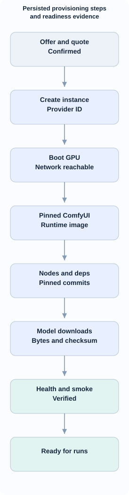
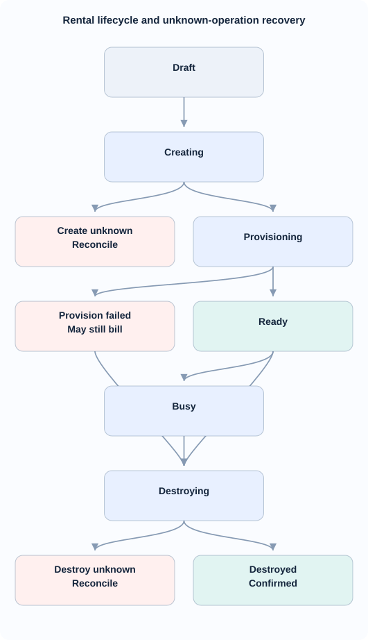

<!-- id:s1 -->
## Mục tiêu và ranh giới

Tài liệu này là thiết kế chính thức cho **Gate 4**, bổ sung vào bộ tài liệu 01–08; chưa có nghĩa chức năng đã được code. [01 — Yêu cầu](01-system-design.md#s6) sở hữu FR/NFR; [02 — Kiến trúc](02-architecture.md) sở hữu quy tắc tầng; [06 — Web UI](06-web-ui.md) sở hữu navigation; [07 — Vận hành](07-operations.md) sở hữu runbook; [08 — Roadmap](08-roadmap.md) sở hữu quyết định triển khai.

- **GPU Rentals** quản lý nhà cung cấp GPU, offer on-demand, thuê, provisioning, instance đang hoạt động, logs, chi phí, stop/destroy.
- **ComfyUI Workflows** quản lý file workflow JSON, dependencies, execution, outputs và liên kết tới GPU sẵn sàng.
- **Video Studio** (Tasks, Storyboard, Task detail, Series) giữ nguyên: adapter ComfyUI ở Gate 4 chỉ nhận endpoint đã ready, không thêm bước thuê GPU vào core pipeline.
- **Vast.ai** là provider đầu tiên; có thể thay bằng RunPod hoặc nhà cung cấp khác qua adapter tương ứng sau khi có nhu cầu. Không xây provider thứ hai ở MVP.
- **ComfyUI** là runtime trên GPU, không phải GPU provider. Không nhầm workflow ComfyUI (node graph JSON) với danh sách step cố định của Igniterra.
- Mặc định chỉ thuê **on-demand theo tiêu chí giá/cấu hình**, không triển khai bid/spot, serverless, auto-scaling hay GPU scheduler phân tán.

<!-- id:s2 -->
## Luồng tổng thể (từ trên xuống dưới)

<!-- id:s2.b1 -->
<!-- report-kit:d2
```d2
# cap: GPU provider-neutral and ComfyUI service boundaries
direction: down
gpuui: "GPU Rentals\nWeb UI" {class: plain}
wfui: "ComfyUI Workflows\nWeb UI" {class: plain}
gpu: "GPU Rental Service" {class: gate}
workflow: "Workflow Service" {class: gate}
proto: "GPUProvider Protocol" {class: data}
deps: "Dependency Planner" {class: data}
vast: "Vast.ai Adapter" {class: hands}
runtime: "ComfyUI Runtime" {class: hands}
outputs: "Verified Outputs" {class: data}
gpuui -> gpu
wfui -> workflow
gpu -> proto
proto -> vast
workflow -> deps
vast -> runtime
deps -> runtime
runtime -> outputs
```
-->
<picture>
<source media="(prefers-color-scheme: dark)" srcset="09-gpu-comfyui.figs/s2.b1-dark.svg">

</picture>

Các service nằm trong cùng modular monolith FastAPI và worker hiện có, dùng SQLite và thư mục data/. Không thêm n8n, LangGraph, queue broker hoặc microservice chỉ để thuê GPU. Progress được persist ở SQLite, web đọc qua polling HTMX (2–5 giây khi đang chạy, giảm khi idle); SSE có thể bổ sung nếu polling không đáp ứng. Không hiển thị phần trăm giả: hiển thị **step hiện tại, step hoàn tất, thời điểm cập nhật và log**, và số byte tải nếu provider hỗ trợ.

<!-- id:s3 -->
## Màn hình 1 — GPU Rentals

| Vùng | Hiển thị bắt buộc | Hành động |
| --- | --- | --- |
| Provider selector | Vast.ai (enabled); provider chưa triển khai ghi rõ unavailable | Chọn provider; không giả lập hỗ trợ |
| Search offers | GPU/VRAM, RAM, disk, vùng, giá GPU/giờ, giá storage/giờ nếu có, bandwidth, verified/reliability, tổng giá ước tính và thời điểm báo giá | Filter và sort theo **tổng giá phù hợp**, refresh báo giá |
| Create rental | Offer, template/image, dung lượng disk, thời gian dự kiến, chi phí ước tính, quota/giới hạn, đường dẫn workflow tùy chọn | Confirm trước khi tạo instance; chỉ on-demand |
| Instance list | Internal ID, provider ID, provider, GPU, VRAM, trạng thái, giá/giờ, elapsed, accumulated estimate, last update | Xem chi tiết, stop/destroy có xác nhận |
| Provision detail | Timeline từng phase, start/end, elapsed, source log, last heartbeat, error code, bước đang chạy | Xem log, retry **bước an toàn**, reconcile, destroy |
| Safety controls | Idle TTL, max runtime, nhắc khi phí tăng, tình trạng cleanup | Đặt TTL, destroy ngay, kiểm tra trạng thái provider |

Bố cục ưu tiên: thanh filter ở trên; danh sách offers/instances ở giữa; chọn instance mở detail với timeline **theo chiều dọc**. Không dồn thành dashboard phức tạp. Không cộng giá bằng cách chỉ lấy GPU $/h: hiển thị riêng compute, disk, phí bổ sung có sẵn, ghi nhãn **estimate, not invoice**.

Ví dụ timeline trên detail:

<!-- id:s3.b1 -->
<!-- report-kit:d2
```d2
# cap: Persisted provisioning steps and readiness evidence
direction: down
quote: "Offer and quote\nConfirmed" {class: data}
create: "Create instance\nProvider ID" {class: hands}
boot: "Boot GPU\nNetwork reachable" {class: hands}
image: "Pinned ComfyUI\nRuntime image" {class: hands}
nodes: "Nodes and deps\nPinned commits" {class: hands}
models: "Model downloads\nBytes and checksum" {class: hands}
smoke: "Health and smoke\nVerified" {class: gate}
ready: "Ready for runs" {class: gate}
quote -> create -> boot -> image -> nodes -> models -> smoke -> ready
```
-->
<picture>
<source media="(prefers-color-scheme: dark)" srcset="09-gpu-comfyui.figs/s3.b1-dark.svg">

</picture>

Các phase có thể `skipped` khi template đã cài sẵn; thứ tự model/nodes có thể phụ thuộc manifest. Dòng tiến độ chỉ chuyển thành DONE sau khi có bằng chứng kiểm tra (không dựa vào thông báo bắt đầu). Cho phép hủy từ mọi bước đã có instance ID, nhưng không được xóa trạng thái theo dõi trước khi xác nhận provider đã destroy.

<!-- id:s4 -->
## Màn hình 2 — ComfyUI Workflows

| Vùng | Hiển thị bắt buộc | Hành động |
| --- | --- | --- |
| Workflow library | Tên, revision/hash file, loại GUI/API JSON, model/node refs, validation status | Upload/import JSON, chọn version, xóa bản nháp |
| Dependency review | Models: URL, size nếu biết, checksum nếu có, đích; nodes: repo/ref, pip requirements; unresolved | Review và approve trước khi deploy; chỉnh mapping |
| Runtime binding | Danh sách instance `ready`, GPU/VRAM/free disk, runtime image/version | Chọn instance; link về GPU detail; tạo rental riêng nếu chưa có |
| Workflow run | Input/prompt, output path, ComfyUI `prompt_id`, trạng thái, thời gian, logs, ảnh/video | Run, xem progress, cancel (nếu API hỗ trợ), tải output |
| Output verification | Artifact path, file size/hash, loại media, chuyển về storage local, kết quả kiểm tra | Download/verify; đánh dấu safe-to-destroy |

**Không viết lại ComfyUI node graph editor** trong Igniterra: workflow chỉ upload, version, kiểm dependencies, cấu hình input cơ bản và thực thi. Nút “Open ComfyUI” mở giao diện ComfyUI trên phiên đã được bảo vệ xác thực, khi cần sửa node graph. Không truy cập trực tiếp port không có TLS/auth từ Internet.

**Đường đi tối thiểu:** Import JSON -> dependency scan -> human review -> select ready GPU (hoặc chuyển sang GPU Rentals thuê) -> provision/verify -> run -> collect output -> release GPU. Các màn hình có link qua lại nhưng có state và route độc lập; đóng hoặc xóa workflow không tự hủy GPU đang dùng bởi run khác.

<!-- id:s5 -->
## Module và interface tách theo trách nhiệm

Bố cục thư mục **đề xuất tại Gate 4**, không đổi 5 nội dung provider interface sẵn có của `studio/providers/base.py`:

```text
studio/
  gpu/
    service.py          # rental/provision lifecycle, reconcile
    contracts.py        # ProviderOffer, Rental, ProvisionStep/Event
    registry.py         # SQLite persistence + ownership
    adapters/
      base.py           # GPUProvider Protocol
      vast.py           # Vast.ai on-demand adapter
  comfyui/
    workflows.py        # import + validation + version/hash
    dependencies.py     # model/node manifest; resolver
    runtime.py          # remote ComfyUI readiness + API client
    runs.py             # execution, output verification
  providers/direct/
    comfyui.py          # Gate 4 ImageProvider/VideoProvider bridge (optional)
  web/
    ...                 # /gpu/* và /comfyui/* route + HTMX templates
```

`GPUProvider` tối thiểu có: `search_offers(filters)`, `create_instance(offer, spec, idempotency_ref)`, `get_instance(provider_id)`, `list_owned_instances()`, `stop_instance(provider_id)` (chỉ khi capability hỗ trợ), `destroy_instance(provider_id)` và `connection_info(provider_id)`. Adapter trả trạng thái/capability chuẩn hóa; không để web import API Vast.ai. Vast adapter ưu tiên SDK/CLI chính thức `vast-ai/vast-cli` hoặc client REST nhỏ với kiểm HTTP và timeout; image/template khởi điểm `vast-ai/base-image` ghim version.

`ComfyUIRuntime` xử lý HTTP API ComfyUI/SSH, không tìm hay thuê GPU. `DependencyPlanner` đọc workflow GUI JSON, danh sách nodes, URLs models, manifest bổ sung; trả kết quả `resolved | unresolved | needs_approval`. **Không cam kết tự suy ra tất cả dependencies**: workflow dạng API có thể không chứa metadata; thiếu URL/checksum, pip/native deps hoặc custom nodes có version xung đột phải được review; không tự động cài bằng một URL chưa kiểm. Bản provisioning YAML/manifest có thể lấy từ file định nghĩa workflow và overrides đã duyệt, không phải yêu cầu người dùng nhập trực tiếp shell script.

Đóng gói provisioning thành các thành phần có thể thay thế: RuntimeTemplate (image + version), ProvisionManifest (models/nodes/deps/checks), GPUProvider (thuê máy), ComfyUIRuntime (run). Template **không phải ComfyUI workflow file**; UI phân biệt rõ.

<!-- id:s6 -->
## State machine, tracking và dữ liệu

### Rental lifecycle

<!-- id:s6.b1 -->
<!-- report-kit:d2
```d2
# cap: Rental lifecycle and unknown-operation recovery
direction: down
draft: "Draft" {class: data}
create: "Creating" {class: hands}
unknown: "Create unknown\nReconcile" {class: bad}
provision: "Provisioning" {class: hands}
failed: "Provision failed\nMay still bill" {class: bad}
ready: "Ready" {class: gate}
busy: "Busy" {class: hands}
destroy: "Destroying" {class: hands}
dunknown: "Destroy unknown\nReconcile" {class: bad}
done: "Destroyed\nConfirmed" {class: gate}
draft -> create
create -> unknown
create -> provision
provision -> failed
provision -> ready
ready -> busy
ready -> destroy
busy -> destroy
failed -> destroy
destroy -> dunknown
destroy -> done
```
-->
<picture>
<source media="(prefers-color-scheme: dark)" srcset="09-gpu-comfyui.figs/s6.b1-dark.svg">

</picture>

- `creating` không rõ kết quả: lưu client operation ID/offer/time rồi query `list_owned_instances` và provider dashboard trước khi gửi lại; **không tự tạo instance lần hai** khi response timeout.
- `provisioning` thất bại: ghi `failed`, để instance có thể vẫn **đang bị tính tiền**; chỉ retry bước có tính idempotent hoặc destroy theo chính sách đã xác nhận.
- `stopped` không đồng nghĩa “miễn phí”: disk/storage hoặc phí khác vẫn có thể phát sinh; chỉ `destroyed` được provider xác nhận mới kết thúc thuê.
- `destroy_unknown`: giữ record, cảnh báo và tiếp tục reconcile; không báo tiết kiệm thành công trước xác nhận.
- Không cho 2 run claim cùng GPU trừ khi cấu hình concurrency cho phép; MVP một workflow run/instance.

### Dữ liệu riêng của GPU và ComfyUI

| Entity/table (đề xuất) | Trường chính |
| --- | --- |
| `gpu_rentals` | id, provider_key, provider_instance_id, offer_id, template_ref, config_hash, status, created_at, updated_at, idle_deadline, destroy_confirmed_at |
| `gpu_provision_steps` | rental_id, step_key, attempt, status, start_at, finish_at, message, log_ref, bytes_done/total nullable |
| `gpu_events` | event_id, rental_id, ts, type, old/new_status, provider_error_code, scrubbed_detail |
| `gpu_cost_samples` | rental_id, ts, hourly_compute_est, hourly_storage_est, accrued_est, billing_state, source |
| `comfy_workflows` | workflow_id, revision, sha256, format, source_path, manifest_path, validation_status |
| `comfy_runs` | run_id, workflow_id, rental_id, prompt_id, status, started_at, ended_at, output_manifest_path |

SQLite lưu trạng thái/khóa; file JSON và artifact đặt dưới `data/comfyui/`, logs theo `data/gpu/<rental-id>/`. Dữ liệu sản xuất của studio vẫn nằm trong task directory hiện có. Sự kiện transition ghi **trước/đồng thời** với hành động không thể lặp mù. Timestamp UTC, log không có secrets, mọi record giữ provider_key để tránh giả định Vast.ai.

Luồng update: request -> persist operation -> provider call -> persist result/event -> polling worker -> UI HTMX. Sau restart, reconciler lấy trạng thái provider theo instance ID. Kiểm soát mutation bằng lock/CAS theo rental ID (không để hai worker tạo/destroy cùng lease). Khi phát hiện thiếu heartbeat, hiển thị “Last update / reconnecting” chứ không coi là progress.

<!-- id:s7 -->
## Provisioning và dependency policy

1. **Preflight trước khi thuê**: kiểm API credentials, template compatibility, GPU VRAM/RAM/disk tối thiểu, license của model, giá dự kiến/giờ, giới hạn local và xác nhận thủ công. Ghi kích thước download ước lượng và chỗ trống đĩa nếu biết.
2. **Create on-demand**: search verified/rentable offers; xác nhận báo giá mới; lưu operation key; create qua adapter; phải có provider instance ID hoặc chuyển unknown để reconcile.
3. **Boot/connect**: chờ lifecycle và kiểm SSH/API endpoint có thật; deadline riêng; lỗi giữ timeline. Không coi container `running` là ComfyUI `ready`.
4. **Runtime/template**: image ComfyUI ghim tag/digest; provisioning YAML idempotent. Tách base image (CUDA/PyTorch/ComfyUI) khỏi workflow dependencies.
5. **Custom nodes**: clone từ repo/ref allowlisted hoặc người dùng xác nhận, pin commit; cài `requirements.txt` trong môi trường được kiểm soát; không blind `git pull`/`pip install` từ node chưa duyệt.
6. **Models**: nguồn Hugging Face/Civitai/URL được duyệt, token chỉ đi qua secret transport; kiểm checksum nếu có, không tải trùng; báo byte progress nếu downloader cho phép; hỗ trợ resume nếu backend hỗ trợ.
7. **Health**: kiểm service được xác thực, `GET /system_stats` hoặc health endpoint tương thích; smoke test bằng workflow nhỏ đã biết khi cấu hình yêu cầu; lỗi không chuyển `ready`.
8. **Execution/output**: submit prompt; persist `prompt_id` trước polling; fetch history/output, kiểm định file có thật, tải/backup output trước destroy.
9. **Release**: auto-destroy idle sau TTL hoặc manual destroy; xác nhận API và reconcile; nếu thất bại phải cảnh báo rõ để người vận hành vào dashboard.

Không hứa hẹn auto-discovery 100%. `vast-ai/base-image` có extension phân tích `properties.models` và `cnr_id` trên GUI workflow, không đầy đủ với API JSON và phụ thuộc native. Provisioning failure có thể không ngăn host boot; Igniterra phải dựa vào **health/smoke check** và event lỗi, không chỉ trạng thái host.

<!-- id:s8 -->
## Chi phí, bảo mật và failure handling

- Giá hiển thị gồm giá GPU/giờ và phí lưu trữ khi provider trả đủ dữ liệu, cộng dự phòng thời gian boot/download; có “quote timestamp”, không bảo đảm giá tới lúc thuê. Ghi estimate trong bảng GPU riêng; không thay `costs.jsonl` của task sản xuất, không xây pricing catalog toàn cục.
- MVP có `max_hourly_price`, `max_runtime_minutes` và `idle_ttl_minutes` trong cấu hình rental, user xác nhận tổng ước tính trước create. Đây là **guardrails mềm**, không phải cam kết provider sẽ tự ngắt đúng thời điểm; cảnh báo/reconcile và dùng giới hạn tại tài khoản provider nếu có.
- Secrets để qua env/credential store cục bộ; tuyệt đối không lưu token trong workflow JSON, DB event, HTML/log, container manifest công khai. SSH bật host-key verification hoặc host fingerprint pin; không dùng `StrictHostKeyChecking=no` ở production.
- Chỉ expose ComfyUI sau TLS/auth hoặc private tunnel. Không truyền tùy ý shell từ UI ra host; script/template và model source phải nằm trong allowlist/được duyệt. Tách quyền đọc logs, nguồn model và quyền destroy.
- Lỗi có nhóm: `offer_disappeared`, `auth_failed`, `capacity_unavailable`, `create_unknown`, `connect_timeout`, `install_failed`, `download_failed`, `runtime_unhealthy`, `run_unknown`, `destroy_unknown`. Mọi lỗi có code, step, timestamp, message đã scrub secrets và hành động gợi ý.
- Retry **GET/status/download idempotent** có backoff, bounded attempts. Không tự retry create/destroy/submit bất đồng bộ khi chưa reconcile được kết quả trước đó.
- Theo dõi output tồn đọng trước khi hủy. Nếu dashboard provider báo instance còn chạy nhưng DB không có record (orphan), hiển thị cảnh báo reconcile — không tự nhận quyền xóa instance ngoài owner tag.

<!-- id:s9 -->
## UI contract, acceptance và giới hạn MVP

Routes đề xuất Gate 4, kế thừa auth của `studio/web/`:

| Route | Mục đích |
| --- | --- |
| `GET /gpu` | List rental, filter providers |
| `GET /gpu/offers?provider=vastai` | Search/quote offers |
| `POST /gpu/instances` | Create sau confirm; không tự retry create |
| `GET /gpu/instances/{id}` | Detail + step timeline + events/costs |
| `POST /gpu/instances/{id}/stop`, `.../destroy` | Explicit mutation có kiểm owner/capability |
| `POST /gpu/instances/{id}/reconcile` | Đồng bộ lại provider, đọc trạng thái thật |
| `GET /comfyui/workflows` | Library, import và validation |
| `GET /comfyui/workflows/{id}` | Manifest, dependency review, history |
| `POST /comfyui/workflows/{id}/runs` | Execute trên ready GPU đã chọn |
| `GET /comfyui/runs/{id}` | Progress, output status và logs |

Các route, DB tables là hợp đồng **thiết kế**, chưa triển khai. Khi code, chuẩn hóa authorization + CSRF/confirmation trước mutating POST; dùng status polling trên trang detail, giới hạn khối log và che secret trong cả lỗi API.

**Bộ kiểm thử chấp nhận Gate 4 (FakeGPUProvider + FakeComfyRuntime trước; live test thủ công có hạn mức):**

| ID | Điều kiện | Kết quả bắt buộc |
| --- | --- | --- |
| G01 | Có Vast adapter và một fake provider | Web/service không hardcode Vast.ai |
| G02 | Chọn giá thấp nhưng VRAM/disk không đủ | Không tạo instance |
| G03 | Confirm missing hoặc quote quá cũ | Từ chối tạo, phải xác nhận lại |
| G04 | Create API timeout sau khi gửi | `unknown`; reconcile trước, không nhân đôi thuê |
| G05 | Boot xong, pip/model install lỗi | Timeline hiển thị phase failed; không báo ready |
| G06 | Workflow thiếu model metadata/custom node | `needs_approval`; không tự cài không kiểm |
| G07 | Test dependency xung đột và không đủ disk | Thất bại rõ nguyên nhân; không chạy workflow |
| G08 | ComfyUI prompt submitted, mạng đứt | Lưu prompt_id/unknown; không submit lại mù |
| G09 | Stop/destroy API trả lỗi | Không thông báo thành công; tiếp tục reconcile |
| G10 | Idle TTL hoặc worker restart | Thu hồi rental do app sở hữu; log từng attempt |
| G11 | Output chưa copy thành công | Cảnh báo rủi ro mất output trước destroy |
| G12 | UI log chứa fake token | Token bị redacted; external endpoint không public |

**Thứ tự tối thiểu:** (A) fake provider + UI + DB lifecycle → (B) Vast on-demand search/create/get/destroy + tracking/cost → (C) pinned ComfyUI runtime + dependencies + health → (D) workflow import/run/output → (E) idle TTL/reconcile + test live. Không bắt đầu thêm provider thứ hai khi Vast chưa qua G01–G12. Thiết kế không tự thay đổi quyết định mở Gate 4 D-05 ở [08](08-roadmap.md#s7).

<!-- id:s10 -->
## Nguồn mã tham khảo, giới hạn áp dụng

| Repo | Thành phần tham khảo | Kết luận review mã (26/10/2026) |
| --- | --- | --- |
| [vast-ai/vast-cli](https://github.com/vast-ai/vast-cli) | Official search offers, create, stop/destroy instance | Ưu tiên kết nối Vast; vẫn cần guardrails & reconcile |
| [vast-ai/base-image](https://github.com/vast-ai/base-image) | ComfyUI Docker, provisioner YAML, extension workflow | Tận dụng image/provisioner; discovery GUI phụ thuộc metadata; health-check riêng |
| [ttulttul/ComfyUI-Modal](https://github.com/ttulttul/ComfyUI-Modal) | Leases, cost-aware quote, reuse, watchdog, tests | Tham khảo pattern, không copy nguyên hệ thống alpha |
| [ayan4m1/vast-ai-provisioner](https://github.com/ayan4m1/vast-ai-provisioner) | Chọn template + modules + tự thuê on-demand | Không mang nguyên cơ chế Pastebin/HTTP không kiểm response vào production |
| [ai-dock/comfyui](https://github.com/ai-dock/comfyui) | Docker/config mẫu | Tham khảo, so lại version cũ trước reuse |
| [daveinme/ComfyUI-Cloud-Manager](https://github.com/daveinme/ComfyUI-Cloud-Manager) | SSH UX, model sync, GUI | Không dùng cấu hình SSH bỏ xác thực host key |
| [ChristopherJdL/vast-ai-comfyui-wan2.2-remix](https://github.com/ChristopherJdL/vast-ai-comfyui-wan2.2-remix) | Bootstrap Wan custom nodes/models | Chỉ dùng như ví dụ install, không coi là framework quản trị |

Đây là **static source review + thiết kế**: chưa chạy E2E trên GPU thuê; không có bằng chứng live readiness/chi phí thực tế. Quyền dùng model/node và giấy phép phải kiểm lại tại lúc triển khai.

<!-- id:s11 -->
## Đặc tả chi tiết Gate 4

[10 · GPU Rentals](10-gpu-rentals.md) — API/provider, provisioning, reconciliation và chi phí. [11 · ComfyUI Workflows](11-comfyui-workflows.md) — manifest, nodes/models, execution/output. [12 · UX/UI](12-gpu-comfyui-ux.md) — hai màn hình và states. [13 · Verification](13-gpu-comfyui-verification.md) — kiểm thử G01–G12, chỉ mở live pilot sau khi được duyệt.

Tất cả sơ đồ của phần Gate 4 sử dụng **nguồn D2 trong Markdown** và preview SVG cạnh nguồn. Không dùng Mermaid/PlantUML hay ảnh raster.
