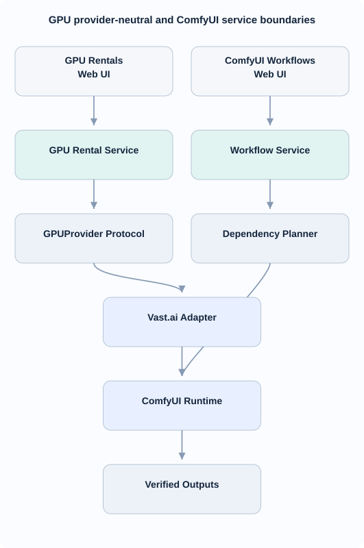
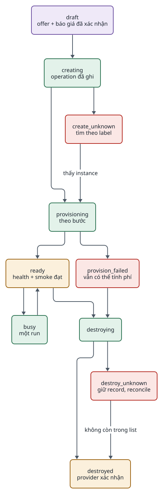

<!-- id:s1 -->
## Phạm vi và trạng thái

<!-- id:s1.b1 -->
> [!IMPORTANT]
> `studio/gpu/` và `studio/comfyui/` đã triển khai lát A–E; mặc định `[gpu] provider = "none"`. Bật provider và thuê thật chỉ trong phạm vi chi phí đã được người vận hành duyệt. Cách chạy, giới hạn và bằng chứng nằm trong [runbook Slice E](../../runbooks/gpu-slice-e.md).

<!-- id:s1.b2 -->
- **GPU Rentals**: tìm offer, thuê on-demand, theo dõi provisioning, chi phí ước tính, stop/destroy. Là module hạ tầng, không phải provider nội dung thứ sáu.
- **ComfyUI Workflows**: nhập workflow JSON, duyệt dependency, chạy trên một GPU đã `ready`, tải và kiểm output. Không viết lại node editor.
- **Video studio** giữ nguyên danh sách bước. Adapter `providers/direct/comfyui.py` (`ImageProvider`) dùng rental đã `ready`; pipeline không thuê GPU. `VideoProvider` qua ComfyUI chưa triển khai.
- MVP: on-demand, một người vận hành, một worker, một run mỗi instance, một provider (Vast.ai). Không bid/interruptible, serverless, autoscaling hay provider thứ hai (CON-09).

<!-- id:s2 -->
## Thành phần và ranh giới

<!-- id:s2.b1 -->
<!-- report-kit:d2
```d2
# cap: GPU Rentals và ComfyUI Workflows là hai module hạ tầng riêng; pipeline video chỉ thấy endpoint đã ready
direction: down
ui: "Web: /gpu, /comfyui\n(FastAPI + Jinja2 + HTMX)" {class: plain}
gsvc: "studio/gpu/service.py\nvòng đời thuê, reconcile" {class: gate}
csvc: "studio/comfyui/\nworkflow, manifest, run" {class: gate}
proto: "GPUProvider\n(Fake, Vast)" {class: data}
vast: "Vast.ai REST API\n(requests, không gói vastai)" {class: hands}
inst: "Instance thuê\nbase-image + provisioner\n+ ComfyUI ghim version" {class: hands}
pipe: "Pipeline video\nproviders/direct/comfyui.py" {class: brain}
db: "SQLite gpu_*, comfy_*\n+ data/gpu, data/comfyui" {shape: cylinder; class: data}
ui -> gsvc
ui -> csvc
gsvc -> proto -> vast
vast -> inst: "tạo, xóa"
csvc -> inst: "HTTP ComfyUI\nqua tunnel có xác thực"
pipe -> inst: "endpoint ready"
gsvc -> db
csvc -> db
```
-->
<picture>
<source media="(prefers-color-scheme: dark)" srcset="09-gpu-comfyui.figs/s2.b1-dark.svg">

</picture>

<!-- id:s2.b2 -->
Table: Module đề xuất
| Đường dẫn | Trách nhiệm |
| --- | --- |
| `studio/gpu/contracts.py` | `Offer`, `Rental`, `ProvisionStep`, `GPUEvent` (Pydantic) |
| `studio/gpu/service.py` | Tạo, theo dõi, reconcile, destroy; khóa theo `rental_id` |
| `studio/gpu/adapters/base.py`, `fake.py`, `vast.py` | `GPUProvider` Protocol, bản giả, adapter Vast.ai |
| `studio/comfyui/workflows.py`, `manifest.py` | Nhập JSON, revision SHA-256, manifest dependency đã duyệt |
| `studio/comfyui/runtime.py`, `runs.py` | Client HTTP ComfyUI; chạy, theo dõi, tải output |
| `studio/providers/direct/comfyui.py` | `ComfyImage`: bind input vào workflow đã duyệt, nối attempt với run và trả một ảnh đã kiểm |

<!-- id:s2.b3 -->
Quy tắc: web chỉ gọi service, không import adapter; `studio/gpu` và `studio/comfyui` không import `app.*` của MPT (giữ NFR-01); worker hiện có làm poll và reconcile, không thêm process, broker hay dịch vụ riêng. Hai trang có state riêng, liên kết bằng `rental_id`; xóa workflow không hủy GPU, hủy GPU không xóa workflow.

<!-- id:s3 -->
## GPUProvider và adapter Vast.ai

<!-- id:s3.b1 -->
Table: GPUProvider và lời gọi Vast.ai tương ứng (theo `vast.py` của vast-cli 1.9.1; kiểm lại khi viết adapter)
| Method | Vast.ai REST | Ghi chú |
| --- | --- | --- |
| `capabilities()` | — | `supports_stop`, thành phần giá có sẵn |
| `search_offers(filters)` | `POST /bundles/` | Lọc `rentable`, `verified`, `gpu_ram`, `disk_space`, `reliability`, `cuda_max_good`; giữ thời điểm báo giá |
| `create_instance(offer, spec)` | `PUT /asks/{offer_id}/` | Luôn gửi `label = igniterra:<rental_id>` và `cancel_unavail = true`; image ghim digest |
| `get_instance(id)` | `GET /instances/{id}/` | `actual_status`, cổng, giá |
| `list_owned_instances()` | `GET /instances` | Lọc theo tiền tố label `igniterra:`; dùng để reconcile |
| `stop_instance(id)` | `PUT /instances/{id}/` `{"state": "stopped"}` | Stop vẫn tính phí storage |
| `destroy_instance(id)` | `DELETE /instances/{id}/` | API chỉ trả "destroying"; xác nhận bằng `get`/`list` tới khi instance biến mất |

<!-- id:s3.b2 -->
- **Không thêm gói `vastai`/`vastai-sdk` vào `pyproject.toml`.** `vastai==1.9.1` ghim `pillow==12.2.0`, còn `mpt==1.3.9` kéo `moviepy==2.2.1` cần `pillow<12`: hai gói không cài chung một `uv.lock`. Adapter là client REST nhỏ trên `requests` (đã có trong lock), đọc vast-cli (MIT) làm tài liệu tham chiếu endpoint. CLI `vastai` chỉ dùng tay, cài riêng bằng `uv tool install vastai`.
- **Label là khóa đối soát.** Lời gọi create của vast-cli không mang idempotency key. Ghi `rental_id` và `operation_id` vào SQLite trước khi gọi create; nếu timeout, tìm instance có label đó trước khi cân nhắc tạo lại (G04).
- **`cancel_unavail = true`.** Không có cờ này, khi lập lịch thất bại Vast tạo instance ở trạng thái stopped, vẫn tính phí disk.
- **Chi phí ước tính tách ba phần**: giá theo giờ, disk (`storage_cost` tính theo GB-tháng × dung lượng yêu cầu), băng thông (`inet_up_cost`, `inet_down_cost` theo GB). Lát E đã kiểm response thật có `dph_total = dph_base + storage_total_cost`: adapter đánh dấu `Offer.dph_total_includes_disk` để tách compute và disk, không cộng hai lần. Snapshot cũ/provider chưa khai báo giữ cách cộng disk bảo thủ. Ghi nhãn "ước tính, không phải hóa đơn"; bandwidth chưa được đo.
- Khóa API: biến môi trường `VAST_API_KEY`, thêm vào `SECRET_ENV` của `studio/config.py` để `redact()` che nó trong log và lỗi.

<!-- id:s4 -->
## Vòng đời thuê

<!-- id:s4.b1 -->
<!-- report-kit:d2
```d2
# cap: Vòng đời thuê; mọi kết quả không rõ đều reconcile trước khi làm tiếp, chỉ destroyed đã xác nhận mới kết thúc phí
direction: down
draft: "draft\noffer + báo giá đã xác nhận" {class: data}
create: "creating\noperation đã ghi" {class: hands}
cunk: "create_unknown\ntìm theo label" {class: bad}
prov: "provisioning\ntheo bước" {class: hands}
pfail: "provision_failed\nvẫn có thể tính phí" {class: bad}
ready: "ready\nhealth + smoke đạt" {class: gate}
busy: "busy\nmột run" {class: hands}
destroying: "destroying" {class: hands}
dunk: "destroy_unknown\ngiữ record, reconcile" {class: bad}
done: "destroyed\nprovider xác nhận" {class: gate}
draft -> create
create -> prov
create -> cunk
cunk -> prov: "thấy instance"
prov -> ready
prov -> pfail
ready -> busy
busy -> ready
ready -> destroying
pfail -> destroying
destroying -> done
destroying -> dunk
dunk -> done: "không còn trong list"
```
-->
<picture>
<source media="(prefers-color-scheme: dark)" srcset="09-gpu-comfyui.figs/s4.b1-dark.svg">

</picture>

<!-- id:s4.b2 -->
- Mọi mutation (create, stop, destroy, submit) ghi intent vào SQLite trước khi gọi API; không tự retry mutation có kết quả không rõ, chỉ retry GET và download có backoff, giới hạn số lần. Cùng nguyên tắc với `Unconfirmed` của pipeline (ADR-0006).
- Khóa CAS theo `rental_id` (cột `version`); tối đa một run trên một instance.
- `ready` chỉ khi có bằng chứng: host chạy, kết nối có xác thực, `/.provisioning_complete` tồn tại, ComfyUI trả `GET /system_stats`, workflow smoke chạy ra file. Host `running` không phải `ready`.
- Sau khi worker khởi động lại: đọc `list_owned_instances()`, đối chiếu từng rental; instance có label `igniterra:` mà không có record thì báo orphan, không tự xóa.
- Idle TTL, `max_runtime_minutes`, `max_hourly_usd` là guardrail mềm do worker thực thi; khi mất kết nối, tiền vẫn chạy. Đặt thêm giới hạn ở tài khoản Vast (nạp trước số dư nhỏ).
- `[gpu.limits]` mặc định: idle 30 phút (chỉ `ready`), runtime 240 phút từ lúc gửi create, giá compute + disk tối đa 2 USD/giờ. `max_total_usd` mặc định bằng giá tối đa × thời gian tối đa / 60; đây là ước tính mỗi rental, chưa gồm băng thông. `stopped` cần destroy thủ công vì disk còn dữ liệu.
- Worker thường chạy guard mỗi `[gpu] guard_interval_s` (60 giây); `worker --once` và `worker --task` không mở guard. `gpu poll` chạy một lượt provisioning, giới hạn và reconcile; `gpu enforce-limits` chỉ thực thi giới hạn. Khởi động lại đối soát trước khi chạy guard; chỉ xét rental của provider hiện hành, kiểm label trước destroy tự động, không tự hủy orphan.
- G11 ưu tiên giữ output: rental vượt giới hạn mà có run chưa tải/kiểm thì không tự destroy, log ERROR mỗi lượt và cảnh báo trên `/gpu` cùng trang rental. Người vận hành tải output hoặc xác nhận bỏ rồi destroy. Trong thời gian chờ, máy vẫn tính phí. Hoạt động qua runtime gia hạn idle; thao tác chỉ xem trang GPU không gia hạn. Điều kiện idle và run chưa kiểm nằm trong cùng giao dịch CAS với `→destroying`.

<!-- id:s5 -->
## Provisioning trên instance

<!-- id:s5.b1 -->
Image khởi điểm là `vastai/base-image` (CUDA, Caddy, Instance Portal, provisioner) ghim theo digest, cài ComfyUI ở commit cố định. Provisioning dùng **manifest YAML khai báo** của provisioner (`PROVISIONING_MANIFEST`), không dùng shell tùy ý từ form.

<!-- id:s5.b2 -->
Table: Cách dùng provisioner của base-image
| Việc | Cách làm | Vì sao |
| --- | --- | --- |
| Manifest | Sinh từ manifest đã duyệt trong SQLite, ghi vào `data/gpu/<rental_id>/provisioning.yaml`, truyền qua `PROVISIONING_MANIFEST` hoặc `onstart` | Tái lập được; review được trước khi trả tiền |
| ComfyUI và custom node | `git_repos` với `ref` là full commit SHA | Provisioner nhận tag, branch hoặc commit; branch trôi theo thời gian |
| Model | `downloads` từ Hugging Face dạng `/resolve/<commit>/<file>`; script cố định do studio sinh tính SHA-256, worker đọc qua `/view` có xác thực và so với manifest | Provisioner không kiểm checksum; thiếu hash thì chưa `ready`, lệch thì fail và destroy |
| Phát hiện dependency | Extension `provisioner_comfyui` chỉ chạy khô (dry run) khi nhập workflow, rồi đóng băng kết quả vào manifest | Extension tra Registry, lấy bản node hiện hành, không ghim |
| Lỗi provisioning | `on_failure.action: destroy`, `max_retries` nhỏ | Mặc định là `continue`: instance hỏng vẫn tính phí |
| Tiến độ | `GET /capabilities`: `provisioning.status` là `complete`, `failed`, `in_progress` hoặc `none`; chỉ `complete` chứng minh sentinel đã có | Portal không cung cấp tiến độ từng bước ở endpoint này; không bịa phần trăm |
| Xác thực | Giữ `ENABLE_AUTH` mặc định; đặt `WEB_PASSWORD` ngẫu nhiên cho mỗi rental lúc tạo, lưu cục bộ, dùng làm Bearer; không đặt `AUTH_EXCLUDE` cho cổng ComfyUI | Instance Portal tự tạo Cloudflare tunnel với URL công khai |
| Kênh kết nối | Lát E không dùng SSH. Portal và ComfyUI đi qua Caddy có HTTPS + Bearer; CA tin cậy cấu hình ở `[gpu.portal] verify_tls` | Không cần giữ thêm khóa SSH và `known_hosts`; nếu bổ sung SSH sau này phải ghim host key và giữ kiểm tra nghiêm ngặt |

<!-- id:s5.b4 -->
Manifest sinh thêm lệnh cài `requirements.txt` từ repo đã ghim và service Supervisor chạy ComfyUI ở `127.0.0.1:18188`. Cổng ngoài `8188` được Caddy proxy có xác thực, không mở cổng backend `18188`. Adapter mở cổng ngoài `1111` và `8188`; `PORTAL_CONFIG` giữ cổng trong khác cổng ngoài. `onstart` ghi manifest trước khi gọi entrypoint; tắt cập nhật Portal/CLI lúc boot để giữ phiên bản trong image đã ghim. Schema đối chiếu với [base-image](https://github.com/vast-ai/base-image) và [provisioner](https://github.com/vast-ai/base-image/blob/main/ROOT/opt/instance-tools/lib/provisioner/README.md).

<!-- id:s5.b5 -->
Quyết định checksum: script chờ sentinel provisioning rồi ghi file `output/igniterra/model_sha256.txt` bằng file tạm + `mv`; worker chỉ nhận hash khớp manifest trước smoke. SHA-256 ở đây phát hiện file sai/hỏng, không chứng minh host của provider đáng tin: cả SSH và HTTPS đều nhận kết quả do instance tính. Dùng lại kênh HTTPS đã xác thực tránh thêm bộ máy SSH; CA phải được tin từ nguồn độc lập, không đặt `verify_tls = false`. Nếu Portal đã trả hash trong báo cáo thì dùng trước, thiếu mới tải file checksum.

<!-- id:s5.b3 -->
Bước provisioning lưu ở `gpu_provision_steps`: `instance_create`, `host_boot`, `transport_ready`, `runtime_setup`, `custom_nodes`, `models`, `health_smoke`, `ready`. Mỗi bước có `pending/running/done/failed/skipped/unknown`, lượt thử, thời điểm, mã lỗi, con trỏ log và số byte nếu biết. UI không hiển thị phần trăm khi không có tổng byte.

<!-- id:s6 -->
## ComfyUI workflow và lượt chạy

<!-- id:s6.b1 -->
- **Nhập**: mỗi lần nhập là một revision bất biến (`workflow_id`, `revision`, SHA-256 của file gốc). GUI JSON có `nodes[].properties.models` và `cnr_id` nên trích được dependency; API JSON (`{node_id: {class_type, inputs}}`) thường thiếu, kết quả là `needs_review`, không đoán.
- **Duyệt**: manifest liệt kê model (URL ghim commit, đích, dung lượng, SHA-256, license) và custom node (repo, commit, `requirements.txt`). Chỉ manifest đã duyệt mới được gắn vào một rental.
- **Kiểm trước khi chạy**: `GET /object_info` của runtime phải có mọi `class_type` trong workflow dạng API; thiếu node thì chặn, không submit.
- **Submit**: worker sinh UUID, ghi `comfy_runs.prompt_id` rồi mới `POST /prompt` kèm `prompt_id` đó (ComfyUI hiện hành nhận `prompt_id` do client đặt; ghim bản ComfyUI có tính năng này). Khi mất response, tra `GET /history/{prompt_id}` và `GET /queue`; không submit lại mù (G08).
- **Theo dõi**: poll `/queue` và `/history/{prompt_id}`, lưu trạng thái và thời điểm sự kiện cuối. Chưa có WebSocket hay phần trăm tiến độ từng node.
- **Output**: tải qua `GET /view`, kiểm SHA-256 và loại media, ghi vào `data/comfyui/runs/<run_id>/` qua kiểm `realpath`/`commonpath` như `safe_path` của web. Run chỉ `succeeded` khi output đã kiểm; output chưa tải thì cảnh báo trước khi destroy (G11).

<!-- id:s6.b2 -->
`ComfyImage` chọn template text-to-image hoặc reference theo refs, chỉ bind text, seed, kích thước, prefix output và tên ảnh; không thay model hay liên kết graph. Một attempt của task/scene gắn với một `run_id` bền vững và fingerprint input: mất response hoặc timeout phải đối soát run cũ, không tự submit lần hai. Adapter tuần tự hóa scene trên một rental. Profile [FLUX.2 Klein 4B](../../../workflows/flux2-klein-4b/README.md) có ba model Apache-2.0 ghim commit/SHA-256 và không có custom node. Upload character sheet dùng tên SHA-256 ở input root để tương thích danh sách file `LoadImage`; chỉ nhận một PNG/JPEG/WebP tối đa 64 MiB.

<!-- id:s7 -->
## Dữ liệu, chi phí, bảo mật và route

<!-- id:s7.b1 -->
Table: Bảng SQLite riêng của Gate 4 (không đổi 5 bảng core)
| Bảng | Trường chính |
| --- | --- |
| `gpu_rentals` | `rental_id`, `provider_key`, `provider_instance_id`, `label`, `offer_json`, `status`, `version`, `idle_deadline`, `destroy_confirmed_at` |
| `gpu_operations` | `op_id`, `rental_id`, `action`, `request_hash`, `sent_at`, `confirmed_at`, `status` |
| `gpu_provision_steps` | `rental_id`, `step_key`, `attempt`, `status`, thời điểm, `bytes_done/total`, `log_ref` |
| `gpu_events` | `rental_id`, `ts_utc`, `transition`, `error_code`, `detail` đã che bí mật (chỉ thêm) |
| `gpu_cost_samples` | `rental_id`, `ts`, `compute_per_h`, `disk_per_h`, `accrued_est` |
| `comfy_workflows`, `comfy_manifests` | Revision workflow; manifest và trạng thái duyệt |
| `comfy_runs` | `run_id`, `workflow_revision`, `manifest_sha256`, `rental_id`, `prompt_id`, `status`, đường dẫn output |

<!-- id:s7.b2 -->
- `costs.jsonl` ghi lượt gọi ComfyImage và lượng ảnh, không gán USD/ảnh khi chưa phân bổ được giờ GPU. Rental ghi chi phí ước tính; pilot ghi chênh lệch tài khoản có độ trễ, hóa đơn Vast là thực chi.
- Bí mật (`VAST_API_KEY`, `HF_TOKEN`, `WEB_PASSWORD` từng rental) chỉ ở `.env` hoặc `data/gpu/` quyền 600; không vào workflow JSON, manifest, `gpu_events`, HTML.
- POST GPU và ComfyUI có CSRF token theo process; thuê/chạy cần xác nhận và ID sinh trước chống bấm hai lần. Giữ một uvicorn worker; Basic auth đặt qua `STUDIO_BASIC_AUTH`.

<!-- id:s7.b3 -->
Table: Route đề xuất (kế thừa basic auth của `studio/web/`)
| Route | Mục đích |
| --- | --- |
| `GET /gpu`, `GET /gpu/offers` | Danh sách rental; tìm offer (HTMX) |
| `POST /gpu/instances` | Thuê sau khi xác nhận báo giá còn hạn |
| `GET /gpu/instances/{id}` | Timeline provisioning, sự kiện, chi phí ước tính |
| `POST /gpu/instances/{id}/reconcile\|stop\|destroy` | Đồng bộ với provider; stop, destroy có xác nhận |
| `GET/POST /comfyui/workflows`, `GET /comfyui/workflows/{id}` | Thư viện, nhập, duyệt manifest |
| `POST /comfyui/workflows/{id}/runs`, `GET /comfyui/runs/{id}` | Chạy trên GPU `ready`; tiến độ và output |
| `POST /comfyui/image-profile` | Nhập profile FLUX ghim sẵn, chờ duyệt manifest; không thuê máy |
| `GET /monitor?task={id}` | Đọc SQLite mỗi 5 giây; nối task/scene ↔ run ↔ rental, cảnh báo và chi phí; GET không poll provider |

<!-- id:s8 -->
## Kiểm chứng G01–G12

<!-- id:s8.b1 -->
Test chạy với `FakeGPUProvider`, Vast REST giả và HTTP runtime giả (mô phỏng `/system_stats`, `/object_info`, `/upload/image`, `/prompt`, `/queue`, `/history`, `/view`), 0 USD, trong `uv run pytest`. Lượt thuê thật có trần chi phí riêng, kết thúc bằng xác nhận không còn instance có label `igniterra:`. Bằng chứng Slice E ở [g4](../../reports/g4/README.md); pilot ComfyImage ghi chất lượng, thời gian và chi phí trên ảnh đạt, không so sánh OmniRoute.

<!-- id:s8.b2 -->
Table: Bộ test chấp nhận
| ID | Tình huống | Kết quả bắt buộc |
| --- | --- | --- |
| G01 | Đổi provider Vast sang Fake | Service và web không import hay viết cứng Vast |
| G02 | Offer rẻ nhưng thiếu VRAM/disk | Bị loại, không create |
| G03 | Báo giá quá hạn hoặc chưa xác nhận | Không create |
| G04 | Create đã tới provider nhưng response timeout | `create_unknown`, tìm theo label, không create thêm |
| G05 | Host chạy, pip hoặc model lỗi | `provision_failed`, không `ready`; manifest có `on_failure: destroy` |
| G06 | API JSON thiếu metadata model/node | `needs_review`, không cài |
| G07 | Thiếu disk hoặc dependency xung đột; thiếu `class_type` trong `/object_info` | Chặn run, ghi nguyên nhân |
| G08 | `POST /prompt` mất response | Tra `/history/{prompt_id}`, không submit thêm |
| G09 | Destroy trả lỗi hoặc timeout | `destroy_unknown`, giữ record, reconcile |
| G10 | Worker khởi động lại; idle TTL hết | Phục hồi state; chỉ thu hồi instance có label của app |
| G11 | Tải output lỗi | Không tự destroy khi output chưa kiểm |
| G12 | Token giả trong log, URL hoặc đường dẫn độc hại, endpoint không xác thực | Token bị che; URL, path bị chặn; không mở cổng ComfyUI không xác thực |

<!-- id:s9 -->
## Repo mã nguồn mở: áp dụng thế nào

<!-- id:s9.b1 -->
Kiểm ngày 26/10/2026 từ metadata GitHub, PyPI, Hugging Face và mã nguồn; không có lượt chạy trên GPU thật. Kiểm lại license và commit khi bắt đầu lát tương ứng.

<!-- id:s9.b2 -->
Table: Repo, license và cách áp dụng
| Repo / model | License | Áp dụng trong Igniterra | Không làm |
| --- | --- | --- | --- |
| [vast-ai/vast-cli](https://github.com/vast-ai/vast-cli) (PyPI `vastai` 1.9.1) | MIT | Tham chiếu endpoint, tên trường offer; CLI cài riêng để thao tác tay | Thêm vào dependency của `studio` (xung đột `pillow` với `mpt`) |
| [vast-ai/base-image](https://github.com/vast-ai/base-image) (`vastai/base-image`) | Vast.ai Elastic License: bản dẫn xuất chỉ dùng trên Vast.ai, không cung cấp như dịch vụ hosted | Image runtime ghim digest; provisioner manifest; Instance Portal có TLS và auth | Mang image hoặc template dẫn xuất sang provider khác; coi đây là phần provider-neutral |
| [Comfy-Org/ComfyUI](https://github.com/Comfy-Org/ComfyUI) | GPL-3.0 | Chạy như process riêng trên instance, gọi qua HTTP; ghim commit | Import mã ComfyUI vào `studio` (sẽ kéo nghĩa vụ GPL); phát hành image chứa ComfyUI mà không kèm nguồn |
| `provisioner_comfyui` (trong base-image) | Như base-image | Chạy khô để gợi ý dependency từ GUI JSON | Dùng lúc boot để tự cài node bản mới nhất |
| [ttulttul/ComfyUI-Modal](https://github.com/ttulttul/ComfyUI-Modal) | Không có license | Chỉ đọc ý tưởng lease, watchdog | Copy mã |
| [ayan4m1/vast-ai-provisioner](https://github.com/ayan4m1/vast-ai-provisioner) | MIT | Đọc cách chọn template và tự thuê | Mang cơ chế tải script qua Pastebin, HTTP không kiểm response |
| [ai-dock/comfyui](https://github.com/ai-dock/comfyui) | License riêng, cấm sửa mã gốc; cập nhật cuối 11/2024 | Không dùng | Làm image nền |
| [daveinme/ComfyUI-Cloud-Manager](https://github.com/daveinme/ComfyUI-Cloud-Manager) | Không có license | Không dùng | Copy cấu hình SSH bỏ kiểm host key |
| [ChristopherJdL/vast-ai-comfyui-wan2.2-remix](https://github.com/ChristopherJdL/vast-ai-comfyui-wan2.2-remix) | Không có license | Chỉ đọc danh sách node, model của Wan 2.2 | Copy script |
| FLUX.2 klein 4B (`black-forest-labs/FLUX.2-klein-4B`) | Apache-2.0 | Ảnh keyframe tự host (CON-06) | Dùng FLUX.2 klein 9B hay FLUX.2 dev cho thương mại (license khác, có gate) |
| Wan 2.2 (`Wan-AI/Wan2.2-TI2V-5B`, `Wan2.2-I2V-A14B`) | Apache-2.0 | Image-to-video tự host | Tải không ghim commit |

<!-- id:s9.b3 -->
Hệ quả của license base-image: "provider-neutral" chỉ đúng ở tầng `GPUProvider` và manifest dependency. Runtime template gắn với Vast.ai; provider thứ hai cần image riêng, dựng từ `nvidia/cuda` và ComfyUI.
