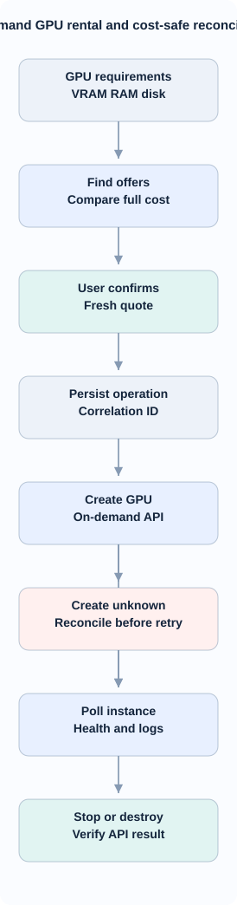

<!-- id:s1 -->
## Mục tiêu và MVP

GPU Rentals độc lập với ComfyUI workflow và video studio task. Vast.ai là nhà cung cấp đầu tiên, không viết cứng trong UI/service. Mặc định **on-demand**, không bid, không spot, không autoscaling, một GPU và một workflow run trên instance trong MVP. Chọn template đã kiểm chứng, pin image/tag/digest; không tự tạo nhiều instance để thử giá.

<!-- id:s2 -->
## Rental flow

<!-- id:s2.b1 -->
<!-- report-kit:d2
```d2
# cap: On-demand GPU rental and cost-safe reconciliation
direction: down
requirements: "GPU requirements\nVRAM RAM disk" {class: data}
search: "Find offers\nCompare full cost" {class: hands}
confirm: "User confirms\nFresh quote" {class: gate}
intent: "Persist operation\nCorrelation ID" {class: data}
request: "Create GPU\nOn-demand API" {class: hands}
unknown: "Create unknown\nReconcile before retry" {class: bad}
poll: "Poll instance\nHealth and logs" {class: hands}
cleanup: "Stop or destroy\nVerify API result" {class: gate}
requirements -> search -> confirm -> intent -> request
request -> unknown
request -> poll
unknown -> poll
poll -> cleanup
```
-->
<picture>
<source media="(prefers-color-scheme: dark)" srcset="10-gpu-rentals.figs/s2.b1-dark.svg">

</picture>

Trước API create/destroy phải persist `operation_id`, `rental_id`, snapshot offer, giá, timestamp, owner label. Tham số `idempotency_ref` là correlation ID phía client; không giả định provider đảm bảo idempotency. Khi create trả timeout sau gửi, ngừng retry và reconcile theo exact instance/owner label.

<!-- id:s3 -->
## GPUProvider protocol

| Method | Input | Output |
| --- | --- | --- |
| `capabilities()` | — | supports_stop, pricing_components, owner_label |
| `search_offers(filters)` | VRAM, RAM, disk, GPU, region, price, availability | typed list với quote timestamp |
| `create_instance(offer, spec)` | confirmed offer, image, disk, owner label/op_id | instance ID hoặc create_unknown |
| `get_instance(id)` | provider instance ID | runtime/billing state, connection |
| `list_owned_instances()` | owner scope | instances để reconcile |
| `connection_info(id)` | instance ID | SSH/proxy endpoint đã auth |
| `stop_instance(id)` | instance ID | capability-dependent |
| `destroy_instance(id)` | instance ID | confirmed / unknown / failure |

Các method sống ở `studio/gpu/adapters/base.py`; adapter `vast.py` tham khảo [vast-ai/vast-cli](https://github.com/vast-ai/vast-cli). Các field không có từ provider là nullable; tuyệt đối không invent giá/VRAM/uptime. Bảo đảm lựa chọn offer so sánh **compute + disk + extras khi có** theo cùng thời gian, không chỉ `gpu_price`; quote hết hạn phải refresh và confirm lại. Search lọc verified/rentable on-demand, VRAM/RAM/disk và compatibility trước khi sort theo giá.

<!-- id:s4 -->
## Provisioning checkpoints

<!-- id:s4.b1 -->
<!-- report-kit:d2
```d2
# cap: Provisioning failure classification and safe recovery
direction: down
boot: "Host connected" {class: hands}
setup: "Runtime and models\nProvisioning" {class: hands}
verify: "Health and smoke\nVerification" {class: gate}
ready: "Ready for workflow" {class: gate}
failure: "Phase failure\nEvidence logged" {class: bad}
triage: "Classify error\nCost still accruing" {class: data}
retry: "Idempotent step\nRetry if safe" {class: hands}
cleanup: "Confirm destroy\nReconcile result" {class: gate}
boot -> setup -> verify -> ready
setup -> failure
verify -> failure
failure -> triage
triage -> retry
triage -> cleanup
```
-->
<picture>
<source media="(prefers-color-scheme: dark)" srcset="10-gpu-rentals.figs/s4.b1-dark.svg">

</picture>

| Step | Bằng chứng `done` | Khi lỗi |
| --- | --- | --- |
| offer_selected | quote + confirmation | refresh nếu stale |
| instance_create | provider ID | create_unknown, reconcile |
| host_boot | API running + host reachable | timeout có log |
| transport_ready | SSH fingerprint/API verified | fail closed |
| runtime_setup | pinned image, runtime service alive | stop progression |
| custom_nodes | pinned git commits + dependency exit code | needs_review/fail |
| models | model path, downloaded bytes, checksum nếu có | resume only when supported |
| health_smoke | health + canary result | không chuyển ready |
| ready | runtime version, manifest hash, timestamp | bind GPU cho ComfyUI |

Mỗi bước có `pending/running/done/failed/skipped/unknown`, `attempt`, `start/end`, error code, log pointer, bytes nullable. UI không hiển thị phần trăm giả. Host `running` không đồng nghĩa ComfyUI `ready`. Lỗi provision vẫn có thể bị tính phí, hiển thị billing warning và cleanup action.

<!-- id:s5 -->
## State và recover

Rental states được định nghĩa tại [09](09-gpu-comfyui.md#s6): draft/creating/create_unknown/provisioning/ready/busy/provision_failed/stopped/destroying/destroy_unknown/destroyed. Terminal chỉ khi `destroyed` đã có provider confirmation. Khi restart worker, reconcile trạng thái provider, không tự create GPU thứ hai. Khóa CAS/version theo `rental_id` chống hai actor update/destroy/claim cùng rental; tối đa 1 active ComfyUI run/instance.

Idle TTL áp dụng khi không có run claim; `max_hourly_usd`, `max_runtime_minutes`, `idle_ttl_minutes` là guardrails mềm, không đảm bảo ngắt tiền khi mất kết nối. Stop có thể vẫn tính phí storage. Destroy cần xác nhận và kiểm output chưa backup; không xóa record khi API lỗi.

<!-- id:s6 -->
## Storage, cost ledger và constraints

| Table | Trường | Quy tắc |
| --- | --- | --- |
| gpu_rentals | rental_id, provider_key, provider_instance_id?, owner_ref, offer_json, status, version | unique(provider_key, provider_instance_id) when known |
| gpu_operations | op_id, rental_id, action, request_hash, sent_at, confirmed_at, status | intent trước API mutation |
| gpu_provision_steps | rental_id, step_key, attempt, status, times, bytes, logs | unique per attempt |
| gpu_events | id, rental_id, ts_utc, transition, error_code, sanitized_detail | append-only |
| gpu_cost_samples | rental_id, ts, compute_per_h, disk_per_h, accrued_est | ước tính riêng |

Không nhập GPU billing vào `costs.jsonl` của studio task vì chưa có cơ chế allocation verified. Giá hiển thị kèm nguồn và thời điểm; chỉ đối chiếu hóa đơn provider mới là thực chi. Lưu cả snapshot config/manifest hash cho reproducibility.

<!-- id:s7 -->
## Endpoints và bảo mật

`GET /gpu`, `GET /gpu/offers`, `POST /gpu/instances`, `GET /gpu/instances/{id}`, `POST /gpu/instances/{id}/reconcile`, `POST /gpu/instances/{id}/stop`, `POST /gpu/instances/{id}/destroy`. Mutation kiểm auth, CSRF, confirmation/nonce, owner, quote freshness và state. Logs scrub token, response body bounded; SSH pin host fingerprint (không `StrictHostKeyChecking=no`), không truyền arbitrary script từ form. ComfyUI chỉ ở private tunnel hoặc authenticated TLS proxy.

Lỗi phân nhóm `offer_unavailable, auth_failed, create_unknown, connect_timeout, install_failed, download_failed, unhealthy, destroy_unknown`. Retry GET và download idempotent có backoff bounded; không tự retry POST create/destroy không rõ kết quả.

<!-- id:s8 -->
## Verification và quyết định Gate 4

Test G01/02/03/04/05/09/10/12 tại [13](13-gpu-comfyui-verification.md). Fake provider trước, sau đó mock Vast API; không live thuê GPU trước khi có xác nhận Gate 4 D-05. Chỉ khi đã chạy E2E mới ghi implementation-ready. Phạm vi UI xem [12](12-gpu-comfyui-ux.md).
