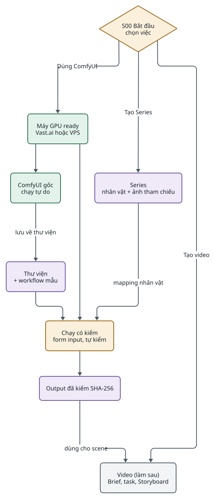
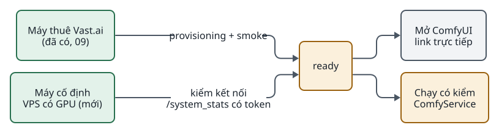
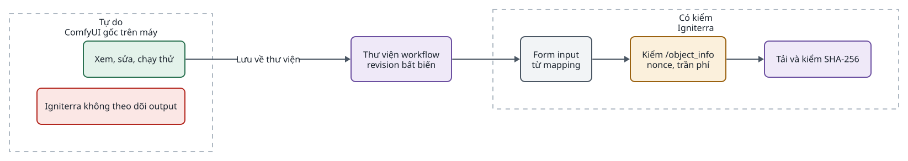
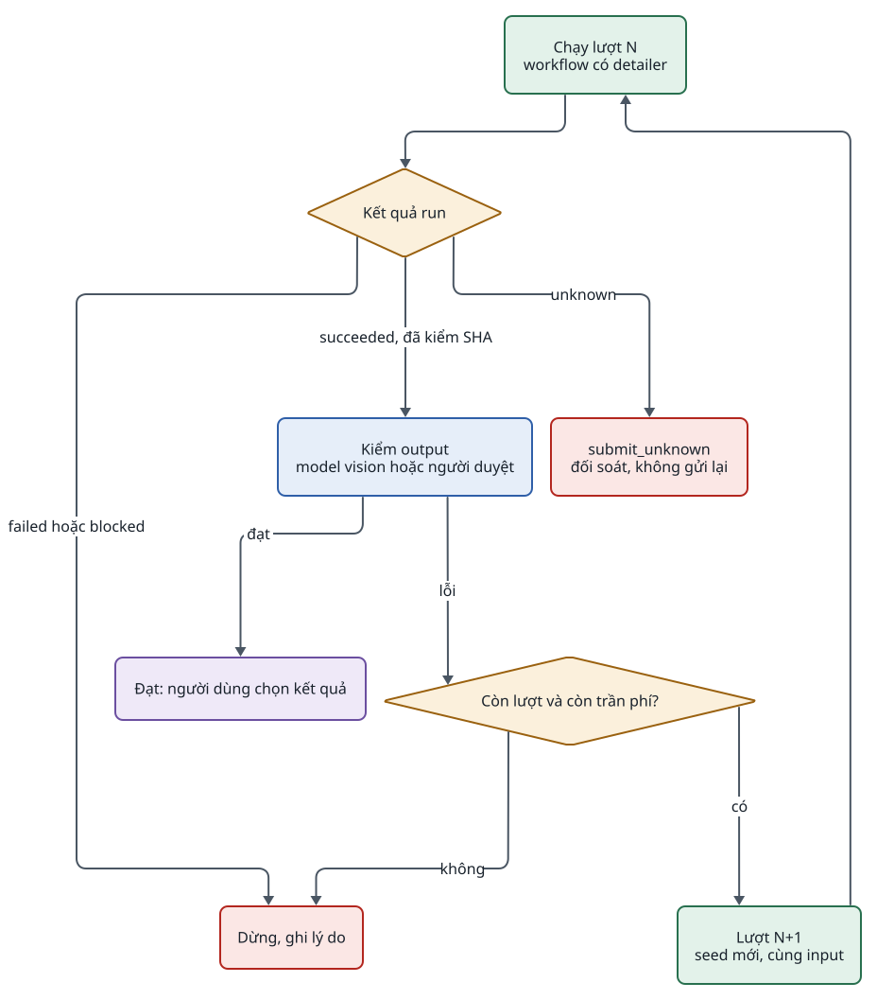
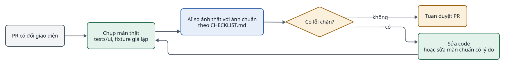

<!-- id:s1 -->
## Phạm vi và trạng thái

<!-- id:s1.b1 -->
> [!IMPORTANT]
> Tài liệu này là thiết kế, chưa có code. Thứ tự làm do Tuan chốt ngày 2026-10-27: ComfyUI làm trước, Brief và Series làm sau. Mỗi giai đoạn là một PR riêng và dừng lại cho Tuan duyệt.

<!-- id:s1.b2 -->
Persona chính là người biết mình muốn video hay ảnh gì nhưng không biết JSON, CLI, SHA-256, provisioning hay API export. Tài liệu trả lời ba việc:

<!-- id:s1.b3 -->
- Người đó làm được gì, theo hành trình nào, gặp lỗi thì đi đâu (J01–J15).
- ComfyUI chạy độc lập với pipeline video ra sao, trên máy thuê Vast.ai lẫn VPS có GPU.
- Giao diện chuẩn trông thế nào, ở dạng hình để người và AI so với sản phẩm thật ([màn hình chuẩn](#s9)).

<!-- id:s1.b4 -->
Phần giữ nguyên từ [06 · Giao diện](06-web-ui.md) và [09 · GPU và ComfyUI](09-gpu-comfyui.md): FastAPI + Jinja2 + HTMX, `ComfyService`, `GPUService`, revision bất biến, mọi guard về chi phí và trạng thái unknown.

<!-- id:s2 -->
## Người dùng và nguyên tắc

<!-- id:s2.b1 -->
Table: Hai persona
| ID | Ai | Cần |
| --- | --- | --- |
| U0 | Người mới, không rành kỹ thuật | Đi hết việc chính mà không gõ JSON hay lệnh; biết trước bước nào tốn phí |
| U1 | Người vận hành (Tuan) | Vẫn thấy ID, SHA-256, revision, log trong phần Nâng cao |

<!-- id:s2.b2 -->
1. Mỗi màn trả lời được ba câu: tôi đang ở đâu, tôi cần làm gì, bấm tiếp có tốn phí không.
2. Mỗi trạng thái lỗi hay chặn có đúng một nút dẫn tới chỗ sửa.
3. Không có nút giả. Nút nào hiện ra cũng có handler thật; chưa làm được thì ẩn đi, hoặc disable và ghi lý do.
4. Không âm thầm gọi provider, trả phí hay xóa dữ liệu. GET không bao giờ gọi provider.
5. Một thư viện và một runner cho mọi loại workflow. Ảnh, video, giọng đọc chỉ khác nhau ở input và output khai cho từng revision.
6. Thuật ngữ kỹ thuật giữ như trong code, nhưng có giải thích một câu ngay cạnh.

<!-- id:s3 -->
## Bản đồ hành trình

<!-- id:s3.b1 -->
<!-- report-kit:d2
```d2
# cap: Ba lối vào từ màn Bắt đầu; ComfyUI là nhánh làm trước
direction: down
goal: "S00 Bắt đầu\nchọn việc" {shape: diamond; class: gate}
machine: "Máy GPU ready\nVast.ai hoặc VPS" {class: hands}
native: "ComfyUI gốc\nchạy tự do" {class: hands}
lib: "Thư viện\n+ workflow mẫu" {class: data}
series: "Series\nnhân vật + ảnh tham chiếu" {class: data}
run: "Chạy có kiểm\nform input, tự kiểm" {class: gate}
out: "Output đã kiểm SHA-256" {class: data}
video: "Video (làm sau)\nBrief, task, Storyboard" {class: plain}
goal -> machine: "Dùng ComfyUI"
goal -> series: "Tạo Series"
goal -> video: "Tạo video"
machine -> native
native -> lib: "lưu về thư viện"
machine -> run
lib -> run
series -> run: "mapping nhân vật"
run -> out
out -> video: "dùng cho scene"
```
-->
<picture>
<source media="(prefers-color-scheme: dark)" srcset="10-ux-beginner.figs/s3.b1-dark.svg">

</picture>

<!-- id:s3.b2 -->
Mũi tên từ Series sang Chạy có kiểm là use case "mapping nhân vật": ảnh tham chiếu đã duyệt của một nhân vật thành một ô input trên form. Mũi tên từ output sang Storyboard là J12: dùng ảnh, clip hoặc giọng đọc vừa tạo cho một scene mà không phải tải xuống rồi upload lại.

<!-- id:s4 -->
## Máy GPU: thuê và cố định

<!-- id:s4.b1 -->
<!-- report-kit:d2
```d2
# cap: Hai loại máy, một trạng thái ready, cùng nút Mở ComfyUI; chỉ máy thuê có vòng đời và chi phí do Igniterra quản lý
direction: right
vast: "Máy thuê Vast.ai\n(đã có, 09)" {class: hands}
vps: "Máy cố định\nVPS có GPU (mới)" {class: hands}
ready: "ready" {class: gate}
open: "Mở ComfyUI\nlink trực tiếp" {class: plain}
run: "Chạy có kiểm\nComfyService" {class: gate}
vast -> ready: "provisioning + smoke"
vps -> ready: "kiểm kết nối\n/system_stats có token"
ready -> open
ready -> run
```
-->
<picture>
<source media="(prefers-color-scheme: dark)" srcset="10-ux-beginner.figs/s4.b1-dark.svg">

</picture>

<!-- id:s4.b2 -->
Table: Khác nhau giữa hai loại máy
| Khía cạnh | Máy thuê Vast.ai | Máy cố định (VPS có GPU) |
| --- | --- | --- |
| Có sẵn chưa | Có (lát A–E) | Chưa; giai đoạn 1 |
| Vòng đời | Thuê, provisioning, stop, destroy, reconcile | Igniterra không quản lý; chỉ thêm, kiểm, gỡ khỏi danh sách |
| Lên ready khi | Đủ bằng chứng provisioning và smoke (09) | Từ chối request không token, nhận token, `/system_stats` trả lời |
| Chi phí | Ước tính theo giá offer, giới hạn idle, giờ chạy, ngân sách | Giá USD/giờ tự khai (tùy chọn), chỉ để ước tính; chưa tính vào ngân sách 5 USD (Tuan chốt 2026-10-27) |
| Cài model thiếu | Qua provisioning manifest mới (giai đoạn 5) | Hướng dẫn cài tay, không cài tự động |
| Mở ComfyUI | Cổng 8188 qua Caddy có xác thực `WEB_PASSWORD` | URL người dùng khai |

<!-- id:s4.b3 -->
Mở ComfyUI là link trực tiếp tới máy, mở ở tab mới; Igniterra không làm proxy (Tuan chốt). Cần kiểm trong giai đoạn 1: Caddy của base-image Vast.ai nhận xác thực từ trình duyệt bằng cách nào, để người dùng không phải gõ token mỗi lần, đồng thời token không bị in ra trên trang.

<!-- id:s5 -->
## Hai chế độ chạy ComfyUI

<!-- id:s5.b1 -->
<!-- report-kit:d2
```d2
# cap: Chế độ tự do dùng ComfyUI gốc; chế độ có kiểm đi qua ComfyService; hai chế độ gặp nhau ở thư viện
direction: right
free: "Tự do\nComfyUI gốc trên máy" {
  class: zone
  edit: "Xem, sửa, chạy thử" {class: hands}
  nf: "Igniterra không theo dõi output" {class: bad}
}
checked: "Có kiểm\nIgniterra" {
  class: zone
  form: "Form input\ntừ mapping" {class: plain}
  guard: "Kiểm /object_info\nnonce, trần phí" {class: gate}
  verify: "Tải và kiểm SHA-256" {class: data}
  form -> guard -> verify
}
lib: "Thư viện workflow\nrevision bất biến" {class: data}
free.edit -> lib: "Lưu về thư viện"
lib -> checked.form
```
-->
<picture>
<source media="(prefers-color-scheme: dark)" srcset="10-ux-beginner.figs/s5.b1-dark.svg">

</picture>

<!-- id:s5.b2 -->
Table: Hai chế độ
|  | Tự do (giai đoạn 2) | Có kiểm (giai đoạn 3) |
| --- | --- | --- |
| Dùng khi | Thử nghiệm, sửa graph, học workflow mới | Tạo kết quả để dùng: keyframe, clip, giọng đọc |
| Ai gửi prompt | Người dùng, trong ComfyUI gốc | `ComfyService.start_run` |
| Output | Nằm trên máy; mất khi destroy | Tải về `data/`, kiểm SHA-256, gắn provenance |
| Chi phí | Máy vẫn tính phí; idle và ngân sách vẫn áp dụng | Có ước tính trước khi chạy, trần phí mỗi run |
| Idle | Hoạt động trong ComfyUI gốc gia hạn idle | Như hiện tại: run giành và nhả máy |

<!-- id:s5.b3 -->
Để chế độ tự do không bị destroy giữa chừng, worker cần coi hàng đợi hoặc lịch sử ComfyUI có thay đổi là "có hoạt động". Đọc `/queue` và `/history` là GET tới máy đã thuê, không phải gọi provider Vast.ai.

<!-- id:s6 -->
## Tự kiểm và chạy lại

<!-- id:s6.b1 -->
ComfyUI không có vòng lặp "kiểm, sai thì làm lại": mỗi prompt chạy graph đúng một lượt. Node detailer (ví dụ FaceDetailer của Impact Pack) vẽ lại mặt và tay trong một lượt nhưng không tự đánh giá. Node lặp của custom pack cần một node chấm điểm, mà loại node này hay chấm sai, lại tốn GPU ngoài tầm theo dõi. Vì vậy vòng lặp nằm ở Igniterra (Tuan đồng ý ngày 2026-10-27):

<!-- id:s6.b2 -->
<!-- report-kit:d2
```d2
# cap: Vòng tự kiểm: mỗi lượt là một run thường, dừng khi đạt, hết lượt hoặc chạm trần phí; kết quả unknown thì dừng
direction: down
run: "Chạy lượt N\nworkflow có detailer" {class: hands}
st: "Kết quả run" {shape: diamond; class: gate}
judge: "Kiểm output\nmodel vision hoặc người duyệt" {class: brain}
ok: "Đạt: người dùng chọn kết quả" {class: data}
budget: "Còn lượt và còn trần phí?" {shape: diamond; class: gate}
next: "Lượt N+1\nseed mới, cùng input" {class: hands}
stop: "Dừng, ghi lý do" {class: bad}
unk: "submit_unknown\nđối soát, không gửi lại" {class: bad}
run -> st
st -> judge: "succeeded, đã kiểm SHA"
st -> unk: "unknown"
st -> stop: "failed hoặc blocked"
judge -> ok: "đạt"
judge -> budget: "lỗi"
budget -> next: "có"
budget -> stop: "không"
next -> run
```
-->
<picture>
<source media="(prefers-color-scheme: dark)" srcset="10-ux-beginner.figs/s6.b2-dark.svg">

</picture>

<!-- id:s6.b3 -->
- Mỗi lượt là một run bình thường, có `run_id` riêng, nên mọi guard hiện có vẫn đúng: một run mỗi máy, nonce chống bấm hai lần, không gửi lại khi kết quả không rõ.
- Trần phí và số lượt tối đa nhập trên form (S16) và lưu cùng nhóm lượt. Chi phí mỗi lượt là ước tính theo thời gian GPU, ghi rõ không phải hóa đơn.
- Cách kiểm: model vision qua OmniRoute (đã có cho LLM và ảnh), hoặc người dùng tự duyệt từng lượt. Model vision cụ thể và tiêu chí "đạt" là câu hỏi mở ở [mục cuối](#s13).
- Workflow mẫu "Sửa dị dạng" (giai đoạn 4) dùng detailer, để lượt đầu đã ít lỗi.

<!-- id:s7 -->
## Loại workflow và input

<!-- id:s7.b1 -->
Loại là nhãn trên revision để lọc thư viện và chọn mẫu, không phải một luồng code riêng. Form chạy chỉ hiện ô đã khai trong input mapping (S17); mapping đổi thì tạo revision mới.

<!-- id:s7.b2 -->
Table: Loại workflow Tuan cần, input và output
| Loại | Input trên form | Output | Ghi chú |
| --- | --- | --- | --- |
| Ảnh từ chữ | prompt, seed, số ảnh | PNG/JPEG | Đã có FLUX.2 Klein 4B (`workflows/flux2-klein-4b`) |
| Sửa ảnh | ảnh, prompt, độ mạnh | PNG/JPEG |  |
| Video từ ảnh | ảnh, mô tả chuyển động, thời lượng | MP4/WEBM | `runs.py` đã nhận video; chưa nối `VideoProvider` |
| Phóng to | ảnh, hệ số | PNG |  |
| Giọng đọc | văn bản tiếng Việt, giọng, tốc độ | WAV/MP3/FLAC | Cần thêm output audio vào `runtime.py` và `runs.py`; model chưa chọn |
| Sửa dị dạng | ảnh, vùng (mặt, tay) | PNG | Detailer; dùng chung vòng tự kiểm |
| Giữ nhân vật | nhân vật từ Series, prompt, seed | PNG | Ảnh tham chiếu đã duyệt thành input; như character sheet của ComfyImage |

<!-- id:s7.b3 -->
Kiểu ô input: chữ, số, ảnh, nhân vật (ảnh tham chiếu đã duyệt của Series), giọng đọc (văn bản + giọng). Mọi giá trị được kiểm phía server theo mapping và `/object_info` lúc gửi. Igniterra không tự dò node rồi ghi vào `inputs` bất kỳ.

<!-- id:s8 -->
## Hành trình J01–J15

<!-- id:s8.b1 -->
J01–J05 lấy từ đề xuất v2.1, đã thu gọn. J06–J15 là các use case bổ sung sau khi rà theo persona U0. Giai đoạn ghi theo [lộ trình](#s12).

<!-- id:s8.b2 -->
Table: Hành trình, điều kiện xong và giai đoạn
| ID | Hành trình | Xong khi | Màn chuẩn | Giai đoạn |
| --- | --- | --- | --- | --- |
| J06 | Mở ComfyUI trên máy GPU (thuê hoặc cố định) | Tab ComfyUI mở được, không phải gõ lệnh hay SSH | S10, S11, S12 | 1–2 |
| J07 | Chạy workflow với input của mình, kể cả tự kiểm và chạy lại | Output đã kiểm SHA-256, chi phí trong trần | S16, S17, S18, S19 | 3 |
| J08 | Đưa workflow từ ComfyUI gốc hoặc file vào thư viện | Revision mới, không trùng ngoài ý muốn | S13, S15 | 2–3 |
| J09 | Workflow cần model hoặc node máy chưa có | Biết thiếu gì; máy thuê có gói cài đặt mới chờ duyệt | S20 | 5 |
| J03 | Nhập, cập nhật, quản lý workflow (2 bước) | Đúng workflow và revision, có trạng thái chạy được | S14, S15 | 3 |
| J04 | Thuê GPU khi không biết Vast.ai | Máy ready, biết khi nào hết phí | S10 | đã có, sửa ở 1 |
| J05 | Xử lý sự cố, việc cần làm trước | Mỗi việc có một nút tới trang gốc | S21 | 1 |
| J10 | Biết trước phí, thời gian, ngân sách còn lại | Con số ước tính trước mỗi bước có phí | S00, S16 | 3 |
| J11 | Quên tắt máy, quay lại hôm sau | Thấy hạn idle, biết output nào sẽ mất | S12, S21 | 1–2 |
| J12 | Dùng output ComfyUI cho scene hoặc làm ảnh nhân vật | Không phải tải xuống rồi upload lại | S19 | sau 3 |
| J01 | Tạo video đầu tiên từ ý tưởng | Brief hợp lệ không cần JSON, task chạy, MP4 tải được | S00, S01 | 6 |
| J02 | Tạo Series và nhập ảnh tham chiếu | Nhân vật có ảnh đã duyệt và character sheet | (hiện có) | 6 |
| J13 | Sửa lời đọc một scene, chỉ làm lại phần đó | Chỉ scene đó chạy lại | (hiện có) | 6 |
| J14 | Hủy task, dọn dữ liệu cũ | Không xóa dữ liệu còn được tham chiếu | — | sau 6 |
| J15 | Tra thuật ngữ | Giải thích một câu ngay trên màn | — | xuyên suốt |

<!-- id:s8.b3 -->
Ngoài phạm vi: đăng mạng xã hội, nhiều người dùng, thanh toán, graph editor riêng của Igniterra (đã có ComfyUI gốc), xóa cứng workflow.

<!-- id:s9 -->
## Màn hình chuẩn

<!-- id:s9.b1 -->
Bộ màn hình chuẩn nằm ở [`docs/ux/spec`](../../ux/spec/README.md). Mỗi màn được dựng bằng CSS thật của app, chụp ở 1440, 768 và 390 px. Checklist điều phải có và không được có của từng màn nằm trong [`CHECKLIST.md`](../../ux/spec/CHECKLIST.md), sinh từ `screens.json`. Khi tài liệu này và màn hình chuẩn lệch nhau, sửa cả hai trong cùng PR.

<!-- id:s9.b2 -->
Table: 14 màn hình chuẩn
| ID | Màn | Trạng thái | Giai đoạn | Ảnh 1440 |
| --- | --- | --- | --- | --- |
| S10 | Máy GPU (thuê + cố định) | sửa | 1 | [xem](../../ux/spec/shots/1440-S10-gpu-machines.png) |
| S11 | Thêm máy cố định | mới | 1 | [xem](../../ux/spec/shots/1440-S11-machine-add.png) |
| S21 | Monitor (sửa F10) | sửa | 1 | [xem](../../ux/spec/shots/1440-S21-monitor.png) |
| S12 | Máy ready: Mở ComfyUI | sửa | 2 | [xem](../../ux/spec/shots/1440-S12-machine-ready.png) |
| S13 | Lưu workflow từ máy | mới | 2 | [xem](../../ux/spec/shots/1440-S13-save-from-machine.png) |
| S14 | Thư viện workflow | sửa | 3 | [xem](../../ux/spec/shots/1440-S14-library.png) |
| S15 | Nhập: Kiểm tra & Lưu | sửa | 3 | [xem](../../ux/spec/shots/1440-S15-import-check.png) |
| S16 | Chạy có kiểm | sửa | 3 | [xem](../../ux/spec/shots/1440-S16-workflow-run.png) |
| S17 | Khai input cho workflow | mới | 3 | [xem](../../ux/spec/shots/1440-S17-input-mapping.png) |
| S18 | Run tự kiểm và chạy lại | mới | 3 | [xem](../../ux/spec/shots/1440-S18-run-autofix.png) |
| S19 | Kết quả giọng đọc | mới | 3 | [xem](../../ux/spec/shots/1440-S19-run-audio.png) |
| S20 | Thiếu model trên máy | mới | 5 | [xem](../../ux/spec/shots/1440-S20-missing-deps.png) |
| S00 | Bắt đầu | mới | 6 | [xem](../../ux/spec/shots/1440-S00-start.png) |
| S01 | Tạo Brief | mới | 6 | [xem](../../ux/spec/shots/1440-S01-brief-builder.png) |

<!-- id:s9.b3 -->
Các màn đã có và không đổi (Tasks, Storyboard, Series, Settings, chi tiết rental) giữ ảnh hiện tại trong [`docs/ux/evidence`](../../ux/evidence/README.md). Số liệu trên màn chuẩn là ví dụ, không phải kết quả đo.

<!-- id:s10 -->
## Review sản phẩm bằng AI

<!-- id:s10.b1 -->
<!-- report-kit:d2
```d2
# cap: Mỗi PR giao diện: chụp màn thật bằng fixture giả lập, AI so với ảnh chuẩn theo checklist, lỗi chặn quay lại sửa
direction: right
pr: "PR có đổi giao diện" {class: plain}
shot: "Chụp màn thật\ntests/ui, fixture giả lập" {class: hands}
ai: "AI so ảnh thật với ảnh chuẩn\ntheo CHECKLIST.md" {class: brain}
verdict: "Có lỗi chặn?" {shape: diamond; class: gate}
fix: "Sửa code\nhoặc sửa màn chuẩn có lý do" {class: hands}
done: "Tuan duyệt PR" {class: gate}
pr -> shot -> ai -> verdict
verdict -> fix: "có"
fix -> shot
verdict -> done: "không"
```
-->
<picture>
<source media="(prefers-color-scheme: dark)" srcset="10-ux-beginner.figs/s10.b1-dark.svg">

</picture>

<!-- id:s10.b2 -->
- Ảnh thật chụp bằng `tests/ui/fixture_server.py` và `tests/ui/verify.cjs`, không thuê GPU, không gọi API có phí.
- AI trả lời từng dòng checklist là đạt, không đạt hoặc không áp dụng, kèm vị trí trên ảnh. Một mục "Không được có" xuất hiện là lỗi chặn.
- Lệch bố cục hay chữ mà không làm sai checklist thì ghi là lệch chấp nhận được. Muốn giữ khác biệt, sửa `fragments/` trong cùng PR để ảnh chuẩn đi theo.
- Prompt mẫu và cách dựng lại ảnh: [README của màn hình chuẩn](../../ux/spec/README.md).

<!-- id:s11 -->
## Phát hiện trên code hiện tại

<!-- id:s11.b1 -->
Rà trên `main@7d80e07` ngày 2026-10-27, đọc code, chưa chạy app.

<!-- id:s11.b2 -->
Table: Phát hiện còn hiệu lực
| ID | Phát hiện | Bằng chứng | Xử lý |
| --- | --- | --- | --- |
| F09 | Block title của trang ComfyUI chứa cả dialog nhập workflow, dialog lặp lại trong body | `studio/web/templates/comfyui.html` dòng 3 | Giai đoạn 1: title chỉ là chữ, một dialog; thêm test |
| F10 | Nút "Làm mới" trên Monitor tắt luôn tự cập nhật | `monitor.html` dòng 7 trỏ `?refresh=off` | Giai đoạn 1: S21 |
| F20 | Run không nhận input; muốn đổi prompt phải nhập revision mới | `ComfyService.start_run(run_id, workflow_id, revision, rental_id)` | Giai đoạn 3: input mapping |
| F19 | `Scene.mode = "motion"` chỉ có adapter `video.fake` | `studio/providers/__init__.py` | Sau giai đoạn 3: `VideoProvider` qua ComfyService |
| F21 | Chống trùng chỉ so với revision mới nhất của cùng workflow | `ComfyService.import_workflow` | Giai đoạn 3: cảnh báo trùng toàn thư viện (S15), không tự xóa |
| F04 | Duyệt manifest workflow phải dùng CLI | `comfyui_workflow.html` | Giai đoạn 3: duyệt trên web, giữ kiểm SHA và license |
| F01 | Chưa có thư viện Brief; tạo task cần JSON đầy đủ | `POST /tasks` chỉ nhận `brief_file` hoặc `brief_json` | Giai đoạn 6: S01 |
| F12 | Upload ảnh nhân vật không kiểm nội dung trước khi lưu | `series.py` `upload_ref` | Giai đoạn 6 |
| F13 | POST của task, series, settings chưa có CSRF như GPU và ComfyUI | `studio/web/__init__.py` | Khi đụng tới các route đó |

<!-- id:s11.b3 -->
So với đề xuất v2.1: F22 trùng F09 nên đã gộp; 38 browser test B01–B38 và buổi thử với 5 người được thay bằng checklist theo màn và review bằng AI; ticket và bảng test chuyển sang tiếng Việt.

<!-- id:s12 -->
## Lộ trình

<!-- id:s12.b1 -->
Table: Giai đoạn, mỗi giai đoạn một PR
| Giai đoạn | Nội dung | Xong khi |
| --- | --- | --- |
| 0 | Tài liệu này và màn hình chuẩn | PR được duyệt |
| 1 | Máy cố định (VPS), nút Mở ComfyUI cho cả hai loại máy, sửa F09 và F10 | S10, S11, S21 qua checklist; test kiểm kết nối bằng ComfyUI giả lập |
| 2 | Chế độ tự do: idle tính cả hoạt động trong ComfyUI gốc, Lưu workflow từ máy | S12, S13 qua checklist |
| 3 | Chế độ có kiểm: input mapping, form chạy, loại workflow, output audio, tự kiểm và chạy lại, cảnh báo trùng, duyệt manifest trên web | S14–S19 qua checklist; mọi guard cũ còn nguyên |
| 4 | Workflow mẫu cho bảy loại, mỗi mẫu chạy thật trên GPU (Tuan chạy, có phí) | Mỗi mẫu có bằng chứng run thật |
| 5 | Sinh provisioning manifest từ workflow manifest đã duyệt | S20 qua checklist |
| 6 | Brief Library, màn Bắt đầu, Series cho người mới, motion trong Storyboard | S00, S01 qua checklist |

<!-- id:s13 -->
## Câu hỏi còn mở

<!-- id:s13.b1 -->
```q
Q-UX-01 · Model đọc tiếng Việt cho workflow giọng đọc?
1. VieNeu-TTS (Apache 2.0, 24 kHz, có giọng mẫu và clone giọng) qua node VieNeu TTS của pack ComfyUI-HMT-Ultimate; Tuan chạy thử trên GPU trước khi làm mẫu
2. F5-TTS Vietnamese (giọng tốt nhưng license CC-BY-NC-SA, chỉ dùng phi thương mại)
3. Giữ Edge TTS hiện tại cho video; workflow giọng đọc chỉ là tùy chọn thêm
rec: 1
```

<!-- id:s13.b2 -->
```q
Q-UX-02 · Lượt tự kiểm được chấm bằng gì?
1. Model vision qua OmniRoute chấm theo bảng tiêu chí cố định, trả JSON (mặt, tay, giống nhân vật, lỗi hình); người dùng vẫn chọn kết quả cuối
2. Chỉ người dùng tự duyệt từng lượt
rec: 1
```

<!-- id:s13.b3 -->
> [!IMPORTANT]
> Q-UX-03 đã chốt (Tuan, 2026-10-27): máy cố định chưa tính vào ngân sách 5 USD. Giá USD/giờ tự khai chỉ dùng để hiện ước tính.

<!-- id:s13.b4 -->
Lý do đề xuất Q-UX-01: [VieNeu-TTS](https://github.com/pnnbao97/VieNeu-TTS) có license Apache 2.0, chạy được cả trên CPU, nên còn có thể chạy ngoài GPU thuê nếu cần. Node [VieNeu TTS](https://comfy.icu/node/VieNeuTTS) của [ComfyUI-HMT-Ultimate](https://github.com/tuyenhm68/ComfyUI-HMT-Ultimate) nhận `text`, `voice` (21 giọng mẫu) và trả `AUDIO` 24 kHz cùng file WAV, khớp kiểu input "giọng đọc" ở trên. [F5-TTS Vietnamese](https://www.promptlayer.com/models/f5-tts-vietnamese-100h) dùng license CC-BY-NC-SA-4.0, nên nếu video có kiếm tiền thì không dùng được. Chưa kiểm chất lượng giọng của cả hai; đó là việc của giai đoạn 4.

<!-- id:s13.b5 -->
Lý do đề xuất Q-UX-02: chấm qua OmniRoute dùng lại khóa và giới hạn chi phí đã có, tốn ít so với một lượt GPU. Bảng tiêu chí cố định và đầu ra JSON giúp so được giữa các lượt và ghi được vào sổ chi phí. Model vision cụ thể chọn ở giai đoạn 3 từ `/v1/models` của OmniRoute. Nếu chấm sai nhiều, người dùng chuyển sang tự duyệt trên cùng form (S16).
