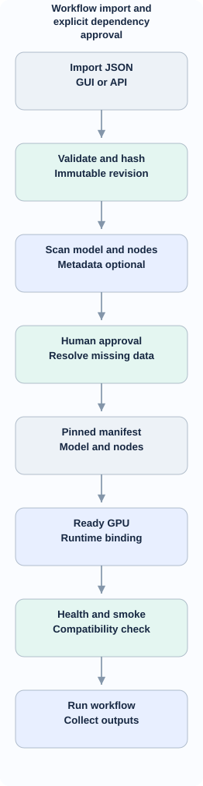
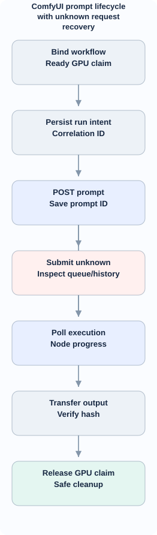

<!-- id:s1 -->
## Phạm vi và ranh giới

ComfyUI Workflows lưu, kiểm và chạy ComfyUI workflow JSON; **không quản lý thuê GPU**. Luồng rental, giá và cleanup nằm ở [10](10-gpu-rentals.md). Workflow có thể import và validate khi chưa có GPU; chạy chỉ sau khi đã chọn instance có ComfyUI runtime `ready`. Giữ danh sách step sản xuất video của studio, không biến nó thành ComfyUI graph engine hoặc viết lại giao diện node editor.

<!-- id:s2 -->
## Workflow và dependency flow (D2)

<!-- id:s2.b1 -->
<!-- report-kit:d2
```d2
# cap: Workflow import and explicit dependency approval
direction: down
input: "Import JSON\nGUI or API" {class: data}
schema: "Validate and hash\nImmutable revision" {class: gate}
scan: "Scan model and nodes\nMetadata optional" {class: hands}
review: "Human approval\nResolve missing data" {class: gate}
manifest: "Pinned manifest\nModel and nodes" {class: data}
gpu: "Ready GPU\nRuntime binding" {class: hands}
smoke: "Health and smoke\nCompatibility check" {class: gate}
run: "Run workflow\nCollect outputs" {class: hands}
input -> schema -> scan -> review -> manifest -> gpu -> smoke -> run
```
-->
<picture>
<source media="(prefers-color-scheme: dark)" srcset="11-comfyui-workflows.figs/s2.b1-dark.svg">

</picture>

Mỗi lần import tạo `workflow_id + revision + original_sha256` bất biến. GUI JSON có `nodes` và có thể có `definitions.subgraphs`; API JSON dạng mapping node ID -> `class_type/inputs`. Chỉ GUI JSON chứa metadata `properties.models` và `cnr_id` mới có thể được trích model/node tự động; **API JSON có thể thiếu thông tin**, kết quả phải `needs_review`, không tự cài từ phỏng đoán.

| Artifact | Thuộc tính | Ràng buộc |
| --- | --- | --- |
| Workflow revision | raw JSON, format, SHA256, source | immutable |
| Dependency manifest | models, nodes, Python/native deps, requirements, runtime | hash + review |
| Runtime template | image digest, ComfyUI ref, CUDA/PyTorch compatibility | pinned |
| Execution input | prompt/parameters, approved manifest ref, rental ID | validated |
| Outputs | file hash, bytes, content type, local path | verified before cleanup |

<!-- id:s3 -->
## Dependency planner và policy

Nguồn được phép: GUI workflow metadata; registry lookup cho `cnr_id`; user-approved manifest overrides; pinned runtime requirements. Model phải biết nguồn, đích trong workspace, dung lượng nếu có, checksum nếu có, license/trust; custom node phải biết repository và Git **commit** (không `main` trôi nổi) cùng `requirements.txt`/native dependencies. Thiếu một phụ thuộc quan trọng → `needs_review` hoặc `blocked`. Manifest duyệt chỉ chạy trên GPU tương thích và đủ disk.

Extension [vast-ai/base-image provisioner_comfyui](https://github.com/vast-ai/base-image) là một nguồn phát hiện dependencies, **không phải công cụ suy luận tất cả dependencies**. Không chạy shell tùy ý từ workflow import. Cho phép tải từ nguồn đã được người dùng duyệt, hạn chế URL tới localhost/metadata service, chống traversal/symlink khi ghi file. Nếu pip custom node phá môi trường torch, coi lỗi provisioning và không `ready`.

Ví dụ *contract logic* (chưa phải provisioning YAML của Vast.ai):

```yaml
schema_version: 1
runtime: {image_digest: "sha256:...", comfyui_commit: "full-git-sha"}
requirements: {min_vram_gb: 16, min_disk_gb: 80}
custom_nodes:
  - {repo: "https://github.com/example/approved-node", commit: "full-sha"}
models:
  - {url: "https://huggingface.co/...", dest: "models/checkpoints/model.safetensors", sha256: "hex"}
smoke_test: {required: true}
```

### Khả năng cài đặt

Vast.ai image/template dùng `vast-ai/base-image` phiên bản ghim; provisioning idempotent chia runtime install, git clone pinned refs, pip/native packages, model downloads, health/smoke. Download bytes tiến độ chỉ khi API cung cấp total. Cache một instance có thể mất khi destroy; không hứa cache đa provider trong MVP.

<!-- id:s4 -->
## ComfyUI runtime protocol

`ComfyUIRuntime` có `probe()`, `submit_prompt(api_workflow)`, `get_queue()`, `get_history(prompt_id)`, `fetch_output(meta)`, `interrupt()` nếu version hỗ trợ, `get_logs()`. Runtime client chỉ biết authenticated endpoint; không có `create_instance`/`destroy_instance`. `GET /system_stats` là health signal, không phải bằng chứng workflow chạy được; smoke test dùng workflow nhỏ đã biết khi cần. Cần pin version vì API và custom nodes thay đổi.

Nhận progress qua WebSocket nếu sẵn; fallback poll `/queue` và `/history`; UI hiển thị node hiện tại, số bước nếu nhận được, và time since last event. Không hiển thị phần trăm ước đoán.

<!-- id:s5 -->
## Execution và recovery (D2)

<!-- id:s5.b1 -->
<!-- report-kit:d2
```d2
# cap: ComfyUI prompt lifecycle with unknown request recovery
direction: down
bind: "Bind workflow\nReady GPU claim" {class: data}
intent: "Persist run intent\nCorrelation ID" {class: data}
submit: "POST prompt\nSave prompt ID" {class: hands}
unknown: "Submit unknown\nInspect queue/history" {class: bad}
poll: "Poll execution\nNode progress" {class: hands}
out: "Transfer output\nVerify hash" {class: data}
release: "Release GPU claim\nSafe cleanup" {class: gate}
bind -> intent -> submit
submit -> unknown
submit -> poll
unknown -> poll
poll -> out -> release
```
-->
<picture>
<source media="(prefers-color-scheme: dark)" srcset="11-comfyui-workflows.figs/s5.b1-dark.svg">

</picture>

Trước `POST /prompt` persist `run_id` và submission intent. Khi nhận `prompt_id` lưu ngay trước polling. Nếu timeout sau khi gửi nhưng không có `prompt_id`, chuyển `submission_unknown`, reconcile qua queue/history/client correlation khi được provider hỗ trợ, không tự submit thêm. Nếu không thể xác minh, chờ người thao tác; không đoán rằng job chưa chạy. Chỉ chuyển `succeeded` khi outputs đã tải/kiểm hợp lệ.

| Trạng thái run | Ý nghĩa |
| --- | --- |
| queued/submitting | chuẩn bị request, claim GPU |
| running | prompt ID verified, đang chạy |
| submission_unknown | khả năng job đã gửi, phải reconcile |
| output_pending | remote complete, output chưa verified |
| succeeded | file được tải & kiểm tra |
| failed/cancel_unknown | log nguyên nhân, không tuyên bố đã hủy thành công |

### Output contract

`run_id, workflow_revision, manifest_sha256, prompt_id, rental_id, asset_name, media_type, remote_meta, local_path, bytes, sha256, verified_at`. Local artifacts trong `data/comfyui/runs/<run_id>/` sau realpath/commonpath, không cho remote filename ghi ngoài thư mục này. Nếu output chưa verified, UI cảnh báo trước khi destroy GPU.

<!-- id:s6 -->
## Dữ liệu và API/UI

SQLite: `comfy_workflows`, `comfy_manifests` (manifest revisions/approval), `comfy_runs` và `comfy_outputs`. Một run liên kết đúng một rental; runtime claim cập nhật transaction theo instance (1 run đồng thời MVP). Route: `GET/POST /comfyui/workflows`, `GET /comfyui/workflows/{id}`, `POST /comfyui/workflows/{id}/approve`, `POST /comfyui/workflows/{id}/runs`, `GET /comfyui/runs/{id}`, `GET /comfyui/runs/{id}/outputs`. Các route là **hợp đồng thiết kế**, chưa implement.

Bảo mật: secret HF/Civitai chỉ trong credential store/env; không trong workflow JSON, manifest committed hoặc log; authenticated ComfyUI proxy/private tunnel; CSRF cho mọi mutation; upload JSON giới hạn dung lượng. Chi tiết màn hình ở [12](12-gpu-comfyui-ux.md).

<!-- id:s7 -->
## Test và giới hạn

G06: thiếu metadata -> needs_review; G07: thiếu disk hoặc dependency conflict -> chặn run; G08: submit timeout -> submission_unknown, zero blind retry; G11: output mất -> chặn auto-cleanup; G12: path/hostile URL/token -> rejected/redacted. Test GUI JSON subgraphs, API JSON thiếu metadata, checksum mismatch, WebSocket disconnect, prompt error và worker restart. Report tại [13](13-gpu-comfyui-verification.md). Chưa kiểm chứng live ComfyUI/Vast.ai.
