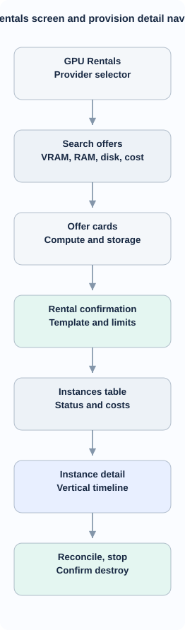
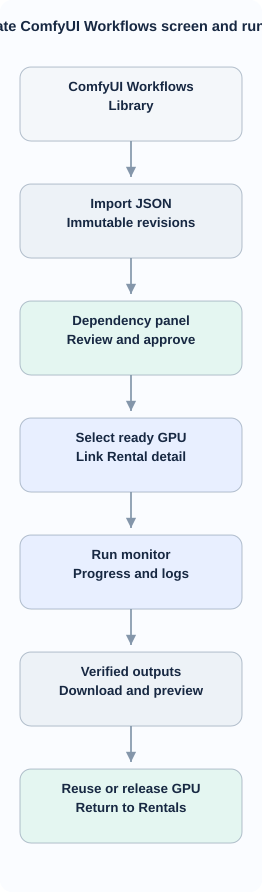

<!-- id:s1 -->
## Navigation và nguyên tắc

Gate 3 vẫn giữ Tasks, Storyboard, Task detail, Series và Settings. Gate 4 thêm hai mục ngang cấp **GPU Rentals** (`/gpu`) và **ComfyUI Workflows** (`/comfyui/workflows`). Không nhét GPU admin vào Storyboard; workflow Run detail có link ngược về GPU instance detail theo `rental_id`. UI chỉ gọi application services, không gọi API Vast.ai trực tiếp; không làm SPA hoặc ComfyUI node editor mới.

<!-- id:s2 -->
## GPU Rentals — screen flow D2

<!-- id:s2.b1 -->
<!-- report-kit:d2
```d2
# cap: GPU Rentals screen and provision detail navigation
direction: down
nav: "GPU Rentals\nProvider selector" {class: plain}
filters: "Search offers\nVRAM, RAM, disk, cost" {class: data}
offers: "Offer cards\nCompute and storage" {class: plain}
confirm: "Rental confirmation\nTemplate and limits" {class: gate}
instances: "Instances table\nStatus and costs" {class: data}
detail: "Instance detail\nVertical timeline" {class: hands}
actions: "Reconcile, stop\nConfirm destroy" {class: gate}
nav -> filters -> offers -> confirm -> instances -> detail -> actions
```
-->
<picture>
<source media="(prefers-color-scheme: dark)" srcset="12-gpu-comfyui-ux.figs/s2.b1-dark.svg">

</picture>

| Vùng của màn hình | Trường bắt buộc | Hành động |
| --- | --- | --- |
| Header | provider selector (Vast.ai enabled), instance count, last refresh, estimated accrued cost | Refresh |
| Offer filters | min VRAM/RAM/disk, GPU count, region, max total USD/h, reliability, template | Search offers |
| Offer list | model GPU, VRAM, disk, compute/storage fees, total estimated USD/h, quote timestamp | Select |
| Confirm | provider, offer, expected duration, image/template, hourly cap, idle TTL, disk, projected cost | Confirm & Rent |
| Rentals list | provider/instance ID, status, current phase, elapsed, price, last heartbeat | Details |
| Instance detail | vertical timeline, phase name, attempt, timestamp, error, bounded logs, download bytes | Reconcile, safe retry |
| Destructive actions | active run claims, output pending, possible storage charges | Stop / Destroy confirmation |

**Chi tiết tiến độ:** phase `pending/running/done/failed/skipped/unknown`, start/end, elapsed, last log line, source log, last heartbeat. Chỉ hiển thị phần trăm khi có bytes_done/bytes_total; nếu không dùng indeterminate indicator. Lỗi provisioning hiển thị **"GPU có thể vẫn tính phí"** và nút Destroy, không tự báo dừng.

**Create unknown:** “Có thể đã thuê GPU — đang xác minh trạng thái” + khóa nút Rent Again cho đến khi reconcile/manual override có cảnh báo. **Destroy unknown:** vẫn hiện instance và chi phí tiềm năng; không gắn badge Completed.

<!-- id:s3 -->
## ComfyUI Workflows — screen flow D2

<!-- id:s3.b1 -->
<!-- report-kit:d2
```d2
# cap: Separate ComfyUI Workflows screen and run detail
direction: down
nav: "ComfyUI Workflows\nLibrary" {class: plain}
import: "Import JSON\nImmutable revisions" {class: data}
deps: "Dependency panel\nReview and approve" {class: gate}
select: "Select ready GPU\nLink Rental detail" {class: hands}
run: "Run monitor\nProgress and logs" {class: hands}
outputs: "Verified outputs\nDownload and preview" {class: data}
release: "Reuse or release GPU\nReturn to Rentals" {class: gate}
nav -> import -> deps -> select -> run -> outputs -> release
```
-->
<picture>
<source media="(prefers-color-scheme: dark)" srcset="12-gpu-comfyui-ux.figs/s3.b1-dark.svg">

</picture>

| Vùng | Dữ liệu | Hành động |
| --- | --- | --- |
| Library | workflow name, GUI/API format, immutable revision, dependency status, last run | Import JSON / Details |
| Dependency review | models source/size/checksum; nodes repo/commit/pip; unresolved list; disk estimate | Approve manifest / Edit mapping |
| Runtime selector | ready GPU, VRAM/free disk, rent ID, runtime version | Select / Go to GPU Rentals |
| Run controls | schema-backed workflow inputs, manifest version, attached GPU | Validate / Run |
| Run timeline | submission status, prompt ID, node progress when available, last update, errors | Reconcile / Cancel if supported |
| Outputs | preview media, local verification, file size, hash, download status | Download / View |
| Cross-link | provider/instance, cost estimate, output safety | Open GPU / Release or reuse |

Không có runtime ready: hiển thị action “Rent GPU”, không tự thuê lúc nhấn Run. Workflow manifest chưa approved hoặc storage không đủ thì nút Run disabled kèm lý do. Trường API JSON thiếu dependencies chuyển “Needs review”, không đoán node download.

**Run unknown:** “Có thể đã chạy — kiểm tra queue/history trước khi gửi lại”, không hiển thị nút Run Again trực tiếp. **Output pending:** warning trước destroy và nút tải lại; chỉ đánh dấu safe-to-destroy sau verified/explicit acknowledgement.

<!-- id:s4 -->
## Confirmation và error states

| Action | Confirm | Nếu API ambiguous |
| --- | --- | --- |
| Rent | quote timestamp, USD/h, duration/disk, cap, instance owner | create_unknown |
| Stop | có run active không, storage có thể tính phí | reconcile provider |
| Destroy | irreversible, pending outputs, exact instance | destroy_unknown |
| Install node/model | repo/ref/hash, nguồn/license, disk | show phase log |
| Run | manifest hash, rental, estimated cost | submission_unknown |
| Remove workflow revision | immutable history, affected runs | soft-delete/draft |

Mọi lỗi cung cấp `code, timestamp, stage, sanitized detail, next_action`. Các trạng thái trống riêng: No matching offers, Provider unavailable, No active rentals, No workflows, No ready GPU. Stale network: hiển thị last synced time, không tiếp tục giữ "Ready" vô hạn. Bảo vệ double submit bằng nonce + CSRF.

<!-- id:s5 -->
## Routes và giao diện responsive

| Route | Thành phần |
| --- | --- |
| `GET /gpu` / `GET /gpu/offers` | listing, HTMX offer results |
| `POST /gpu/instances` | confirmed create |
| `GET /gpu/instances/{id}` | detail + timeline |
| `POST /gpu/instances/{id}/reconcile` | refresh provider status |
| `POST /gpu/instances/{id}/stop` / `destroy` | guarded mutation |
| `GET /comfyui/workflows` / `POST /comfyui/workflows` | library/import |
| `GET /comfyui/workflows/{id}` | dependency review |
| `POST /comfyui/workflows/{id}/runs` | run on ready GPU |
| `GET /comfyui/runs/{id}` / `outputs` | execution/output |

HTMX status polling 2–5s active, slower idle; request log via bounded cursor. Desktop table + detail panel; mobile 360px stack cards/filter collapsible, timeline vertical full width. Keyboard focus, semantic labels, status **text + icon** not only color. Currency USD/h and UTC persisted timestamps converted to local display. No external public ComfyUI endpoint without authenticated proxy.

<!-- id:s6 -->
## UI acceptance và status

Test screenshot với FakeGPUProvider/FakeComfyUIRuntime: create/destroy unknown, provisioning phase fail, output pending, zero offers, stale quote, no GPU, empty library, missing model, mobile/keyboard. Chưa có UI screen implementation/screenshot thật; wireflow là **D2**, không ảnh mock tạo từ AI. Test plan [13](13-gpu-comfyui-verification.md).
