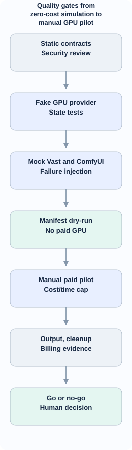

<!-- id:s1 -->
## Mục đích

Kiểm chứng bằng **mã chạy và bằng chứng**, không suy luận production-ready chỉ từ README các repo GitHub. Mỗi test fake/simulator phải không tốn phí. Test live Vast.ai on-demand chỉ thủ công sau quyết định D-05, có giới hạn giờ thuê/chi phí đã được chấp thuận và hướng dẫn cleanup. Không live trên PR CI.

<!-- id:s2 -->
## Các tầng kiểm chứng D2

<!-- id:s2.b1 -->
<!-- report-kit:d2
```d2
# cap: Quality gates from zero-cost simulation to manual GPU pilot
direction: down
static: "Static contracts\nSecurity review" {class: data}
fake: "Fake GPU provider\nState tests" {class: hands}
mock: "Mock Vast and ComfyUI\nFailure injection" {class: hands}
check: "Manifest dry-run\nNo paid GPU" {class: gate}
live: "Manual paid pilot\nCost/time cap" {class: hands}
audit: "Output, cleanup\nBilling evidence" {class: data}
decide: "Go or no-go\nHuman decision" {class: gate}
static -> fake -> mock -> check -> live -> audit -> decide
```
-->
<picture>
<source media="(prefers-color-scheme: dark)" srcset="13-gpu-comfyui-verification.figs/s2.b1-dark.svg">

</picture>

Source evidence: exact repo commit SHA, runtime image digest, manifests, workflow hashes, test inputs, output SHA256, unit/mock logs đã scrub, provider instance ID, count create/destroy, rate/time/cost estimate và invoice reconciliation khi có.

<!-- id:s3 -->
## Ma trận G01–G12

| ID | Tình huống | Tiêu chuẩn |
| --- | --- | --- |
| G01 | Đổi Vast provider sang fake | GPU service/web không import hoặc hardcode Vast |
| G02 | Offer rẻ không đủ VRAM/disk | Bị loại, zero create |
| G03 | Giá quá hạn / chưa confirm | Không create |
| G04 | Server tạo GPU nhưng response timeout | create_unknown, reconcile, zero extra create |
| G05 | Host running, pip/model fail | Provision failed, never ready |
| G06 | API JSON thiếu metadata node/model | needs_review, không cài mù |
| G07 | Disk thiếu, pin dependency conflict | block run, log nguyên nhân |
| G08 | Submit prompt thành công nhưng mất response | submission_unknown, zero extra submit |
| G09 | Destroy trả 500/timeout | Not completed, giữ record và reconcile |
| G10 | Worker restart, idle TTL | Phục hồi state; chỉ reclaim owned GPU |
| G11 | Output download fail | không tự release/destroy khi chưa xác nhận |
| G12 | Fake tokens, hostile URL/path, public endpoint | redact/chặn chính xác |

Bổ sung failure injection: hai concurrent create requests cùng nonce, double-click destroy, mất kết nối giữa download, SSH fingerprint không đúng, clone repo không pin, worker restart ở từng phase, WebSocket disconnect, prompt OOM, output checksum mismatch. Test conformance protocol bằng cùng fixture cho Fake và Vast mock.

<!-- id:s4 -->
## Test harness

`FakeGPUProvider` giữ stateful offers/instances và đếm request. Mock Vast REST mô phỏng on-demand search, create request accepted-but-response-lost, stop/destroy ambiguous, 404 unexpected. `FakeComfyUIRuntime` mô phỏng `/system_stats`, `/prompt`, `/queue`, `/history`, `/view`, output và WebSocket. Fixtures workflow: GUI simple, GUI subgraphs, API JSON, missing model URLs, invalid node commit, package conflict, path traversal, checksum mismatch, output image/video.

Assertions: events persisted before/after mutation; transition valid; idempotency/correlation guards local; no unsafe retries; one active run claim; output verified before safe cleanup; no secrets in JSON/HTML/log. GitHub PR CI chạy fake không tạo GPU thật.

<!-- id:s5 -->
## Rollout, limits và stop/go

| Slice | Deliverable | Exit |
| --- | --- | --- |
| A | GPU contracts + SQLite + fake service + screen | G01–G04 |
| B | Vast on-demand adapter, prices, reconcile, UI timeline | G05, G09, G10 |
| C | Pinned ComfyUI template + manifest + health | G05–G07 |
| D | Library, run, output verify | G06, G08, G11 |
| E | Idle guard, security, manual live pilot | G09–G12 + real evidence |

Live pilot: một GPU on-demand theo VRAM/giá, confirm quote và max cost, một workflow smoke hợp pháp, ghi event/fee, kiểm output về local rồi destroy, xác nhận không còn instance qua provider API/dashboard. Nếu destroy thất bại, ưu tiên dừng pilot và xử lý cleanup thay vì retry chạy model. Không lặp lại live test đã pass còn hiệu lực nếu source/template chưa đổi, trừ yêu cầu rõ ràng.

**Stop conditions:** API key leak, cannot destroy, double-create, unexpected charge growth, checkpoint misleading, remote ComfyUI public without auth, output mất trong cleanup. **Go** chỉ khi test fake/negative pass và manual live evidence có thật; đây là thiết kế, không phải kết quả kiểm thử đã chạy.

<!-- id:s6 -->
## Report sau mỗi eval

Report lưu: timestamp, source revision, test case, expected/actual, PASS/FAIL/SKIP, retry count, API request count, token usage nếu có, total time, GPU compute/storage estimate, actual invoice nếu có, logs đã scrub, artifact hashes và cleanup status. Không commit bất cứ token, credentials hoặc authenticated URL vào repo. Chi tiết vận hành ở [10](10-gpu-rentals.md), [11](11-comfyui-workflows.md), [12](12-gpu-comfyui-ux.md).
